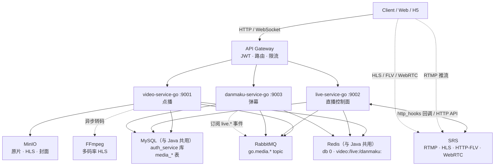

# Go 媒体微服务群（点播 / 直播 / 弹幕）

依据工作区根目录《直播，点播，弹幕设计方案.md》落地的一套 **Go 微服务**，
与已有 Java 体系（网关 / 鉴权 / 用户 / 商品 / 订单）**平铺同级、契约对齐**，两套可同时运行。

**数据层与 Java 体系共用**：直接用 Java 那套 MySQL（`127.0.0.1:3306`，库 `auth_service`）
与 Redis（`127.0.0.1:6379`，db 0），不另起实例。
共库/共实例靠命名空间隔离：**表名前缀 `media_`** + **Redis key 域前缀 `video:` / `live:` / `danmaku:`**。
只有 RabbitMQ 与 MinIO 是 Go 这套独有的组件（Java 侧没有），由 `deploy/compose.infra.yml` 提供。

**部署入口已经统一到 [`deploy/README.md`](deploy/README.md)**：编排文件、环境变量模板、
数据库基线、K8s 清单全部在 `deploy/` 下，覆盖 Java 与 Go 两套体系。

---

## 1. 服务一览

| 服务 | 端口 | 库 / 表前缀 | 核心职责 | 文档 |
| --- | --- | --- | --- | --- |
| `video-service-go` | 9001 | `auth_service` / `media_video*` | 视频上传、异步转码、HLS 点播、发布 | [需求](video-service-go/docs/需求文档.md) · [设计](video-service-go/docs/设计文档.md) · [接口](video-service-go/docs/接口文档.md) |
| `live-service-go` | 9002 | `auth_service` / `media_live_*` | 直播间、开播/关播、推拉流地址、在线人数 | [需求](live-service-go/docs/需求文档.md) · [设计](live-service-go/docs/设计文档.md) · [接口](live-service-go/docs/接口文档.md) |
| `danmaku-service-go` | 9003 | `auth_service` / `media_danmaku`、`media_sensitive_word` | 弹幕 WebSocket 广播、敏感词、限流、异步落库 | [需求](danmaku-service-go/docs/需求文档.md) · [设计](danmaku-service-go/docs/设计文档.md) · [接口](danmaku-service-go/docs/接口文档.md) |

**公共约定**：[Go微服务-公共约定.md](Go微服务-公共约定.md) —— 目录结构 / 统一响应 / 错误码 / 身份传递 / 消息拓扑 / Redis 命名。

**问题解决记录**：[Go微服务-问题解决记录.md](Go微服务-问题解决记录.md) —— 实现过程中真实踩到并已修复的坑
（MQ 队列撞车与绑错交换机、载荷类型不一致、`time.Now()` 排序退化、关播状态语义、
DDL 漂移、PowerShell 编码陷阱……）。**遇到故障先查它的 §9 排查清单**，那里按症状索引。

---

## 2. 架构



---

## 3. 快速开始

```powershell
# 1) 准备环境变量（可选：不设置也能跑，默认值就是「连 Java 那套 MySQL/Redis」）
Copy-Item deploy\.env.example deploy\.env

# 2) 启动 Go 体系独有组件：RabbitMQ + MinIO
#    MySQL / Redis 直接使用 Java 那套（127.0.0.1:3306 auth_service 库 / 127.0.0.1:6379 db0）
#    ★ 本机已经手工跑着 rabbitmq / minio / nacos 容器，所以**不要**加 --profile infra
#      （会抱 5672 / 9000 / 8848 端口）；只有空机器才用 `--profile infra` 自建
cd deploy
 docker compose up -d                     # Go 三服务
 docker compose --profile media up -d     # 需要真实推流时再叠加 SRS

# 3) 启动三个服务（各自独立目录，可分别在不同终端运行）
#    默认即连 3306/auth_service 与 6379/db0，无需额外配置；表由 AutoMigrate 自动创建
cd video-service-go;   go run ./cmd/server
cd live-service-go;    go run ./cmd/server
cd danmaku-service-go; go run ./cmd/server

# 4) 健康检查
curl.exe http://localhost:9001/readyz   # video
curl.exe http://localhost:9002/readyz   # live
curl.exe http://localhost:9003/readyz   # danmaku
```

管理台：

| 组件 | 地址 | 账号 |
| --- | --- | --- |
| RabbitMQ | <http://localhost:15672> | `admin` / `admin` |
| MinIO | <http://localhost:9090> | `minioadmin` / `minioadmin` |

---

## 4. 端口与数据层说明

数据层不再做端口偏移，因为它与 Java **是同一个实例**：

| 组件 | Java 体系 | Go 体系 | 隔离手段 |
| --- | --- | --- | --- |
| MySQL | 3306 | **3306（共用）** | 表名前缀 `media_` |
| Redis | 6379 | **6379（共用 db 0）** | key 前缀 `video:` / `live:` / `danmaku:` |
| RabbitMQ | — | 5672 / 15672 | Go 独有（Java 没有 MQ） |
| MinIO | — | 9000 / 9001 | Go 独有 |
| SRS | — | 1936 / 8088 / 1986 | Go 独有（profile `media`） |

HTTP 端口仍需避开 Java：Java 占 8000（网关）/ 8003 / 8004，Go 用 9001 / 9002 / 9003。

Java 侧已占用、Go 侧**不得使用**的库内名字：表 `account` / `user` / `product` / `sku` /
`inventory` / `order` / `payment_record`；Redis 前缀 `auth:` / `gateway:`。

---

## 5. 技术栈落点（每个技术都有明确业务理由）

| 技术 | 解决的问题 |
| --- | --- |
| **Gin** | 三个服务的 HTTP 出入口 |
| **GORM** | MySQL 实体映射与 AutoMigrate 建表 |
| **MySQL** | 业务事实存储（视频元数据 / 直播间 / 弹幕） |
| **Redis** | 详情缓存、播放量缓冲、直播间实时状态、在线人数 ZSet、弹幕热数据、限流计数 |
| **RabbitMQ** | 转码异步化、弹幕实时链路与持久化链路解耦、直播事件分发（含死信与重试） |
| **MinIO** | 原片、HLS 分片、封面、直播录制（视频不进数据库） |
| **FFmpeg** | 多码率 HLS 转码（360p/720p/1080p + master.m3u8） |
| **SRS** | 真正的直播媒体服务：RTMP 收流、转 HLS/HTTP-FLV/WebRTC |
| **WebSocket** | 弹幕实时双向通信（`gorilla/websocket` + 房间 Hub） |
| **Docker Compose** | 一键拉起 RabbitMQ / MinIO / SRS 与三个业务服务 |

> 与 Java 体系共用的 MySQL 与 Redis **不在 Compose 默认启动范围内**，只是容器化部署时
> 用 `extra_hosts` 回连宿主机实例；需要独立实例时用 `--profile infra`
> （自建 MySQL 3307 / Redis 6380，同时要按 `deploy/README.md` 改 `.env` 的 `INFRA_*`）。

---

## 6. 分阶段路线

| 阶段 | video | live | danmaku | 状态 |
| --- | --- | --- | --- | --- |
| **一** | 元数据 + 上传 + 转码编排 + 发布 + 播放 | 房间 CRUD + 开播关播 + 推拉流地址 + 心跳在线人数 + SRS 回调 | WS Hub + 发送 + 敏感词 + 限流 + 冷热分离历史 + 异步落库 | 文档完成 |
| 二 | 真实 FFmpeg 多码率、封面、重试与死信 | 禁言名单、峰值统计、开播兜底 | 主播/管理员撤回、正则规则 | 待启动 |
| 三 | gRPC（供 live 关联回放）、签名播放 | 对接真实 SRS、录制、回放转点播 | 多实例广播（Redis Pub/Sub） | 待启动 |
| 四 | OTel + Prometheus + K8s | WebRTC 连麦 + 指标 | AI 审核 + 压测 | 待启动 |

---

## 7. 与 Java 体系的契约对齐

| 维度 | 约定 |
| --- | --- |
| 身份 | 网关注入 `X-User-Id` / `X-User-Role`；Go 服务**不解析 JWT** |
| 响应 | `{"code":0,"message":"success","data":{...}}` |
| 错误码 | 沿用 `40001 / 40101 / 40301 / 404xx / 409xx / 429xx / 5xxxx`，媒体业务扩展 `6xxxx`（video）、`7xxxx`（live）、`8xxxx`（danmaku） |
| 归属校验 | 写操作校验资源所有者；ADMIN 不绕过归属，仅执行治理动作 |
| 库隔离 | 一个服务一个库，不共表 |

挂到现有网关只需加三条路由：

```yaml
- id: video-service-go
  uri: http://localhost:9001
  predicates: [ Path=/api/v1/videos/**,/api/v1/categories/** ]
- id: live-service-go
  uri: http://localhost:9002
  predicates: [ Path=/api/v1/live/** ]
- id: danmaku-service-go
  uri: http://localhost:9003
  predicates: [ Path=/api/v1/danmaku/**,/ws/danmaku ]
```
