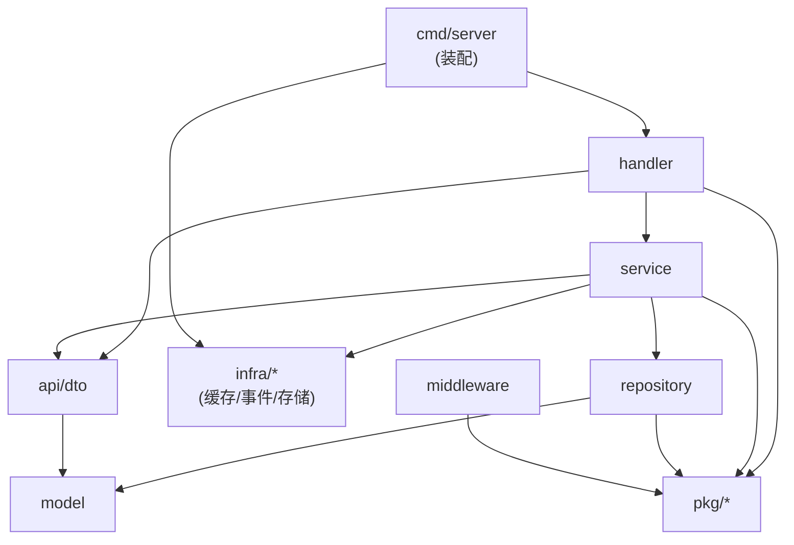

# Go 媒体微服务 — 实现问题解决记录

> **用途**：把实现 video / live / danmaku 三个服务过程中 **真实踩到并已修复** 的问题沉淀下来，
> 供后续开发与重点学习。
>
> **怎么用**：
> 1. 遇到故障先查 [§9 排查清单](#9-排查清单照着走)，那里是按「症状」索引的；
> 2. 想理解原理，按类别读 §1~§7，每条都写了 **根因** 而不只是修法；
> 3. 改代码前对照 [§8 架构与分层红线](#8-架构与分层红线)，避免重复踩。
>
> **约定**：每条格式统一为 **现象 → 定位过程 → 根因 → 修复 → 教训**。
> 只写实际发生过的，不写 "可能发生" 的假想问题。

---

## 0. 环境基线（很多坑与平台有关）

| 项 | 值 | 备注 |
| --- | --- | --- |
| Go | 1.25.0（`go.mod` 三个服务一致） | `GO111MODULE=on` 在终端必须显式设置 |
| OS | Windows（**这一条很关键**） | 部分坑只在 Windows 出现 |
| Shell | PowerShell 5.1 | 编码/转义坑的主要来源 |
| MySQL | 8.0，库 `auth_service`（与 Java 共用） | collation `utf8mb4_0900_ai_ci` |
| RabbitMQ | 4.1.0，`admin`/`admin` | Go 体系独有 |
| MinIO | `minioadmin`/`minioadmin`，API 9000 / 控制台 9090 | 控制台不能用 9001（被 video 占用） |

> 仓库里 Go 源文件已统一为 **LF、无 BOM**（2026-09-27 全量 `gofmt -w` 的结果），
> `gofmt -l` 现在无输出。要注意 `gofmt -w` 会顺带规范化文档注释里缩进的行
> （例如 `cmd/server/main.go` 的装配顺序那行会被改成 tab 缩进），属标准行为，
> 提交前确认一下别把无关改动一起带进去。

**先记住一句话**：下面 §3.2、§6.1~§6.5 全都是「Windows/PowerShell 特有」，
在 Linux 上复现不了；而 §1、§4、§5 是 **跨平台** 的真实设计缺陷，与操作系统无关。

---

## 1. 消息队列（RabbitMQ）

### 1.1 两个服务订阅同一个 routing key → 队列名撞车，后启动的服务起不来

**现象**

live-service 先启动正常，danmaku-service 启动直接失败：

```
406 PRECONDITION_FAILED - inequivalent arg 'x-dead-letter-exchange' for queue
'live.started.q' in vhost '/': received 'go.media.danmaku.dlx' but current is 'go.media.live.dlx'
```

**定位过程**

1. 报错说队列参数不等价 —— 说明队列 **已经存在**，是第二个服务去声明同名队列时参数对不上；
2. 查队列命名代码：之前是 `queue = routingKey + ".q"`，**只用了 routingKey**；
3. 但 live-service 和 danmaku-service 都要订阅 `live.started` / `live.stopped`
   （前者算自己的统计，后者联动房间直播状态）→ 两边算出同一个队列名 `live.started.q`；
4. 而死信交换机用的是 **各自的** exchange → 参数不一致 → 拒绝。

**根因**

队列名没有表达「这个队列属于哪个服务」。用 `routingKey` 做全局唯一键是错的，
因为 **一个 routing key 天然会被多个消费者订阅**（这正是 topic exchange 的价值）。

**修复**

队列名 / DLQ / DLX 全部带上 **消费方自己的 exchange** 作前缀：

```go
// internal/infra/events/bus.go
func QueueNameFor(exchange, routingKey string) string { return exchange + "." + routingKey + ".q" }
func DLQNameFor(exchange, routingKey string) string   { return exchange + "." + routingKey + ".dlq" }
func DLXNameFor(exchange string) string               { return exchange + ".dlx" }
```

结果：`go.media.live.live.started.q`（live-service 的统计）与
`go.media.danmaku.live.started.q`（danmaku 的房间联动）各自独立，各有自己的重试与死信。

**教训**

> 队列是 **每个消费者独占** 的资源，命名必须包含消费者身份。
> 看到 `PRECONDITION_FAILED` 先想「是不是两个服务抢了同一个队列名」。

---

### 1.2 绑错交换机 → 订阅 "成功" 却永远收不到，且 **零报错**

**现象**

- danmaku-service 日志显示订阅成功，队列有消费者；
- live-service 正常发布了 `live.started`；
- 但 WebSocket 客户端 **永远收不到** `system` 帧；
- **全链路没有任何 error / warning**。

**定位过程**

这是最难的一个 —— 所有日志都是绿色的。排查靠的是 "直觉 + 外部工具"：

```powershell
# 直接问 RabbitMQ：这个队列绑到哪个交换机上了？
curl.exe -s -u admin:admin "http://localhost:15672/api/bindings" | ConvertFrom-Json |
  Where-Object { $_.destination -like "*live.started*" } |
  Select-Object source, destination, routing_key
```

输出暴露了问题：

```text
source            destination                          routing_key
go.media.danmaku  go.media.danmaku.live.started.q      live.started   ← 绑错了
```

队列绑在了 `go.media.danmaku`（**自己的** 交换机）上，而 live-service 是往
`go.media.live`（**生产方的** 交换机）发的 —— 两边活在平行世界。

**根因**

`Subscribe` 里图省事用了 `b.exchange`（本服务自己的交换机）去 bind：
"我是 danmaku 服务，当然绑 danmaku 的交换机"。但订阅的语义是
**"去消息被发出来的那个地方接"**，而不是 "在我家门口等"。

**修复**

由 routing key **反推生产方交换机**，绑到它上面：

```go
// internal/infra/events/event.go
const ExchangePrefix = "go.media."

// ExchangeFor 由路由键推导**生产方**交换机：路由键形如 "<域>.<事件>"，域即交换机后缀。
//	danmaku.created → go.media.danmaku
//	live.started    → go.media.live
func ExchangeFor(routingKey string) string {
	domain := routingKey
	if i := strings.Index(routingKey, "."); i > 0 {
		domain = routingKey[:i]
	}
	return ExchangePrefix + domain
}
```

`Subscribe` 里区分两个角色：

```go
owner := b.exchange              // 队列/DLQ/DLX 用「我自己的」，见 §1.1
source := ExchangeFor(routingKey) // 绑定用「生产方的」
ch.ExchangeDeclare(source, "topic", true, false, false, false, nil) // 幂等声明
ch.QueueBind(queue, routingKey, source, false, nil)
```

验证：

```text
source: go.media.live, destination: go.media.danmaku.live.started.q, routing_key: live.started  ✅
```

**教训**

> **这一类 bug 单元测试永远抓不到**：mock 掉 Bus 之后，"绑到哪个交换机" 这件事根本没被执行。
> 只有 **跨进程端到端** 才能发现。所以每个服务都必须有一个
> "打通真实 MQ 的链路验证脚本"（本项目是 `tools/cross-service-events.ps1`）。
>
> 另一个启示：**"没有报错" 不构成 "链路是通的" 的证据**。AMQP 的 bind 不做任何语义校验，
> 你绑到一个空交换机它也返回成功。

---

### 1.3 载荷字段类型不一致 → 消费端解析失败，静默进死信队列

**现象**

danmaku-service 日志：

```
解析 live.started 载荷失败: json: cannot unmarshal number into Go struct field
LiveStartedPayload.roomId of type string
```

然后消息被重试 3 次 → 进 DLQ。表现是 `system` 帧不广播，但 **主流程看起来没坏**。

**定位过程**

报错本身很明确，但要注意它为什么 "不显眼"：消费失败是 **异步** 的，
HTTP 请求早就返回 200 了。所以必须主动看消费端日志 / DLQ 深度。

查 DLQ 深度：

```powershell
curl.exe -s -u admin:admin "http://localhost:15672/api/queues" | ConvertFrom-Json |
  Select-Object name, messages
```

**根因**

同一个逻辑事件，生产者用 `uint64` 序列化，消费者按 `string` 反序列化：

```go
// live-service（生产者）
type LiveStartedPayload struct { RoomID uint64 `json:"roomId"` }   // 发出 123
// danmaku-service（消费者）
type LiveStartedPayload struct { RoomID string `json:"roomId"` }   // 期望 "123" → 崩
```

JSON 是 **弱类型** 的（`123` 和 `"123"` 都是合法 JSON），
所以两边编译期都通过、单元测试各自也都过，只有真连起来才炸。

**修复**

统一约定：**事件载荷里所有 ID 字段一律用 `string`**。

```go
// live-service-go/api/dto/dto.go
type LiveStartedPayload struct {
	// RoomID 用 string 而不是 uint64：跨服务契约里 ID 统一为 string，
	// 避免生产端发数字、消费端按字符串解析时静默进死信队列。
	RoomID string `json:"roomId"`
}
```

发布时显式转换：`strconv.FormatUint(room.ID, 10)`。

**教训**

> 跨服务载荷是 **契约**，不是 "各自的结构体"。
> 数字/字符串这种 "看起来无所谓" 的差异是最危险的，因为 **编译期与单测都发现不了**。
> 已经把这条写进 `Go微服务-公共约定.md` §7.2。

---

### 1.4 MQ 凭据错误 → 静默降级为进程内总线

**现象**

服务能启动、接口能用、`/healthz` 是 UP，但：
弹幕落库没了、没有死信、跨服务事件完全不通。

**定位过程**

日志里搜 `eventsDriver`：

```text
eventsDriver=local  ...  rabbitmq_unavailable_fallback_local  ← 出事了
eventsDriver=rabbitmq                                        ← 真连上了
```

根因是 **本机 Docker 里跑的 RabbitMQ 凭据不是文档里写的那套**。
之前文档写 `gomedia/gomedia123`，实际容器是 `admin/admin`：

```powershell
docker inspect rabbitmq --format "{{range .Config.Env}}{{println .}}{{end}}"
# 或直接问管理台 API
curl.exe -s -u admin:admin http://localhost:15672/api/whoami
```

**修复**

把三个服务的 `configs/config.yaml`、`deploy/compose*.yml`、`deploy/.env.example`、文档默认值
统一改成实际凭据 `admin/admin`（MinIO 同理 `minioadmin/minioadmin`，控制台 9090）。

**教训**

> **降级设计是双刃剑**：LocalBus 让 "没起 MQ 也能开发"，但也让
> "凭据写错" 从 "启动失败" 变成了 "静默功能缺失"。
>
> 两条对策：
> 1. 降级 **必须打 WARN 日志**，并且 `/readyz` 要把 `events` 的 driver 暴露出来；
> 2. 记住这条判据：**`eventsDriver=local` 就是 MQ 没连上**，别被 "服务起来了" 骗过去。

---

## 2. 配置加载

### 2.1 数值型占位符加了引号 → 服务根本起不来

**现象**

live-service 启动即退出：

```
yaml: unmarshal errors:
  line 47: cannot unmarshal !!str '1936' into int
  line 48: cannot unmarshal !!str '8088' into int
  line 50: cannot unmarshal !!str '8001' into int
```

配置里明明写的是 `1936`，为什么 MySQL 说是 **字符串** `'1936'`？

**定位过程**

1. 看配置行：`rtmp_port: "${LIVE_SRS_RTMP_PORT:-1936}"` —— 带引号；
2. 看加载流程：`internal/config/config.go` 是 **先做字符串替换、再喂给 yaml.v3**；
3. 关键链条：
   - `${LIVE_SRS_RTMP_PORT:-1936}` → 展开成 **裸的** `1936`
   - 但模板里 **外面还有一对引号** → 最终文本是 `rtmp_port: "1936"`
   - YAML 双引号里的数字 **就是字符串** → yaml.v3 拒绝写进 `int`。

**根因**

占位符替换发生在 **YAML 解析之前**，所以 "引号是模板的一部分" 这件事在替换后依然生效。
写 `"${X:-1936}"` 的人想表达 "默认值是 1936"，实际表达了 "值是字符串 1936"。

**修复**

数值型占位符 **不加引号**：

```yaml
rtmp_port: ${LIVE_SRS_RTMP_PORT:-1936}     # ✅
http_port: ${LIVE_SRS_HTTP_PORT:-8088}
webrtc_port: ${LIVE_SRS_WEBRTC_PORT:-8001}

rtmp_host: "${LIVE_SRS_RTMP_HOST:-localhost}"   # 字符串型的才加引号 ✅
```

**教训**

> **字符串模板 + 类型化解析** 这个组合天然脆。
> 判定规则很简单：把占位符 **手写成默认值**，看 YAML 合不合法 ——
> `rtmp_port: 1936` 合法，`rtmp_port: "1936"` 语义就变了。
>
> 已补进单测（`internal/config/config_test.go` 断言三个端口是 `int`），
> 这个问题下次会在 `go test` 阶段就被拦住，而不是启动时。

---

## 3. WebSocket

### 3.1 关闭码被 "后到者" 覆盖 → 客户端看到的关闭原因永远是 1000

**现象**

`readPump` 因为连续 3 个畸形帧决定以 `1003`（不支持的数据类型）关闭连接，
但客户端收到的关闭码是 `1000`（正常关闭）—— **真正的关闭原因丢了**。

端到端脚本里表现为："畸形帧应该触发 1003" 这条断言失败。

**定位过程**

1. 关闭路径上有两处调用：
   - `readPump` 检测到协议错误 → `CloseWith(1003, ...)`
   - HTTP handler 收尾 → `CloseWith(1000, "连接结束")`
2. 读 `CloseWith` 实现，发现守卫条件是 `if c.closeCode == 0 { 设置 }`；
3. **但 `NewClient` 把默认值初始化成了 `CloseGoingAway`(1001)** ——
   所以 `closeCode` 从来就不是 0，守卫永远不生效，后到的 1000 每次都覆盖。

**根因**

用 "哨兵值"（0 表示 "没设置过"）表达 "未设置"，但字段本身已经有一个非哨兵的默认值。
**语义冲突**：`1001` 既可能是 "默认值"，也可能是 "显式设置过的服务端重启码"，代码分不清。

**修复**

引入独立的布尔标志，而不是复用数值当哨兵：

```go
type Client struct {
	closeCode   int
	closeReason string
	closeSet    bool // 关闭码是否被**显式**设置过（默认 1001 不算）
}

// CloseWith 关闭连接。code 为 0 表示沿用已有关闭码。
// **先到者胜**：一旦关闭码被显式设置过（1003 协议错误 / 4001 被踢 / 1001 重启），
// 后面的调用不会覆盖它。
func (c *Client) CloseWith(code int, reason string) {
	c.closeMu.Lock()
	if code != 0 && !c.closeSet {                    // ← 关键
		c.closeCode, c.closeReason, c.closeSet = code, reason, true
	}
	c.closeMu.Unlock()
	c.closeOnce.Do(func() { close(c.closeCh) })
}
```

配 5 个子测试锁定语义（`TestCloseWithKeepsFirstNonZeroCode`）：
1003 胜、4001 胜、无既有关闭码时 1000 生效、`code=0` 沿用已有、没人设置过用 1001。

**教训**

> **不要用 "魔法值" 当 "未设置" 的哨兵**，尤其当字段本身有合法默认值时。
> 加一个 `xxxSet bool` 的代价是 1 行，省下的是整晚的调试。
>
> 另外：`closeOnce` 只管 "通道只关一次"，**不管 "关闭码只设一次"** ——
> 这是两个独立的关注点，很容易混为一谈。

---

### 3.2 用 `time.Now()` 排序判断 "谁更旧" → Windows 上退化为随机

**现象**

需求：同一 uid 在同一房间的连接数超过上限（3）时，踢掉 **最旧** 的那条（关闭码 4001）。

```
--- FAIL: TestRegisterKicksOldestConnectionOfSameUser
    hub_test.go:103: 超过 max_conns_per_user 时最旧连接应被关闭
```

单测失败，但逻辑看起来完全正确。而且这个测试 **时好时坏** —— 典型的 "随机失败" 特征。

**定位过程**

写了一个诊断测试，连续打印 6 次 `time.Now()`：

```go
for i := 0; i < 6; i++ { ts = append(ts, time.Now()) }
// 输出（Windows）
ts[0] = 15:25:15.002048400 (unixnano=1790493915002048400)
ts[1] = 15:25:15.002048400 (unixnano=1790493915002048400)
... 6 个完全相同 ...
唯一时间戳个数 = 1 / 6
```

**根因**

**Windows 上 `time.Now()` 的粒度约 15.6ms**（系统时钟中断周期）。
同一 "时钟滴答" 内创建的多条连接，`ConnectedAt` 是 **完全相同的值**。

而排序代码是：

```go
sort.Slice(out, func(i, j int) bool { return out[i].ConnectedAt.Before(out[j]) })
```

`Before` 遇到相等值时返回 false → `sort.Slice` 是 **不稳定排序** →
`peers[:excess]`（取最旧的那几条）拿到的是 **随机** 顺序。

注意这个问题的严重性：它不只是 "测试挂了"，而是 **产品行为错误** ——
Windows 上部署时，"踢最旧连接" 会随机踢掉 **用户正在用的那条新连接**。

**修复**

用 **单调递增序号** 代替时间戳做顺序判据：

```go
// connSeq 为每条新连接分配单调递增序号，是 Client.Seq 的唯一来源。
var connSeq atomic.Uint64

type Client struct {
	ConnectedAt time.Time // 仅用于展示与日志
	// Seq 是连接建立顺序（进程内单调递增），用于判定「谁更旧」。
	// 为什么不用 ConnectedAt：见上，粗粒度时钟下会退化。
	Seq uint64
}

// NewClient 内
Seq: connSeq.Add(1),

// room.go 内
sort.Slice(out, func(i, j int) bool { return out[i].Seq < out[j].Seq })
```

**教训**

> **任何 "顺序" 语义都不要依赖 `time.Now()`**：
> - 时钟粒度可能不够（Windows 15.6ms）；
> - 时钟可能回拨（NTP 校时）；
> - 跨进程/跨机器时更不可靠。
>
> 需要 "先后" 就用 **单调计数器**（`atomic.Uint64`）或 **单调时钟**（`time.Since` 的基准）。
> `time.Time` 只适合 "给人看" 和 "算间隔"。
>
> 另一个教训：**随机失败的测试一定要当真**。它背后几乎总是真实的并发/时序缺陷，
> 而不是 "测试写得不好"。这次如果不追下去，就会带着一个 Windows 专属的生产 bug 上线。

---

## 4. 业务状态语义

### 4.1 关播时 "删键" 而不是 "写 0" → 把 "明确禁止" 降级成了 "未知允许"

**现象**

`POST /rooms/:id/stop` 关播成功后，往这个房间发弹幕 **竟然返回 200 成功**，
而需求文档 FR-6.3 明确要求 "未开播的房间拒绝发送弹幕（`409` / `80003`）"。

**定位过程**

1. 需求 → 代码：`checkLiving` 的判定是三态：

   ```go
   // 明确 "1"（直播中） → 放行
   // 明确 "0"（已结束） → 拒绝 409 / 80003
   // 键不存在（未知）   → 由 require_living 决定：false 放行 / true 拒绝
   ```

   `require_living` 默认是 `false`（为了本地单独调试方便）。

2. 查 `live.stopped` 的处理（`live_bridge.go`）：

   ```go
   // 修复前
   b.Recent.DelLiving(ctx, payload.RoomID)   // ← 删掉了 danmaku:live:{roomId}
   ```

3. 关键推理链：
   - 删键 → `Living()` 返回 `known=false`（**未知**）
   - `require_living=false` 下 "未知" 被 **放行**（这条规则本身是为了调试）
   - 于是 "明确已关播" 被悄悄降级成了 "不知道，那就让过" → 关播后还能刷弹幕。

4. 交叉验证设计文档：Redis key 定义明确写着该键取值是 `1` / `0`，
   **从来没有 "键不存在" 这个正常状态** —— 删键是用法错误。

**根因**

`DelLiving` 的语义是 "清理房间相关状态"（房间被 **删除** 时用），
但关播只是 "状态 **变更**"，不是 "实体消失"。
两者被混用，导致 "三态判定" 中的 "明确 0" 分支 **永远不可达**。

**修复**

关播写 `"0"`：

```go
// live_bridge.go onStopped
// 标记为「明确已结束」（写 "0"，不是删键）。
// 删键会让状态退化成 known=false（未知），在 require_living=false 下就变成放行，
// 关播后还能继续刷弹幕 —— 与需求文档 FR-6.3「未开播的房间拒绝发送」相反。
if err := b.Recent.SetLiving(ctx, payload.RoomID, false); err != nil {
	b.logger().Warn("live_state_set_failed", "roomId", payload.RoomID, "err", err.Error())
}
```

同时收紧了三处文档/注释，让语义不再有解释空间：
- `Recent.SetLiving`（键是 `1`/`0`，永不删除，无 TTL）与 `DelLiving`（**仅** 用于房间删除）；
- `config.yaml` 的 `require_living` 注释明确写清两种取值的后果；
- 设计文档时序图把 `80003` 分支拆成 "明确为 `0`" 与 "键不存在且 require_living = true" 两条。

**教训**

> **"未知" 必须是一个显式状态，而且绝不能和 "允许" 合流。**
> 这个 bug 的本质是 **三态被压成了两态**，而压扁的方向恰好是 "更宽松"。
>
> 设计阶段就要问自己：
> 1. 这个状态一共有几种取值？
> 2. "不在任何已知状态里" 应该保守（拒绝）还是激进（放行）？
> 3. 为了方便调试而放宽的规则（`require_living=false`），
>    会不会 **意外掩盖** 正常的业务分支？
>
> 第 3 点尤其阴险：调试开关的 "宽松" 本意是好的，但它把
> "代码写错了" 和 "环境没配好" 变成了 **同一个现象**，所以修复时一定要回到需求文档去对照。

---

## 5. 数据库与 DDL

### 5.1 手工维护的 DDL 与 GORM AutoMigrate 漂移

**现象**

`deploy/db/go/media-tables.sql` 是给人看/给容器初始化用的建表脚本
（当时还在仓库根 `migrations/` 下，现已收进 `deploy/`，见 §8.5）。
对着真实库逐列比对后发现 **三类系统性差异**（8 张表几乎全中）。

**定位过程**

不是靠肉眼看，而是 **把两边都导出成可比对的形式**：

```sql
-- 列
SELECT TABLE_NAME, COLUMN_NAME, COLUMN_TYPE, IS_NULLABLE, IFNULL(COLUMN_DEFAULT,'~'), IFNULL(DATETIME_PRECISION,'~')
  FROM information_schema.COLUMNS
 WHERE TABLE_SCHEMA='auth_service' AND TABLE_NAME LIKE 'media_%'
 ORDER BY TABLE_NAME, ORDINAL_POSITION;
-- 索引
SELECT TABLE_NAME, INDEX_NAME, NON_UNIQUE, GROUP_CONCAT(COLUMN_NAME ORDER BY SEQ_IN_INDEX)
  FROM information_schema.STATISTICS
 WHERE TABLE_SCHEMA='auth_service' AND TABLE_NAME LIKE 'media_%'
 GROUP BY TABLE_NAME, INDEX_NAME, NON_UNIQUE;
```

**三类差异**

| 类别 | 文件里写的 | AutoMigrate 实际产出 | 原因 |
| --- | --- | --- | --- |
| 整型宽度 | `INT` | **`BIGINT`** | Go 的 `int` / `int64` 都是 64 位，只有 `int32` 才映射 `INT` |
| 时间精度 | `DATETIME` | **`DATETIME(3)`** | GORM 默认毫秒精度 |
| 索引列 | `idx_owner_created(owner_id, created_at)` | **`idx_owner_created(owner_id)`** | 名字有误导性：tag 里没给 `created_at` 标 `priority:2`，它就只是一列 |
| 漏索引 | 无 | `idx_media_live_room_deleted_at` | 软删除字段的自动索引 |

**根因**

DDL 是 **照着 model 结构 "想当然" 手写** 的，而不是从真实库反向导出。
命名（`idx_owner_created`）暗示了列组合，但 GORM 的索引列完全由 `priority` 决定。

**修复**

1. 以 **AutoMigrate 为唯一事实来源**，用 `SHOW CREATE TABLE` 的真实输出重写 DDL
   （含 collation 改为 MySQL 8 的 `utf8mb4_0900_ai_ci`，并注明 5.7 下换成 `utf8mb4_unicode_ci`）；
2. 新增 **可重复运行的校验脚本** `deploy/db/verify-schema.ps1`：
   把脚本里的 `USE auth_service` 换成临时库 → 真跑一遍 DDL → 逐表比对列与索引 → 删临时库。

   > 脚本位置本身也说明了一个约定：**DDL 基线在 `deploy/db/go/`，校验/部署工具在 `deploy/db/`。**
   > 后来整个部署资产又统一收到了 `deploy/` 下（见 §8.5），但「基线与工具分开」这条一直没变。

```text
========== 结果：通过 20 项，失败 0 项 ==========
DDL 文件与 AutoMigrate 结构完全一致
```

**教训**

> **同一份结构只能有一个事实来源。** 手工 DDL 必然会漂移，
> 唯一可持续的做法是 "自动生成 + 自动校验"。
>
> 校验脚本有个关键设计：**必须在临时库里真跑一遍 DDL**。
> 因为脚本用的是 `CREATE TABLE IF NOT EXISTS`，对着已有表执行是 **空操作**，
> 那样 "校验" 毫无意义（永远通过）。
>
> 另外注意：`sort` 类问题（§3.2）与这里的 "想当然" 是同一个思维陷阱 ——
> **从名字/直觉推断行为，而不是从实现验证行为**。

---

### 5.2 GORM 自动生成的索引名不能 "顺手改名"

**现象**

审查 DDL 时觉得 `idx_media_live_room_deleted_at` 这个名字太啰嗦、不符合本项目
`idx_*` 的命名风格，想改成 `idx_deleted`。

**根因**

那个名字是 **GORM 自动生成的**（model 里 `DeletedAt` 没写 `index:` 名字）。
如果手工 DDL 用 `idx_deleted` 建表，下次 `AutoMigrate` 按 model 找不到
`idx_media_live_room_deleted_at`，就 **再建一个** → 同一列上出现两个重复索引。

**修复**

保持原名字，并在 DDL 里写明原因：

```sql
-- 注意：这个索引名是 GORM 自动生成的（model 里 DeletedAt 没写 index: 名字），
-- 不要「顺手改名」—— 改名后 AutoMigrate 会再建一个新索引，出现两个重复索引。
KEY `idx_media_live_room_deleted_at` (`deleted_at`)
```

**教训**

> 用 ORM 的 AutoMigrate 时，**表结构有一半的 "所有权" 在 ORM 手里**。
> 想让手工 DDL 与它对得上，就得接受它起的名字；
> 想用自己的名字，就得在 model 的 tag 里显式写 `index:你的名字`。

---

## 6. 脚本与工具链（Windows / PowerShell 专属）

> 这一节的问题 **在 Linux/macOS 上完全不会出现**，但 Windows 是本项目的主力开发环境，
> 所以每个坑都值得记下来。

### 6.1 `.ps1` 必须带 BOM，但喂给 curl 的 JSON 不能带

**现象**

写好的冒烟脚本运行时报：

```
表达式或语句中包含意外的标记"..."。
```

**根因**

PowerShell 5.1 **按本地代码页（中文系统是 GBK）读取脚本文件**，
而不是按 UTF-8。脚本里有中文注释和字符串，GBK 解码后会破坏引号配对。

**修复**

给 `.ps1` **加上 UTF-8 BOM**（BOM 让 PS 5.1 正确识别为 UTF-8）：

```powershell
$p = "x.ps1"
$c = [System.IO.File]::ReadAllText($p, [System.Text.UTF8Encoding]::new($false))
[System.IO.File]::WriteAllText($p, $c, [System.Text.UTF8Encoding]::new($true))   # $true = 带 BOM
```

**但反过来的坑**：用 `Set-Content -Encoding utf8` 写 **JSON 请求体** 文件再 `curl --data-binary @file`，
BOM 会被当作请求体内容 → 服务端返回 `40001 请求体格式不正确`。
写 JSON 必须用 **无 BOM**：

```powershell
[System.IO.File]::WriteAllText($f, $json, [System.Text.UTF8Encoding]::new($false))
```

**教训**

> 同一台机器上，"文本文件要不要 BOM" 取决于 **谁来读它**：
> - PowerShell 5.1 脚本 → **要** BOM
> - JSON / SQL / 配置文件 → **不要** BOM
>
> 养成写文件时显式指定 `UTF8Encoding($true/$false)` 的习惯，别用默认值。

---

### 6.2 `Get-Content -Raw` 默认按 ANSI 解码 → SQL 里的引号被吞掉

**现象**

校验脚本报出一个完全看不懂的错误：

```
ERROR 1064 (42000) at line 48: You have an error in your SQL syntax;
... near 'DRAFT', at line 12
```

指向 `status VARCHAR(16) NOT NULL DEFAULT 'DRAFT',` —— 这行语法 **完全正确**。

**定位过程**

1. 直接把原始 SQL 文件喂给 mysql → 成功。说明 **文件本身没问题**；
2. 差异在于脚本做了 "读文件 → 替换库名 → 写回临时文件"；
3. 用最小样例复现：只含 `COMMENT '秒'` 和 `DEFAULT 'DRAFT'` 的两列表建表语句；
4. 检查临时文件第 52 行的实际内容 —— `owner_id ... COMMENT '**閺夈儴鍤?**X-User-Id'`
   —— 中文注释变成了 **乱码**。

**根因**

链条是这样的：

1. `Get-Content -Raw` 在 PS 5.1 下 **默认按 ANSI（GBK）解码**，而文件是 UTF-8；
2. `COMMENT '秒'` 的 UTF-8 字节被 GBK 解码时，**尾字节和后面的 `'` 被合成了一个合法汉字**
   → 引号 **被吞掉**；
3. 再 `WriteAllText`（UTF-8）写回，非法字符变 `?` —— **有损且不可逆**；
4. 于是 `DEFAULT 'DRAFT'` 之前的引号丢失，SQL 语法错乱，报错指向了 **毫不相关的行**。

**修复**

读文件时显式指定编码：

```powershell
$content = (Get-Content $src -Raw -Encoding UTF8) -replace 'USE `auth_service`;', "USE ``$tmpDb``;"
[System.IO.File]::WriteAllText($tmp, $content, [System.Text.UTF8Encoding]::new($false))  # 无 BOM
```

另外：**往 mysql 客户端喂 SQL 文件** 要用 `cmd` 重定向 + 显式字符集，
不能用 PowerShell 管道（会重新编码）：

```powershell
cmd /c "mysql --user=root --host=127.0.0.1 --port=3306 --default-character-set=utf8mb4 < `"$file`""
```

**教训**

> **PS 5.1 的默认编码是 "本地代码页"，不是 UTF-8** ——
> 凡是 "读文件 → 加工 → 写回" 的脚本都有这个风险，而且 **错误信息会指向错误的位置**。
>
> 调试心法：当报错行看起来完全正确时，**不要盯着那一行看**，
> 要怀疑 "文件在到达解析器之前已经被改过了"。用 `read_file`（不是终端 `Select-String`）
> 复核真实内容，或写个最小复现。

---

### 6.3 PowerShell 里 `?` 是合法的变量名字符

**现象**

WebSocket 冒烟脚本报 `ConnectAsync` 收到的是相对 URI。

**根因**

```powershell
$url = "$base?roomId=$roomId"     # ← $base?roomId 被当成「一个变量名」
```

PowerShell 的变量名允许 `?`，所以 `$base?roomId` 是一个未定义变量（值为空），
拼出来的 URL 就丢了主机名。

**修复**

用 `${}` 显式界定变量边界：

```powershell
$url = "${base}/ws?roomId=${roomId}&videoId=${videoId}"
```

**教训**

> 在 PowerShell 里拼接 URL 时，**一律用 `${var}`**。
> `?`、`&`、`:` 都可能被解析成变量名的一部分。

---

### 6.4 `ClientWebSocket` 只允许 **一个** 未完成的 `ReceiveAsync`

**现象**

WebSocket 测试里出现 "游客居然能发弹幕" 的假失败 —— 但手工验证时游客是正常的只读。

**定位过程**

1. 先怀疑产品代码，手工起两个连接验证 → 游客确实被拒（`40101`），连接保持；
2. 说明是 **脚本** 的问题。回顾脚本里的读取方式：

   ```powershell
   $task = $ws.ReceiveAsync(...)
   if ($task.Wait(1500)) { ... }    # ← 超时就放弃，但任务还在跑
   ```

3. 关键点：**`Wait` 超时并不会取消 `ReceiveAsync`** —— 那个任务变成 "孤儿"，仍在后台；
4. 下一帧到达时，**孤儿任务先把它吃掉**，随后所有断言都在 "等一帧永远不来的消息"，
   于是全是假超时。

**修复**

改成 **严格顺序** 的读取，不做 "超时探测式" 断言：

```powershell
# 只允许一个未完成的 receive；要么等到，要么整个脚本失败
$result = $ws.ReceiveAsync(...).GetAwaiter().GetResult()
```

**教训**

> **不要用 "等超时" 来判断 "有没有收到消息"。**
> 这是异步 API 的经典陷阱：放弃等待 ≠ 取消操作。
>
> 另一个更普适的教训：**测试失败时，先怀疑测试**。
> 这次如果直接去 "修" 游客只读逻辑，就会把一段正确的代码改坏。
> 正确的做法是 **用独立手段（手工客户端）先确认产品行为**，再回头查测试。

---

### 6.5 其他小坑速查

| 现象 | 根因 | 处理 |
| --- | --- | --- |
| `curl.exe -d '<json>'` 报 `option -d: requires parameter` | PowerShell 把花括号/引号拆坏了 | 用无 BOM 临时文件 + `--data-binary "@file"` |
| `mvn help:evaluate "-Dexpression=..."` 报 `No plugin found for prefix` | PS 把含 `=`/`:` 的参数拆成多个 token | 整个 `-D` 参数加引号 |
| `gofmt -l` 把所有文件都报成未格式化 | 文件是 CRLF，注释重缩进在 CRLF 下不幂等 | 转 LF → `gofmt -w` → 转回 CRLF（或统一 LF） |
| `grep_search` 搜不到工作区外/含中文的路径 | 工具限制 | 工作区外改用 `read_file` 绝对路径或终端 `Select-String` |
| `run_in_terminal` 里的 `cd` 被简化掉 | 命令在终端 **当前** cwd 执行，不新开 shell | 跨目录一律用绝对路径或 `Push-Location` |

---

## 7. 测试策略的教训

### 7.1 有些 bug 单元测试 **结构上不可能** 抓到

本项目的三个 MQ 问题（§1.2 绑错交换机、§1.3 载荷类型、§1.4 凭据降级）
以及 §4.1 的状态语义问题，**全部** 逃过了单元测试：

| 问题 | 为什么单测抓不到 |
| --- | --- |
| 绑错交换机 | 单测把 Bus 换成 mock，"绑到哪个交换机" 这件事根本没被执行 |
| 载荷类型不一致 | 生产者和消费者各有各的结构体，各自编译、各自测试都通过 |
| 凭据错误静默降级 | mock 的 Bus 永远 "连接成功"，降级分支不被触发 |
| 关播后仍可发送 | 单测直接构造 Redis 状态，跳过了 "事件真的到达并改写状态" 这一步 |

**对策**

每个服务都要有 **打通真实中间件** 的端到端脚本，并纳入常规回归：

| 脚本 | 覆盖范围 | 当前结果 |
| --- | --- | --- |
| `video-service-go/tools/video-smoke.ps1` | 建草稿 → 上传 MinIO → MQ 异步转码 → READY → 发布 → 播放 → 下架 → 重上架 → 删除 | 38/38 |
| `live-service-go/tools/live-smoke.ps1` | 建房 → 开播 → 幂等 → on_publish → 播放地址 → 心跳 → 关播 → 记录 → 重开 → 删除 | 36/36 |
| `live-service-go/tools/cross-service-events.ps1` | live 事件 → danmaku 广播 system 帧；关播后发送被拒 80003 | 11/11 |
| `danmaku-service-go/tools/ws-smoke.ps1` | welcome / 广播 / 房间隔离 / 游客只读 / 限流 / 畸形帧 → 1003 / 顶号 → 4001 | 28/28 |
| `deploy/db/verify-schema.ps1` | DDL 与 AutoMigrate 结构一致性 | 20/20 |

**教训**

> 测试金字塔的顶端（端到端）不是 "锦上添花"，而是 **唯一能覆盖集成契约的层级**。
> 判断标准：如果一处改动的错误 **不会让任何单测变红**，那就必须补端到端脚本。
>
> 一个实用判据：**"这个 bug 的失败信号会不会在单测里出现？"**
> 如果错误被异步化、被 mock 掉、或跨越进程边界 —— 答案就是 "不会"。

### 7.2 集成测试的环境相关性

**现象**

"没有提供者时应报错" 这类断言在本地会 **莫名失败**。

**根因**

本地常年驻留着一个真实的服务实例（监听同一端口），
于是 "预期失败" 的用例实际上调用成功了。

**修复**

把这个 "必然失败" 的前提 **显式化**：把直连地址指向一个 **保证空闲** 的端口，
而不是依赖 "环境里没有服务"。

**教训**

> 测试不能依赖 "环境里没有 X"。要么显式指定一个不可达的地址，
> 要么在测试里自己起一个受控的 stub。

### 7.3 修复后必须重新跑端到端

§4.1 的修复（`SET "0"` 取代 `DEL`）在逻辑上显然正确，
但 **必须重跑 `cross-service-events.ps1` 才能确认** —— 尤其要确认：
- 断言从 "失败" 变成 `80003`（`11/11`）；
- Redis 里确实存在 `danmaku:live:{roomId} = "0"`（而不是键不存在）；
- `live_state_set_failed` 这条 WARN **没有** 出现。

---

## 8. 架构与分层红线

### 8.1 统一目录结构（三个服务一致）

```text
<service>/
├── api/dto/                 # 对外数据结构（请求/响应/事件载荷），跨层共享的契约
├── cmd/server/main.go       # 唯一入口：只做装配（配置→日志→基础设施→仓储→服务→handler→路由）
├── configs/config.yaml      # 配置 + ${ENV:-default} 占位
├── docs/                    # 需求文档 / 设计文档 / 接口文档
├── internal/
│   ├── config/              # 配置读取与结构体
│   ├── handler/             # HTTP / WebSocket：解析、校验、调 service、返回响应
│   ├── infra/               # 基础设施适配器（可替换实现）
│   │   ├── cache/           #   Redis
│   │   ├── events/          #   RabbitMQ / 进程内总线
│   │   ├── hub/             #   WebSocket Hub（danmaku）
│   │   ├── media/           #   SRS / FFmpeg / mock 转码器
│   │   ├── filter/          #   敏感词（danmaku）
│   │   ├── ratelimit/       #   限流（danmaku）
│   │   ├── router/          #   路由表
│   │   └── storage/         #   MinIO（video）
│   ├── middleware/          # 鉴权 / RequestID / 日志 / 限流
│   ├── model/               # GORM 实体
│   ├── repository/          # 纯数据访问（只有 GORM，无业务判断）
│   └── service/             # 业务逻辑 + 编排
├── pkg/                     # 可被多服务复用的通用能力
│   ├── errs/  identity/  logx/  migrate/  response/  store/  trace/
└── tools/                   # 端到端冒烟脚本
```

> **Go 侧的 DDL 只有一份**（`deploy/db/go/media-tables.sql` + `README.md`），
> 各服务内部**不再各自放一份**。原因：三个服务的表在同一个库 `auth_service` 里，
> 拆成三份必然漂移，而且 `deploy/compose.infra.yml` 的 `infra` profile 需要
> 把整份 DDL 一次挂进 `docker-entrypoint-initdb.d`。
> 这不是"省略"，而是**刻意的单一事实来源**（见 §5.1 的教训）。
> 同时注意：**Java 侧的 DDL 反过来必须留在各自服务的 `resources/` 下**，
> 因为 Spring 的 `spring.sql.init` 只从 classpath 找。两边做法不同是有理由的，
> 完整对比见 `deploy/db/README.md`。

### 8.2 依赖方向（只能单向）



**红线**（违反即架构退化）：

1. `handler` 不碰 DB —— 不能引入 `repository` 或 `*gorm.DB`；
2. `repository` 不调 `service`，不写业务判断（如 "是否可发布"）；
3. `service` 不依赖 HTTP 细节 —— 不引入 `gin` / 不接收 `*gin.Context`；
4. 基础设施依赖 **通过接口注入**（`events.Bus`、`media.Transcoder`、`media.Server`、
   `hub.Backend` 都是接口，mock 与真实实现可互换）；
5. 一个业务职责只有一个实现位置，不允许 `controller/`、`repo/` 这类同义词并存。

### 8.3 已知的、**有理由** 的例外

架构红线不是教条，以下两处是 **自觉的例外**，都写明了原因：

**例外 1：`TranscodeWorker` 直接持有 `*gorm.DB`**

```go
// 说明：这里直接持有 *gorm.DB 而不是走 repository，
// 是因为「video 状态」与「task 终态」必须落在同一个事务里 —— 这是唯一一处跨表写，
// 封装成 repository 方法反而会为了让 worker 拿到事务句柄而引入更重的抽象。
```

**例外 2：`StatsService` / `TranscodeWorker` 直接持有 `*redis.Client`**

用于 **消息幂等键**（`mq:idem:{eventId}`）这类 "基础设施自身的状态"，
它不是业务领域数据，放进 `repository` 反而会把技术细节泄漏到数据层。

> **判断标准**：如果抽象带来的复杂度 **大于** 它隔离的东西，
> 就是过早抽象。但 **必须在代码里写明理由**，否则下次会被当成 "违规" 改回去。

### 8.4 分层改造的注意点

1. 移动包之后 **立刻** 跑 `go build ./... && go vet ./... && go test -race ./...`；
2. 目录重组 **会移动文件但不改变逻辑** —— 如果测试从绿变红，说明有隐藏的
   包级状态或初始化顺序依赖（本次重组后 `TestRegisterKicksOldestConnectionOfSameUser`
   暴露了 §3.2 的问题，正是这种 "意外收获"）；
3. `internal/` 是 Go 的强制封装边界，跨服务复用必须放 `pkg/`；
4. 改目录后同步更新：`docs/` 里的路径引用、`Dockerfile`、`deploy/compose*.yml`、
   `deploy/k8s` 清单、以及各 README 里的命令示例。

### 8.5 部署资产整理：一个概念只能有一个位置

这条是 §8 分层红线的**同一条原则在部署侧的体现** —— 代码里不允许"两个地方各写一份
同一件事"，部署文件也一样。

**现象：同一个「部署」概念散在三个层级**

| 位置 | 内容 | 服务对象 |
| --- | --- | --- |
| 仓库根 | `docker-compose.yml`、`.env.example` | 仅 Go |
| 仓库根 | `migrations/`（DDL + README） | 仅 Go（但目标是共用的 `auth_service` 库） |
| `deploy/` | `mysql/verify-schema.ps1`、`srs/srs.conf` | 仅 Go |
| 各 Go 服务内 | `Dockerfile` ×3 | Go |
| `auth-service/` | `Dockerfile`、`infra/k8s/`（9 个清单 + README） | **仅 Java 的 auth** |
| 各 Java 服务内 | `resources/schema.sql` / `resources/db/schema.sql` | Java |

由此暴露出**六个真问题**（不只是"不好看"）：

1. **根目录的 `docker-compose.yml` 只服务 Go，却占着通用名字** —— 会让人以为能起整个项目，
   实际 Java 五个服务一个都起不来。
2. **compose 里没有 Nacos**，而五个 Java 服务全部依赖 `localhost:8848` 做服务注册，
   新人根本无法复现。
3. **Java 只有 auth 有 Dockerfile**，其余四个（gateway/user/product/order）完全无法容器化，
   与 Go 三个服务（都有 Dockerfile）不对称。
4. **`standalone` profile 的 MySQL 密码是 `root123456`，而应用的 DSN 里写的是 `***REMOVED***`**
   —— 这个 profile 从写下来那天起就是**跑不通的**。
5. **自建 Redis 设了 `redis123456` 密码，而应用的 `GO_REDIS_PASSWORD` 是空** —— 同上，
   而且这类"只在某一种模式下复现"的毛病最难查。
6. **DDL 分两套玩法**：Java 侧 `schema.sql` 与 `db/schema.sql` 两种路径、自动与手工两种加载
   方式混用，且**没有任何一处说明新环境该按什么顺序建表**。

**方案：`deploy/` 作为唯一的部署入口**

```text
deploy/
├── README.md                 部署总入口（目录说明 / 端口表 / 三种启动方式 / 排查）
├── .env.example              变量模板（与 compose 同目录，Compose 才会自动读）
├── compose.yml               总入口，只用 include 把下面三个合成一个项目
├── compose.infra.yml         MySQL/Redis/RabbitMQ/MinIO/Nacos   profile: infra
├── compose.go.yml            Go 三服务 + SRS                   默认 + profile: media
├── compose.java.yml          Java 五服务                        profile: java
├── db/{README.md, go/media-tables.sql, go/README.md, verify-schema.ps1}
├── media/srs.conf
└── k8s/{README.md, base/*.yaml}
```

几个**刻意的设计决定**，以及它们的理由：

| 决定 | 理由 |
| --- | --- |
| `Dockerfile` 留在各服务目录，不搬进 `deploy/` | `build.context` 必须是服务目录，搬出来只会让上下文变绕 |
| Java 的 `schema.sql` 留在 `resources/` | Spring 的 `spring.sql.init` 只从 classpath 找，且 auth/user 是 `mode: always`；复制一份到 `deploy/db/` 就又变成"两份副本 → 迟早漂移" |
| `.env.example` 与 compose 同目录 | Compose 只从**compose 文件所在目录**读 `.env`，放子目录就得给每条命令加 `--env-file` |
| 中间件全部挂 `infra` profile，**默认不启动** | 开发机上已经手工跑着 rabbitmq/minio/nacos，默认启动会直接抢 5672/9000/8848 |
| 用 5 个 `INFRA_*` 变量切换"宿主/自建" | 一个开关就够，避免出现上面第 4、5 条那种"两种模式各有各的错" |
| 不写 `depends_on` 指向 profile 外的服务 | 被 profile 关掉的依赖服务会让 Compose 直接报错；宁可让应用自己重试 |

**一次差点丢文件的操作（教训比结果重要）**

搬 `auth-service/infra/k8s/` 时用了这样一串命令：

```powershell
New-Item -ItemType Directory -Force -Path "$root\deploy\k8s" | Out-Null
Move-Item "$root\auth-service\infra\k8s\*" "$root\deploy\k8s\" -Recurse -Force
Remove-Item "$root\auth-service\infra" -Recurse -Force      # ← 致命
```

`Move-Item` 带通配符搬目录时**没有报错也没搬过去**，紧接着的 `Remove-Item` 把源删了，
**9 个 k8s 清单 + README 全部消失**。

- 项目**不是 git 仓库**，`git checkout` 救不了；
- `Remove-Item` **不进回收站**；
- 最后是从 **VS Code 的本地历史**（`%APPDATA%\Code\User\History\`，每个文件一个
  哈希目录 + `entries.json` 记录版本）里把每个文件的**最新版本**捞回来的。
  要注意 `entries.json` 里的 `resource` 可能是**旧路径**（文件被移动过），
  而同一文件在旧路径、新路径下各有一份历史 —— 必须**按文件名取全局最新时间戳**，
  按目录遍历会让旧版本覆盖新版本。

**教训**

> 1. **搬完先验证目标，再删源**：`Move-Item` 之后立刻 `Test-Path` / 数文件个数，
>    确认无误才 `Remove-Item`。这次是"两步合并成一个自信的操作"。
> 2. **破坏性操作前先确认有没有后悔药**：这个仓库没有 git，`Remove-Item` 也不进回收站，
>    等于没有任何安全网。真正稳妥的顺序是"先复制、验证、再删除"。
> 3. **VS Code 本地历史是最后的兜底**，但它只记录**在编辑器里打开过的文件**，
>    且时间戳可能很旧 —— 不能当版本控制用。
> 4. `Remove-Item` 这类命令**不要和前面的命令串在一条里**，分开执行才能及时发现前一步失败。

---

## 9. 排查清单（照着走）

### 9.1 按症状索引

| 症状 | 先查 | 详见 |
| --- | --- | --- |
| 服务起不来，`cannot unmarshal !!str ... into int` | 数值型占位符是否加了引号 | §2.1 |
| `406 PRECONDITION_FAILED ... inequivalent arg` | 两个服务是否撞了同一个队列名 | §1.1 |
| 跨服务事件收不到，但 **没有任何报错** | `/api/bindings` 看队列绑在哪个交换机上 | §1.2 |
| 消息进了 DLQ / 消费反复重试 | 生产端与消费端的载荷 **字段类型** 是否一致 | §1.3 |
| 功能静默缺失（不落库、无死信） | 日志搜 `eventsDriver`，是否 `=local` | §1.4 |
| WebSocket 客户端拿到的关闭码不对 | `CloseWith` 的 "先到者胜" 守卫 | §3.1 |
| 测试 **随机** 失败 | 是否用时间戳排序 / 判断先后 | §3.2 |
| 状态校验 "该拒的没拒" | 状态是否被降级成了 "未知" | §4.1 |
| 集合类操作结果不稳定 | 判据是否依赖 `time.Now()` / map 遍历顺序 | §3.2 |
| 手工 DDL 与 ORM 不一致 | 逐列比对 `information_schema` | §5.1 |
| `.ps1` 报 "意外的标记" | 脚本是否带 UTF-8 BOM | §6.1 |
| 服务端返回 `40001 请求体格式不正确` | JSON 文件是否带了 BOM | §6.1 |
| 报错行看起来完全正确 | 文件在到达解析器前是否被重新编码过 | §6.2 |
| URL 参数丢了 | PowerShell 里是否用了 `${var}` | §6.3 |
| WebSocket 断言全部假超时 | 是否有孤儿的 `ReceiveAsync` | §6.4 |
| 容器起不来 / 端口被占 | 本机是不是已经手工跑着 rabbitmq / minio / nacos（**不要**加 `--profile infra`） | §8.5 |
| `docker compose` 报 profile 相关错误 | `depends_on` 是否指向了被 profile 关掉的服务 | §8.5 |
| 只在“自建中间件”模式下连不上 | `.env` 的 `INFRA_*` 是否改成了服务名，密码/口令是否与应用一致 | §8.5 |
| 新环境不知道要建哪些表 | `deploy/db/README.md` 的归属表与建表顺序 | §8.5 |
| k8s 里的探针一直失败 | 清单端口是否与应用默认端口一致（曾错写成 8080 vs 8002） | §8.5 |

### 9.2 通用排查顺序（推荐）

```text
1. 看启动日志有没有 WARN/降级        → 基础设施真的连上了吗？（§1.4）
2. 看 /readyz 的逐项 check           → mysql / redis / events / minio / srs 各自状态
3. 跨进程问题直接问中间件管理台        → 队列绑定、消息堆积、死信深度（§1.1 §1.2）
4. 比对契约（字段名 / 类型 / 必填）    → 生产端与消费端逐字段对照（§1.3）
5. 回到需求文档核对"应该是什么语义"    → 防止把"明确状态"降级成"未知"（§4.1）
6. 端到端脚本复现                     → 单测绿 ≠ 链路通（§7.1）
7. 怀疑工具链                         → 编码 / 转义 / 平台差异（§6）
```

### 9.3 每次改完代码的固定动作

```powershell
# 三个服务都要过
foreach ($s in @('video-service-go','live-service-go','danmaku-service-go')) {
    Push-Location "c:\Users\79042\Desktop\service\$s"
    gofmt -l .          # 空输出 = 合规
    go vet ./...
    go test -race ./...
    Pop-Location
}
# 涉及表结构变化时
powershell -NoProfile -ExecutionPolicy Bypass -File deploy/db/verify-schema.ps1
```

---

## 10. 一页速记（真正要背下来的）

1. **"没有报错" ≠ "链路是通的"**（§1.2 —— 最难发现的 bug 是静默失败）。
2. **顺序不要用 `time.Now()`**，用单调计数器（§3.2）。
3. **不要用魔法值当 "未设置"**，用独立的 `xxxSet bool`（§3.1）。
4. **"未知" 状态绝不能与 "允许" 合流**（§4.1）。
5. **同一份结构只能有一个事实来源**，其余靠校验脚本对齐（§5.1）。
6. **跨进程契约要逐字段比对类型**，JSON 的弱类型会放过所有编译期检查（§1.3）。
7. **降级设计必须打日志并暴露在探针里**，否则把 "配置错误" 伪装成 "功能正常"（§1.4）。
8. **测试失败时先怀疑测试**，但 **随机失败的测试一定是真 bug**（§6.4 / §3.2）。
9. **单测绿不代表集成对**，端到端脚本是必需品而非奢侈品（§7.1）。
10. **Windows + PowerShell 下，编码与转义是头号故障源**（§6）。

---

## 附录 A：本次修复的问题清单

| # | 类别 | 问题 | 位置 | 状态 |
| --- | --- | --- | --- | --- |
| 1 | MQ | 队列名跨服务撞车 → 启动失败 | `internal/infra/events/bus.go` | ✅ |
| 2 | MQ | 订阅绑到自己的交换机 → 静默收不到 | `internal/infra/events/event.go` `rabbit.go` | ✅ |
| 3 | MQ | 载荷 `roomId` 类型不一致 → 进 DLQ | `api/dto/dto.go` | ✅ |
| 4 | MQ | 凭据错误 → 静默降级 LocalBus | 3 × `configs/config.yaml` / compose / docs | ✅ |
| 5 | 配置 | 数值占位符加引号 → 服务起不来 | `live-service-go/configs/config.yaml` | ✅ |
| 6 | WS | 关闭码被后到者覆盖（1003→1000） | `internal/infra/hub/client.go` | ✅ |
| 7 | WS | `time.Now()` 排序 → "踢最旧" 退化为随机 | `internal/infra/hub/client.go` `room.go` | ✅ |
| 8 | 业务 | 关播删键 → 状态 "未知" 被放行 | `internal/service/live_bridge.go` | ✅ |
| 9 | DB | 手工 DDL 与 AutoMigrate 三类漂移 | `deploy/db/go/media-tables.sql` | ✅ |
| 10 | DB | GORM 自动索引名的命名约束 | 同上（已加注释） | ✅ |
| 11 | 脚本 | PS 编码/转义/异步 API 若干 | `tools/*.ps1`、`deploy/db/*.ps1` | ✅ |
| 12 | 部署 | 根 compose 只服务 Go，Java 无任何编排 | `deploy/compose*.yml` | ✅ |
| 13 | 部署 | compose 缺 Nacos → Java 五个服务无法复现 | `deploy/compose.infra.yml` | ✅ |
| 14 | 部署 | `standalone` 的 MySQL/Redis 口令与应用不一致 → 该 profile 一直是跑不通的 | `deploy/compose.infra.yml` + `deploy/.env.example` | ✅ |
| 15 | 部署 | k8s 清单端口 8080 与 Java 默认 8002 不符 → 探针必失败 | `deploy/k8s/base/auth-deployment.yaml` `envoy.yaml` | ✅ |
| 16 | 部署 | Java 五个服务只有 auth 有 Dockerfile | 5 × `Dockerfile` + `.dockerignore` | ✅ |
| 17 | 工具 | `Move-Item` 静默失败 + `Remove-Item` 误删 k8s 清单 | 见 §8.5 | ⚠️ 已从编辑器本地历史恢复 |

## 附录 B：相关文档

| 文档 | 内容 |
| --- | --- |
| `Go微服务-README.md` | 服务一览、架构、快速开始、技术栈落点 |
| `Go微服务-公共约定.md` | 目录结构、错误码、响应体、身份约定、**消息拓扑与命名规则（§7.1/§7.2）** |
| `直播，点播，弹幕设计方案.md` | 总体方案 |
| `<service>/docs/需求文档.md` `设计文档.md` `接口文档.md` | 各服务的三段式文档 |
| `deploy/README.md` | 部署总入口：目录结构、端口表、三种启动方式 |
| `deploy/db/README.md` | 共用库 `auth_service` 全部 17 张表的归属与建表顺序 |
| `deploy/db/go/README.md` | Go 侧建表基线的使用与约束 |
| `deploy/k8s/README.md` | Kubernetes 部署步骤与设计说明 |
| `deploy/db/verify-schema.ps1` | DDL 一致性校验脚本 |

> **本文件与 §7.1/§7.2 的分工**：公共约定里放 **必须遵守的规则**（简短），
> 本文件放 **踩坑过程与原理**（详尽）。改代码遇到困惑时来这边查原因；
> 定规矩、写新代码时看公共约定。
