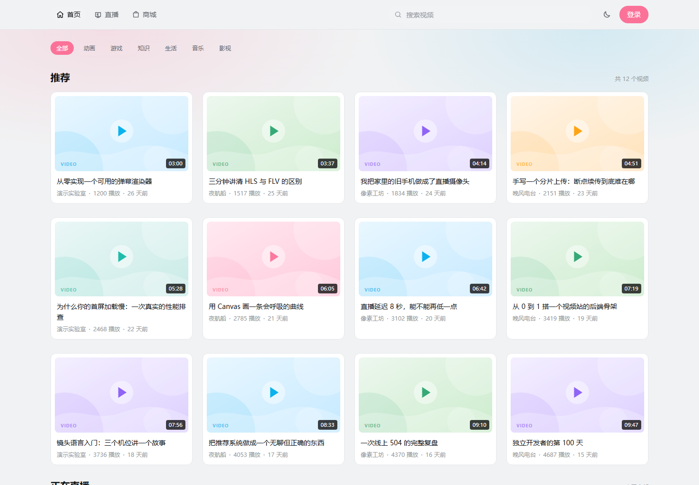

# 音视频社区（media-platform）

一个前后端分离的音视频社区：React 负责页面与播放器，Java 负责账号、交易与权限，Go 负责视频、直播与长连接。覆盖点播上传/转码/播放、直播与弹幕、点赞收藏关注、商城订单和后台管理。



## 1. 项目概览

### 三层职责

| 层 | 服务 | 职责 | 边界 |
| --- | --- | --- | --- |
| **Web** | React SPA | 路由与页面组合、TanStack Query 缓存、上传编排、HLS / FLV 播放、弹幕渲染、主题与响应式；统一处理 loading / empty / error 状态 | 不判断权限、不计算库存与订单金额，只按后端返回渲染 |
| **Java** | gateway / auth / user / product / order | JWT 校验与身份注入、注册登录与会话、资料与关注、商品 / SKU / 库存、订单 / 支付、管理接口 | 不接大文件、不转码、不维持 WebSocket 长连接 |
| **Go** | video / live / danmaku | 分片上传、FFmpeg 转码、HLS、点赞收藏；直播间、开播/结束、心跳与在线人数；弹幕 REST + WebSocket 广播 | 不处理登录、不扣库存、不下单 |

**分工原则**

- **Web 薄**：只做展示、交互与客户端状态，接口契约统一走 `/api`，业务规则以服务端为准。
- **Java 稳**：账号、权限、商品库存、订单支付这类需要事务与边界校验的写操作放在 Java 服务。
- **Go 快**：大文件、转码、音视频切片、长连接与高并发广播放在 Go 服务，避免阻塞业务服务。

请求链路：`Web → Nginx → Gateway → Java / Go 服务`。Gateway 校验 JWT 后注入
`X-User-Id` / `X-User-Role`，下游服务只信任这两个头。

---

## 2. 技术栈

**前端**


**Java 服务**


**Go 服务**


**基础设施**


---

## 3. 代码结构

```text
media-platform/
├─ web/                                  React SPA
│  ├─ src/app/                           路由、布局、全局 Provider
│  ├─ src/pages/                         按业务域拆分的路由页面
│  │  ├─ home/ search/ video/            首页、搜索、播放页
│  │  ├─ upload/ studio/                 投稿、视频/商品管理
│  │  ├─ live/                           直播列表、开播管理、直播间
│  │  ├─ shop/ orders/                   商城、商品详情、订单
│  │  ├─ user/ space/                    他人主页、个人空间、资料编辑
│  │  ├─ admin/ auth/                    管理后台、登录注册
│  │  └─ not-found/
│  ├─ src/entities/                      领域 API + 类型 + TanStack Query hooks
│  │  └─ video live danmaku product order user category admin upload
│  ├─ src/features/                      跨页面能力
│  │  └─ auth/ danmaku/ video-upload/
│  ├─ src/widgets/                       可复用 UI 组合
│  │  └─ site-header/ video-card/ live-card/ player/ danmaku-layer/ empty-state/
│  └─ src/shared/                        api / ws / store / styles / ui / lib
│
└─ media-platform-backend/
   ├─ gateway-service/                   Spring Cloud Gateway：路由、JWT 校验、身份注入
   ├─ auth-service/                      注册、登录、刷新、登出、验证码
   ├─ user-service/                      资料、公开 profiles、关注/粉丝、角色
   ├─ product-service/                   商品、SKU、库存
   ├─ order-service/                     订单、模拟支付
   ├─ video-service-go/                  视频、分片上传、转码、播放、点赞收藏、图片
   ├─ live-service-go/                   直播间、开播/结束、心跳、在线人数
   ├─ danmaku-service-go/                弹幕 REST + WebSocket
   ├─ deploy/                            Compose、Nginx、SQL、启停脚本
   └─ docs/                              契约、联调与问题记录
```

前端按 **页面 → 领域实体 → 通用组件** 分层：页面只做组合与交互，接口与缓存收敛在
`entities/*`，鉴权、上传、弹幕等跨页逻辑放在 `features/*`，请求封装、WebSocket、主题与
基础 UI 放在 `shared/*`。

---

## 4. 业务模块

### 4.1 账号与鉴权

| 层 | 实现 |
| --- | --- |
| 前端 | `/login`、`/register`；`features/auth` 保存会话与用户状态；未登录访问受保护页带 `returnTo` 回跳 |
| 后端 | `gateway-service` 统一校验 JWT 并注入 `X-User-Id` / `X-User-Role`；`auth-service` 负责账号与令牌 |

- 手机号 / 邮箱注册，验证码发送与校验
- 登录、刷新令牌、登出；刷新请求单飞 + 跨标签页锁，避免并发刷新互相失效
- 登出写入 JWT 黑名单；密码 BCrypt 存储
- 网关统一鉴权，下游服务不再解析 JWT

### 4.2 用户与社交

| 层 | 实现 |
| --- | --- |
| 前端 | `/space` 我的空间、`/user/:uid` 他人主页、`/settings` 资料编辑；粉丝/关注列表 |
| 后端 | `user-service`：资料读写、批量 profiles、关注关系、粉丝/关注分页、管理员用户查询 |

- 昵称、头像、性别、简介编辑；头像上传走视频服务图片接口
- 公开主页展示作品数、粉丝数、关注数、作品 / 粉丝 / 关注三个 Tab
- 关注 / 取消关注幂等，返回最新关注状态与计数
- 资料与列表均支持游客只读

### 4.3 点播与上传

| 层 | 实现 |
| --- | --- |
| 前端 | `/` 首页、`/search` 搜索、`/video/:id` 播放页、`/upload` 投稿、`/studio/videos` 视频管理 |
| 后端 | `video-service-go`：视频 CRUD、分片上传、FFmpeg 转码、HLS、封面上传、视频管理 |

- 首页推荐流、分类筛选、关键词搜索、分页
- 播放页：HLS 播放、点赞/收藏、UP 主卡、简介与标签、点播弹幕
- 分片上传：5MiB 分片、并发上传、断点续传、失败退避重试、取消
- FFmpeg 生成 360p / 720p / 1080p 多码率 HLS，前端轮询转码状态后发布
- 视频管理：我的投稿、编辑标题/简介/分区/标签、下架、删除

### 4.4 互动

| 层 | 实现 |
| --- | --- |
| 前端 | 播放页操作区、个人空间「我的收藏」 |
| 后端 | `video-service-go` 点赞、收藏、收藏列表、计数聚合 |

- 点赞 / 取消点赞、收藏 / 取消收藏，均幂等
- 收藏列表按收藏时间倒序，和「我的投稿」共用视频列表接口
- 批量查询当前用户对一屏视频的点赞/收藏状态，避免 N+1

### 4.5 直播

| 层 | 实现 |
| --- | --- |
| 前端 | `/streams` 直播列表、`/streams/manage` 开播管理、`/streams/:id` 直播间 |
| 后端 | `live-service-go`：直播间、开播/结束、推流地址、心跳、在线人数 |

- 创建直播间、我的直播间、进入房间
- 主播控制台：开始/结束直播，展示 OBS 推流「服务器 / 串流密钥」并支持分别复制
- 观众端：HLS 优先（hls.js），FLV 兜底；直播模式关闭原生进度条
- 20s 心跳、8s 在线人数轮询；房间状态 LIVING / ENDED / FAILED

### 4.6 弹幕

| 层 | 实现 |
| --- | --- |
| 前端 | `features/danmaku` + `widgets/danmaku-layer`；播放页与直播间共用 |
| 后端 | `danmaku-service-go`：历史查询、发送、WebSocket 广播 |

- 点播：按视频时间轴回放历史弹幕，发送时绑定当前播放进度
- 直播：WebSocket 实时收发，进入房间下发 welcome 与最近弹幕
- 弹幕样式、颜色、滚动轨道；REST 作为 WS 断线时的兜底

### 4.7 商城与订单

| 层 | 实现 |
| --- | --- |
| 前端 | `/shop` 商城、`/shop/:id` 商品详情、`/studio/products` 商品管理、`/orders` 订单 |
| 后端 | `product-service`：商品/SKU/库存；`order-service`：下单、支付、订单查询 |

- 商品列表、关键词搜索、商品详情、SKU 选择、数量与库存校验
- 下单、模拟支付、订单列表与订单详情
- 商品管理：创建商品与默认 SKU、上架/下架、改价、补库存

### 4.8 管理后台

| 层 | 实现 |
| --- | --- |
| 前端 | `/admin` 五个 Tab，仅 ADMIN 可见入口 |
| 后端 | `video-service-go`、`user-service`、`live-service-go` 的管理接口 |

- 分类创建与列表
- 敏感词词库维护
- 强制关闭直播间
- 按 userId 查询用户
- 视频下架

---

## 5. 架构与接口约定

```text
浏览器
  └─ Nginx（同源入口）
       ├─ /            → web（React SPA）
       ├─ /api         → gateway:8000（JWT 校验 → 注入 X-User-Id / X-User-Role）
       ├─ /ws          → gateway → danmaku-service（WebSocket）
       ├─ /media       → MinIO（HLS 分片、封面）
       └─ /live        → SRS（HLS / HTTP-FLV）

gateway ─┬─ auth-service       (8002) 登录 / 刷新 / 登出 / 验证码
         ├─ user-service       (8001) 资料 / profiles / 关注
         ├─ product-service    (8003) 商品 / SKU / 库存
         ├─ order-service      (8004) 订单 / 支付
         ├─ video-service-go   (9001) 视频 / 上传 / 转码 / 互动
         ├─ live-service-go    (9002) 直播间 / 开播 / 心跳
         └─ danmaku-service-go (9003) 弹幕 REST + WebSocket
```

**接口约定**

- 下游服务只信任网关注入的 `X-User-Id` / `X-User-Role`，不解析 JWT。
- 游客可读、登录后读自己的接口使用 `optional-auth`：有令牌则校验并注入，无令牌放行。
- 页面与接口同源，不依赖 CORS；媒体地址一律使用相对路径。
- 统一响应 `{ code, message, data }`；时间使用 RFC3339 `+08:00`；分页、空值、枚举约定见
  [契约约定.md](media-platform-backend/docs/契约约定.md)。

---

## 6. 快速开始

### 前端

```bash
cd web
pnpm install
pnpm dev          # http://localhost:5173
```

默认 `VITE_USE_MOCK=1`，没有后端也能用内置数据浏览页面；联调时改为 `0` 或删除该行。

### 后端

```powershell
cd media-platform-backend/deploy
.\dev-up.ps1      # 起基础设施 + 导表 + 建桶 + 启动 8 个服务
.\dev-down.ps1    # 停止（-KeepInfra 只停服务）
```

首次启动后按
[deploy/db/README.md](media-platform-backend/deploy/db/README.md)
导入商品/订单表，再执行
[seed-media.sql](media-platform-backend/deploy/db/seed-media.sql)。

### 前端容器（可选）

```bash
docker compose -f compose.yml -f compose.web.yml --profile web up -d --build
# http://localhost:8080
```

---

## 7. 文档索引

| 文档 | 内容 |
| --- | --- |
| [契约约定.md](media-platform-backend/docs/契约约定.md) | 信封、时间、分页、空值、ID、枚举、鉴权、媒体地址 |
| [web/README.md](web/README.md) | 前端目录分层与本地开发说明 |
| [web/docs/UI设计规范.md](web/docs/UI设计规范.md) | 设计 token、组件规则与页面截图 |
| [media-platform-backend/deploy/README.md](media-platform-backend/deploy/README.md) | Compose、端口、启停与部署 |
| [本地联调.md](media-platform-backend/docs/本地联调.md) | 本机全栈启动与链路验证步骤 |
| [开发问题记录.md](开发问题记录.md) | 代码 / 业务逻辑问题的根因与修复 |
| [开发环境问题.md](开发环境问题.md) | 构建、脚本、编码等环境问题 |

---

## 8. 运行注意

1. 转码演示需 `VIDEO_TRANSCODER_DRIVER=real`；`mock` 只生成结构正确但没有分片的 m3u8。
2. Windows 受限终端若 `pnpm build` 报 `spawn EPERM`，把 `TEMP` 指向工作区目录再执行。
3. `mock-pay` 只在本地/演示开启（`MOCK_PAY_ENABLED`），生产必须关闭。
4. 浏览器不能直接 RTMP 推流，主播使用 OBS；种子直播间没有真实推流，需 OBS 或
   `/live/dev/publish` 才能验证完整直播链路。
