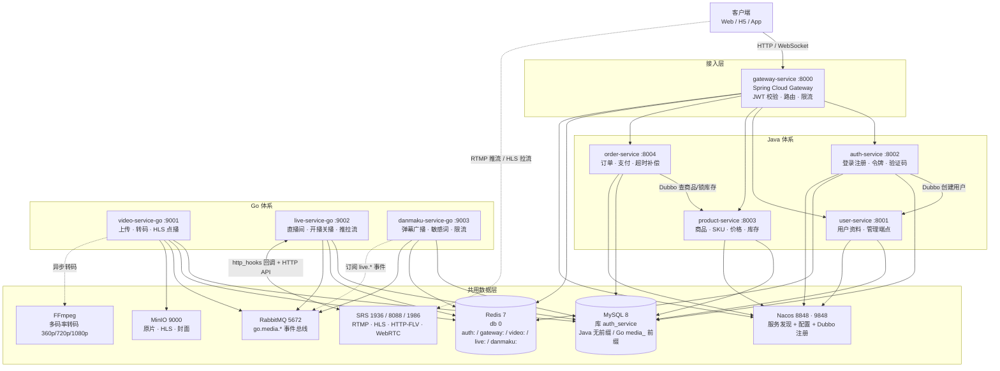
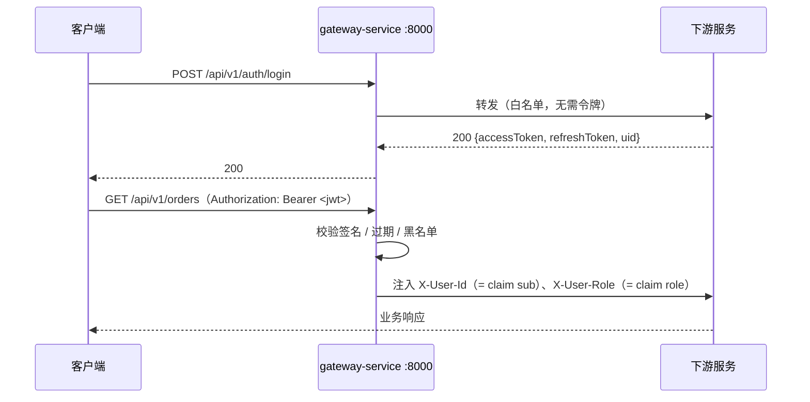

# 音视频社区后端（Media Community Backend）


一个**微服务架构**的音视频社区后端，覆盖「账号体系 + 电商交易 + 音视频媒体」三条完整业务链路：

- **用户侧**：注册登录、资料管理、商品浏览、下单支付、视频点播、直播、弹幕互动
- **媒体侧**：视频上传（小文件一次上传 / 大文件**分片上传 + 断点续传**）→ 异步转码 → 多码率 HLS 播放；RTMP 推流 → HLS / HTTP-FLV / WebRTC 拉流；WebSocket 弹幕实时广播

项目由 **两套技术体系**组成，平铺部署在同一台机器上、**共用同一份数据层**，通过统一的网关、统一的响应结构与身份传递约定保持契约一致：

| 体系 | 服务数 | 技术栈 | 负责的业务 |
| --- | --- | --- | --- |
| **Java 体系** | 5 | Java 17 · Spring Boot · Spring Cloud Gateway · Nacos · Dubbo 3 · MyBatis | 网关、鉴权、用户、商品、订单 |
| **Go 体系** | 3 | Go · Gin · GORM · go-redis · amqp091-go | 视频点播、直播、弹幕 |

---

## 目录

- [1. 整体架构](#1-整体架构)
- [2. 服务一览](#2-服务一览)
- [3. 技术栈](#3-技术栈)
- [4. 快速开始](#4-快速开始)
- [5. 接口测试](#5-接口测试)
- [6. 目录结构](#6-目录结构)
- [7. 文档索引](#7-文档索引)
- [8. 已知限制](#8-已知限制)

---

## 1. 整体架构



### 1.1 两套体系如何共用数据层

两套体系**不是**各起一套数据库，而是连接**同一个 MySQL 实例、同一个库 `auth_service`**，
靠命名空间硬隔离：

| 组件 | Java 体系 | Go 体系 | 隔离手段 |
| --- | --- | --- | --- |
| **MySQL** | 表 `account` / `user` / `product` / `sku` / `inventory` / `order` / `order_item` / `payment_order` / `payment_record` | 表 `media_video*` / `media_live_*` / `media_danmaku` / `media_sensitive_word` | **表名前缀 `media_`** |
| **Redis** | `auth:verification:*` · `auth:blacklist:*` · `gateway:rate:*` | `video:*` · `live:*` · `danmaku:*` · `mq:idem:*` | **key 域前缀** |
| **Nacos** | 5 个 Java 服务全部注册 | 不接入（Go 侧直连地址） | — |

> 共库的收益是部署成本低、Go 服务可以直接复用 Java 侧已有的账号与 JWT 身份；
> 代价是表名与 key 名**必须**自带命名空间 —— 所以 `media_` 前缀不是风格偏好，而是硬约束。

### 1.2 服务间通信

| 链路 | 方式 |
| --- | --- |
| 客户端 → 各 Java 服务 | 经 `gateway-service` 统一入口，网关校验 JWT 后注入 `X-User-Id` / `X-User-Role` |
| `auth-service` → `user-service` | **Dubbo 3** RPC（创建用户，经 Nacos 注册中心） |
| `order-service` → `product-service` | **Dubbo 3** RPC（查询商品/SKU、预占/确认/释放库存） |
| Go 三服务之间 | **RabbitMQ** topic 交换机 `go.media.video` / `go.media.live` / `go.media.danmaku` |
| 客户端 → 弹幕 | **WebSocket** 长连接（`/ws/danmaku`） |
| SRS → `live-service` | SRS **http_hooks** 回调（推流开始/结束/观众进出） |

---

## 2. 服务一览

| 服务 | 端口 | 体系 | 核心职责 | 详细文档 |
| --- | --- | --- | --- | --- |
| `gateway-service` | **8000** | Java | 统一入口：JWT 校验、路由转发（Java 侧 `lb://`、Go 侧直连）、限流、JWT 黑名单、方法级白名单、WS 查询参数令牌 | [技术文档](gateway-service/技术文档.md) · [网关架构](gateway-service/网关架构.md) |
| `auth-service` | **8002** | Java | 手机/邮箱注册登录、双令牌（access + refresh）、Refresh Token Rotation、注销与黑名单、验证码、管理员强制下线 | [技术方案](auth-service/技术方案.md) · [测试文档](auth-service/测试文档.md) |
| `user-service` | **8001** | Java | 用户资料查询/修改/注销，管理员查询与状态管理；对外提供 Dubbo `UserDubboService` | [技术方案](user-service/技术方案.md) · [测试文档](user-service/测试文档.md) |
| `product-service` | **8003**<br/>Dubbo **20880** | Java | 商品与 SKU 管理、价格、库存（可用/锁定两态）、上架下架；Dubbo 暴露商品与库存 RPC | [设计方案](product-service/设计方案.md) · [README](product-service/README.md) |
| `order-service` | **8004** | Java | 下单、订单查询/取消、支付单与支付回调（HmacSHA256 验签）、超时取消与补偿 | [设计文档](order-service/设计文档.md) · [README](order-service/README.md) |
| `video-service-go` | **9001** | Go | 视频上传（→ MinIO，支持**分片上传 + 断点续传**）、异步多码率转码（FFmpeg）、HLS 播放地址、发布/下架、转码重试 | [需求](video-service-go/docs/需求文档.md) · [设计](video-service-go/docs/设计文档.md) · [接口](video-service-go/docs/接口文档.md) |
| `live-service-go` | **9002** | Go | 直播间 CRUD、开播关播、推流密钥、播放地址（HLS/FLV/WebRTC）、在线人数心跳、SRS 回调 | [需求](live-service-go/docs/需求文档.md) · [设计](live-service-go/docs/设计文档.md) · [接口](live-service-go/docs/接口文档.md) |
| `danmaku-service-go` | **9003** | Go | 弹幕 WebSocket 广播、历史弹幕、敏感词过滤、双层限流、幂等落库、撤回与敏感词管理 | [需求](danmaku-service-go/docs/需求文档.md) · [设计](danmaku-service-go/docs/设计文档.md) · [接口](danmaku-service-go/docs/接口文档.md) |

### 2.1 中间件端口

| 组件 | 端口 | 账号 | 说明 |
| --- | --- | --- | --- |
| MySQL 8 | `3306` | `root` | 共用库 `auth_service`；自建时映射到 `3307` |
| Redis 7 | `6379`（db 0） | — | 自建时映射到 `6380` |
| Nacos | `8848` / `9848`（gRPC） | — | Java 侧服务发现与配置中心 |
| RabbitMQ | `5672` / `15672`（管理台） | `admin` / `admin` | Go 侧事件总线 |
| MinIO | `9000`（S3）/ `9090`（控制台） | `minioadmin` / `minioadmin` | bucket `media` |
| SRS | `1936`（RTMP）/ `8088`（HTTP）/ `1986`（API）/ `8001`（WebRTC） | — | 直播媒体服务器 |

---

## 3. 技术栈

| 层次 | 选型 |
| --- | --- |
| **语言与运行时** | Java 17（LTS）、Go 1.25 |
| **Web 框架** | Spring Boot 3.3 / 3.4、Spring WebFlux（网关）、Gin |
| **微服务治理** | Spring Cloud 2024.0、Spring Cloud Alibaba 2023.0、Nacos（discovery + config）、**Dubbo 3** |
| **API 网关** | Spring Cloud Gateway（响应式）、JWT 全局过滤器、Redis 令牌桶限流 |
| **数据访问** | MyBatis（Java，手写 XML）、GORM（Go，`AutoMigrate` 建表） |
| **数据库** | MySQL 8（`utf8mb4_0900_ai_ci`） |
| **缓存** | Redis 7（验证码、Session、JWT 黑名单、限流、在线人数、弹幕热数据、幂等键） |
| **消息队列** | RabbitMQ（topic 交换机，Go 侧跨服务事件 + 异步落库） |
| **对象存储** | MinIO（S3 兼容，存原片 / HLS 分片 / 封面） |
| **媒体处理** | FFmpeg（多码率转码 360p / 720p / 1080p + master playlist）、SRS（RTMP 接入、HLS/FLV/WebRTC 分发） |
| **实时通信** | WebSocket（`gorilla/websocket` + 房间 Hub 广播） |
| **鉴权** | JWT（HS256）+ Refresh Token Rotation + Redis 黑名单 |
| **部署** | Docker Compose v2（`include` 分层编排）、Kubernetes（Traefik 入口 + Envoy sidecar） |
| **测试** | JUnit 5 + MockMvc + H2（Java）、Testcontainers（auth）、Go 标准 `testing` + `-race` |

---

## 4. 快速开始

### 4.1 前置要求

- **JDK 17+**、**Maven 3.9+**
- **Go 1.25+**
- **Docker Desktop**（含 Compose v2.20+，需要 `include:` 支持）
- 可选：**FFmpeg**（真实转码）、**curl**（接口冒烟）

### 4.2 启动中间件

```powershell
# 复制环境变量模板（Compose 只读取与 compose 文件同目录的 .env）
Copy-Item deploy\.env.example deploy\.env

# 启动中间件（MySQL / Redis / RabbitMQ / MinIO / Nacos）
docker compose -f deploy\compose.infra.yml --profile infra up -d
```

> 如果本机已经在跑 RabbitMQ / MinIO / Nacos，**不要**加 `--profile infra`，
> 直接使用现有实例即可（默认配置指向 `127.0.0.1` 的标准端口）。

初始化数据库（Go 侧的表由 `AutoMigrate` 自动创建；Java 侧的 `product` / `order` 表需手工导入）：

```powershell
# 校验 Go 侧 DDL 基线与代码是否一致（期望输出「通过 20 项，失败 0 项」）
powershell -NoProfile -ExecutionPolicy Bypass -File deploy\db\verify-schema.ps1
```

详细的建表顺序与幂等性说明见 [`deploy/db/README.md`](deploy/db/README.md)。

### 4.3 启动服务

**Java 体系**（5 个服务，各自独立终端；也可用 `deploy/compose.java.yml` 容器化启动）：

```powershell
# 建议先起注册中心与网关
cd gateway-service; mvn spring-boot:run   # :8000
cd auth-service;    mvn spring-boot:run   # :8002
cd user-service;    mvn spring-boot:run   # :8001
cd product-service; mvn spring-boot:run   # :8003 + Dubbo :20880
cd order-service;   mvn spring-boot:run   # :8004
```

**Go 体系**（3 个服务，默认即连共用的 MySQL / Redis，无需额外配置）：

```powershell
$env:GO111MODULE = "on"
cd video-service-go;   go run ./cmd/server   # :9001
cd live-service-go;    go run ./cmd/server   # :9002
cd danmaku-service-go; go run ./cmd/server   # :9003
```

需要真实推流能力时，再叠加 SRS：

```powershell
docker compose -f deploy\compose.go.yml --profile media up -d
```

### 4.4 健康检查

```powershell
# Java：Spring Boot Actuator
curl.exe http://localhost:8000/actuator/health   # 网关

# Go：存活 / 就绪探针
curl.exe http://localhost:9001/readyz            # video
curl.exe http://localhost:9002/readyz            # live
curl.exe http://localhost:9003/readyz            # danmaku（就绪体含敏感词库词数）
```

---

## 5. 接口测试

### 5.1 统一响应结构

所有服务（Java 与 Go）返回同一信封：

```json
{ "code": 0, "message": "success", "data": { } }
```

- `code = 0` 表示成功，非 0 见 §5.3 错误码表；HTTP 状态码与错误码前缀一致（`40001` → HTTP 400）。
- Java 侧配置了 `spring.jackson.default-property-inclusion: non_null`：**值为 `null` 的字段会整体消失**。
  例如删除成功返回 `{"code":0,"message":"success"}`（没有 `data` 字段），断言时不要写 `"data": null`。
- 时间统一为 `LocalDateTime`，序列化成 `2026-09-27T10:30:00`（时区 `Asia/Shanghai`）。
- 金额单位**一律为分**（`Long`），如 `1399800` 表示 13998.00 元。

### 5.2 认证与身份传递



| 项 | 约定 |
| --- | --- |
| uid 来源 | JWT 标准 claim `sub`（auth-service 签发时写入 uid） |
| 角色来源 | JWT 的 `role` claim（`ADMIN` / `user`，缺失按 `user`） |
| 下游可见头 | `X-User-Id` / `X-User-Role`，由网关**先清后写**，客户端伪造无效 |
| 下游服务 | **只信任上述两个头**，不解析 JWT，不接受请求体/查询参数里的用户标识与角色 |
| 缺身份头 | `401 / 40101` |
| 角色不足 | `403 / 40301` |

> **直连服务调试时**（绕过网关，如 `http://localhost:8003`）服务本身不做 JWT 校验，
> 必须手工补上 `-H "X-User-Id: 1001"`，否则一律返回 `401 / 40101`。

### 5.3 错误码速查

| HTTP | code | 含义 | 适用范围 |
| --- | --- | --- | --- |
| 200 | `0` | 成功 | 全部 |
| 400 | `40001` | 请求参数不合法 | 全部 |
| 400 | `40002` | 支付回调签名校验失败 | order |
| 401 | `40101` | 未登录或登录已过期 | 全部 |
| 403 | `40301` | 无权限（非资源创建者 / 角色不足） | 全部 |
| 404 | `404xx` | 资源不存在（商品 / SKU / 订单 / 支付单…） | 全部 |
| 409 | `409xx` | 状态冲突（状态机、库存不足、重复提交…） | 全部 |
| 429 | `42901` | 触发限流 | auth |
| 500 | `50000` | 服务器内部错误 | 全部 |
| 503 | `50001` | 远程服务调用失败（下游不可达） | 全部 |
| 6xxxx | — | 媒体段扩展：video-service | video |
| 7xxxx | — | 媒体段扩展：live-service | live |
| 8xxxx | — | 媒体段扩展：danmaku-service | danmaku |

参数校验失败（`@Valid`）的返回体形如：

```json
{ "code": 40001, "message": "name 商品名称不能为空", "data": null }
```

### 5.4 接口清单

#### 网关路由（`gateway-service`）

| 方法 | 路径 | 转发目标 |
| --- | --- | --- |
| `ANY` | `/api/v1/users/**`、`/api/v1/admin/users/**` | `lb://user-service` |
| `ANY` | `/api/v1/auth/**` | `lb://auth-service` |
| `ANY` | `/api/v1/products/**`、`/api/v1/skus/**` | `lb://product-service` |
| `ANY` | `/api/v1/orders/**`、`/api/v1/payments/**` | `lb://order-service` |
| `ANY` | `/api/v1/categories/**`、`/api/v1/videos/**` | `video-service-go`（直连 `:9001`） |
| `ANY` | `/api/v1/live/**` | `live-service-go`（直连 `:9002`） |
| `ANY` | `/api/v1/danmaku/**`、`/ws/danmaku` | `danmaku-service-go`（直连 `:9003`） |
| `GET` | `/actuator/health`、`/actuator/info`、`/actuator/gateway` | 网关自身端点 |

> Java 五服务注册在 Nacos，网关按服务名负载均衡；**Go 三服务未接入 Nacos**，只能直连，
> 地址由 `VIDEO_SERVICE_URI` / `LIVE_SERVICE_URI` / `DANMAKU_SERVICE_URI` 覆盖（默认 `http://localhost:900X`）。

**JWT 白名单（免登录）**

| 路径 | 说明 |
| --- | --- |
| `POST /api/v1/auth/login` | 登录 |
| `POST /api/v1/auth/token/refresh` | 刷新令牌 |
| `POST /api/v1/auth/verification/send` | 发验证码 |
| `POST /api/v1/auth/register/phone`、`POST /api/v1/auth/register/email` | 注册 |
| `GET /api/v1/products/*` | 商品详情（`*` 只匹配单段，不含 `/{id}/skus`） |
| `GET /api/v1/skus/*` | SKU 详情（不含 `/price`、`/stock`） |
| `POST /api/v1/payments/callback` | 支付渠道异步回调（会先清掉伪造的 `X-User-*` 头） |
| `GET /api/v1/categories`、`GET /api/v1/videos`、`GET /api/v1/videos/*`、`GET /api/v1/videos/*/play` | 点播浏览 / 播放地址 |
| `GET /api/v1/live/rooms`、`GET /api/v1/live/rooms/*`、`GET /api/v1/live/rooms/*/online`、`GET /api/v1/live/rooms/*/play` | 直播间列表 / 详情 / 在线人数 / 播放地址 |
| `POST /api/v1/live/rooms/*/heartbeat` | 观播心跳 |
| `POST /api/v1/live/hooks/**` | SRS 推流回调（服务间调用） |
| `POST /api/v1/live/dev/**` | 本地推流联调接口（仅 debug 模式注册） |
| `GET /api/v1/danmaku/rooms/*/history`、`GET /api/v1/danmaku/videos/*/history`、`GET /api/v1/danmaku/stats` | 弹幕历史 / 统计 |

> `/ws/danmaku` **不在白名单**：它需要鉴权，令牌走查询参数 `?access_token=<JWT>`（浏览器 `new WebSocket(url)` 不能设置请求头）。
> 校验链路与 Header 令牌完全相同，转发前会把 `access_token` 从 URL 上摘掉。

#### 鉴权 `auth-service`（前缀 `/api/v1/auth`，全为 `POST`）

| 方法 | 路径 | 说明 | 鉴权 |
| --- | --- | --- | --- |
| `POST` | `/api/v1/auth/login` | 手机/邮箱 + 密码登录，返回 `uid` / `accessToken` / `refreshToken` | 公开（含 IP 限流） |
| `POST` | `/api/v1/auth/token/refresh` | 用 refreshToken 换新令牌（Refresh Token Rotation，Redis Lua 原子切换） | 公开 |
| `POST` | `/api/v1/auth/logout` | 注销，access token 写入 Redis 黑名单 | 需登录 |
| `POST` | `/api/v1/auth/force-logout?uid=` | 管理员强制指定用户下线 | 需 `ADMIN` |
| `POST` | `/api/v1/auth/verification/send` | 发送短信/邮箱验证码（60s 冷却） | 公开 |
| `POST` | `/api/v1/auth/register/phone` | 手机号 + 验证码 + 密码注册 | 公开 |
| `POST` | `/api/v1/auth/register/email` | 邮箱 + 验证码 + 密码注册 | 公开 |

#### 用户 `user-service`（前缀 `/api/v1`）

| 方法 | 路径 | 说明 | 鉴权 |
| --- | --- | --- | --- |
| `GET` | `/api/v1/users/me` | 查询当前登录用户资料 | 需登录 |
| `PUT` | `/api/v1/users/me` | 修改资料（字段可选，未传保持原值） | 需登录 |
| `DELETE` | `/api/v1/users/me` | 逻辑注销（状态置 `DELETED`） | 需登录 |
| `GET` | `/api/v1/admin/users/{userId}` | 管理员按内部 ID 查询用户 | 需 `ADMIN` |
| `PATCH` | `/api/v1/admin/users/{userId}/status` | 管理员修改用户状态 | 需 `ADMIN` |

> 另有 Dubbo 接口 `UserDubboService`：`createUser` / `getUser` / `batchGetUsers` / `checkUserExists`。
> **刻意不暴露 HTTP 创建用户接口**，避免绕过认证服务。

#### 商品 `product-service`（17 个接口）

| 方法 | 路径 | 说明 | 鉴权 |
| --- | --- | --- | --- |
| `POST` | `/api/v1/products` | 创建商品（创建者 = `X-User-Id`） | 需登录 |
| `GET` | `/api/v1/products/{id}` | 商品详情 | 公开 |
| `PUT` | `/api/v1/products/{id}` | 修改商品 | 仅创建者 |
| `DELETE` | `/api/v1/products/{id}` | 删除商品 | 仅创建者 |
| `POST` | `/api/v1/products/{id}/on-shelf` | 上架 | 仅创建者 |
| `POST` | `/api/v1/products/{id}/off-shelf` | 下架 | 仅创建者 |
| `POST` | `/api/v1/products/{id}/skus` | 创建 SKU（可带 `initialStock`） | 仅创建者 |
| `GET` | `/api/v1/skus/{id}` | SKU 详情 | 公开 |
| `PUT` | `/api/v1/skus/{id}` | 修改 SKU | 仅创建者 |
| `DELETE` | `/api/v1/skus/{id}` | 删除 SKU | 仅创建者 |
| `GET` | `/api/v1/skus/{id}/price` | 查询当前价格 | 需登录 |
| `PUT` | `/api/v1/skus/{id}/price` | 修改价格 | 仅创建者 |
| `GET` | `/api/v1/skus/{id}/stock` | 查询库存 | 需登录 |
| `POST` | `/api/v1/skus/{id}/stock/increase` | 增加库存 | 仅创建者 |
| `POST` | `/api/v1/skus/{id}/stock/reserve` | 库存预占（可用 → 锁定） | 仅创建者 |
| `POST` | `/api/v1/skus/{id}/stock/release` | 库存释放 | 仅创建者 |
| `POST` | `/api/v1/skus/{id}/stock/confirm` | 确认扣减（只减锁定部分） | 仅创建者 |

> `{id}` 同时支持内部主键（`1`）与业务编号（`P…` / `S…`）。

#### 订单与支付 `order-service`

| 方法 | 路径 | 说明 | 鉴权 |
| --- | --- | --- | --- |
| `POST` | `/api/v1/orders` | 创建订单（`items: [{skuId, quantity}]`，价格经 RPC 实时取快照） | 需登录 |
| `GET` | `/api/v1/orders?status=&page=&size=` | 查询我的订单（分页） | 需登录 |
| `GET` | `/api/v1/orders/{id}` | 订单详情（他人订单按「不存在」处理） | 需登录 |
| `POST` | `/api/v1/orders/{id}/cancel` | 取消订单（释放预占库存） | 需登录 |
| `POST` | `/api/v1/orders/{id}/pay` | 创建支付单 | 需登录 |
| `POST` | `/api/v1/payments/callback` | 支付渠道异步回调（HmacSHA256 验签） | 公开 |

> 另有 `OrderTimeoutTask` 定时任务（默认 60s 扫描）处理超时取消与权益发放补偿，无对应 HTTP 接口。

#### 点播 `video-service-go`

| 方法 | 路径 | 说明 | 鉴权 |
| --- | --- | --- | --- |
| `GET` | `/healthz`、`/readyz` | 存活 / 就绪探针 | 公开 |
| `GET` | `/api/v1/categories` | 分类列表 | 公开 |
| `POST` | `/api/v1/categories` | 新建分类 | `ADMIN` |
| `GET` | `/api/v1/videos` | 视频列表（分页，可见性在 service 层判定） | 公开 |
| `GET` | `/api/v1/videos/{id}` | 视频详情 | 公开 |
| `GET` | `/api/v1/videos/{id}/play` | 取播放信息（HLS + 多码率 sources） | 公开 |
| `POST` | `/api/v1/videos` | 创建视频草稿（`DRAFT`） | 需登录 |
| `PUT` | `/api/v1/videos/{id}` | 修改视频 | 仅创建者 |
| `DELETE` | `/api/v1/videos/{id}` | 删除视频（软删） | 仅创建者 |
| `POST` | `/api/v1/videos/{id}/upload` | 上传原片（**小文件一次上传**，→ MinIO，转 `TRANSCODING`） | 仅创建者 |
| `POST` | `/api/v1/videos/{id}/upload/init` | **大文件分片上传**：初始化/复用上传会话（幂等，返回 `uploadId` + 切片计划） | 仅创建者 |
| `GET` | `/api/v1/videos/{id}/upload/status` | 查询已上传分片（**断点续传入口**） | 仅创建者 |
| `PUT` | `/api/v1/videos/{id}/upload/parts/{partNumber}` | 上传单个分片（`application/octet-stream`，可并发、可中断重传） | 仅创建者 |
| `POST` | `/api/v1/videos/{id}/upload/complete` | 合并分片 → 校验齐备 → 提交转码 | 仅创建者 |
| `DELETE` | `/api/v1/videos/{id}/upload` | 取消上传，回收已传分片 | 仅创建者 |
| `POST` | `/api/v1/videos/{id}/publish` | 发布（`READY` → `PUBLISHED`） | 仅创建者 |
| `POST` | `/api/v1/videos/{id}/offline` | 下架（`ADMIN` 可下架他人） | 需登录 |
| `GET` | `/api/v1/videos/{id}/transcode` | 查询转码任务状态 | 需登录 |
| `POST` | `/api/v1/videos/{id}/transcode/retry` | 重试转码 | 需登录 |

#### 直播 `live-service-go`

| 分组 | 方法 | 路径 | 说明 |
| --- | --- | --- | --- |
| 探针 | `GET` | `/healthz`、`/readyz` | 存活 / 就绪 |
| SRS 回调 | `POST` | `/api/v1/live/hooks/on-publish` | 推流开始（校验密钥 → `LIVING` → 发 `live.started`） |
| SRS 回调 | `POST` | `/api/v1/live/hooks/on-unpublish` | 断流（→ `ENDED`） |
| SRS 回调 | `POST` | `/api/v1/live/hooks/on-play` | 观众开始播放 |
| SRS 回调 | `POST` | `/api/v1/live/hooks/on-stop` | 观众停止播放 |
| 直播间 | `GET` | `/api/v1/live/rooms` | 直播间列表 |
| 直播间 | `GET` | `/api/v1/live/rooms/{id}` | 直播间详情（`pushUrl` / `streamKey` 按调用者裁剪） |
| 直播间 | `GET` | `/api/v1/live/rooms/{id}/online` | 在线人数（只读 Redis 轻量轮询） |
| 直播间 | `GET` | `/api/v1/live/rooms/{id}/play` | 取播放地址（HLS / HTTP-FLV / WebRTC） |
| 心跳 | `POST` | `/api/v1/live/rooms/{id}/heartbeat` | 观众心跳（游客用 `X-Session-Id`） |
| 写操作 | `POST` | `/api/v1/live/rooms` | 创建直播间（返回 `streamKey` / `pushUrl`） |
| 写操作 | `PUT` | `/api/v1/live/rooms/{id}` | 修改直播间 |
| 写操作 | `DELETE` | `/api/v1/live/rooms/{id}` | 删除直播间 |
| 写操作 | `GET` | `/api/v1/live/rooms/{id}/stream-key` | 获取推流密钥 |
| 写操作 | `GET` | `/api/v1/live/rooms/{id}/records` | 直播历史记录 |
| 写操作 | `POST` | `/api/v1/live/rooms/{id}/start` | 开播（生成新密钥 + `sessionId` → `STARTING`） |
| 写操作 | `POST` | `/api/v1/live/rooms/{id}/stop` | 关播（落库记录 + 发 `live.stopped`） |
| 写操作 | `POST` | `/api/v1/live/rooms/{id}/force-close` | 强制关闭（调 SRS HTTP API 断流） |
| 调试 | `POST` | `/api/v1/live/dev/publish/{streamKey}` | 模拟推流成功（**仅 debug 模式注册**） |
| 调试 | `POST` | `/api/v1/live/dev/unpublish/{streamKey}` | 模拟断流（**仅 debug 模式注册**） |

#### 弹幕 `danmaku-service-go`

| 分组 | 方法 | 路径 | 说明 | 鉴权 |
| --- | --- | --- | --- | --- |
| 探针 | `GET` | `/healthz`、`/readyz` | 存活 / 就绪（就绪体含敏感词库词数） | 公开 |
| 实时 | `WS` | `/ws/danmaku?roomId=&uid=&nickname=`<br/>或 `?videoId=` | 弹幕长连接（注意：不在 `/api/v1` 前缀下） | 见协议 |
| 历史 | `GET` | `/api/v1/danmaku/rooms/{roomId}/history` | 直播弹幕历史（第 1 页走 Redis 热数据） | 公开 |
| 历史 | `GET` | `/api/v1/danmaku/videos/{videoId}/history` | 点播弹幕历史（按播放时间轴） | 公开 |
| 历史 | `GET` | `/api/v1/danmaku/stats` | 房间弹幕统计 | 公开 |
| 发送 | `POST` | `/api/v1/danmaku/send` | 发送弹幕（敏感词 + 双层限流 + 幂等） | 需登录 |
| 发送 | `POST` | `/api/v1/danmaku/rooms/{roomId}/send` | 同上（`roomId` 放在路径里） | 需登录 |
| 发送 | `DELETE` | `/api/v1/danmaku/{danmakuId}` | 撤回弹幕（本人在窗口内 / 主播管理员） | 需登录 |
| 管理 | `POST` | `/api/v1/danmaku/admin/reload-words` | 热重载敏感词 | `ADMIN` |
| 管理 | `GET` | `/api/v1/danmaku/admin/words` | 查看敏感词 | `ADMIN` |
| 管理 | `POST` | `/api/v1/danmaku/admin/words` | 新增敏感词 | `ADMIN` |

**WebSocket 帧协议**：服务端 → 客户端 `welcome` | `danmaku` | `system` | `pong` | `error`；客户端 → 服务端 `danmaku` | `ping`。

### 5.5 冒烟测试示例

**① 登录拿令牌**

```powershell
curl.exe -X POST http://localhost:8000/api/v1/auth/login `
  -H "Content-Type: application/json" `
  -d '{"type":"PHONE","target":"13800000001","password":"Aa123456"}'
```

```json
{
  "code": 0,
  "message": "success",
  "data": {
    "uid": "1001",
    "accessToken": "eyJhbGciOiJIUzI1NiJ9....",
    "refreshToken": "eyJhbGciOiJIUzI1NiJ9....",
    "accessTokenExpiresIn": 7200,
    "refreshTokenExpiresIn": 604800
  }
}
```

**② 带令牌访问受保护接口**

```powershell
$BASE_GW = "http://localhost:8000"
$TOKEN   = "<上一步的 accessToken>"

curl.exe "$BASE_GW/api/v1/users/me" -H "Authorization: Bearer $TOKEN"
curl.exe "$BASE_GW/api/v1/orders?page=1&size=10" -H "Authorization: Bearer $TOKEN"
```

**③ 直连服务调试（绕过网关，手工补身份头）**

```powershell
# 商品详情是白名单，直连无需身份头
curl.exe http://localhost:8003/api/v1/products/1

# 写操作直连必须手工补 X-User-Id，否则 401 / 40101
curl.exe -X POST http://localhost:8003/api/v1/products `
  -H "Content-Type: application/json" `
  -H "X-User-Id: 1001" `
  -d '{"name":"测试商品","description":"desc"}'
```

**④ Go 服务探针与公开接口**

```powershell
curl.exe http://localhost:9001/readyz
curl.exe http://localhost:9001/api/v1/videos?page=1&size=10
curl.exe http://localhost:9002/api/v1/live/rooms
curl.exe http://localhost:9003/api/v1/danmaku/rooms/1/history
```

**⑤ 经网关访问 Go 服务（验证路由与鉴权链路）**

```powershell
$BASE_GW = "http://localhost:8000"

# 公开读接口：白名单放行，无需令牌
curl.exe "$BASE_GW/api/v1/videos?page=1&size=10"
curl.exe "$BASE_GW/api/v1/live/rooms"
curl.exe "$BASE_GW/api/v1/danmaku/stats"

# 需鉴权接口：不带令牌应得 401 / 40101（说明路由已通、鉴权已生效，而不是 404）
curl.exe -i "$BASE_GW/api/v1/videos"
curl.exe -i -X POST "$BASE_GW/api/v1/live/rooms" -H "Content-Type: application/json" -d '{}'

# WebSocket：令牌只能走查询参数（浏览器 new WebSocket 不能设置请求头）
# 未带令牌 → 401；带有效令牌 → 101 Switching Protocols
curl.exe -i "$BASE_GW/ws/danmaku?roomId=5001"
curl.exe -i "$BASE_GW/ws/danmaku?roomId=5001&access_token=$TOKEN"
```

> 若这里返回 `503`，说明网关连不上 Go 服务（先确认 `:900X` 已启动，或 `*_SERVICE_URI` 配错）；
> 若返回 `404`，说明路由未命中，检查 `Path` 断言与请求路径的 `**` 匹配关系。

### 5.6 接口测试文档与自动化测试

| 范围 | 文档 / 方式 |
| --- | --- |
| product + order 全量接口测试（含失败场景、错误码逐条对应） | [`docs/接口测试文档-商品与订单.md`](docs/接口测试文档-商品与订单.md) |
| auth / user 接口测试用例 | [auth 测试文档](auth-service/测试文档.md) · [user 测试文档](user-service/测试文档.md) |
| Go 三服务接口契约 | [video](video-service-go/docs/接口文档.md) · [live](live-service-go/docs/接口文档.md) · [danmaku](danmaku-service-go/docs/接口文档.md) |
| 网关路由与鉴权（含 Go 三服务、WebSocket 令牌） | `gateway-service` 下 `mvn test` → `GatewayGoRoutingTests`（60 例，直接读取真实 `application.yml`，配置漂移会导致构建失败） |
| Java 单元 / 集成测试 | `mvn test`（JUnit 5 + MockMvc + H2） |
| Go 单元测试 | `go test -race -count=1 ./...`（各服务目录下执行） |
| video 分片上传 / 断点续传端到端冒烟 | `video-service-go/tools/upload-chunk-smoke.ps1`（49 项断言：切片计划推导、不合法分片、**中断后复用同一 `uploadId` 续传**、分片未齐拒绝合并、合并后转码至 READY、abort 回收） |

---

## 6. 目录结构

```text
media-community-backend/
├── README.md                     # 本文档：整体架构 + 接口测试
├── docs/                         # 跨服务文档（设计 / 约定 / 踩坑 / 接口测试）
├── deploy/                       # ★ 部署总入口：compose 编排、环境变量、DB 基线、K8s
│   ├── compose.yml               #   编排总入口（include 下面三个）
│   ├── compose.infra.yml         #   共用中间件        profile: infra
│   ├── compose.go.yml            #   Go 三服务 + SRS   默认 + profile: media
│   ├── compose.java.yml          #   Java 五服务       profile: java
│   ├── db/                       #   共用库 DDL 基线 + 一致性校验脚本
│   ├── media/srs.conf            #   SRS 直播服务器配置
│   └── k8s/                      #   Kubernetes 清单（Traefik + Envoy）
├── tools/publish-all.ps1         # 聚合快照发布脚本
├── gateway-service/              # Java · 网关
├── auth-service/                 # Java · 鉴权
├── user-service/                 # Java · 用户
├── product-service/              # Java · 商品与库存
├── order-service/                # Java · 订单与支付
├── video-service-go/             # Go · 点播
├── live-service-go/              # Go · 直播
└── danmaku-service-go/           # Go · 弹幕
```

> **仓库组织说明**：本项目在**本地开发时是 9 个独立 git 仓库**（8 个服务各一个 + 1 个根仓库负责部署编排与跨服务文档）。
> 当前这个远端仓库是它们的**聚合快照**，由 `tools/publish-all.ps1` 生成，用于整体浏览与分享；
> 各服务的完整提交历史保存在本地各自的仓库中，快照时的 commit 锚点记录在 `AGGREGATE.md`。

---

## 7. 文档索引

| 文档 | 内容 |
| --- | --- |
| [`deploy/README.md`](deploy/README.md) | **部署总入口**：目录结构、依赖图、端口表、三种启动方式、故障排查 |
| [`deploy/db/README.md`](deploy/db/README.md) | 共用库 `auth_service` 全部 18 张表的归属、建表顺序与幂等性 |
| [`deploy/db/go/README.md`](deploy/db/go/README.md) | Go 侧 DDL 基线的使用与约束 |
| [`deploy/k8s/README.md`](deploy/k8s/README.md) | Kubernetes 部署步骤与设计说明 |
| [`docs/直播，点播，弹幕设计方案.md`](docs/直播，点播，弹幕设计方案.md) | Go 媒体体系的总体设计方案 |
| [`docs/Go微服务-README.md`](docs/Go微服务-README.md) | Go 三服务的服务一览、架构、快速开始 |
| [`docs/Go微服务-公共约定.md`](docs/Go微服务-公共约定.md) | Go 侧目录结构、统一响应、错误码、身份传递、消息拓扑、Redis 命名 |
| [`docs/Go微服务-问题解决记录.md`](docs/Go微服务-问题解决记录.md) | 实现中真实踩到并已修复的坑（**§9 为按症状索引的排查清单**） |
| [`docs/接口测试文档-商品与订单.md`](docs/接口测试文档-商品与订单.md) | product + order 的全量 HTTP 接口测试文档 |

---

## 8. 已知限制

| 项 | 说明 |
| --- | --- |
| Go 三服务未接入 Nacos | 网关已为它们配好 3 条路由，但因为是**直连 `uri`** 而非 `lb://`，地址变更需通过 `VIDEO_SERVICE_URI` / `LIVE_SERVICE_URI` / `DANMAKU_SERVICE_URI` 覆盖并重启网关，也拿不到负载均衡与自动扩缩容 |
| 查询参数令牌会留在访问日志 | `/ws/danmaku?access_token=` 会进入客户端访问日志 / 浏览器历史；已通过「仅该路径允许 + 转发前摘除」收敛，更彻底的方案是一次性握手票据 |
| 弹幕广播为单实例 | 弹幕 Hub 在进程内内存中维护，多实例部署需要引入 Redis Pub/Sub 做跨节点广播 |
| 短信 / 邮件为学习模式 | `NotificationProvider` 未对接真实渠道，验证码直接回显在响应里 |
| 转码默认 mock | `transcoder.driver=mock` 时不调用真实 FFmpeg；需要真实转码时改为 `real` 并安装 FFmpeg |
| `product-service` / `order-service` 初始表需手工导入 | 其 `db/schema.sql` 不在 Spring 默认执行路径上，见 [`deploy/db/README.md`](deploy/db/README.md) |

---

## 许可

本仓库为个人学习与技术实践项目，未附带开源许可证。
