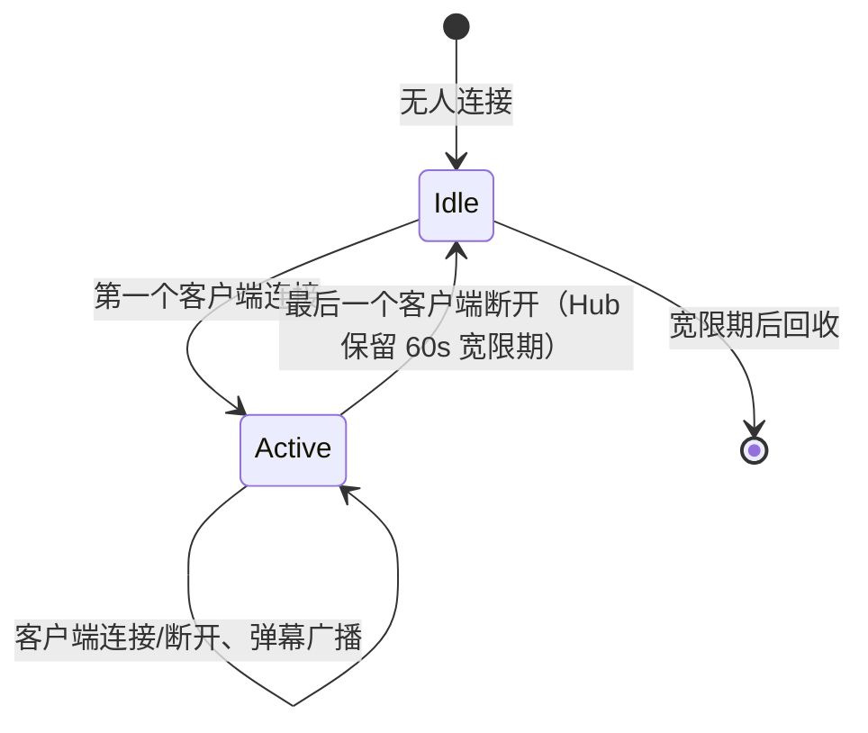

# danmaku-service-go · 需求文档

> 版本：v1.0（阶段一）
> 上游依据：工作区根目录《直播，点播，弹幕设计方案.md》
> 相关文档：`设计文档.md`、`接口文档.md`

---

## 1. 背景与目标

### 1.1 背景

弹幕是本项目里**最能体现 Go 并发能力**的部分：它同时具备

- **长连接**：数万条 WebSocket 连接常驻，需要连接生命周期管理；
- **高扇出**：一条弹幕要广播给同一房间的全部观众（1 → N）；
- **写密集**：热门直播间每秒数十条弹幕；
- **实时性与持久化要求不同**：观众只关心「马上看到」，而落库可以慢一点。

因此本服务的核心设计是**双链路解耦**：

```text
发送弹幕 → 快速校验（鉴权/敏感词/限流）→ 立即广播（Redis + 内存 Hub）→ 异步落库（RabbitMQ → MySQL）
```

对应到点播场景，弹幕还能**按视频时间轴定位**（`videoId + timeMs`），
这也是「点播弹幕」与「直播弹幕」唯一的语义差异，本服务用同一套模型统一支持。

### 1.2 目标

| 目标 | 度量 |
| --- | --- |
| 单条弹幕端到端投递延迟 | P99 < 100ms（同机房） |
| 广播不阻塞持久化 | MQ 不可用时仍能广播（降级），MySQL 慢不影响 RT |
| 单机连接容量 | ≥ 10,000 条 WebSocket 连接（可水平扩展） |
| 写保护 | 单用户 1 秒 ≤ 5 条、单房间 1 秒 ≤ 200 条 |
| 内容安全 | 敏感词命中直接拒绝，不入库、不广播 |
| 历史回放 | 点播弹幕可按时间窗口分页拉取 |
| 契约兼容 | 复用 `X-User-Id`，响应体 `{code,message,data}` |

---

## 2. 范围

### 2.1 纳入范围

- WebSocket 长连接接入与房间 Hub 管理
- 弹幕发送（HTTP 与 WebSocket 双入口）
- 弹幕实时广播（房间内扇出）
- 弹幕异步持久化（RabbitMQ → MySQL）
- 敏感词过滤（前缀树 + 词库热加载）
- 发送频率限制（用户级 + 房间级，Redis 滑动窗口）
- 弹幕历史查询（直播按时间倒序；点播按时间轴区间）
- 弹幕历史冷热分离（Redis 热数据 + MySQL 冷数据）
- 直播间状态联动（订阅 `live.started` / `live.stopped`）
- 弹幕撤回（本人 / ADMIN）
- 运维：健康检查、结构化日志、连接数指标

### 2.2 明确不做（非目标）

| 不做 | 原因 |
| --- | --- |
| 视频转码 / 直播推流 | 属 `video-service` / `live-service` + SRS |
| 弹幕点赞 / 打赏 / 举报工单 | 阶段四，且依赖 `order-service` 域 |
| 弹幕样式（颜色以外的高级特效） | 由前端渲染，服务端只透传 `style` |
| AI 内容审核（图像/语义） | 阶段四接入第三方服务，当前仅敏感词 |
| 跨机房多活 | 阶段四（需要 Redis Cluster + MQ 联邦） |

---

## 3. 角色与权限

| 角色 | 能力 |
| --- | --- |
| 游客 | 连接 WebSocket 只读（可看弹幕）、拉取历史弹幕 |
| 登录用户 | 游客能力 + 发送弹幕 + 撤回**自己**的弹幕 |
| 房间主播（`live-service` 的 room owner） | 登录用户能力 + 撤回本房间任意弹幕（阶段二接入） |
| 管理员 | 撤回任意弹幕、拉黑用户发送权限（阶段二） |

**重要约束**

- **游客不能发送弹幕**。发送必须带 `X-User-Id`（HTTP）或已在 WebSocket 握手时完成鉴权。
- 发送者身份**只能来自身份头 / 握手参数**，请求体里的 `uid` 字段一律忽略。

---

## 4. 功能性需求

### FR-1 WebSocket 接入

| 编号 | 需求 | 优先级 | 阶段 |
| --- | --- | --- | --- |
| FR-1.1 | 提供 `/ws/danmaku?roomId=&videoId=&token=` 握手入口 | P0 | 一 |
| FR-1.2 | 握手时校验房间存在性与可见性（直播未开播 / 视频未发布 → 拒绝） | P0 | 一 |
| FR-1.3 | 每个房间一个 Hub，维护该房间全部连接 | P0 | 一 |
| FR-1.4 | 心跳（Ping/Pong）保活，60s 无响应则关闭连接 | P0 | 一 |
| FR-1.5 | 单用户在同一房间最多 3 条连接（多端），超出踢掉最旧 | P1 | 一 |
| FR-1.6 | 服务端主动推送房间内弹幕与系统消息 | P0 | 一 |
| FR-1.7 | 连接数按房间聚合，暴露 `/metrics` | P1 | 四 |

**消息协议（服务端 → 客户端）**

```json
{ "type": "danmaku", "data": { "danmakuId": 1, "roomId": 5001, "uid": "u-2001", "nickname": "小明",
  "content": "好耶", "color": "#FFFFFF", "position": "SCROLL", "timeMs": 0, "sentAt": "2026-09-27T20:00:01+08:00" } }
{ "type": "system",  "data": { "event": "LIVE_ENDED", "message": "直播已结束", "at": "..." } }
{ "type": "pong",    "data": { "serverTime": "..." } }
{ "type": "error",   "data": { "code": 80002, "message": "发送过于频繁" } }
```

**消息协议（客户端 → 服务端）**

```json
{ "type": "danmaku", "data": { "content": "好耶", "color": "#FFFFFF", "position": "SCROLL", "timeMs": 0 } }
{ "type": "ping", "data": {} }
```

### FR-2 弹幕发送

| 编号 | 需求 | 优先级 | 阶段 |
| --- | --- | --- | --- |
| FR-2.1 | HTTP 发送：`POST /api/v1/danmaku/rooms/:roomId/send` | P0 | 一 |
| FR-2.2 | WebSocket 发送（同一处理器，避免两套逻辑） | P0 | 一 |
| FR-2.3 | 内容长度 1–100 字符，去除首尾空白 | P0 | 一 |
| FR-2.4 | 颜色白名单（`#RRGGBB` 格式校验） | P1 | 一 |
| FR-2.5 | 位置枚举：`SCROLL`（滚动）/ `TOP` / `BOTTOM` | P1 | 一 |
| FR-2.6 | 点播弹幕可携带 `timeMs`（视频时间轴位置） | P0 | 一 |
| FR-2.7 | 返回 `danmakuId` 与 `sentAt`，供前端本地先行渲染（乐观更新） | P0 | 一 |
| FR-2.8 | 撤回：`DELETE /api/v1/danmaku/:danmakuId`（本人或 ADMIN） | P1 | 一 |

**规则**

- 发送成功后**立即**写入 Redis 热数据 + 广播，**同时**投递 `danmaku.created` 事件异步落库。
- MQ 投递失败不阻断广播（记 error 日志），但响应中 `persisted:false` 提示最终一致性风险。
- 重复发送（相同 `clientMsgId`）在 10s 内去重，避免网络重试造成重复弹幕。

### FR-3 敏感词过滤

| 编号 | 需求 | 优先级 | 阶段 |
| --- | --- | --- | --- |
| FR-3.1 | 基于前缀树（Trie）的敏感词匹配 | P0 | 一 |
| FR-3.2 | 词库从 MySQL `media_sensitive_word` 加载，启动时预热 | P0 | 一 |
| FR-3.3 | 支持热重载（`POST /api/v1/danmaku/admin/reload-words`，仅 ADMIN） | P1 | 一 |
| FR-3.4 | 命中策略：`REJECT`（拒绝）/ `REPLACE`（替换为 `*`）/ `LOG`（放行但记录） | P1 | 一 |
| FR-3.5 | 正则类规则（如连续数字 = 疑似广告） | P2 | 二 |

**规则**

- 匹配时**忽略大小写与常见变体**（全角转半角、去空格）。
- 默认策略 `REJECT`：命中即 `400 / 80001`，不入库、不广播。
- 词库为空时**不阻断**（只是不过滤），避免词库未初始化导致全站无法发弹幕。

### FR-4 频率限制

| 编号 | 需求 | 优先级 | 阶段 |
| --- | --- | --- | --- |
| FR-4.1 | 用户级：同一用户 1 秒最多 5 条 | P0 | 一 |
| FR-4.2 | 房间级：单个房间 1 秒最多 200 条（保护广播） | P0 | 一 |
| FR-4.3 | 超限返回 `429 / 80002`，并带 `retryAfterMs` | P0 | 一 |
| FR-4.4 | 限流基于 Redis 固定窗口计数器（Lua 保证原子） | P0 | 一 |
| FR-4.5 | Redis 不可用时降级为进程内限流（单实例有效） | P1 | 一 |

### FR-5 弹幕历史

| 编号 | 需求 | 优先级 | 阶段 |
| --- | --- | --- | --- |
| FR-5.1 | 直播弹幕历史：按时间倒序分页 | P0 | 一 |
| FR-5.2 | 点播弹幕历史：按 `timeMs` 区间 + 分页 | P0 | 一 |
| FR-5.3 | 冷热分离：热数据（最近 500 条 / 2 小时）走 Redis List | P0 | 一 |
| FR-5.4 | 冷数据走 MySQL，命中索引 `(room_id, id)` / `(video_id, time_ms)` | P0 | 一 |
| FR-5.5 | 回放模式：点播按 `timeMs` 升序返回，客户端按时间轴投放 | P1 | 一 |
| FR-5.6 | 撤回的弹幕不再出现在历史中（软删） | P1 | 一 |

### FR-6 与直播状态联动

| 编号 | 需求 | 优先级 | 阶段 |
| --- | --- | --- | --- |
| FR-6.1 | 订阅 `live.started`，标记房间为直播中、清理上一轮热数据 | P0 | 一 |
| FR-6.2 | 订阅 `live.stopped`，向房间广播「直播已结束」并触发最后一轮落库 | P0 | 一 |
| FR-6.3 | 未开播的房间拒绝发送弹幕（`409 / 80003`） | P1 | 一 |

### FR-7 运维与可观测

| 编号 | 需求 | 优先级 | 阶段 |
| --- | --- | --- | --- |
| FR-7.1 | `GET /healthz` / `GET /readyz` | P0 | 一 |
| FR-7.2 | 每 30s 输出各房间连接数与 Hub 数 | P0 | 一 |
| FR-7.3 | 结构化日志 + TraceID（连接 ID 作为日志字段） | P0 | 一 |
| FR-7.4 | Prometheus 指标：连接数、广播延迟、丢弃数 | P1 | 四 |

---

## 5. 非功能性需求

| 类别 | 要求 |
| --- | --- |
| 性能 | 单条弹幕广播 P99 < 100ms；单机支撑 10k 连接、5k msg/s |
| 可靠性 | 广播链路与持久化链路解耦；MQ 挂掉不阻断广播 |
| 背压 | 单连接发送缓冲满时**丢弃并计数**，绝不阻塞 Hub（防止慢客户端拖垮全房间） |
| 一致性 | 弹幕落库为最终一致；Redis 热数据与 MySQL 允许短暂不一致 |
| 安全 | 发送必须登录；内容过敏感词；请求体不可携带 uid；颜色值严格校验（防 XSS 注入样式） |
| 容量 | 单房间热数据 500 条；冷数据按房间+时间分区思路设计索引 |
| 兼容 | 响应体与错误码与 Java 侧一致 |

---

## 6. 状态与生命周期

弹幕本身无复杂状态机，但**房间 Hub 有明确生命周期**：



- Hub 在「无人连接」后**不立即销毁**：直播间观众进出频繁，立即销毁会导致回放热数据丢失、
  重连时要重建结构。保留 60s 宽限期，兼顾内存与抖动。
- `live.stopped` 事件到达时，无论是否有连接，都触发一次「最终落库 + 广播结束消息」。

弹幕可见性：

| 场景 | 行为 |
| --- | --- |
| 直播中 | 广播 + 写热数据 + 投递落库事件 |
| 直播已结束（同一 session） | 广播 + 写热数据（用于结束前的收尾弹幕）+ 投递落库 |
| 未开播（`IDLE` / `FAILED`） | 拒绝：`409 / 80003` |
| 点播（`videoId`） | 广播 + 写热数据 + 投递落库（不校验直播状态，但校验视频存在） |

---

## 7. 验收标准（阶段一）

| 编号 | 验收项 | 判定方式 |
| --- | --- | --- |
| AC-1 | 项目可编译 | `go build ./...` / `go vet ./...` 通过 |
| AC-2 | 服务可启动 | `/healthz` 200；`/readyz` 中 mysql/redis/events 均 UP |
| AC-3 | 建表自动完成 | `auth_service`（与 Java 共库）中 2 张 `media_*` 表存在，且未影响 Java 的表 |
| AC-4 | WebSocket 可连通 | 用客户端连上 `/ws/danmaku?roomId=5001`，收到 `welcome` 消息 |
| AC-5 | 广播可验证 | A、B 两个连接加入同一房间；A 发弹幕，B 立即收到 |
| AC-6 | 异步落库可验证 | 发送后 MQ 中出现 `danmaku.created`；消费后 MySQL 有对应行 |
| AC-7 | 敏感词生效 | 内容命中词库 → `400 / 80001`；用调试接口确认前缀树已加载 |
| AC-8 | 限流生效 | 1 秒内连发 6 条 → 第 6 条 `429 / 80002` |
| AC-9 | 历史查询正确 | `GET /rooms/5001/history` 返回倒序且包含刚发的弹幕 |
| AC-10 | 游客不能发送 | 无 `X-User-Id` 调 HTTP 发送 → `401 / 40101`；WebSocket 只收不发（发则 `error` 帧） |
| AC-11 | 撤回生效 | 本人撤回 → 历史中消失；他人撤回 → `403 / 40301` |
| AC-12 | 直播联动 | 收到 `live.stopped` 后连接收到 `system: LIVE_ENDED` |

---

## 8. 阶段划分

| 阶段 | 交付 |
| --- | --- |
| **一（本次）** | 骨架 + WebSocket Hub + HTTP/WS 双入口发送 + 敏感词 Trie + Redis 限流 + 冷热分离历史 + 异步落库 + 撤回 |
| 二 | 主播/管理员撤回权限（对接 live-service）、拉黑名单、正则规则、连接数指标完善 |
| 三 | 多实例水平扩展（Redis Pub/Sub 或 NATS 桥接广播） |
| 四 | 弹幕风控（AI 审核）、Prometheus 指标、压测报告（10k 连接） |

---

## 9. 风险与开放问题

| 风险 | 影响 | 应对 |
| --- | --- | --- |
| 慢客户端阻塞广播 | 整个房间卡顿 | 每连接独立带缓冲的 send channel；满则丢弃 + 计数，**绝不阻塞 Hub** |
| 单实例 Hub 无法水平扩展 | 连接被固定到某实例 | 阶段三用 Redis Pub/Sub 桥接；当前文档明确「单实例广播」的边界 |
| MQ 不可用 | 弹幕不落库 | 广播照常；同时把未投递的弹幕写入 **Redis 待补发 List**，恢复后重放 |
| 敏感词误伤 | 正常内容被拒 | 词库人工维护 + 默认策略可配置；提供 `LOG` 模式先观察 |
| Redis 热数据丢失 | 历史不完整 | MySQL 是事实来源；热数据丢失只影响「最近 2 小时」的查询性能 |
| 弹幕灌水 | 广播被打爆 | 双层限流（用户 + 房间）；超限直接拒绝而非排队 |
| 时间轴 `timeMs` 与实际视频不同步 | 点播弹幕错位 | 前端以播放器 `currentTime` 为准；服务端只存储不校正 |
