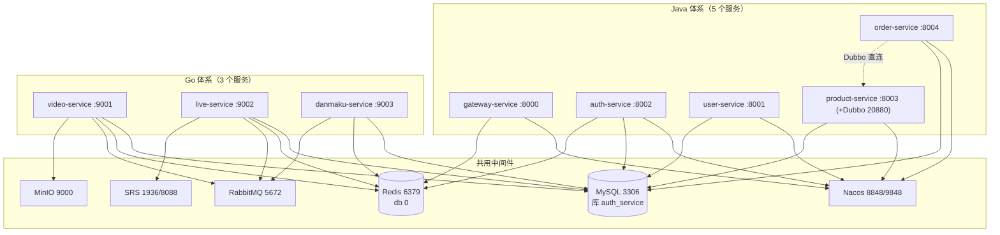

# deploy —— 本项目的部署总入口

这里集中放**「怎么把项目跑起来」**相关的全部东西：编排文件、环境变量模板、
数据库基线、媒体服务器配置、Kubernetes 清单。
覆盖 **Java 体系（gateway / auth / user / product / order）** 与
**Go 体系（video / live / danmaku）** 两套，它们跑在同一台机器上、共用同一份数据层。

> 为什么都在这里：以前这些文件散在三处 —— 仓库根（`docker-compose.yml`、`.env.example`、
> `migrations/`）、`deploy/`（DDL 校验脚本、SRS 配置）、服务目录内（`Dockerfile`、
> `auth-service/infra/k8s/`）。同一个「部署」概念有多个入口，没人知道该看哪个。
> 现在**只有一个入口：本文件**。

---

## 1. 目录结构

```
deploy/
├── README.md                    ← 你在这里：部署总入口
├── .env.example                 环境变量模板（复制成同目录的 .env 后 Compose 自动读取）
├── compose.yml                  编排总入口（只做 include，把三组服务合成一个 Compose 项目）
├── compose.infra.yml            共用中间件：MySQL / Redis / RabbitMQ / MinIO / Nacos   profile: infra
├── compose.go.yml               Go 三服务 video/live/danmaku + SRS                    默认 + profile: media
├── compose.java.yml             Java 五服务 gateway/auth/user/product/order           profile: java
├── db/
│   ├── README.md                共用库 auth_service 的全部 DDL 与执行顺序
│   ├── go/media-tables.sql      Go 侧 9 张 media_* 表的 DDL 基线（幂等）
│   └── verify-schema.ps1       校验「DDL 基线」与「GORM AutoMigrate 实际产出」是否一致（22 项）
├── media/srs.conf              SRS 直播媒体服务器配置
└── k8s/                        Kubernetes 清单（Traefik + Envoy sidecar 链路）
    ├── README.md
    └── base/*.yaml
```

`.env.example` 刻意与 `compose*.yml` 放在同一层：Compose 只从「compose 文件所在目录」
读取 `.env`，放到子目录就得给每条命令都加 `--env-file`。

各服务的 `Dockerfile` **仍然留在各自服务目录里**，没有搬进来 ——
因为 `build.context` 必须是服务目录，把 Dockerfile 挪出来只会让构建上下文变得绕。

---

## 2. 两套体系与依赖关系



**共享且必须共用**（两套体系是同一个实例，靠命名空间隔离）：

| 组件 | 地址 | 隔离手段 |
| --- | --- | --- |
| MySQL | `3306`，库 `auth_service` | 表前缀：Java 无前缀（`account`/`user`/`product`/…），Go 用 `media_` |
| Redis | `6379` db 0 | key 前缀：Java 用 `auth:` / `gateway:`，Go 用 `video:` / `live:` / `danmaku:` |
| Nacos | `8848`（+ `9848` gRPC） | 服务名即 `spring.application.name` |

**Go 体系独有**（Java 侧没有）：RabbitMQ、MinIO、SRS。

---

## 3. 端口表

| 组件 | 宿主机端口 | 容器内端口 | 归属 |
| --- | --- | --- | --- |
| gateway-service | 8000 | 8000 | Java |
| user-service | 8001 | 8001 | Java |
| auth-service | 8002 | 8002 | Java |
| product-service | 8003 / 20880 | 8003 / 20880 | Java |
| order-service | 8004 | 8004 | Java |
| video-service | 9001 | 9001 | Go |
| live-service | 9002 | 9002 | Go |
| danmaku-service | 9003 | 9003 | Go |
| MySQL | **3306（与 Java 共用）** / 自建时 3307 | 3306 | 共用 |
| Redis | **6379（与 Java 共用）** / 自建时 6380 | 6379 | 共用 |
| Nacos | 8848 / 9848 | 8848 / 9848 | 共用 |
| RabbitMQ | 5672 / 15672（管理台） | 5672 / 15672 | Go |
| MinIO | 9000（S3）/ 9090（控制台） | 9000 / 9090 | Go |
| SRS | 1936 RTMP / 8088 HTTP / 1986 API / 8001 WebRTC | 1935 / 8080 / 1985 / 8000 | Go |

> MinIO 控制台用 **9090** 而不是 9001 —— 宿主机上的 minio 容器已经占了 9001。

---

## 4. 三种启动方式

先准备变量文件（`SHARED_MYSQL_PASSWORD` 是必填项，其余都有内置默认值）：

```powershell
Copy-Item deploy\.env.example deploy\.env
# 编辑 deploy/.env：把 SHARED_MYSQL_PASSWORD=change-me 换成你自己的口令
```

### 方式 A：本机已经有中间件（**默认，也是本机现状**）

宿主机上已经有 MySQL / Redis，并且手工跑着 RabbitMQ / MinIO / Nacos 容器
（`docker ps` 可见 `rabbitmq`、`minio`、`nacos-standalone-derby`）。
此时**只需要起业务服务**，不要起 `--profile infra`（会抢端口）：

```powershell
cd deploy
docker compose up -d                      # Go 三服务（video / live / danmaku）
docker compose --profile java up -d       # 再叠加 Java 五服务
docker compose --profile media up -d      # 还需要直播推拉流时叠加 SRS
```

带 `--profile` 的命令会**叠加**运行，不会把之前起的停掉。

### 方式 B：一台什么都没有的机器（自建中间件）

```powershell
cd deploy
docker compose --profile infra up -d      # MySQL/Redis/RabbitMQ/MinIO/Nacos 全起
```

**然后必须把 `deploy/.env` 里的 `INFRA_*` 从 `host.docker.internal` 改成服务名**
（`mysql` / `redis` / `rabbitmq` / `minio:9000` / `nacos:8848` / `http://srs:1985`）——
`.env.example` 里已经把这 8 行写好并注释掉了，直接替换即可。改完重启业务服务。

### 方式 C：完全不用容器

Go 服务直接 `go run ./cmd/server`，Java 服务直接 `mvn spring-boot:run`。
此时它们读的是各服务自己的 `configs/config.yaml` / `application.yml`，
默认值本来就指向 `127.0.0.1`，**不需要 .env**。

### 停止与清理

```powershell
cd deploy
docker compose --profile java --profile media down     # 停止（保留数据卷）
docker compose --profile infra down -v                 # 连数据卷一起清掉
docker compose --profile java --profile infra --profile media config   # 只看合并后的配置
```

---

## 5. 数据库初始化（最容易踩的一步）

`auth_service` 库里的表来自**四个不同的地方**，且**只有一部分会自动建**：

| 表 | DDL 在哪 | 会自动执行吗 |
| --- | --- | --- |
| `account` | `auth-service/src/main/resources/schema.sql` | ✅ Spring `spring.sql.init.mode=always` |
| `user` | `user-service/src/main/resources/schema.sql` | ✅ 同上 |
| `product` / `sku` / `inventory` | `product-service/src/main/resources/db/schema.sql` | ❌ **需手工导入** |
| `order` / `order_item` / `payment_order` / `payment_record` | `order-service/src/main/resources/db/schema.sql` | ❌ **需手工导入** |
| `media_*` 共 9 张 | `deploy/db/go/media-tables.sql` | ❌ 手工导入，或由 GORM `AutoMigrate` 自动建 |

完整说明、执行顺序与校验方法见 **[`db/README.md`](db/README.md)**。

---

## 6. 健康检查

```powershell
# Go 三服务（/healthz 存活、/readyz 依赖就绪，/readyz 会分别报 mysql/redis/events/minio）
curl.exe http://localhost:9001/readyz
curl.exe http://localhost:9002/readyz
curl.exe http://localhost:9003/readyz

# Java 服务（只有 auth / gateway 引了 actuator）
curl.exe http://localhost:8002/actuator/health
curl.exe http://localhost:8000/actuator/health

# 容器状态
docker compose --profile java --profile infra ps
```

Java 镜像里写的是「端口可连」探针（bash `/dev/tcp`）：官方 JRE 镜像没有 curl/wget，
而 user/product/order 也没引 actuator，这样五个镜像可以用同一套写法。

---

## 7. 出故障先看哪里

| 症状 | 先查 |
| --- | --- |
| 服务起不来 / 连不上数据库 | 本文 §5「数据库初始化」，尤其 product/order 的表是要手工导的 |
| Go 服务收不到跨服务事件（订阅成功但没消息） | `../docs/Go微服务-问题解决记录.md` §1.2（绑错交换机） |
| MQ 启动报 `406 PRECONDITION_FAILED` | 同上 §1.1（队列撞名） |
| 配置读取报 `cannot unmarshal !!str '1936' into int` | 同上 §2.1（数值占位符被引号包住） |
| Windows 上排序/先后语义错乱 | 同上 §3.2（`time.Now()` 粒度约 15.6ms） |
| PowerShell 脚本编码/引号问题 | 同上 §6 |
| DDL 与代码不一致 | 同上 §5 + 本文 `db/README.md` |

排查清单的完整索引在 **`../docs/Go微服务-问题解决记录.md` §9**。

---

## 8. Kubernetes

`k8s/` 下的清单是**另一条部署链路**（集群内自建 MySQL/Redis + Traefik 入口 +
Envoy sidecar 服务间通信），与 compose 不冲突也不共用。见 [`k8s/README.md`](k8s/README.md)。

---

## 9. 相关文档

| 文档 | 内容 |
| --- | --- |
| [`db/README.md`](db/README.md) | 共用库的全部 DDL、归属与执行顺序 |
| [`db/go/media-tables.sql`](db/go/media-tables.sql) | Go 侧 DDL 基线（BOM、索引名、类型映射的约束见 `db/README.md` §6/§7） |
| [`k8s/README.md`](k8s/README.md) | Kubernetes 部署步骤与设计说明 |
| [`../docs/Go微服务-公共约定.md`](../docs/Go微服务-公共约定.md) | Go 侧的目录结构 / 响应格式 / 错误码 / 消息拓扑约定 |
| [`../docs/Go微服务-问题解决记录.md`](../docs/Go微服务-问题解决记录.md) | 全部踩过并修复的坑（含 §9 按症状索引的排查清单） |
