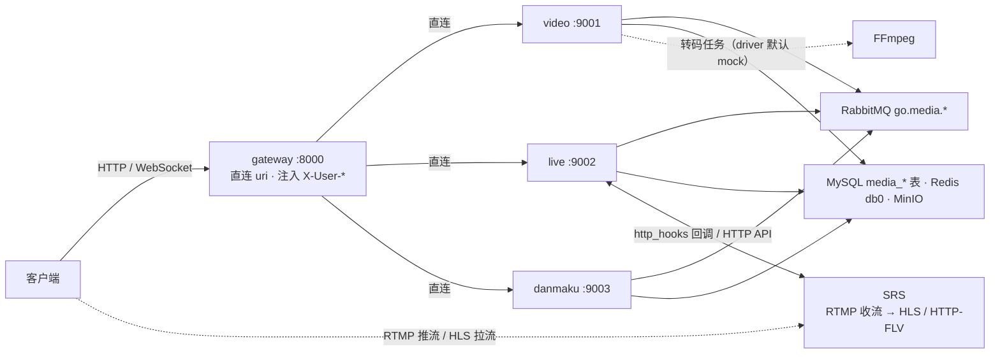

# Go 媒体微服务群 · 公共约定

> 适用范围：`video-service-go`（点播）、`live-service-go`（直播）、`danmaku-service-go`（弹幕）。
> 本文只写三个服务**必须一致**的横切约定：目录骨架、配置、统一响应、错误码、身份传递、
> 消息拓扑、Redis 命名、幂等、时区与单位。
>
> 业务细节见各服务 `docs/设计文档.md` / `接口文档.md`；网关接入见
> [`gateway-service/技术文档.md` §11](../gateway-service/技术文档.md)（3 条直连路由、白名单、WS 查询参数令牌）；
> 踩坑与排查清单见 [`Go微服务-问题解决记录.md`](Go微服务-问题解决记录.md) §9；部署与端口总表见
> [`deploy/README.md`](../deploy/README.md)，整体架构见[根 README](../README.md) §1。

## 1. 三服务一览

| 服务 | 端口 | 核心职责 | Go 侧 MySQL 表 |
| --- | --- | --- | --- |
| `video-service-go` | **9001** | 视频上传（MinIO，含分片续传）、异步转码、HLS 播放地址、发布/下架 | `media_video`、`media_video_category`、`media_video_tag`、`media_transcode_task`、`media_upload_session` |
| `live-service-go` | **9002** | 直播间 CRUD、开播/关播状态机、推拉流地址、在线人数、SRS 回调 | `media_live_room`、`media_live_record` |
| `danmaku-service-go` | **9003** | 弹幕 WebSocket 广播、历史冷热分离、敏感词、双层限流、异步落库 | `media_danmaku`、`media_sensitive_word` |

详细文档见 [video](../video-service-go/docs/) · [live](../live-service-go/docs/) · [danmaku](../danmaku-service-go/docs/)
下的 `设计文档.md` / `接口文档.md`。

服务间通信**只有** RabbitMQ topic 事件（`go.media.video` / `go.media.live` / `go.media.danmaku`）：没有 gRPC、没有同步 RPC。
网关对三个服务是 3 条**直连 `uri`** 路由（`VIDEO_SERVICE_URI` / `LIVE_SERVICE_URI` / `DANMAKU_SERVICE_URI`，
默认 `localhost:9001~9003`），Go 未接入 Nacos，写 `lb://` 会因「无可用实例」直接 503。

端口纪律：只有 HTTP 端口要避开 Java 的 8000（网关）/ 8001 / 8002 / 8003（+Dubbo 20880）/ 8004，Go 用 9001 / 9002 / 9003；数据层不偏移，因为与 Java **是同一个实例**。
MinIO 控制台是 **9090** 而不是 9001——9001 被 video-service 占用，容器里也显式写了 `--console-address :9090`（`deploy/compose.infra.yml:104-116`）。



## 2. 共用数据层与命名空间

与 Java 体系**同一个 MySQL 实例、同一个库 `auth_service`、同一个 Redis db 0**。
收益是部署成本低、Go 直接复用 Java 侧已有的账号与 JWT 身份；代价是表名与 key 必须自带命名空间——
`media_` 前缀和 `video:` / `live:` / `danmaku:` 前缀**不是风格偏好，而是硬约束**。

- 建表：启动时 GORM `AutoMigrate` 自动创建（只增不删），或手工执行 `deploy/db/go/media-tables.sql`（幂等）；两者一致性用 `deploy/db/verify-schema.ps1` 校验。18 张表的归属与顺序见 [`deploy/db/README.md`](../deploy/db/README.md)。
- Java 已占用、Go **不得使用**的表名：`account` / `user` / `product` / `sku` / `inventory` / `order` / `order_item` / `payment_order` / `payment_record`；`AutoMigrate` 只注册上面那 9 张，不会触碰 Java 的 9 张表。

### 2.1 Redis key 全表

Key 形态 `<域>:<实体>:<ID>`。Java 已占用前缀：`auth:verification:*`、`auth:blacklist:*`、
`gateway:rate:global:*`、`gateway:rate:ip:*`——新增 key 前先确认前缀未被占用，Go 侧不得使用 `auth:` / `gateway:`。

| Key | 类型 | TTL | 归属 | 说明 |
| --- | --- | --- | --- | --- |
| `video:detail:{videoId}` | String(JSON) | 300s | video | 详情缓存；改/删/发布/下架/转码提交与完成时 `DEL` |
| `video:view:{videoId}` | String(计数) | 持久 | video | 播放量缓冲，定时回写 MySQL 后删除 |
| `video:cate:all` | String(JSON) | 600s | video | 分类列表；分类增改时 `DEL` |
| `live:room:{roomId}` | Hash | 30s | live | 实时状态：status / sessionId / startedAt / ownerId / peakBase / viewerTotalBase |
| `live:online:{roomId}` | ZSet | 120s（2×online_ttl） | live | member = `u:{uid}` / `anon:{sid}`，score = 最后心跳时间戳 |
| `live:peak:{roomId}` | String | 持久 | live | 本场在线峰值（开播时清空） |
| `live:viewers:{roomId}` | String | 持久 | live | 本场累计人次，关播时累加到 `viewer_total` |
| `live:key:{streamKey}` | Hash | 24h | live | 推流密钥反查 `roomId` / `sessionId` |
| `live:mine:{ownerId}` | String | 持久 | live | 「一人一房间」快速路径，MySQL 是权威兜底 |
| `live:detail:{roomId}` | String(JSON) | 30s | live | 详情缓存；不存在的房间写 `__nil__` 60s |
| `live:stats:started` / `live:stats:stopped` | String | 持久 | live | 自消费 `live.*` 事件的计数 |
| `danmaku:room:{roomId}:recent` | List | 2h | danmaku | 直播热数据，`LPUSH` + `LTRIM 500` |
| `danmaku:video:{videoId}:recent` | List | 2h | danmaku | 点播热数据，同上 |
| `danmaku:rate:u:{uid}` | String(计数) | 1s | danmaku | 用户级固定窗口 |
| `danmaku:rate:room:{roomId}` | String(计数) | 1s | danmaku | 房间级固定窗口（保护广播扇出） |
| `danmaku:dedup:{clientMsgId}` | String(首发响应快照) | 10s | danmaku | 客户端重试去重 |
| `danmaku:idem:{eventId}` | String | 1h | danmaku | 落库消费幂等 |
| `danmaku:pending:persist` | List | 持久 | danmaku | MQ 不可用时的补发队列，上限 10 万条 |
| `danmaku:live:{roomId}` | String(`1`/`0`) | 持久 | danmaku | 是否直播中，由 `live.*` 事件维护（关播写 `0`，不删键） |
| `mq:idem:{eventId}` | String | 1h | video / live | 事件消费幂等（danmaku 用 `danmaku:idem:`，见 §7） |

- 热数据用 **List + `LPUSH`/`LTRIM`** 而不是 ZSet：只需「最新 N 条、按时间倒序」，O(1) 且天然有界；ZSet 还要维护 member 唯一性，而弹幕内容可重复。
- 在线人数用 ZSet：score 就是心跳时间戳，心跳/查询路径顺手 `ZADD → ZREMRANGEBYSCORE -inf (now-60s) → ZCARD`，没有独立清理任务；`ZADD` 新增成员数 > 0 才算「新进入」。
- 扫描必须带完整域前缀（如 `SCAN video:view:*`）；**绝不能**对共用的 db 0 做 `KEYS *` / `FLUSHDB`。

## 3. 统一目录结构

三个服务同一套骨架，保证「换个服务也能立刻读懂」：

```text
<svc>/
├── cmd/server/main.go              # 进程入口：装配依赖 → 启动 → 优雅退出
├── configs/config.yaml             # 默认配置（支持 ${ENV:-default} 占位）
├── api/dto/dto.go                  # 对外请求 / 响应契约
├── internal/                       # 本服务实现，禁止被外部导入
│   ├── handler/                    # HTTP 出入口（只做参数绑定 + 调 service）
│   ├── service/                    # 业务逻辑
│   ├── repository/  model/         # 数据访问 + GORM 实体
│   ├── middleware/                 # RequestID / Recovery / Logger / CORS / Auth / AdminOnly / ErrorHandler
│   ├── config/config.go            # 配置加载（YAML + 环境变量覆盖）
│   └── infra/                      # 领域基础设施适配器：events / cache / router / media / storage
├── pkg/                            # 平台基础设施，与业务无关、可复用
│   ├── errs/errs.go                # ErrorCode 枚举 + BizError
│   ├── response/response.go        # 统一响应体、分页体与渲染函数
│   ├── identity/identity.go        # CurrentUser + 归属判断 + 请求头解析
│   └── logx/  trace/  store/  migrate/   # 日志 / 链路 ID / MySQL·Redis 连接 / AutoMigrate
├── docs/                           # 设计文档.md / 接口文档.md
└── Dockerfile · Makefile · README.md
```

各服务在骨架上多出的包（其余完全同构）：`danmaku-service-go` 的 `internal/infra/hub`（WebSocket 连接与房间广播）、
`internal/infra/filter`（敏感词前缀树）、`internal/infra/ratelimit`（Redis Lua 固定窗口）；`live-service-go` 的
`internal/infra/media`（SRS 适配器，mock / srs 驱动）；`video-service-go` 的 `internal/infra/media`（转码）与
`internal/infra/storage`（MinIO multipart）。

建表 DDL 不在服务目录内，而是仓库 `deploy/db/go/media-tables.sql`（三个服务共库）。
**分层纪律**：`handler` 不写业务、不碰 GORM；`service` 不感知 `*gin.Context`；`repository` 只做数据存取；
三者之间用 `context.Context` + 实体/领域对象传递。依赖只能单向向内，`pkg` 不得反向依赖 `internal`。

## 4. 统一响应与错误码

### 4.1 响应信封

```json
{ "code": 0, "message": "success", "data": { } }
```

分页统一 `{"items": [...], "total": 123, "page": 1, "pageSize": 20}`（`pkg/response.PageData`）。
与 Java 侧的差异（刻意为之，不破坏契约）：失败时 `data` 为 `null`（Java 侧 `non_null` 会省略该字段，前端只判断 `code`，两种都能兼容）；
长整型 ID 按数字输出（Go `int64`），超出 `Number.MAX_SAFE_INTEGER` 的 ID 前端需按字符串兜底；时间格式见 §6。

实现：`pkg/errs/errs.go` 定义 `ErrorCode{Code, Message, HTTPStatus}` 与 `BizError`；`handler` 只返回
`errs.CodeX.New("...")`，由 `middleware.ErrorHandler` 渲染（`video-service-go/internal/middleware/middleware.go:101`）；
`BizError.Detail` 非空时覆盖默认 message——统一提示由错误码保证，具体原因由 Detail 提供。

### 4.2 错误码分段与全表

编号与 HTTP 状态码同源（`40001` → 400）；`4xxxx` / `5xxxx` 为全平台通用段，`6xxxx` = video、`7xxxx` = live、
`8xxxx` = danmaku，一个服务只使用**通用段 + 自己那段**。`404xx` / `409xx` 的后两位由各服务按资源细分
（如弹幕撤回不存在的 ID 是 `40401 弹幕不存在`），编号规则不变，具体含义看各服务《接口文档》。

| 段 | code | HTTP | 含义 |
| --- | --- | --- | --- |
| 成功 | `0` | 200 | 成功 |
| 通用 | `40001` / `40101` / `40301` | 400 / 401 / 403 | 参数不合法（message 为「字段名 + 原因」）/ 未认证（缺 `X-User-Id` 或令牌失效）/ 无权限或非资源所有者 |
| 通用 | `404xx` | 404 | `40401` 视频不存在（danmaku：弹幕不存在）· `40402` 分类不存在 · `40403` 转码任务不存在 · `40404` 上传会话不存在或已失效 |
| 通用 | `409xx` / `42901` | 409 / 429 | 状态冲突（重复开播、重复点赞、敏感词已存在…）/ 请求过于频繁（danmaku、live） |
| 通用 | `50000` / `50001` | 500 / 503 | 内部错误 / 下游依赖不可用（MySQL / Redis / MQ / MinIO） |
| video | `60001` | 400 | 文件类型不支持 |
| video | `60002` | 413 | 文件超出大小限制（> 2GB） |
| video | `60003` | 409 | 视频状态不允许该操作 |
| video | `60004` | 503 | 转码任务提交失败 |
| video | `60005` | 400 | 上传分片不合法（大小不符 / 序号越界 / partSize < 5MiB） |
| video | `60006` | 409 | 分片尚未全部上传 |
| live | `70001` | 409 | 直播间不在直播中 |
| live | `70002` | 409 | 推流密钥无效或会话已过期 |
| live | `70003` | 409 | 超出单用户直播间数量上限 |
| live | `70004` | 409 | 该用户已有正在直播的直播间 |
| live | `70005` | 404 | 直播间不存在 |
| live | `70006` | 503 | 媒体服务器（SRS）不可用 |
| danmaku | `80001` | 400 | 弹幕内容不合法（空 / 超长 / 命中敏感词） |
| danmaku | `80002` | 429 | 发送过于频繁（`data.retryAfterMs`） |
| danmaku | `80003` | 409 | 直播间当前未开播，不允许发送弹幕 |

> 两处历史遗留，排查时以代码为准：① 弹幕撤回超窗复用 `40001` 但 HTTP 是 `409`（`danmaku-service-go/pkg/errs/errs.go:47`），别拿它当编号规则样例；
> ② video 的 `40402` / `40403` / `40404`、`60005` / `60006` 早期文档漏登记，以 `video-service-go/pkg/errs/errs.go` 为准。

## 5. 身份传递与中间件

身份只有两个头，Go 服务**不解析 JWT、不持有密钥**：

| 头 | 语义 | 来源 |
| --- | --- | --- |
| `X-User-Id` | 当前用户 ID（字符串） | JWT 的 `sub`，网关**先清后写**，客户端伪造无效 |
| `X-User-Role` | `ADMIN` / `user`，缺失按 `user` | JWT 的 `role` claim |

令牌生命周期由 auth-service 独占：access **1800s**（30 分钟）/ refresh **604800s**（7 天）
（`auth-service/src/main/resources/application.yml:69-70`），Go 侧不参与签发与续期。
直连调试（绕过网关）必须手工补 `X-User-Id`，否则一律 `401 / 40101`。

| 中间件 | 行为 |
| --- | --- |
| `RequestID` | 读 `X-Request-Id`（缺失/空白则生成 UUID），回写响应头，同时注入 gin.Context 与 request context（发 MQ 事件时带 `traceId`） |
| `Recovery` | 捕获 panic → 日志 + `500 / 50000` |
| `Logger` | method / path / status / 耗时 / requestId / uid |
| `CORS` | 允许跨域，HLS 播放与 WebSocket 握手需要 |
| `Auth` | 解析两个身份头到 context，缺失即 `401 / 40101` |
| `AdminOnly` | 要求 `X-User-Role: ADMIN`，否则 `403 / 40301`（挂在 `Auth` 之后） |
| `ErrorHandler` | 把 `*errs.BizError` 渲染成统一响应；非业务错误归 `500 / 50000` |

- 归属校验在 service 层：`X-User-Id != 资源.ownerId` → `403 / 40301`；ADMIN 不绕过归属，只执行治理动作（下架视频、强制关播、撤回弹幕）。
- 「登录可有可无」的接口（观众心跳）与白名单接口（视频详情、房间列表/详情/播放地址、弹幕历史、SRS 回调）**不挂 `Auth`**，
  由 handler 自行判定；需要登录的接口用 `middleware.Auth()` 显式声明，不靠约定。

## 6. 时区、时间格式与金额单位

| 项 | 约定 | 备注 |
| --- | --- | --- |
| 时区 | 一律 `Asia/Shanghai` | MySQL 连接串 `loc=Local`；容器时区随宿主机 |
| Go 出参时间 | RFC3339：`2026-09-27T10:30:00+08:00` | `time.Time` 默认序列化，带偏移 |
| Java 出参时间 | `2026-09-27T10:30:00`（`LocalDateTime`，无偏移） | 混调时按同一时区解释，不要硬解析 |
| 金额 | 一律**分**（`Long`）：`1399800` = 13998.00 元 | 媒体域不涉及金额，跨体系聚合时不要换算成元 |

## 7. 幂等约定

| 场景 | 机制 | Key / TTL |
| --- | --- | --- |
| MQ 消费（video / live） | `SETNX` 认领事件，处理失败释放 | `mq:idem:{eventId}`，1h |
| MQ 消费（danmaku 落库 worker） | 同上，前缀尚未统一 | `danmaku:idem:{eventId}`，1h |
| 弹幕重试去重 | 客户端带 `clientMsgId`，10s 内回放首发响应快照 | `danmaku:dedup:{clientMsgId}`，10s |
| 分片上传 init | 同 `(videoId, fileSize, partSize)` 且会话未超 24h → 复用原 `uploadId` | `media_upload_session` |

- 除 MQ 外，幂等靠**业务唯一键 + 状态机**：发布/下架/开播/关播在「当前状态不允许」时返回 `409 / 60003`、`409 / 70001`，重复请求不会产生第二条记录。
- 消费侧是「先占位、失败回滚」（`danmaku-service-go/internal/service/persist_worker.go:52`、`:96`）：进程在「已占位、未落库」之间被 kill 会残留幂等键，1h 内重投被跳过——排查「MQ 重投了但库里没有」先看这个 key。
- 脏数据（缺 uid / 内容为空）直接丢弃且不返回 error：重投一万次也不会变好，只会把队列堵死。

## 8. 消息拓扑（RabbitMQ）

统一 **topic exchange + 持久化队列 + 手动 ACK + 死信队列**；消费失败按配置重试（默认 3 次）后进死信。

| Exchange | Routing Key | 生产者 | 消费者 | 用途 |
| --- | --- | --- | --- | --- |
| `go.media.video` | `video.uploaded` | video | video（transcode worker） | 触发异步转码 |
| `go.media.video` | `video.transcoded` | video | video | 转码完成回调（发布/通知） |
| `go.media.live` | `live.started` | live | live（统计计数）、**danmaku**（房间激活 + WS `system` 帧） | 开播事件 |
| `go.media.live` | `live.stopped` | live | live、**danmaku** | 关播事件 |
| `go.media.danmaku` | `danmaku.created` | danmaku | danmaku（persist worker） | 弹幕异步落库 |

### 8.1 队列名必须带「消费方 exchange」前缀

```
队列 = <消费方 exchange>.<routingKey>.q     # go.media.danmaku.live.started.q
DLQ  = <消费方 exchange>.<routingKey>.dlq   # go.media.danmaku.live.started.dlq
DLX  = <消费方 exchange>.dlx                # go.media.danmaku.dlx
```

`live.started` 同时被 live 与 danmaku 订阅。若队列名只由 routing key 推导（`live.started.q`），两个服务会争抢同一个队列；而各自的 DLX 按自己的 exchange 命名，后启动者直接拿到 `406 PRECONDITION_FAILED - inequivalent arg 'x-dead-letter-exchange'` 而启动失败。
自产自消同样带前缀：video 订阅自己的 `video.uploaded` → `go.media.video.video.uploaded.q`（`internal/infra/events/bus.go:31`）。

### 8.2 绑定要绑到「生产方」的交换机

`ExchangeFor(routingKey)` 取路由键第一段（`live.started` → `go.media.live`）作为绑定目标
（`internal/infra/events/event.go:44`）。danmaku 订阅 `live.started` 时若绑到自己的 `go.media.danmaku`，
**队列有消费者、绑定显示成功、零报错，但永远收不到消息**：

```
go.media.live    → go.media.danmaku.live.started.q   (routing_key=live.started)   ✅
go.media.danmaku → go.media.danmaku.live.started.q                                ❌
```

这类问题只能靠端到端联调发现，单元测试结构上测不出来。

### 8.3 载荷：信封固定，ID 一律字符串

消息体为 JSON，外层信封固定 `eventId`（幂等键）/ `eventType` / `occurredAt` / `traceId` / `payload`（`internal/infra/events/event.go:55-61`）。
`roomId`、`videoId`、`uid`、`sessionId` 在载荷里**一律字符串**（`"roomId":"5"`，不是 `5`）。发布方塞 `uint64` 时消费方会得到

```
json: cannot unmarshal number into Go struct field LiveStartedPayload.roomId of type string
```

然后消息一直重试到进死信，业务侧表现为「功能静默失效」。发布侧 `strconv.FormatUint(id, 10)` 转一次即可；房间在 Redis key、WebSocket 帧、网关注入里本来都是字符串形态，统一成字符串才没有转换边界。

> 本节只写必须遵守的规则；`406` 报文、`/api/bindings` 定位手法、死信深度查看命令见 **`Go微服务-问题解决记录.md` §1**。

## 9. 配置加载

`configs/config.yaml` 支持 `${VAR:-default}` 占位，由 `internal/config` 在解析前展开；不引入
viper / mapstructure，结构体字段用 `yaml` tag 与文件键名一一对应，环境变量在加载后覆盖。

```yaml
mysql:
  dsn: "${VIDEO_MYSQL_DSN:-root:<password>@tcp(127.0.0.1:3306)/auth_service?charset=utf8mb4&parseTime=True&loc=Local}"
redis:
  # 与 Java 共用：同一个实例、同一个 db 0
  addr: "${VIDEO_REDIS_ADDR:-127.0.0.1:6379}"
  password: "${VIDEO_REDIS_PASSWORD:-}"
  db: 0
events:
  driver: "${VIDEO_EVENTS_DRIVER:-rabbitmq}"   # rabbitmq | local（仅开发）
  exchange: "${VIDEO_EVENTS_EXCHANGE:-go.media.video}"
```

- 环境变量命名 `<SERVICE>_<SECTION>_<KEY>`（如 `VIDEO_MINIO_ENDPOINT`、`LIVE_RABBITMQ_URL`）；生产只用环境变量覆盖，密钥不进仓库。
- `APP_ENV` 控制 gin mode、日志格式（文本/JSON）与「开发专用路由是否注册」（如 live 的 `/api/v1/live/dev/*`）。
- 默认值刻意指向「Java 那套」实例，做到零配置可跑；跨服务只允许用环境变量改地址，不允许改协议。

**数值型占位符不能加引号**：默认值替换发生在 YAML 解析**之前**，`rtmp_port: "${LIVE_SRS_RTMP_PORT:-1936}"`
展开后是字符串 `"1936"`，yaml.v3 写不进 `int` 字段，服务直接起不来：

```
yaml: unmarshal errors: line 47: cannot unmarshal !!str '1936' into int
```

正确写法 `rtmp_port: ${LIVE_SRS_RTMP_PORT:-1936}`，只有字符串型才加引号
（`live-service-go/configs/config.yaml:49-52`）。详见 `Go微服务-问题解决记录.md` §2.1。

## 10. 关键实现落点（以代码为准）

| 能力 | 实现 | 关键数字 / 取舍 |
| --- | --- | --- |
| 视频分片上传 | MinIO multipart：`init → parts/{n} → status → complete → abort` | 上限 **2GB**、单片下限 **5MiB**、片数上限 **10000**（超了就逐次翻倍片大小：100GiB → 20MiB/片 → 5120 片）；**进度只信 `ListParts`**，库里只落 `uploadId`——在别处再存一份必然漂移 |
| 转码 | `transcoder.driver`（`mock` / `real`），`timeout=30m`、`concurrency=2` | 默认 `mock`，不调真实 FFmpeg；`real` 需自装 FFmpeg，产物未校验 |
| 弹幕热/冷分离 | 热：Redis List；冷：MySQL | 热数据只服务第 1 页（500 条 / 2h）。点播历史按 `idx_video_time(video_id, time_ms)` 升序取——列序不能反，否则时间轴过滤退化成全表扫 |
| 直播在线人数 | `live:online:{roomId}` ZSet | 心跳即写、查询即清理，`peak` / `viewers` 只在关播落库；20s 一次心跳写库就是持续写放大 |
| 限流 | 网关令牌桶（全局 + IP）、danmaku 固定窗口双层（用户 + 房间） | 固定窗口 1 key + 1 次 INCR；滑动窗口 ZSet 在 5k msg/s 下内存与 CPU 高一个量级。被房间级拒绝**不回滚**用户级计数 |
| Lua 脚本 | 共 5 段，只用于原子操作：gateway 全局令牌桶、gateway IP 令牌桶、auth Refresh Token 轮换、danmaku 双层限流、video 播放量「读 + 删」 | **库存扣减不是 Lua**：product-service 走 MySQL 条件更新（`UPDATE ... WHERE available_stock >= ?`），仓库里没有 Redis 扣库存实现 |
| 事件总线降级 | `events.driver=rabbitmq`，连不上则退 `local`（进程内，不持久不跨进程） | MQ 凭据错误会静默降级，只有 `/readyz` 暴露；表现是「事件发了没反应」，见问题解决记录 §1.4 |

## 11. 未实现能力（不要当成已实现）

| 能力 | 当前真实状态 | 误判后果 |
| --- | --- | --- |
| **gRPC**（video 供 live 关联回放） | 无 `.proto`，三个服务的 `go.mod` 都没有 grpc 依赖；服务间只有 MQ 事件 | 「Go 服务间走 gRPC」不成立，跨服务能力只能靠事件扩展 |
| **OpenTelemetry / Prometheus** | 全仓库无 OTel、无 Prometheus 客户端，只有 `X-Request-Id` 日志串联。auth 的 actuator 写了 `prometheus` 但 pom 无 micrometer 注册表，端点实际不可用；K8s 的 `prometheus.io/*` 指向 9901 `/stats/prometheus`，那是 **Envoy sidecar** 的指标（`deploy/k8s/base/auth-deployment.yaml:97-99`） | 没有链路追踪、没有 QPS/延迟面板，只能靠 requestId 串日志 |
| **多实例广播（Redis Pub/Sub）** | danmaku Hub 的 `Backend` 只有 `memoryBackend`（`danmaku-service-go/internal/infra/hub/hub.go:13`），跨节点广播只留了接口 | 多副本部署时各副本只广播自己收到的弹幕，观众会丢一半消息 |
| **真实 FFmpeg 多码率** | `transcoder.driver` 默认 `mock` | 上传、状态机、重试、死信链路是真的，但产物不是真转码，播放地址不可播 |
| **WebRTC 连麦** | SRS 配了 `rtc_server`、live 会生成 `webrtc://` 播放地址，连麦（多路合流、信令）没有实现 | 单主播推拉流可用；「连麦」不可用 |

> 旧版文档按「阶段一~四」描述进度，**不要再引用那张路线表**：其中标「待启动」的撤回、峰值统计、开播超时兜底、转码重试、死信与重试其实都已实现，
> 真正缺的只有上表这 5 项。另：实时通道只有 WebSocket（`/ws/danmaku`），**没有 SSE**；本仓库也**没有** notification / recommendation / statistics 服务。
