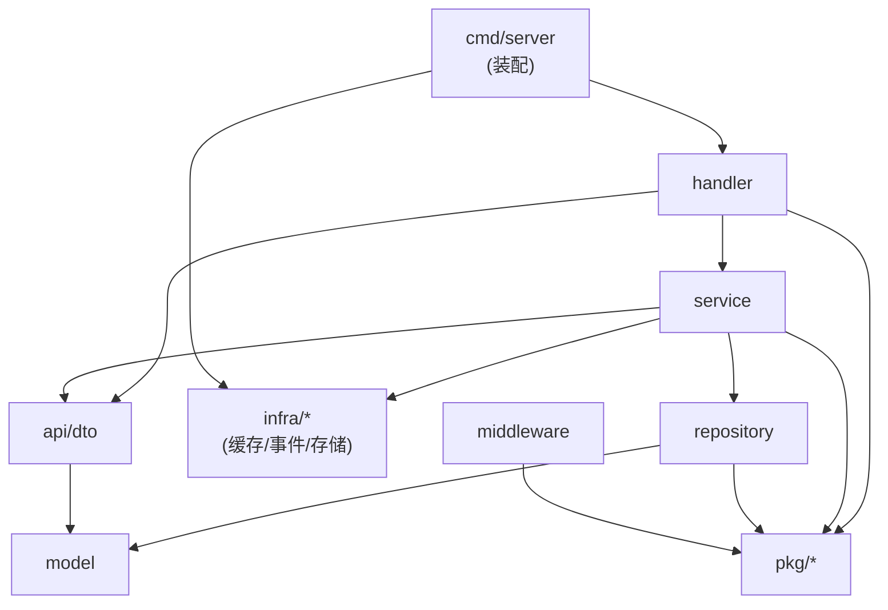

# Go 媒体微服务 — 问题解决记录

> video / live / danmaku 三个 Go 服务实现中**真实踩到并已修复**的问题，共 10 条问题记录 + 3 条测试教训。每条固定 `现象 → 根因 → 修法 → 教训`，不写假想问题。
> 症状索引见 [§8](#8-排查清单照着走)；跨服务契约、错误码与消息拓扑见 `Go微服务-公共约定.md`，本文不复制。

---

## 0. 环境基线

| 项 | 值 |
| --- | --- |
| Go | 1.25.0（三个 `go.mod` 一致） |
| OS | Windows（§3.2 的时钟粒度问题只在 Windows 复现） |
| MySQL | 8.0，共用库 `auth_service`，collation `utf8mb4_0900_ai_ci` |
| RabbitMQ | 4.1.0，`admin`/`admin`，管理台 15672 |
| MinIO | `minioadmin`/`minioadmin`，API 9000 / 控制台 9090 |
| 端口 | gateway 8000 / user 8001 / auth 8002 / product 8003（Dubbo 20880）/ order 8004 / video 9001 / live 9002 / danmaku 9003 |

§1、§4、§5 是跨平台设计缺陷，§3.2 与 Windows 时钟粒度有关。Go 三个服务之间只有 RabbitMQ topic 事件（`go.media.video` / `go.media.live` / `go.media.danmaku`），**没有 gRPC，也没有同步 RPC**。

---

## 1. 消息队列（RabbitMQ）

### 1.1 队列名只含 routing key → 两个服务撞名，后启动的起不来

**现象**：live 先启动正常，danmaku 启动即失败：`406 PRECONDITION_FAILED - inequivalent arg 'x-dead-letter-exchange' for queue 'live.started.q' in vhost '/': received 'go.media.danmaku.dlx' but current is 'go.media.live.dlx'`。
**根因**：队列名曾是 `routingKey + ".q"`，只含 routingKey；live 与 danmaku 都订阅 `live.started` / `live.stopped`（一个算统计、一个联动房间状态），算出同名队列，而死信交换机各用各的 → 参数不等价。
**修法**：队列 / DLQ / DLX 全部带**消费方自己的 exchange** 前缀（`internal/infra/events/bus.go`）：

```go
func QueueNameFor(exchange, routingKey string) string { return exchange + "." + routingKey + ".q" }
func DLQNameFor(exchange, routingKey string) string   { return exchange + "." + routingKey + ".dlq" }
func DLXNameFor(exchange string) string               { return exchange + ".dlx" }
```

结果：`go.media.live.live.started.q` 与 `go.media.danmaku.live.started.q` 各自独立，各有自己的重试与死信。
**教训**：队列是**每个消费者独占**的资源，名字必须带消费者身份；看到 `PRECONDITION_FAILED` 先查是不是两个服务抢了同一个队列名。

### 1.2 绑到自己的交换机 → 订阅"成功"却永远收不到，且零报错

**现象**：danmaku 日志显示订阅成功、队列有消费者，live 也正常发布 `live.started`，但 WebSocket 客户端永远收不到 `system` 帧，全链路没有任何 error / warning。
**根因**：`Subscribe` 用 `b.exchange`（本服务交换机）去 bind——"我是 danmaku 就绑 danmaku 的交换机"；但订阅语义是**去消息被发出来的地方接**。队列实际绑在 `go.media.danmaku`，而 live 往 `go.media.live` 发，两边活在平行世界。
**修法**：由 routing key 反推**生产方**交换机，队列命名仍用 owner——两个角色分开（`internal/infra/events/event.go`）：

```go
const ExchangePrefix = "go.media."
func ExchangeFor(routingKey string) string { // 取第一个 "." 前的域：live.started → go.media.live，danmaku.created → go.media.danmaku
	domain := routingKey
	if i := strings.Index(routingKey, "."); i > 0 { domain = routingKey[:i] }
	return ExchangePrefix + domain
}
// Subscribe 内：
owner := b.exchange               // 队列 / DLQ / DLX 用「自己的」
source := ExchangeFor(routingKey) // 绑定用「生产方的」
ch.ExchangeDeclare(source, "topic", true, false, false, false, nil)
ch.QueueBind(queue, routingKey, source, false, nil) // queue = QueueNameFor(owner, routingKey)
```

排查时直接问管理台，别猜：

```powershell
curl.exe -s -u admin:admin "http://localhost:15672/api/bindings" | ConvertFrom-Json |
  Where-Object { $_.destination -like "*live.started*" } | Select-Object source, destination, routing_key
# 修复前：source=go.media.danmaku（绑错）；修复后：source=go.media.live ✅
```

```text
source            destination                          routing_key
go.media.danmaku  go.media.danmaku.live.started.q      live.started   ← 绑错了
```

修复后：`source=go.media.live, destination=go.media.danmaku.live.started.q`。

**教训**：这类 bug 单测永远抓不到——mock 掉 Bus 后，"绑到哪个交换机"根本没执行；AMQP bind 不做语义校验，绑到空交换机也返回成功，所以**"没有报错"不构成"链路通"的证据**。必须有打通真实 MQ 的跨进程脚本（`tools/cross-service-events.ps1`）。

### 1.3 载荷字段类型不一致 → 消费端解析失败，静默进死信队列

**现象**：danmaku 日志 `解析 live.started 载荷失败: json: cannot unmarshal number into Go struct field LiveStartedPayload.roomId of type string`；重试 3 次进 DLQ，`system` 帧不广播，但主流程照常返回 200。
**根因**：同一事件，生产端 `RoomID uint64` 发 `123`，消费端 `RoomID string` 期望 `"123"`；JSON 是弱类型，两边都编译通过、单测各自也过。

```go
// live-service（生产者）
type LiveStartedPayload struct { RoomID uint64 `json:"roomId"` } // 发出 123
// danmaku-service（消费者）
type LiveStartedPayload struct { RoomID string `json:"roomId"` } // 期望 "123" → 崩
```

**修法**：事件载荷所有 ID 字段一律 `string`（`api/dto/dto.go`），发布时 `strconv.FormatUint(room.ID, 10)` 显式转换。查 DLQ 深度用 `curl.exe -s -u admin:admin http://localhost:15672/api/queues`，看 `name` / `messages`。
**教训**：跨服务载荷是**契约**，不是各自的结构体；数字/字符串这种"看起来无所谓"的差异编译期与单测都发现不了，已写进 `Go微服务-公共约定.md` §8.3。

### 1.4 MQ 凭据错误 → 静默降级为进程内总线

**现象**：服务能启动、接口能用、`/healthz` 是 UP，但弹幕不落库、没有死信、跨服务事件完全不通。
**根因**：本机 Docker 的 RabbitMQ 实际凭据是 `admin/admin`，配置却写 `gomedia/gomedia123`；连不上时 events 自动降级为 LocalBus，功能静默缺失。

```powershell
docker inspect rabbitmq --format "{{range .Config.Env}}{{println .}}{{end}}"
curl.exe -s -u admin:admin http://localhost:15672/api/whoami
```

**修法**：三个服务 `configs/config.yaml`、`deploy/compose*.yml`、`deploy/.env.example` 统一改成 `admin/admin`（MinIO 同理 `minioadmin/minioadmin`，控制台 9090）；降级打 WARN，`/readyz` 暴露 events driver。

```text
eventsDriver=local ... rabbitmq_unavailable_fallback_local   ← 出事了
eventsDriver=rabbitmq                                        ← 真连上了
```

**教训**：降级设计是双刃剑——LocalBus 让"没起 MQ 也能开发"，也把"凭据写错"从启动失败变成**静默功能缺失**；判据：`eventsDriver=local` 就是 MQ 没连上。

---

## 2. 配置加载

### 2.1 数值型占位符加了引号 → 服务根本起不来

**现象**：live 启动即退出：`yaml: unmarshal errors: line 47: cannot unmarshal !!str '1936' into int`（另两行 8088 / 8001，行号 48 / 50）。
**根因**：配置加载是**先字符串替换、再喂给 yaml.v3**；`rtmp_port: "${LIVE_SRS_RTMP_PORT:-1936}"` 展开成 `"1936"`，YAML 双引号里的数字就是字符串，无法写进 `int`。

```text
${LIVE_SRS_RTMP_PORT:-1936} → 展开成裸的 1936
模板外层还有一对引号     → 最终文本 rtmp_port: "1936"
YAML 双引号里的数字       → yaml.v3 拒绝写进 int
```

**修法**：数值型占位符不加引号，字符串型才加（`live-service-go/configs/config.yaml`）：

```yaml
rtmp_port: ${LIVE_SRS_RTMP_PORT:-1936}        # ✅ int
http_port: ${LIVE_SRS_HTTP_PORT:-8088}
webrtc_port: ${LIVE_SRS_WEBRTC_PORT:-8001}
rtmp_host: "${LIVE_SRS_RTMP_HOST:-localhost}" # 字符串才加引号 ✅
```

**教训**：字符串模板 + 类型化解析天然脆；判据是把占位符手写成默认值看 YAML 合不合法。已补 `internal/config/config_test.go` 断言三个端口是 `int`，下次在 `go test` 阶段就被拦住。

---

## 3. WebSocket

### 3.1 关闭码被"后到者"覆盖 → 1003 永远变成 1000

**现象**：`readPump` 连续 3 个畸形帧决定以 `1003`（不支持的数据类型）关闭连接，客户端收到的却是 `1000`；e2e 断言"畸形帧应触发 1003"失败。
**根因**：关闭路径有两处调用——`readPump` 的 `CloseWith(1003)` 与 HTTP handler 收尾的 `CloseWith(1000)`；守卫写的是 `if c.closeCode == 0`，但 `NewClient` 把默认值初始化成了 `CloseGoingAway`(1001)，`closeCode` 从不为 0，守卫永远不生效。
**修法**：用独立布尔标志表达"显式设置过"，**先到者胜**：

```go
type Client struct {
	closeCode   int
	closeReason string
	closeSet    bool // 关闭码是否被**显式**设置过（默认 1001 不算）
}

func (c *Client) CloseWith(code int, reason string) {
	c.closeMu.Lock()
	if code != 0 && !c.closeSet { // code 为 0 表示沿用已有关闭码
		c.closeCode, c.closeReason, c.closeSet = code, reason, true
	}
	c.closeMu.Unlock()
	c.closeOnce.Do(func() { close(c.closeCh) })
}
```

配 5 个子测试 `TestCloseWithKeepsFirstNonZeroCode` 锁定语义：1003 胜、4001 胜、无既有关闭码时 1000 生效、`code=0` 沿用已有、没人设置过用 1001。
**教训**：不要用魔法值当"未设置"，尤其字段本身有合法默认值时；`closeOnce` 只管"通道只关一次"，**不管"关闭码只设一次"**，两个关注点别混为一谈。

### 3.2 用 `time.Now()` 判断"谁更旧" → Windows 上退化为随机

**现象**：同 uid 同房间连接数超过上限（3）时要踢掉**最旧**那条（关闭码 4001），`TestRegisterKicksOldestConnectionOfSameUser` 时好时坏（`hub_test.go:103`）。
**根因**：Windows 上 `time.Now()` 粒度约 **15.6ms**（系统时钟中断周期），同一滴答内创建的多条连接 `ConnectedAt` 完全相同；`Before` 对相等返回 false，加上 `sort.Slice` 不稳定 → `peers[:excess]` 拿到随机顺序。这不只是测试挂——Windows 部署时会随机踢掉用户正在用的**新连接**。
**诊断**：连续打印 6 次 `time.Now()`：

```go
for i := 0; i < 6; i++ { ts = append(ts, time.Now()) }
```

```text
ts[0] = 15:25:15.002048400 (unixnano=1790493915002048400)
ts[1] = 15:25:15.002048400 (unixnano=1790493915002048400)   ← 6 个完全相同
唯一时间戳个数 = 1 / 6
```

**修法**：用 `atomic.Uint64` 单调序号做顺序判据，时间戳只留作展示与日志：

```go
var connSeq atomic.Uint64
type Client struct {
	ConnectedAt time.Time // 仅用于展示与日志
	Seq         uint64    // 连接建立顺序（进程内单调递增），用于判定「谁更旧」
}
Seq: connSeq.Add(1), // NewClient 内
sort.Slice(out, func(i, j int) bool { return out[i].Seq < out[j].Seq }) // room.go
```

**教训**：任何"顺序"语义都不要依赖 `time.Now()`——粒度可能不够、时钟可能回拨（NTP 校时）、跨机更不可靠；要先后就用单调计数器或 `time.Since` 基准。单调序号只在**单实例进程内**有效，多实例部署要换成 Redis 序号或雪花 ID。另外，**随机失败的测试一定要当真**，背后几乎总是真实的时序缺陷。

---

## 4. 业务状态语义

### 4.1 关播时"删键"而不是"写 0" → 把"明确禁止"降级成"未知允许"

**现象**：`POST /rooms/:id/stop` 成功后，往该房间发弹幕仍返回 200；需求 FR-6.3 要求未开播房间拒绝发送（`409` / `80003`）。
**根因**：`live.stopped` 处理里调 `DelLiving` 删掉 `danmaku:live:{roomId}` → `Living()` 返回 `known=false`（未知）；`require_living` 默认 `false` 是为本地调试，恰好把"未知"放行。而设计文档规定该 key 只有 `1` / `0` 两态，**没有"键不存在"**这个正常状态。

```go
// checkLiving 的三态判定
// 明确 "1"（直播中） → 放行
// 明确 "0"（已结束） → 拒绝 409 / 80003
// 键不存在（未知）   → 由 require_living 决定：false 放行 / true 拒绝
```

**修法**：关播写 `"0"`（无 TTL），`DelLiving` 仅用于房间删除；三处注释/文档同步收紧，`80003` 分支拆成"明确为 `0`"与"键不存在且 `require_living=true`"两条（`internal/service/live_bridge.go`）：

```go
// 修复前：b.Recent.DelLiving(ctx, payload.RoomID)
// 修复后：
if err := b.Recent.SetLiving(ctx, payload.RoomID, false); err != nil {
	b.logger().Warn("live_state_set_failed", "roomId", payload.RoomID, "err", err.Error())
}
```

**教训**：**"未知"必须是显式状态，绝不能和"允许"合流**——三态被压成两态，且压向更宽松的一侧；调试开关的"宽松"还会把"代码写错"和"环境没配"变成同一现象，修复时务必回需求文档对照。

---

## 5. 数据库与 DDL

### 5.1 手工维护的 DDL 与 GORM AutoMigrate 漂移

**现象**：`deploy/db/go/media-tables.sql` 与真实库逐列比对，9 张 `media_*` 表几乎全中三类系统性差异。

九张表：`media_video` / `media_video_category` / `media_video_tag` / `media_transcode_task` / `media_upload_session` / `media_live_room` / `media_live_record` / `media_danmaku` / `media_sensitive_word`。

**根因**：DDL 是照着 model 结构"想当然"手写的，不是从真实库反向导出；命名暗示了列组合，但 GORM 索引列完全由 `priority` 决定。
**修法**：以 **AutoMigrate 为唯一事实来源**，用 `SHOW CREATE TABLE` 的真实输出重写 DDL（collation 改 `utf8mb4_0900_ai_ci`，5.7 用 `utf8mb4_unicode_ci`）；再加 `deploy/db/verify-schema.ps1`：换临时库真跑 DDL → 逐表比对列与索引 → 删临时库。比对不是靠肉眼，而是把两边导出成同构结果：

```sql
-- 列
SELECT TABLE_NAME, COLUMN_NAME, COLUMN_TYPE, IS_NULLABLE, IFNULL(COLUMN_DEFAULT,'~'), IFNULL(DATETIME_PRECISION,'~')
  FROM information_schema.COLUMNS
 WHERE TABLE_SCHEMA='auth_service' AND TABLE_NAME LIKE 'media_%'
 ORDER BY TABLE_NAME, ORDINAL_POSITION;
-- 索引
SELECT TABLE_NAME, INDEX_NAME, NON_UNIQUE, GROUP_CONCAT(COLUMN_NAME ORDER BY SEQ_IN_INDEX)
  FROM information_schema.STATISTICS
 WHERE TABLE_SCHEMA='auth_service' AND TABLE_NAME LIKE 'media_%'
 GROUP BY TABLE_NAME, INDEX_NAME, NON_UNIQUE;
```

| 类别 | 文件里写的 | AutoMigrate 实际产出 | 原因 |
| --- | --- | --- | --- |
| 整型宽度 | `INT` | `BIGINT` | Go 的 `int` / `int64` 都是 64 位，只有 `int32` 映射 `INT` |
| 时间精度 | `DATETIME` | `DATETIME(3)` | GORM 默认毫秒精度 |
| 索引列 | `idx_owner_created(owner_id, created_at)` | `idx_owner_created(owner_id)` | tag 没给 `created_at` 标 `priority:2`，它就只是一列 |
| 漏索引 | 无 | `idx_media_live_room_deleted_at` | 软删除字段的自动索引 |

校验结果（9 张表 → 22 项）：

```text
========== 结果：通过 22 项，失败 0 项 ==========
```

> 位置约定：DDL 基线在 `deploy/db/go/`，校验/部署工具在 `deploy/db/`；Java 的 DDL 反过来留在各服务 `resources/`，因为 `spring.sql.init` 只从 classpath 找，完整对比见 `deploy/db/README.md`。

**教训**：同一份结构只能有一个事实来源，手工 DDL 必然漂移；校验脚本**必须在临时库真跑一遍**——`CREATE TABLE IF NOT EXISTS` 对着已有表是空操作，"校验"会永远通过。另外，"从名字/直觉推断行为"与 §3.2 是同一个思维陷阱。

### 5.2 GORM 自动生成的索引名不能"顺手改名"

**现象**：审查 DDL 时想把 `idx_media_live_room_deleted_at` 改成更符合 `idx_*` 风格的 `idx_deleted`。
**根因**：该名字由 GORM 自动生成（model 里 `DeletedAt` 没写 `index:` 名字）；手改成 `idx_deleted` 后，下次 `AutoMigrate` 找不到原名，会**再建一个**，同一列出现两个重复索引。
**修法**：保持原名并在 DDL 里注明原因：

```sql
-- 这个索引名是 GORM 自动生成的，不要「顺手改名」——改名后 AutoMigrate 会再建一个，出现重复索引。
KEY `idx_media_live_room_deleted_at` (`deleted_at`)
```

**教训**：用 AutoMigrate 时，表结构有一半的"所有权"在 ORM 手里；想让手工 DDL 与它对上，就得接受它起的名字；想用自己的名字，必须在 model tag 里显式写 `index:你的名字`。

---

## 6. 测试策略

### 6.1 单测绿 ≠ 链路通

四个问题（§1.2 绑错交换机、§1.3 载荷类型、§1.4 凭据降级、§4.1 关播状态）**全部**逃过了单元测试：

| 问题 | 为什么单测抓不到 |
| --- | --- |
| 绑错交换机 | Bus 被 mock，"绑到哪个交换机"这件事根本没执行 |
| 载荷类型不一致 | 生产者和消费者各有结构体，各自编译、各自测试都通过 |
| 凭据错误静默降级 | mock 的 Bus 永远"连接成功"，降级分支不被触发 |
| 关播后仍可发送 | 单测直接构造 Redis 状态，跳过"事件真的到达并改写状态"这一步 |

对策是**打通真实中间件**的端到端脚本，并纳入常规回归：

| 脚本 | 覆盖范围 | 当前结果 |
| --- | --- | --- |
| `video-service-go/tools/video-smoke.ps1` | 建草稿 → 上传 MinIO → MQ 异步转码 → READY → 发布 → 播放 → 下架 → 重上架 → 删除 | 38/38 |
| `live-service-go/tools/live-smoke.ps1` | 建房 → 开播 → 幂等 → on_publish → 播放地址 → 心跳 → 关播 → 记录 → 重开 → 删除 | 36/36 |
| `live-service-go/tools/cross-service-events.ps1` | live 事件 → danmaku 广播 system 帧；关播后发送被拒 80003 | 11/11 |
| `danmaku-service-go/tools/ws-smoke.ps1` | welcome / 广播 / 房间隔离 / 游客只读 / 限流 / 畸形帧 → 1003 / 顶号 → 4001 | 28/28 |
| `deploy/db/verify-schema.ps1` | DDL 与 AutoMigrate 结构一致性 | 22/22 |

**教训**：端到端不是锦上添花，而是唯一能覆盖集成契约的层级；判据是"这个 bug 的失败信号会不会在单测里出现"——错误被异步化、被 mock、或跨越进程边界，答案就是不会。

### 6.2 修复后必须重跑端到端

§4.1 的 `SET "0"` 取代 `DEL` 逻辑上显然正确，但仍要跑 `cross-service-events.ps1` 确认三件事：

- 断言从失败变成 `80003`（`11/11`）；
- Redis 里确实存在 `danmaku:live:{roomId} = "0"`，而不是键不存在；
- `live_state_set_failed` 这条 WARN **没有**出现。

### 6.3 集成测试不能依赖"环境里没有服务"

**现象**："没有提供者时应报错"这类断言在本地**莫名失败**。
**根因**：本地常年驻留一个真实服务实例（监听同一端口），"预期失败"的用例实际调用成功了。
**修法**：把"必然失败"的前提**显式化**——直连地址指向一个**保证空闲**的端口，而不是依赖"环境里没有服务"。
**教训**：测试不能依赖"环境里没有 X"；要么显式指定不可达地址，要么在测试里自己起一个受控 stub。

---

## 7. 架构与分层红线

### 7.1 统一目录结构（三个服务一致）

```text
<service>/
├── api/dto/                 # 对外数据结构（请求/响应/事件载荷），跨层共享的契约
├── cmd/server/main.go       # 唯一入口：只做装配（配置→日志→基础设施→仓储→服务→handler→路由）
├── configs/config.yaml      # 配置 + ${ENV:-default} 占位
├── docs/                    # 需求文档 / 设计文档 / 接口文档
├── internal/
│   ├── config/              # 配置读取与结构体
│   ├── handler/             # HTTP / WebSocket：解析、校验、调 service、返回响应
│   ├── infra/               # 基础设施适配器（可替换实现）
│   │   ├── cache/           #   Redis
│   │   ├── events/          #   RabbitMQ / 进程内总线
│   │   ├── hub/             #   WebSocket Hub（danmaku）
│   │   ├── media/           #   SRS / FFmpeg / mock 转码器
│   │   ├── filter/          #   敏感词（danmaku）
│   │   ├── ratelimit/       #   限流（danmaku）
│   │   ├── router/          #   路由表
│   │   └── storage/         #   MinIO（video）
│   ├── middleware/          # 鉴权 / RequestID / 日志 / 限流
│   ├── model/               # GORM 实体
│   ├── repository/          # 纯数据访问（只有 GORM，无业务判断）
│   └── service/             # 业务逻辑 + 编排
├── pkg/                     # 可被多服务复用的通用能力
│   ├── errs/  identity/  logx/  migrate/  response/  store/  trace/
└── tools/                   # 端到端冒烟脚本
```

> **Go 侧 DDL 只有一份**（`deploy/db/go/media-tables.sql` + `README.md`），各服务内不再各放一份：三服务的表在同一个库 `auth_service`，拆开必然漂移，且 `compose.infra.yml` 的 `infra` profile 需要一次挂进 `docker-entrypoint-initdb.d`。Java 侧 DDL 反过来必须留在各自 `resources/` 下，因为 `spring.sql.init` 只从 classpath 找。`pkg/trace` 只做 `X-Request-Id` 的 context 传递，**不是** OpenTelemetry。

### 7.2 依赖方向（只能单向）



> 上图是**服务内部**的依赖方向。Go 三服务之间没有 gRPC / 同步 RPC，跨服务只走 RabbitMQ topic 事件。

**红线**（违反即架构退化）：

1. `handler` 不碰 DB —— 不能引入 `repository` 或 `*gorm.DB`；
2. `repository` 不调 `service`，不写业务判断（如"是否可发布"）；
3. `service` 不依赖 HTTP 细节 —— 不引入 `gin` / 不接收 `*gin.Context`；
4. 基础设施依赖**通过接口注入**（`events.Bus`、`media.Transcoder`、`media.Server`、`hub.Backend`）；
5. 一个业务职责只有一个实现位置，不允许 `controller/`、`repo/` 这类同义词并存。

### 7.3 已知的、**有理由** 的例外

| 例外 | 理由 |
| --- | --- |
| `TranscodeWorker` 直接持有 `*gorm.DB` | "video 状态"与"task 终态"必须落在同一个事务里，是唯一一处跨表写；封装成 repository 反而要引入更重的事务句柄抽象 |
| `StatsService` / `TranscodeWorker` 直接持有 `*redis.Client` | 只用于消息幂等键 `mq:idem:{eventId}` 这类"基础设施自身的状态"，放进 repository 会把技术细节泄漏到数据层 |

> **判断标准**：抽象带来的复杂度**大于**它隔离的东西，就是过早抽象。但必须在代码里写明理由，否则下次会被当成"违规"改回去。

### 7.4 分层改造的注意点

1. 移动包之后**立刻**跑 `go build ./... && go vet ./... && go test -race ./...`；
2. 目录重组只搬文件、不改逻辑——测试若从绿变红，说明有隐藏的包级状态或初始化顺序依赖（本次重组后 `TestRegisterKicksOldestConnectionOfSameUser` 暴露了 §3.2，就是这种"意外收获"）；
3. `internal/` 是 Go 的强制封装边界，跨服务复用必须放 `pkg/`；
4. 改目录后同步更新 `docs/` 里的路径引用、`Dockerfile`、`deploy/compose*.yml`、`deploy/k8s` 清单与各 README 的命令示例。

### 7.5 部署资产：一个概念只能有一个位置

- 部署只有一个入口 `deploy/`：`compose.yml` 用 include 聚合 infra / go / java，`.env.example` 与 compose 同目录（Compose 只读同目录的 `.env`），DDL 基线在 `deploy/db/go/media-tables.sql`。
- 中间件全部挂 `infra` profile，**默认不启动**——开发机常驻 rabbitmq / minio / nacos，默认起会抢 5672 / 9000 / 8848；`depends_on` 不指向 profile 外的服务。
- `Dockerfile` 留在各服务目录（`build.context` 必须是服务目录），Java 的 `schema.sql` 留在 `resources/`（`spring.sql.init` 只从 classpath 找）。
- 以前"部署"散在仓库根 `docker-compose.yml`/`migrations/`、`deploy/`、各服务目录，同一个概念多个入口；现在统一收进 `deploy/`，细节见 `deploy/README.md`。
- 事故：`Move-Item` 带通配符搬 k8s 清单**静默失败**，紧随的 `Remove-Item` 把源删了，9 个清单是从 VS Code 本地历史恢复的——**搬完先验证目标再删源，破坏性命令不串联**。

---

## 8. 排查清单（照着走）

### 8.1 按症状索引

| 症状 | 先查 | 详见 |
| --- | --- | --- |
| 服务起不来，`cannot unmarshal !!str ... into int` | 数值型占位符是否加了引号 | §2.1 |
| `406 PRECONDITION_FAILED ... inequivalent arg` | 两个服务是否撞了同一个队列名 | §1.1 |
| 跨服务事件收不到，但**没有任何报错** | `/api/bindings` 看队列绑在哪个交换机上 | §1.2 |
| 消息进了 DLQ / 消费反复重试 | 生产端与消费端的载荷**字段类型**是否一致 | §1.3 |
| 功能静默缺失（不落库、无死信） | 日志搜 `eventsDriver`，是否 `=local` | §1.4 |
| WebSocket 客户端拿到的关闭码不对 | `CloseWith` 的"先到者胜"守卫与 `closeSet` | §3.1 |
| 测试**随机**失败 | 是否用时间戳排序 / 判断先后 | §3.2 |
| 状态校验"该拒的没拒" | 状态是否被降级成了"未知" | §4.1 |
| 集合类操作结果不稳定 | 判据是否依赖 `time.Now()` / map 遍历顺序 | §3.2 |
| 手工 DDL 与 ORM 不一致 | 逐列比对 `information_schema`，跑 `verify-schema.ps1` | §5.1 |
| 单测全绿但功能对不上 | 有没有覆盖该链路的端到端脚本 | §6.1 |
| 关播后还能发弹幕 | Redis `danmaku:live:{roomId}` 是不是被删了而不是写 `"0"` | §4.1 |
| 只在"自建中间件"模式下连不上 | `.env` 的 `INFRA_*` 是否改成了服务名，密码/口令是否与应用一致 | §7.5 |
| 容器起不来 / 端口被占 | 本机是不是已手工跑着 rabbitmq / minio / nacos（**不要**加 `--profile infra`） | §7.5 |
| `docker compose` 报 profile 相关错误 | `depends_on` 是否指向了被 profile 关掉的服务 | §7.5 |
| 新环境不知道要建哪些表 | `deploy/db/README.md` 的 18 张表归属与建表顺序 | §7.5 |
| k8s 里的探针一直失败 | 清单端口是否与应用默认端口一致（曾错写成 8080 vs 8002） | §7.5 |

### 8.2 通用排查顺序

```text
1. 看启动日志有没有 WARN/降级        → 基础设施真的连上了吗？（§1.4）
2. 看 /readyz 的逐项 check           → mysql / redis / events / minio / srs 各自状态
3. 跨进程问题直接问中间件管理台        → 队列绑定、消息堆积、死信深度（§1.1 §1.2）
4. 比对契约（字段名 / 类型 / 必填）    → 生产端与消费端逐字段对照（§1.3）
5. 回到需求文档核对"应该是什么语义"    → 防止把"明确状态"降级成"未知"（§4.1）
6. 端到端脚本复现                     → 单测绿 ≠ 链路通（§6.1）
7. 怀疑平台差异                       → 时钟粒度 15.6ms / 排序稳定性（§3.2）
```

### 8.3 每次改完代码的固定动作

```powershell
# 在仓库根 media-platform-backend 下执行，三个服务都要过
foreach ($s in @('video-service-go','live-service-go','danmaku-service-go')) {
    Push-Location $s
    gofmt -l .          # 空输出 = 合规
    go vet ./...
    go test -race ./...
    Pop-Location
}
# 涉及表结构变化时
powershell -NoProfile -ExecutionPolicy Bypass -File deploy/db/verify-schema.ps1
```

---

## 9. 一页速记（真正要背下来的）

1. **"没有报错" ≠ "链路是通的"**（§1.2 —— 最难发现的 bug 是静默失败）。
2. **顺序不要用 `time.Now()`**，用单调计数器（§3.2）。
3. **不要用魔法值当"未设置"**，用独立的 `xxxSet bool`（§3.1）。
4. **"未知"状态绝不能与"允许"合流**（§4.1）。
5. **同一份结构只能有一个事实来源**，其余靠校验脚本对齐（§5.1）。
6. **跨进程契约要逐字段比对类型**，JSON 的弱类型会放过所有编译期检查（§1.3）。
7. **降级设计必须打日志并暴露在探针里**，否则把"配置错误"伪装成"功能正常"（§1.4）。
8. **测试失败时先怀疑测试**，但**随机失败的测试一定是真 bug**（§3.1 / §3.2）。
9. **单测绿不代表集成对**，端到端脚本是必需品而非奢侈品（§6.1）。
10. **队列名必须带消费者身份**，一个 routing key 天然会被多个消费者订阅（§1.1）。

---

## 附录 A：本次修复的问题清单

| # | 类别 | 问题 | 位置 |
| --- | --- | --- | --- |
| 1 | MQ | 队列名跨服务撞车 → 启动失败 | `internal/infra/events/bus.go` |
| 2 | MQ | 订阅绑到自己的交换机 → 静默收不到 | `internal/infra/events/event.go` `rabbit.go` |
| 3 | MQ | 载荷 `roomId` 类型不一致 → 进 DLQ | `api/dto/dto.go` |
| 4 | MQ | 凭据错误 → 静默降级 LocalBus | 3 × `configs/config.yaml` / compose / `.env.example` |
| 5 | 配置 | 数值占位符加引号 → 服务起不来 | `live-service-go/configs/config.yaml` |
| 6 | WS | 关闭码被后到者覆盖（1003→1000）；`time.Now()` 排序使"踢最旧"退化随机 | `internal/infra/hub/client.go` `room.go` |
| 7 | 业务 | 关播删键 → 状态"未知"被放行 | `internal/service/live_bridge.go` |
| 8 | DB | 手工 DDL 与 AutoMigrate 三类漂移；GORM 自动索引名约束 | `deploy/db/go/media-tables.sql` |

## 附录 B：相关文档

> `Go微服务-公共约定.md`（服务一览 / 目录 / 错误码 / 消息拓扑 §8.1 §8.3 / 幂等 / 未实现能力清单）、`deploy/README.md`（部署总入口）、`deploy/db/README.md`（`auth_service` 18 张表归属与建表顺序）。本文只记录踩坑过程与原理，规则以公共约定为准。
