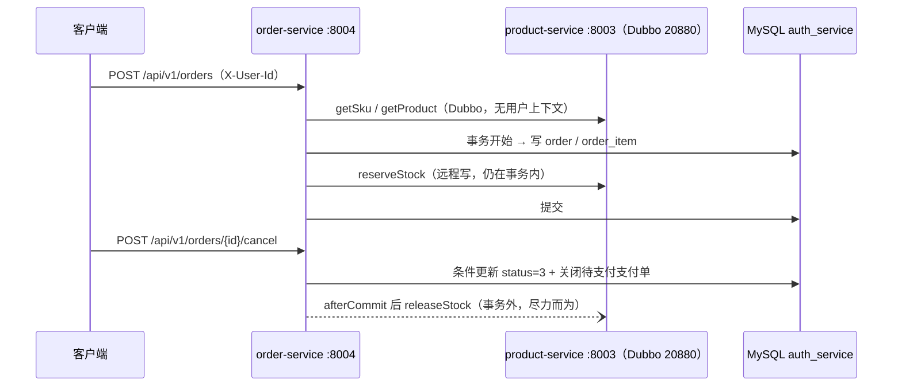

# product-service / order-service 接口测试文档

> 范围：product-service 17 个、order-service 6 个对外 HTTP 接口（不含 Dubbo RPC、定时任务、内部补偿逻辑）。
> 内容按代码逐字段核对：`ProductController`、`SkuController`、`OrderController`、`PaymentController`、各 `*Request` / `*VO`、两个服务的 `ErrorCode` / `GlobalExceptionHandler`、`gateway-service/src/main/resources/application.yml`。
> 统一响应信封与错误码编号规则见 [`../README.md`](../README.md) §5.1、§5.3，本文不复制表格，只在用例行内标注实际命中的 `code`。

---

## 1. 测试环境与前置

### 1.1 组件与端口

| 组件 | 地址 | 本文相关用途 |
| --- | --- | --- |
| MySQL 8 | `localhost:3306/auth_service` | product / order 同库不同表：`product`、`sku`、`inventory`、`order`、`order_item`、`payment_order`、`payment_record` |
| Redis | `localhost:6379` | 网关令牌桶限流、JWT 黑名单 |
| Nacos | `localhost:8848` | Java 服务发现；网关用 `lb://` 路由到 product / order |
| gateway-service | `localhost:8000` | 统一入口，校验 JWT 并注入身份头 |
| product-service | `localhost:8003`（Dubbo `20880`） | 商品 / SKU / 价格 / 库存 |
| order-service | `localhost:8004` | 订单 / 支付回调 |

Go 三服务（9001 / 9002 / 9003）不在本文范围；网关对它们是直连 `uri`，未接 Nacos。

### 1.2 两种访问方式

| 方式 | 基址 | 鉴权 |
| --- | --- | --- |
| 经网关（贴近真实链路） | `http://localhost:8000` | 需 `Authorization: Bearer <jwt>`；网关校验 JWT 后把 `sub` 写入 `X-User-Id`、`role` 写入 `X-User-Role` 转发下游 |
| 直连服务（联调、排障） | `http://localhost:8003` / `:8004` | 服务**不解析 JWT**，必须手工带 `-H "X-User-Id: 1001"`，否则 `401 / 40101`；直连可伪造该头，生产须在网络层禁止 |

### 1.3 身份与授权约定

| 项 | 约定 |
| --- | --- |
| uid 来源 | JWT 标准 claim `sub`，网关固定从 `sub` 取值（`gateway.auth.jwt` 下已无 `user-id-claim` 配置项） |
| 角色来源 | `role` claim，claim 名由 `gateway.auth.jwt.role-claim: role` 指定（取值 `ADMIN` / `user`，缺失按 `user`） |
| 下游可见头 | 仅 `X-User-Id` / `X-User-Role`，网关**先清后写**，客户端伪造无效（根 README §5.2） |
| 缺身份头 | `401 / 40101`（product / order 一致） |
| 角色不足 | `403 / 40301`（两服务都预留了 `FORBIDDEN`，当前只有 product 的归属校验会命中） |
| 商品归属 | 12 个写接口要求 `product.uid == X-User-Id`；SKU / 价格 / 库存按**所属商品**判定，见 `product-service/.../support/ProductOwnership.java` |
| 订单归属 | 查他人订单返回 `404 / 40401` 而非 403，刻意不暴露存在性（`order-service/.../support/OrderLookup.java`） |

### 1.4 网关白名单（只列与本文相关的 3 条）

完整路由表见 [`../README.md`](../README.md) §5.4。本文用例只受以下白名单影响：

| 白名单项 | 实际放行 | 不放行 |
| --- | --- | --- |
| `GET /api/v1/products/*` | 仅 `/products/{id}` | `/products/{id}/skus`（且它是 POST） |
| `GET /api/v1/skus/*` | 仅 `/skus/{id}` | `/skus/{id}/price`、`/skus/{id}/stock`（Ant `*` 只匹配单段） |
| `POST /api/v1/payments/callback` | 全放行（渠道无令牌），该分支会清掉 `uid` / `X-User-Id` / `X-User-Role` | — |

`/api/v1/orders/**` **不在白名单**，全部需要 JWT。

### 1.5 获取 JWT

```powershell
curl.exe -X POST http://localhost:8000/api/v1/auth/login `
  -H "Content-Type: application/json" `
  -d '{"type":"PHONE","target":"13800000001","password":"Aa123456"}'
```

```json
{ "code": 0, "message": "success",
  "data": { "uid": "1001", "accessToken": "eyJhbGciOiJIUzI1NiJ9....", "refreshToken": "eyJhbGciOiJIUzI1NiJ9....",
            "accessTokenExpiresIn": 1800, "refreshTokenExpiresIn": 604800 } }
```

Access Token 30 分钟、Refresh Token 7 天（`auth-service/.../application.yml`：`AUTH_ACCESS_TOKEN_TTL_SECONDS:1800`、`AUTH_REFRESH_TOKEN_TTL_SECONDS:604800`）。

```powershell
$BASE_GW = "http://localhost:8000"
$TOKEN   = "<上一步的 accessToken>"
$AUTH    = @("-H", "Authorization: Bearer $TOKEN")
$OWNER   = @("-H", "X-User-Id: 1001")     # 直连 8003 / 8004 时的身份头
```

### 1.6 断言约定

- 失败响应只有 `{code,message}`：`data` 为 `null` 时被 `non_null` 丢掉（根 README §5.1），**不要断言 `"data": null`**。例外是**网关自己**返回的 401：`{"code":40101,"message":"Missing JWT token","data":null}` 由 `JwtAuthenticationFilter` 手写字符串，带 `data`；429 则完全没有响应体。
- 参数校验 message = `字段名 + 空格 + 注解消息`，多字段用 `"; "` 拼接，数组元素带下标（`items[0].quantity ...`），见 `GlobalExceptionHandler#describe`。
- 金额一律为分（`Long`，`1399800` = 13998.00 元）；时间序列化为 `2026-09-22T10:30:00`（`Asia/Shanghai`）。
- 业务编号 `P…` / `S…` / `O…` 与内部主键（纯数字）互相等价，由 `EntityLookup` / `OrderLookup` 统一解析。

### 1.7 代表性 curl（每接口只留这 3 条，其余按 §3 / §4 的 method + path + body 拼）

```powershell
# P1 创建商品：创建者只来自 X-User-Id，body 里的 uid 会被忽略
curl.exe -X POST http://localhost:8003/api/v1/products `
  -H "X-User-Id: 1001" -H "Content-Type: application/json" `
  -d '{"name":"iPhone 17","description":"新品首发","productType":1}'

# P15 预占库存（P14 / P16 / P17 只改路径末段）
curl.exe -X POST http://localhost:8003/api/v1/skus/S2QP9Z0L4/stock/reserve `
  -H "X-User-Id: 1001" -H "Content-Type: application/json" -d '{"quantity":2}'

# O1 下单（经网关；直连则换 :8004 并补 -H "X-User-Id: 1001"）
curl.exe -X POST $BASE_GW/api/v1/orders `
  -H "Authorization: Bearer $TOKEN" -H "Content-Type: application/json" `
  -d '{"items":[{"skuId":"S2QP9Z0L4","quantity":2}]}'
```

shell 吞掉 JSON 双引号时改用文件体：`'{"name":"iPhone 17","productType":1}' | Set-Content -Encoding utf8 body.json`，再 `--data-binary "@body.json"`。

### 1.8 前置检查

1. **建表**：`product-service/src/main/resources/db/schema.sql` 与 `order-service/.../db/schema.sql` 都落在 `auth_service` 库（5 个 Java 服务共库、按表名区分），需手工执行，服务不会自动建业务表。
2. **启动顺序**：MySQL / Redis / Nacos → product-service（order 依赖其 Dubbo `20880`）→ order-service → gateway-service。
3. **回调密钥**：`PAYMENT_CALLBACK_SECRET` 非空才会验签（§5.2）；不设时验签被跳过，负例失去意义。
4. **定时任务**：`order.task.enabled=true`（默认）时超时订单会被后台取消；做「订单已超时」用例时先把库里 `expire_at` 改到过去并立刻调 `pay`，或临时关闭任务。
5. **两个 uid**：准备创建者（如 `1001`）与他人（如 `9999`），后者用于 `403 / 40301` 与「他人订单 → 404」用例。

---

## 2. 请求体字段约束

`!` = 必填。校验消息即响应 `message`（前面会自动拼字段名）。

| 接口 | 字段 | 必填 | 约束 / 校验消息 |
| --- | --- | --- | --- |
| P1 创建商品 | `name` | ! | `@NotBlank` 商品名称不能为空；`@Size(128)` 商品名称长度不能超过128 |
| | `description` | | `@Size(500)` 商品描述长度不能超过500 |
| | `coverUrl` | | `@Size(512)` 商品封面地址长度不能超过512 |
| | `productType` | ! | `@NotNull` 商品类型不能为空；非 1/2 → `40001` 非法的商品类型: 3（1-实物 2-虚拟） |
| P3 修改商品 | `name` / `description` / `coverUrl` / `productType` | 全否 | 字段为 `null` 表示不修改；`{}` → `40001` 没有需要更新的字段；`name` 纯空白 → `40001` 商品名称不能为空；`productType` 非 1/2 → `40001` |
| P7 创建 SKU | `name` | ! | SKU名称不能为空 / SKU名称长度不能超过128 |
| | `price` | ! | 单位分；`0 ≤ price ≤ 99999999999`（售价不能小于0 / 售价超出允许范围） |
| | `initialStock` | | `≥0`，不传按 `0` 处理（初始库存不能小于0） |
| P9 修改 SKU | `name` / `status` | 全否 | `status` 只允许 `0`-禁用 `1`-启用，越界 → `40001` status SKU状态只能是0或1 |
| P12 修改价格 | `price` | ! | 单位分；`0 ≤ price ≤ 99999999999`（价格不能为空 / 价格不能小于0 / 价格超出允许范围） |
| P14–P17 库存 | `quantity` | ! | `≥1`（库存数量不能为空 / 库存数量必须大于0） |
| O1 创建订单 | `items` | ! | 非空、`≤50` 项（订单商品不能为空 / 单个订单最多包含50个SKU） |
| | `items[].skuId` | ! | `≤32`（SKU编号不能为空 / SKU编号长度不能超过32） |
| | `items[].quantity` | ! | `1 ≤ quantity ≤ 999`（购买数量至少为1 / 单个SKU购买数量不能超过999） |
| O5 创建支付单 | `paymentChannel` | ! | `1`-微信 `2`-支付宝 `3`-余额（支付渠道不能为空；非 1/2/3 → `40001` 非法的支付渠道: 9） |
| O6 支付回调 | `paymentId` / `transactionId` / `paymentChannel` / `tradeStatus` / `amount` / `sign` | 全部 ! | 见 §5 |

订单请求体**不接受价格**：单价与商品名由服务端经 Dubbo 读 product-service 后快照进 `order_item`。

---

## 3. 用例矩阵：product-service（17 接口）

`{id}` 支持内部主键（纯数字）与业务编号（`P…` 商品 / `S…` SKU）。

| # | 接口 | 请求体摘要 | 正常（200） | 关键失败（code） |
| --- | --- | --- | --- | --- |
| P1 | `POST /api/v1/products` | `{name!,description?,coverUrl?,productType!}` | `data.product`：`productId=P…`、`uid`= 头里的值、`status=0`（下架）、`skus=[]` | 缺 `X-User-Id` → 401/`40101`；`name` 缺 → 400/`40001`；`productType=3` → 400/`40001`；body 带 `uid` 被忽略（仍取头） |
| P2 | `GET /api/v1/products/{id}` | 无 | `{product, skus[]}`，每个 SKU 带 `availableStock` / `lockedStock` 快照 | 不存在 / 已逻辑删除 → 404/`40401` |
| P3 | `PUT /api/v1/products/{id}` | `{name?,description?,coverUrl?,productType?}` | 返回更新后详情，`updatedAt` 刷新 | 他人 uid → 403/`40301`；`{}` → 400/`40001`；`productType=9` → 400/`40001` |
| P4 | `DELETE /api/v1/products/{id}` | 无 | `{code:0,message}`（无 `data`），级联逻辑删其下 SKU | 上架中 → 409/`40901`；他人 uid → 403/`40301`；已删 → 404/`40401` |
| P5 | `POST /api/v1/products/{id}/on-shelf` | 无 | `product.status=1` | 无启用 SKU → 409/`40901`；已上架 → 409/`40901` |
| P6 | `POST /api/v1/products/{id}/off-shelf` | 无 | `product.status=0` | 已下架 → 409/`40901`；他人 uid → 403/`40301` |
| P7 | `POST /api/v1/products/{id}/skus` | `{name!,price!,initialStock?}` | `skuId=S…`、`status=1`、`availableStock=initialStock`、`lockedStock=0` | `price` 缺 / `-1` → 400/`40001`；`initialStock=-1` → 400/`40001`；商品不存在 → 404/`40401` |
| P8 | `GET /api/v1/skus/{id}` | 无 | `SkuVO`（同 P7 的 `data`） | 不存在 / 已删 → 404/`40402` |
| P9 | `PUT /api/v1/skus/{id}` | `{name?,status?}` | 名称 / 启停变更，价格与库存不变 | `{}` → 400/`40001`；`status=2` 或 `3` → 400/`40001`；他人 uid → 403/`40301`；不存在 → 404/`40402` |
| P10 | `DELETE /api/v1/skus/{id}` | 无 | `{code:0,message}`（无 `data`） | 商品上架中 → 409/`40902`；`lockedStock>0` → 409/`40902`；不存在 → 404/`40402` |
| P11 | `GET /api/v1/skus/{id}/price` | 无 | `{skuId, price, currency:"CNY", updatedAt}` | 不存在 → 404/`40402` |
| P12 | `PUT /api/v1/skus/{id}/price` | `{price!}` | 返回新价格；同价重复提交 200 且跳过 UPDATE（幂等） | `price` 缺 / `-1` → 400/`40001`；他人 uid → 403/`40301` |
| P13 | `GET /api/v1/skus/{id}/stock` | 无 | `{skuId, availableStock, lockedStock, updatedAt}` | 不存在 → 404/`40402` |
| P14 | `POST /api/v1/skus/{id}/stock/increase` | `{quantity!}` | `available +q`，`locked` 不变 | `quantity=0` / 缺 → 400/`40001`；他人 uid → 403/`40301` |
| P15 | `POST /api/v1/skus/{id}/stock/reserve` | `{quantity!}` | `available -q`、`locked +q` | 可用不足 → 409/`40903`；他人 uid → 403/`40301` |
| P16 | `POST /api/v1/skus/{id}/stock/release` | `{quantity!}` | `available +q`、`locked -q` | 锁定不足 → 409/`40904`；他人 uid → 403/`40301` |
| P17 | `POST /api/v1/skus/{id}/stock/confirm` | `{quantity!}` | `locked -q`，`available` 不变（真正消耗） | 锁定不足 → 409/`40904`；他人 uid → 403/`40301` |

- 只读接口 P2 / P8 / P11 / P13 **不校验归属**，他人商品也能看。
- 写接口 P3–P7、P9、P10、P12、P14–P17（共 12 个）要求 `product.uid == X-User-Id`，否则 `403 / 40301`，`message = 无权操作他人商品: {productId}`；`ADMIN` 角色也不能绕过。
- Dubbo 侧 `ProductRpcService` / `StockRpcService` 供 order-service 交易链路使用，**没有用户上下文、不做归属校验**，不属本文范围。

### 3.1 响应样例（P2 商品详情）

```json
{ "code": 0, "message": "success",
  "data": {
    "product": { "id": 1, "productId": "P2QP7K3M1", "uid": "1001", "name": "iPhone 17", "description": "新品首发",
                 "coverUrl": "https://cdn.example.com/1.png", "productType": 1, "status": 1,
                 "createdAt": "2026-09-22T10:00:00", "updatedAt": "2026-09-22T10:30:00" },
    "skus": [ { "id": 1, "skuId": "S2QP9Z0L4", "productDbId": 1, "name": "256G 黑色", "price": 1399800,
                "status": 1, "availableStock": 10, "lockedStock": 0,
                "createdAt": "2026-09-22T10:05:00", "updatedAt": "2026-09-22T10:05:00" } ] } }
```

- P1 / P3 / P5 / P6 返回同一个 `ProductDetailVO`（`{product, skus[]}`）；P7 / P8 / P9 返回单个 `SkuVO`。
- `SkuVO.productDbId` 是商品**内部主键**，`ProductVO.productId` 是业务编号，同名不同义的历史坑已按前者改名。
- 未传 `description` / `coverUrl` 时字段整体消失（`non_null`），断言用 `hasJsonPath` 而非比对完整 JSON。

---

## 4. 用例矩阵：order-service（6 接口）

| # | 接口 | 请求体摘要 | 正常（200） | 关键失败（code） |
| --- | --- | --- | --- | --- |
| O1 | `POST /api/v1/orders` | `{items:[{skuId!,quantity!}]}` | `status=0`、`statusName=待支付`、`expireAt = now + 30min`（`order.expire-minutes`）、`totalAmount = 单价 × 数量`、`items` 为服务端快照 | 缺头 → 401/`40101`；`items` 空 → 400/`40001`；同一 `skuId` 两次 → 400/`40001`；SKU 不存在 → 404/`40404`；SKU 禁用 → 409/`40903`；商品未上架 → 409/`40902`；库存不足 → 409/`40904`；product 不可达 → 503/`50001` |
| O2 | `GET /api/v1/orders?status=&page=&size=` | 无 | `{page, size, total, list[]}`（`PageVO`） | `status=9` → 400/`40001`（先校验，不返回空列表） |
| O3 | `GET /api/v1/orders/{id}` | 无 | 单个 `OrderVO`（同 O1 的 `data`） | 不存在 / 他人订单 → 404/`40401` |
| O4 | `POST /api/v1/orders/{id}/cancel` | 无 | `status=3`、`statusName=已取消`、`cancelledAt` 有值；待支付支付单被置为已关闭（`2`） | 非待支付 → 409/`40901`；并发重复取消 → 409/`40901` 订单状态已变更，请刷新后重试 |
| O5 | `POST /api/v1/orders/{id}/pay` | `{paymentChannel!}` | `paymentId=P…`、`amount` = 订单金额、`status=0`、`statusName=待支付`、`expireAt` 与订单一致 | 非待支付 → 409/`40901`；已超时 → 409/`40905`；渠道非法 → 400/`40001`；他人订单 → 404/`40401` |
| O6 | `POST /api/v1/payments/callback` | 见 §5 | `{code:0,message}`，随后订单流转、库存确认扣减、写回调流水 | 验签失败 400/`40002`；支付单不存在 404/`40402`；渠道不符 409/`40907`；金额不符 409/`40906`；流水号被占 409/`40908` |

O2 的分页是**归一化**而非报错：`page<1` 按 1、`size≤0` 按 10、`size>50` 按 50（`OrderServiceImpl`），所以 `size=999` 回显 `50`、`page=0` 回显 `1`；`status` 仅接受 `0/1/2/3`。

### 4.1 响应样例（O1 创建订单）

```json
{ "code": 0, "message": "success",
  "data": { "id": 1, "orderId": "O2QQ1A7X5", "uid": "1001", "status": 0, "statusName": "待支付",
            "totalAmount": 2599800, "expireAt": "2026-09-22T11:00:00",
            "createdAt": "2026-09-22T10:30:00", "updatedAt": "2026-09-22T10:30:00",
            "items": [ { "id": 1, "productId": "P2QP7K3M1", "skuId": "S2QP9Z0L4", "productName": "iPhone 17 Pro",
                         "skuName": "256G 黑色", "unitPrice": 1299900, "quantity": 2, "totalAmount": 2599800 } ] } }
```

`OrderVO` 的 `paidAt` / `completedAt` / `cancelledAt` 只在对应状态出现，未到该状态时字段缺失而不是 `null`。`PaymentVO`（O5 返回）字段：`id`、`paymentId`、`orderId`、`uid`、`amount`、`status`、`statusName`、`paymentChannel`、`paymentChannelName`、`transactionId`、`expireAt`、`paidAt`、`createdAt` —— 创建时 `transactionId` 与 `paidAt` 缺失，回调成功后才出现。

---

## 5. 支付回调 O6：验签与状态机

### 5.1 请求体

| 字段 | 必填 | 约束 / 校验消息 |
| --- | --- | --- |
| `paymentId` | 是 | 非空，`≤32`（支付单号不能为空 / 支付单号长度不能超过32） |
| `transactionId` | 是 | 非空，`≤128`；`payment_order.uk_transaction_id` 全局唯一（渠道流水号不能为空） |
| `paymentChannel` | 是 | `1/2/3`，必须与支付单一致（支付渠道不能为空） |
| `tradeStatus` | 是 | 枚举 `SUCCESS` / `FAILED`；缺 → `tradeStatus 回调结果不能为空`，非法值 → 400/`40001` 请求体格式不正确 |
| `amount` | 是 | `≥1`，必须与支付单金额相等，单位分（支付金额不能为空 / 支付金额必须大于0） |
| `sign` | 是 | 非空，`≤128`，小写十六进制 HMAC-SHA256（签名不能为空 / 签名长度不能超过128） |

### 5.2 签名算法（`PaymentSigner`）

```
canonical = "amount={amount}&paymentChannel={paymentChannel}&paymentId={paymentId}&tradeStatus={tradeStatus}&transactionId={transactionId}"
sign      = hex(HmacSHA256(secret, canonical))       # 十六进制小写
```

字段按**字段名升序**拼接、值为原始字面量（`tradeStatus` 用枚举名）；密钥 = `order.payment.callback-secret`（环境变量 `PAYMENT_CALLBACK_SECRET`）。

> 密钥默认为**空串**（`order.payment.callback-secret: ${PAYMENT_CALLBACK_SECRET:}`），此时 `PaymentSigner` **跳过验签**并打 WARN。
> 因此下方「验签失败」用例必须先配密钥再启动，否则非法签名也会返回 200：

```powershell
$env:PAYMENT_CALLBACK_SECRET = "order-service-callback-secret"   # 启动 order-service 之前设置
```

验签是这条免登录链路**唯一**的鉴权手段（回调路径在网关白名单里），生产必须配置且只允许渠道 IP 访问。

### 5.3 正负例

| 用例 | 构造 | 预期 |
| --- | --- | --- |
| 正例 SUCCESS | canonical 正确 + 正确 `sign` | 200 `{code:0}`；订单 `0→1→2`、`paidAt` / `completedAt` 有值；`inventory.locked_stock -2`（可用不变）；`payment_record` 新增一条 `callback_status=1` |
| 正例 FAILED | `tradeStatus=FAILED` + 对应 `sign` | 200；支付单 `status=3`（支付失败），订单仍 `0`，用户可重新 O5 |
| 负例 签名错误 | `sign` 改一位，或改 `amount` 后仍用旧 `sign` | 400/`40002` `支付回调签名校验失败: paymentId=P…`，且**不写流水** |
| 负例 未配密钥 | 不设 `PAYMENT_CALLBACK_SECRET`，发任意非法 `sign` | 200 —— 验签被跳过，属环境配置错误，不能记为通过 |
| 负例 支付单不存在 | 正确 `sign` + 随机 `paymentId` | 404/`40402` `支付单不存在: P-XXX` |
| 负例 渠道不符 | 支付单是 1，回调传 2 | 409/`40907` `支付渠道与支付单不一致: 回调=2, 支付单=1` |
| 负例 金额不符 | 支付单 2599800，回调 100 | 409/`40906` `回调金额与支付单金额不一致: 支付单=2599800, 回调=100` |
| 负例 流水号被占 | 同一 `transactionId` 用于另一张支付单 | 409/`40908` `渠道流水号已被其它支付单占用: WX-TEST-0001` |
| 负例 缺 `sign` | 去掉 `sign` 字段 | 400/`40001` `sign 签名不能为空` |

验签与发送：

```powershell
$secret='order-service-callback-secret'; $paymentId='P2QQ4B9N2'; $transactionId='WX-TEST-0001'
$paymentChannel=1; $tradeStatus='SUCCESS'; $amount=2599800
$canonical="amount=$amount&paymentChannel=$paymentChannel&paymentId=$paymentId&tradeStatus=$tradeStatus&transactionId=$transactionId"
$hmac=[System.Security.Cryptography.HMACSHA256]::new([Text.Encoding]::UTF8.GetBytes($secret))
$sign=[BitConverter]::ToString($hmac.ComputeHash([Text.Encoding]::UTF8.GetBytes($canonical))).Replace('-','').ToLower()

$body='{"paymentId":"' + $paymentId + '","transactionId":"' + $transactionId + '","paymentChannel":' + $paymentChannel + ',"tradeStatus":"' + $tradeStatus + '","amount":' + $amount + ',"sign":"' + $sign + '"}'
curl.exe -X POST $BASE_GW/api/v1/payments/callback -H "Content-Type: application/json" -d $body
```

### 5.4 处理顺序（断言顺序的依据）

固定顺序：**验签 → 支付单存在 → 渠道一致 → 已支付则直接确认（幂等） → FAILED 分支 → 金额 → 流水号唯一 → `mark_paid` 条件更新 → 驱动订单状态机 → 留痕**（`PaymentServiceImpl#handleCallback`）。三个由此而来的断言方向：

1. 已支付的支付单重复回调会**跳过金额校验**，即使 `amount` 不同也返回 200（幂等优先于校验）。
2. 渠道校验在金额校验之前，同时错时先报 `40907`。
3. 验签失败发生在任何写入之前，所以「不写流水」是可断言的。

---

## 6. 并发与幂等用例

| 场景 | 操作 | 期望 | 依据 |
| --- | --- | --- | --- |
| 并发预占不超卖 | N 个并发 `reserve`，合计 > 可用库存 | 成功者的合计不超过可用；其余 409/`40903`，库中不出现负库存 | `InventoryMapper.xml` 用条件 UPDATE `... AND available_stock >= #{quantity}`，影响行数 0 即失败（无 Redis / Lua 参与扣减） |
| 重复创建支付单（串行） | 同一订单连续两次 O5 | 200，返回**同一个** `paymentId`，不新建 | `PaymentServiceImpl`：已存在待支付支付单直接复用 |
| 重复创建支付单（并发） | 同订单两线程同时 O5 | 可能生成两张待支付支付单（先查后插，`payment_order` 上无可用唯一键） | 已记录的取舍；生产建议 MySQL 8 生成列 + 唯一索引 |
| 重复回调 | 同 `transactionId` 再发一次（已支付） | 200 `{code:0}`，`payment_record` 再记一条成功流水，订单与库存不再变化 | 幂等分支直接确认，让渠道停止重试 |
| 并发回调 | 两线程同 `paymentId` + `transactionId` | 只有一个线程的 `mark_paid` 影响行数为 1，另一个 200 且不改状态 | 状态流转全部走条件更新 |
| 渠道流水号抢单 | 同一 `transactionId` 给两张支付单 | 先到者成功，后到 409/`40908`；并发下唯一键兜底为 409/`40909` | 显式校验 + `uk_transaction_id` |
| 取消与支付竞争 | 取消订单的同时回调到账 | 一方生效：先取消则支付单已被置为关闭（`2`），后到回调走 `mark_paid`（`AND status = 0`）影响 0 行 → 返回 200 但订单仍 `3`、库存不变；先支付成功则取消报 409/`40901` | `mark_cancelled` / `mark_paid` 条件更新 + 取消时关闭待支付支付单 |
| 重复取消 | 连续两次 O4 | 第二次 409/`40901` `订单当前状态不允许取消: 已取消` | 状态机前置校验 |
| 重复确认扣减 | 同订单 P17 两次 | 第二次 409/`40904`（锁定已被消耗） | 条件 UPDATE `AND locked_stock >= #{quantity}` |
| 下单本身不幂等 | 客户端超时重试 O1 | 生成两张订单并预占两次库存（无 `Idempotency-Key`） | `OrderServiceImpl` 类注释中的已知取舍 |

### 6.1 库存串行验证脚本（初始 `available=10` / `locked=0`）

| 步骤 | 操作 | 期望 `availableStock` / `lockedStock` |
| --- | --- | --- |
| 1 | P14 `increase 100` | 110 / 0 |
| 2 | P15 `reserve 2` | 108 / 2 |
| 3 | P16 `release 2` | 110 / 0 |
| 4 | P15 `reserve 5` | 105 / 5 |
| 5 | P17 `confirm 5` | 105 / 0（总库存由 110 变 105） |

断言方向最容易写反的三处：`confirm` 只减 `locked`、`available` 不动；`reserve` 是「可用 → 锁定」不是「扣减」；判断总库存一律看 `availableStock + lockedStock`。

---

## 7. 错误码 ↔ 触发用例

编号规则（40001 参数 / 40101 未认证 / 40301 无权限 / 404xx 不存在 / 409xx 冲突 / 42901 限流 / 50000 内部 / 50001 远程失败、媒体段 6xxxx–8xxxx）见 [`../README.md`](../README.md) §5.3。下表只列本文用例实际命中的 code：

| HTTP / code | product-service | order-service |
| --- | --- | --- |
| 400 / `40001` | 参数缺失或越界、非法商品类型、`status` 越界、空更新体、请求体非 JSON | 参数缺失或越界、重复 SKU、非法订单状态 / 支付渠道、请求体非 JSON |
| 400 / `40002` | — | 回调签名校验失败 |
| 401 / `40101` | 直连未带 `X-User-Id` | 同左（`/orders/**` 不在白名单） |
| 403 / `40301` | 非创建者调 P3–P7、P9、P10、P12、P14–P17 | 无接口触发（`FORBIDDEN` 已预置） |
| 404 / `40401` | 商品不存在 / 已删除 | 订单不存在 / 他人订单 |
| 404 / `40402` | SKU 不存在 | 支付单不存在 |
| 404 / `40403` | 库存记录不存在（`inventory` 缺行） | 商品不存在（RPC 返回 null） |
| 404 / `40404` | — | 下单时 SKU 不存在 |
| 409 / `40901` | 无启用 SKU 上架、重复上架 / 下架、上架中删除、状态并发变更 | 取消 / 支付非待支付订单 |
| 409 / `40902` | 上架中删 SKU、SKU 有订单锁定库存 | 商品未上架 |
| 409 / `40903` | 可用库存不足（`reserve`） | SKU 不可售（禁用 / 未设价格） |
| 409 / `40904` | 锁定库存不足（`release` / `confirm`） | 下单库存不足（预占失败，已成功部分补偿释放） |
| 409 / `40905`～`40909` | 仅 `40909`：唯一键冲突兜底 | `40905` 订单超时、`40906` 金额不符、`40907` 渠道不符、`40908` 流水号被占、`40909` 唯一键冲突 |
| 429 / 无 body | 网关令牌桶限流（全局 + 按 IP，Redis + Lua）；直接 `setComplete()` 断连，**没有响应体**，也不是统一信封 | 同左（`42901` 只出现在 auth-service 登录限流，本文两个服务不返回） |
| 500 / `50000` | 未捕获异常（含 `page=abc` 这类类型不匹配） | 未捕获异常 |
| 503 / `50001` | — | product-service 不可达（`调用商品服务失败: getSku`） |

### 7.1 失败用例的断言文案（可直接抄进测试）

| 接口 | 触发条件 | `message` |
| --- | --- | --- |
| 所有需登录接口 | 直连未带 `X-User-Id` | `缺少用户身份信息，请通过网关登录后访问` |
| P3–P7、P9、P10、P12、P14–P17 | `X-User-Id` ≠ 商品创建者 | `无权操作他人商品: P2QP7K3M1` |
| P1 | 缺 `name` / `productType=3` | `name 商品名称不能为空` / `非法的商品类型: 3（1-实物 2-虚拟）` |
| P2 / P3 | 商品不存在或已删 | `商品不存在: P-NOT-EXIST` |
| P3 | `{}` / `name` 纯空白 | `没有需要更新的字段` / `商品名称不能为空` |
| P4 | 商品上架中 | `商品处于上架状态，请先下架再删除` |
| P5 | 无启用 SKU / 已上架 | `商品下没有启用中的SKU，无法上架` / `商品已处于上架状态` |
| P6 | 已下架 | `商品已处于下架状态` |
| P7 | `price` 缺 / 负数 / 超上限 | `price 售价不能为空` / `price 售价不能小于0` / `price 售价超出允许范围` |
| P7 | `initialStock=-1` | `initialStock 初始库存不能小于0` |
| P9 | `status` 非 0/1（含 `2`、`3`） | `status SKU状态只能是0或1` |
| P10 | 商品上架中 / 有锁定库存 | `商品处于上架状态，请先下架商品再删除SKU` / `SKU存在订单锁定的库存，无法删除` |
| P12 | `price` 缺 / 负数 | `price 价格不能为空` / `price 价格不能小于0` |
| P14–P17 | `quantity` 缺 / `0` | `quantity 库存数量不能为空` / `quantity 库存数量必须大于0` |
| P15 | 可用不足 | `可用库存不足，当前可用 105，本次需要 999` |
| P16 / P17 | 锁定不足 | `锁定库存不足，当前锁定 0，本次需要释放 2`（`confirm` 为「本次需要确认 2」） |
| O1 | `items` 空 / 数量越界 | `items 订单商品不能为空` / `items[0].quantity 购买数量至少为1` / `items[0].quantity 单个SKU购买数量不能超过999` |
| O1 | 同一 SKU 重复 | `同一SKU不能重复提交: S2QP9Z0L4` |
| O1 | SKU 不存在 / 禁用 / 无价格 | `SKU不存在: S-XXX` / `SKU当前不可售: S2QP9Z0L4` / `SKU未设置价格: S2QP9Z0L4` |
| O1 | 商品未上架 / 库存不足 | `商品未上架: iPhone 17 Pro` / `库存不足: 256G 黑色 x2` |
| O1 | product-service 不可达 / 请求体非 JSON | `调用商品服务失败: getSku` / `请求体格式不正确` |
| O2 | `status` 非法 | `非法的订单状态: 9` |
| O3 / O4 / O5 | 订单不存在或不属于当前 uid | `订单不存在: O-XXX` |
| O4 | 状态不允许取消 | `订单当前状态不允许取消: 已支付` |
| O4 | 并发重复取消 | `订单状态已变更，请刷新后重试` |
| O5 | 状态不允许支付 / 已超时 | `订单当前状态不可支付: 已取消` / `订单已超时，请重新下单` |
| O5 | 渠道非法 / 缺渠道 | `非法的支付渠道: 9` / `paymentChannel 支付渠道不能为空` |
| O6 | 验签 / 支付单 / 渠道 / 金额 / 流水号 | 见 §5.3 正负例表 |

---

## 8. 关键断言与根因



| 断言点 | 期望 | 根因 |
| --- | --- | --- |
| P4 / P10 删除成功的响应体 | 只有 `{code,message}` | `data=null` 被 `non_null` 丢弃，断言不能写 `"data": null` |
| P12 幂等 | 同价重复提交 200，`updatedAt` 不变 | 先比价，相同则跳过 UPDATE（`PriceServiceImpl`） |
| P3 / P9 重复提交 | 200，但 `updatedAt` 会变 | 无幂等键，只是再次执行 UPDATE |
| P9 `status=2` | 400/`40001` `status SKU状态只能是0或1` | `@Max(1)` 在进 Controller 前就拦下，service 里「删除请调用 DELETE 接口」分支 HTTP 侧走不到 |
| 库存「总量」 | `availableStock + lockedStock` | `reserve` 减可用加锁定、`confirm` 只减锁定、`release` 反向，看单列会误判 |
| 下单前置 | 商品 `status=1`、SKU `status=1`、SKU 有价格 | `OrderServiceImpl` 逐项校验；SKU 无价格同样报 `40903` |
| 下单金额 | 服务端按 RPC 价格重算 | 请求体不接受价格，明细是快照 |
| 预占失败 | 不留残留锁定 | `reserveStock` 捕获异常后对已成功项 `releaseQuietly` |
| 取消 / 超时后的库存 | 提交之后才变 | `releaseAfterCommit` 注册 `afterCommit`，避免事务回滚后重复释放造成超发 |
| 「订单已超时」用例 | 改库 `expire_at` 到过去再 O5 | `pay` 直接比较 `expireAt`，不必等定时任务（`OrderTimeoutTask` 默认 60s 扫描、批 100） |
| 分页越界 | `size=999` 回显 50、`page=0` 回显 1 | `Math.max/min` 归一化，不报错 |
| 压测时的 429 | 循环脚本必然命中 | 网关全局 10000 QPS、按 IP 100 QPS，可调 `GATEWAY_RATE_LIMIT_IP_REPLENISH_RATE` |

---

## 9. 端到端串联

主链路（`X-User-Id: 1001`，商品与订单必须同一 uid）：

| 步骤 | 操作 | 预期 |
| --- | --- | --- |
| 1 | P1 创建商品 | 200，`productId=P…`，`status=0`，`uid=1001` |
| 2 | P7 创建 SKU（`price=1299900`、`initialStock=10`） | 200，`skuId=S…`，库存 `10 / 0` |
| 3 | P5 上架 | 200，`product.status=1` |
| 4 | P2 商品详情 | 200，`skus[0].availableStock=10` |
| 5 | O1 下单 `quantity=2` | 200，`status=0`，`totalAmount=2599800`，`expireAt ≈ now+30min` |
| 6 | P13 查库存 | 200，`8 / 2` |
| 7 | O2 `status=0` | 200，`total ≥ 1` |
| 8 | O5 创建支付单 `paymentChannel=1` | 200，`paymentId=P…`，`amount=2599800`，`statusName=待支付` |
| 9 | O5 重复调用 | 200，`paymentId` 与第 8 步相同 |
| 10 | O6 成功回调（正确签名） | 200 `{code:0}` |
| 11 | O3 订单详情 | 200，`status=2`、`statusName=已完成` |
| 12 | P13 查库存 | 200，`8 / 0`（锁定 2 被确认扣减，可用不变） |
| 13 | P10 删除 SKU | 409/`40902`（商品在上架状态） |
| 14 | P6 下架 → P4 删除 → P2 详情 | 200；随后 404/`40401` |

取消链路（另建一单，`quantity=1`）：

| 步骤 | 操作 | 预期 |
| --- | --- | --- |
| 1 | O1 下单 | 200，`status=0`；查库存：可用 -1、锁定 +1 |
| 2 | O5 创建支付单（可选） | 200 |
| 3 | O4 取消 | 200，`status=3`、`cancelledAt` 有值；支付单 `status=2` |
| 4 | 查库存 | 200，可用 +1、锁定 -1（发生在提交之后） |
| 5 | O4 再次取消 | 409/`40901` `订单当前状态不允许取消: 已取消` |
| 6 | 用该订单调 O5 | 409/`40901` `订单当前状态不可支付: 已取消` |

---

## 10. 已知坑与取舍

1. **Ant `*` 只匹配单段**：`GET /api/v1/skus/*` 放行 `/skus/{id}`，不放行 `/skus/{id}/price`、`/skus/{id}/stock`；`GET /api/v1/products/*` 也不放行 `/products/{id}/skus`。若产品要求价格 / 库存对游客公开，白名单要改成 `GET /api/v1/skus/**`。
2. **白名单曾经整体错位**：早期 `permit-all` 写的是 `/api/v1/auth/refresh`、`/api/v1/auth/register`，而 `AuthController` 真实路径是 `/api/v1/auth/token/refresh`、`/api/v1/auth/register/phone`、`/api/v1/auth/register/email`，导致经网关刷新令牌 / 注册一律 401。现已逐字对齐（含 `/verification/send`），回归时以 `application.yml` 为准。
3. **回调验签默认关闭**：`callback-secret` 为空串时跳过验签（启动 WARN + 每次回调 WARN）。负例必须在配了 `PAYMENT_CALLBACK_SECRET` 的环境跑，默认值不能写进仓库（否则「已启用验签」只是假象）。
4. **远程调用仍在数据库事务里**：`handleCallback → markPaid → confirmStock` 的 Dubbo 调用跑在 `@Transactional` 内；`@Transactional` 挡不住远程调用，改进方向是 `afterCommit` 或本地消息表。
5. **预占与释放不对称，是有意设计**：预占在创建订单的事务内（失败随事务回滚），释放是不可回滚的远程副作用，所以挪到 `afterCommit`。
6. **下单没有幂等键**：客户端超时重试会产生两张订单、两次预占。要做到幂等需要 `Idempotency-Key` + 唯一索引，重试直接返回首次结果。
7. **支付单复用是「先查后插」**：并发下同一订单可能出现两张待支付支付单（`(order_id, status)` 不能做唯一键，因为 status 会变）。
8. **请求体解析失败的处理已一致**：两个服务的 `GlobalExceptionHandler` 都对 `HttpMessageNotReadableException` 返回 `400 / 40001 请求体格式不正确`；仍会落到 500 的是 `MethodArgumentTypeMismatchException` 一类（如 `?page=abc`），两服务都没单独处理。
9. **`X-User-Id` 只在链路可信时才可信**：直连 8003 / 8004 可伪造身份，生产必须在网络层禁止绕过网关。
10. **测试现状**：只有 MockMvc + H2 的 Web 层测试（product 19 例、order 16 例），没有 Testcontainers 集成测试；H2 用 `MODE=MySQL`，order 侧还要 `NON_KEYWORDS=ORDER`（`order` 是保留字），MySQL 8 特有语法（生成列、`ON UPDATE`）在 H2 上不等价，**不能替代真库验证**。

---

## 11. 运行命令

```powershell
cd product-service; mvn test      # ProductHttpApiTest 4 / ProductDomainIntegrationTest 9 / CurrentUserTest 6
cd order-service;   mvn test      # OrderHttpApiTest 4 / OrderDomainIntegrationTest 7 / PaymentSignerTest 4 / OrderRpcWiringTest 1
cd product-service; mvn -Dtest=ProductHttpApiTest test
cd order-service;   mvn -Dtest=PaymentSignerTest test
```

测试 profile 已把 Nacos 关掉、改用 H2（`src/test/resources/application-test.yml`），order 侧 `callback-secret: test-callback-secret`、`order.task.enabled=false`、`order.rpc.product-url` 指向不可达的 `127.0.0.1:20999`（保证 `OrderRpcWiringTest` 稳定断言 `50001`）。

手工验证回调链路（需先在启动 order-service 前设好密钥）：

```powershell
$env:PAYMENT_CALLBACK_SECRET = "order-service-callback-secret"
# 然后按 §5.3 的脚本算 sign 并发送
```
