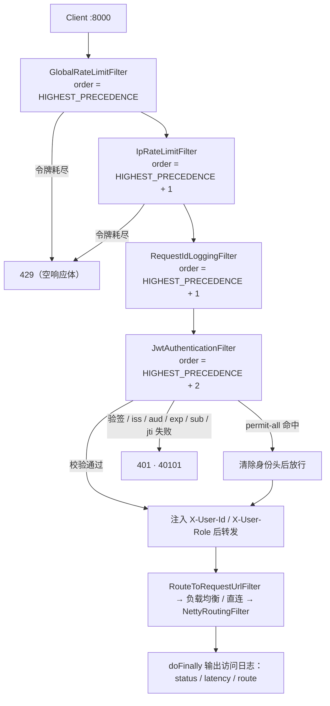
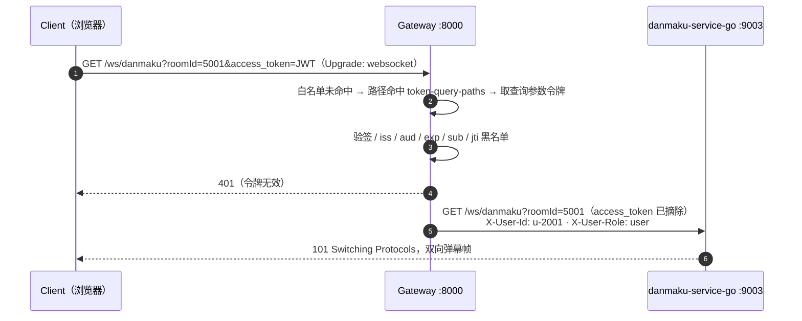
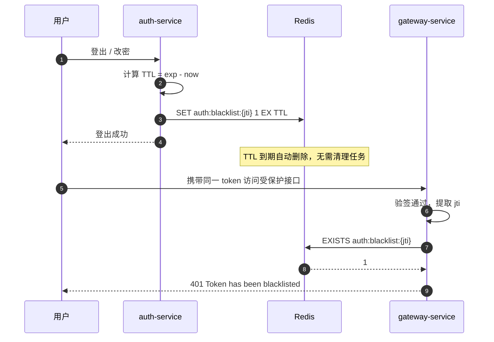
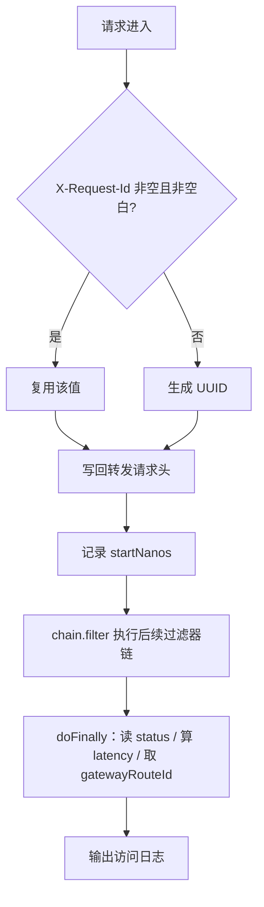
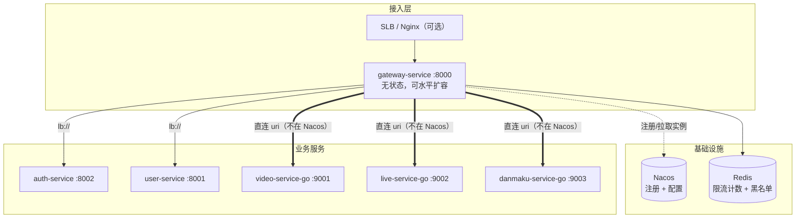

# 网关技术方案（gateway-service）

> **一句话定位**：Gateway 负责「请求往哪里走」；Redis 负责「能不能过」；`X-Request-Id` 负责「一个请求到底怎么走的」。
>
> 平台整体架构、服务与端口一览、统一响应与错误码总表见 [../README.md](../README.md) §1 / §2 / §5.3，本文只写网关自身。

## 1. 定位与目标

所有外部 HTTP 流量统一从 `gateway-service`（`:8000`）进入，网关承担**统一入口 + 统一治理**，业务服务只关心业务逻辑。

网关**无 MySQL 依赖**：限流计数与 Token 黑名单都是「高频读写 + 短期有效 + 需原子性」的场景，全部由 Redis 承担（逐条取舍见各节「设计思路」）。

| 需求 | 状态 | 核心实现 | 详见 |
| --- | --- | --- | --- |
| 路由转发 | 已完成 | `application.yml` 路由表 + Nacos + LoadBalancer | §5 |
| 全局限流 | 已完成 | `GlobalRateLimitFilter` | §6 |
| IP 限流 | 已完成 | `IpRateLimitFilter` | §7 |
| JWT 鉴权 | 已完成 | `JwtAuthenticationFilter` | §8 |
| Token 黑名单 | 已完成 | `RedisBlacklistService` | §9 |
| 访问日志与链路 ID | 已完成 | `RequestIdLoggingFilter` + `logback-spring.xml` | §10 |
| Go 体系接入 | 已完成 | 直连 `uri` + 方法级白名单 + 查询参数令牌 | §11 |
| 灰度发布 | 规划中 | 路由权重 / Nacos 元数据 | §13.2 |
| IP 维度黑白名单 | 规划中 | 网关过滤器 | §13.2 |

设计目标：

1. **统一入口**：前端只认 `:8000`，不感知内部服务拓扑。
2. **统一鉴权**：验签、`iss`/`aud`/`exp` 校验在网关一次完成，下游只读身份头，不解析 JWT。
3. **统一限流**：入口级全局限流 + 来源级 IP 限流。
4. **统一链路 ID**：`X-Request-Id` 全链路透传，日志按同一 ID 串联。
5. **无状态**：状态全在 Redis，网关实例可水平扩容。

## 2. 技术选型

| 组件 | 版本 / 说明 |
| --- | --- |
| Spring Boot | `3.4.5` |
| Spring Cloud | `2024.0.1` |
| Spring Cloud Alibaba | `2023.0.3.2` |
| Spring Cloud Gateway | 响应式（WebFlux），**不可引入 `spring-boot-starter-web`** |
| 服务发现 / 配置中心 | Nacos（`nacos-discovery` + `nacos-config`） |
| 负载均衡 | Spring Cloud LoadBalancer（`lb://` 必需） |
| JWT | jjwt `0.12.6`（`jjwt-api` / `jjwt-impl` / `jjwt-jackson`） |
| 限流存储 | Redis（`spring-boot-starter-data-redis-reactive` + 令牌桶 Lua） |
| 可观测 | Actuator 暴露 `health` / `info` / `gateway`；**无应用指标采集、无链路追踪**（Prometheus / OpenTelemetry / Jaeger 均未接入，见 §13.2） |
| JDK | 17 |

## 3. 关键配置项

| 配置项 | 默认值 | 说明 |
| --- | --- | --- |
| `server.port` | `8000` | 网关唯一对外端口 |
| `spring.cloud.gateway.discovery.locator.enabled` | `false` | 关闭按服务名自动生成的隐式路由 |
| `spring.cloud.gateway.default-filters` | `RemoveRequestHeader=Cookie`、`RemoveRequestHeader=Set-Cookie` | 剥离浏览器凭证头 |
| `spring.cloud.gateway.httpclient.connect-timeout` | `3000`（ms） | 连接超时 |
| `...httpclient.response-timeout` | `10s` | 下游响应超时，超时返回 504 |
| `gateway.auth.jwt.secret` | `${JWT_SECRET:<仓库占位值>}` | HS256 要求 ≥ 32 字节，生产必须注入 |
| `gateway.auth.jwt.issuer` / `audience` | `auth-service` / `api` | `iss` 相等、`aud` 包含 |
| `gateway.auth.jwt.role-claim` | `role` | 角色 claim 名，须与 auth-service 签发一致 |
| `gateway.auth.jwt.token-query-paths` | `/ws/danmaku` | 允许 `?access_token=` 的路径（仅 WebSocket） |
| `gateway.auth.permit-all` | 见 §8.1 | 「方法 + 路径」清单 |
| `gateway.rate-limit.global-limit.key-prefix` | `gateway:rate:global` | 全局单 key |
| `...global-limit.replenish-rate` / `burst-capacity` | `10000` / `10000` | 每秒补充 / 桶容量 |
| `gateway.rate-limit.ip-limit.key-prefix` | `gateway:rate:ip` | 实际 key 为 `gateway:rate:ip:{clientIp}` |
| `...ip-limit.replenish-rate` / `burst-capacity` | `100` / `100` | 每秒补充 / 桶容量 |
| `VIDEO_SERVICE_URI` / `LIVE_SERVICE_URI` / `DANMAKU_SERVICE_URI` | `http://localhost:9001` / `9002` / `9003` | Go 三服务直连地址 |

## 4. 过滤器链与请求流水线

### 4.1 四个全局过滤器的执行顺序

| 顺序 | 过滤器 | `getOrder()` | 职责 | 拦截时响应 |
| --- | --- | --- | --- | --- |
| 1 | `GlobalRateLimitFilter` | `Ordered.HIGHEST_PRECEDENCE`（`Integer.MIN_VALUE`） | 全局单 key 令牌桶 | `429`，响应体为空 |
| 2 | `IpRateLimitFilter` | `HIGHEST_PRECEDENCE + 1` | 客户端 IP 令牌桶 | `429`，响应体为空 |
| 3 | `RequestIdLoggingFilter` | `HIGHEST_PRECEDENCE + 1` | 复用/生成 `X-Request-Id`，请求结束输出访问日志 | 不拦截 |
| 4 | `JwtAuthenticationFilter` | `HIGHEST_PRECEDENCE + 2` | 白名单、验签、claims、`jti` 黑名单、注入身份头 | `401` / `40101` |

> **顺序坑（未修复）**：IP 限流与链路 ID 日志的 order **相同**（都是 `HIGHEST_PRECEDENCE + 1`），二者相对顺序由排序结果决定、不稳定。若 IP 限流先跑，被 429 拦下的请求**不产生访问日志**。修复方向：日志过滤器提到 `HIGHEST_PRECEDENCE`，其余依次 +1（见 §13.1 #1）。

### 4.2 请求流水线



### 4.3 WebSocket 长连接的差异

浏览器 `new WebSocket(url)` **无法设置请求头**，所以 `/ws/danmaku` 只能用 `?access_token=<JWT>` 传令牌。取到令牌后走**完全相同的校验链**，通过后同样注入身份头，并在转发前把 `access_token` 从 URL 上摘掉。



### 4.4 请求头约定

| 请求头 | 方向 | 必填 | 说明 |
| --- | --- | --- | --- |
| `Authorization` | 客户端 → 网关 | 白名单外必填 | `Bearer <jwt>` |
| `X-Request-Id` | 客户端 → 网关 | 否 | 缺失 / 空白时网关生成 UUID（§10） |
| `X-Forwarded-For` / `X-Real-IP` | 客户端 / SLB → 网关 | 否 | 供 IP 限流识别来源（§7） |
| `Cookie` | 客户端 → 网关 | 否 | 转发前被 `default-filters` **移除** |
| `X-User-Id` / `X-User-Role` / `uid` | 客户端 → 网关 | 否 | **一律被清除**，客户端自带无效（§8.3） |
| `X-User-Id` / `X-User-Role` | 网关 → 下游 | 网关注入 | 仅 JWT 校验通过后写入；uid 取 claim `sub` |
| `X-Request-Id` | 网关 → 下游 | 网关写回 | 全链路统一 |

网关**不解析请求体**，HTTP Body 原样透传，因此无 Body 约定。

## 5. 路由转发

### 5.1 路由表（`application.yml`）

| 路由 ID | 目标 `uri` | 断言 |
| --- | --- | --- |
| `user-service` | `lb://user-service` | `Path=/api/v1/users/**,/api/v1/admin/users/**` |
| `auth-service` | `lb://auth-service` | `Path=/api/v1/auth/**` |
| `product-service` | `lb://product-service` | `Path=/api/v1/products/**,/api/v1/skus/**` |
| `order-service` | `lb://order-service` | `Path=/api/v1/orders/**,/api/v1/payments/**` |
| `video-service-go` | `${VIDEO_SERVICE_URI:http://localhost:9001}` | `Path=/api/v1/categories/**,/api/v1/videos/**` |
| `live-service-go` | `${LIVE_SERVICE_URI:http://localhost:9002}` | `Path=/api/v1/live/**` |
| `danmaku-service-go` | `${DANMAKU_SERVICE_URI:http://localhost:9003}` | `Path=/api/v1/danmaku/**,/ws/danmaku` |

客户端可见的「方法 + 路径 → 目标服务」清单见 [../README.md](../README.md) §5.4；网关自身管理接口 `/actuator/health`、`/actuator/info`、`/actuator/gateway` **不经**过滤器链，由 Actuator 直接处理。

### 5.2 为什么 Java 用 `lb://`、Go 用直连

Java 五服务都注册进 Nacos，网关按服务名负载均衡；Go 三服务**未接入 Nacos**（见 [Go微服务-公共约定](../docs/Go微服务-公共约定.md)），注册中心查不到实例，写 `lb://` 会在 `ReactiveLoadBalancer` 阶段因「无可用实例」直接 503。因此 Go 侧写死地址，但地址取自环境变量（`VIDEO_SERVICE_URI` / `LIVE_SERVICE_URI` / `DANMAKU_SERVICE_URI`），容器或集群里可改成服务名 / DNS 名而不动配置。

**为什么不给 Go 服务加 Nacos 客户端**：Go 侧引入 Nacos SDK 会增加依赖与运维面，而当前规模下服务地址稳定；直连 + 环境变量已能满足「容器里改成服务名」，后续要动态扩缩容时再补注册中心（§13.2）。

### 5.3 响应与其它路由取舍

- **为什么关闭 `discovery.locator.enabled`**：该开关会按服务名自动生成路由（如 `/user-service/**`），等于把内部服务名暴露为外部 API，且绕过显式路由约定。
- **为什么移除 `Cookie` / `Set-Cookie`**：鉴权完全依赖 JWT，把浏览器凭证下发给后端既无必要，也扩大凭证面。注意 `RemoveRequestHeader=Set-Cookie` 语义是错的——`Set-Cookie` 是响应头，应写 `RemoveResponseHeader`（§13.1 #11）。
- **超时**：`connect-timeout=3000ms`、`response-timeout=10s`。

成功时下游业务响应**原样透传**（`{"code":0,"message":"ok","data":{...}}`）；异常时返回框架默认错误体，**未自定义 `ErrorWebExceptionHandler`**：

| 状态码 | 触发条件 |
| --- | --- |
| `404 Not Found` | 无任何路由断言匹配 |
| `503 Service Unavailable` | 路由匹配但 Nacos 中无可用实例；或 Go 服务未启动导致直连被拒 |
| `504 Gateway Timeout` | 下游响应超过 `response-timeout`（10s） |

### 5.4 新增一条路由（要点）

1. 在 `application.yml` 的 `spring.cloud.gateway.routes` 加 `id` / `uri` / `Path` 断言；Java 服务用 `lb://`，未注册 Nacos 的服务用直连 `uri` + 环境变量。
2. 需要匿名访问时在 `gateway.auth.permit-all` 按「`METHOD /path`」加一条，路径必须与下游 Controller / Router 的真实映射**逐字一致**（见 §8.1）。
3. 在 `GatewayGoRoutingTests` 补对应断言，测试直接读取真实 `application.yml`，配置漂移即构建失败。
4. 无需改代码，重启网关生效；路由/限流参数的 Nacos 动态刷新仍为规划（§13.2）。

## 6. 全局限流

| 项 | 值 |
| --- | --- |
| 实现 | `GlobalRateLimitFilter`（`GlobalFilter`，order = `Integer.MIN_VALUE`） |
| 作用范围 | 所有命中网关路由的请求（`/actuator/**` 不经过滤器链） |
| 限流维度 | 网关整体入口，**不区分**路径 / 来源 / 用户 |
| Redis key | `gateway:rate:global`（**固定单 key**，非 per-API） |
| 配置前缀 | `gateway.rate-limit.global-limit.*`，默认 `replenish-rate=10000` / `burst-capacity=10000` |

本需求不读取任何请求字段，所有请求共享同一个 key：

```text
gateway:rate:global
```

### 6.1 Lua 脚本（KEYS / ARGV 语义）

```lua
-- KEYS[1] = 限流 key（全局固定 key，或 gateway:rate:ip:{clientIp}）
-- ARGV[1] = replenish_rate  每秒补充令牌数
-- ARGV[2] = burst_capacity 桶容量
-- ARGV[3] = current_time   当前 epoch 秒（System.currentTimeMillis()/1000）
-- 返回 1 = 放行，0 = 拒绝
local bucket = GET key                       -- 不存在则初始化为满桶
if bucket == false then
  tokens = burst_capacity; last_refill = current_time
else
  elapsed = current_time - bucket.last_refill
  tokens  = min(bucket.tokens + floor(elapsed * replenish_rate), burst_capacity)
end
if tokens >= 1 then tokens = tokens - 1; SETEX key 3600 bucket; return 1
else                SETEX key 3600 bucket; return 0 end
```

`KEYS` 只放一个 key（保证 Redis Cluster 下同槽），三个可变参数全部走 `ARGV`，脚本可在 `EVAL` / `EVALSHA` 间复用而不改动内容。值为 JSON `{"tokens":<int>,"last_refill":<epoch秒>}`，用 `String` 而非 `Hash`——只需一次 `GET` / `SETEX`，网络往返最少。

### 6.2 响应与取舍

拒绝时返回 **429，响应体为空**（`setStatusCode(429)` + `setComplete()`，未设 `Content-Type`）：

```http
HTTP/1.1 429 Too Many Requests
```

| 项 | 设计 |
| --- | --- |
| 原子性 | Lua 在 Redis 单线程内执行，「读 → 补 → 扣 → 写」不可分割，天然避免并发超发 |
| TTL | `SETEX 3600`，1 小时无访问自动清理；硬编码在脚本里（§13.1 #6） |
| 时间精度 | 秒级 + 补充量取 `floor`：`replenishRate < 1` 时补充恒为 0，限流退化为「桶耗尽后永久拒绝」 |
| 热点 | 单 key 为全局热点，吞吐上限受 Redis 单分片约束；单 key 约 60~100 字节 |
| 故障策略 | fail-open：`onErrorResume` 捕获异常后放行，优先保证网关可用 |

**为什么用令牌桶而非固定窗口**：令牌桶用 `burstCapacity` 允许配置范围内的瞬时突发，同时避免固定窗口在窗口边界「双倍放行」。**为什么不用 MySQL**：每请求一次的高频读写 + 单 key 原子性 + 原生 TTL，MySQL 的行锁与事务开销不适用。

## 7. IP 限流

| 项 | 值 |
| --- | --- |
| 实现 | `IpRateLimitFilter`（`GlobalFilter`，order = `Integer.MIN_VALUE + 1`） |
| 限流维度 | 客户端 IP |
| Redis key | `gateway:rate:ip:{clientIp}`，如 `gateway:rate:ip:203.0.113.10` |
| 配置前缀 | `gateway.rate-limit.ip-limit.*`，默认 `replenish-rate=100` / `burst-capacity=100` |
| 脚本 | 与 §6 完全同一份令牌桶 Lua（`KEYS[1]` 换成 IP key） |

客户端 IP 提取优先级（`getClientIp`）：

| 优先级 | 来源 | 处理方式 |
| --- | --- | --- |
| 1 | `X-Forwarded-For` | 按 `,` 分割取**第一个**并 `trim()` |
| 2 | `X-Real-IP` | 原样使用 |
| 3 | `request.getRemoteAddress()` | TCP 连接对端地址 |
| 4 | 兜底 | 固定字符串 `unknown` |

拒绝时与 §6 一致：`429` 且响应体为空。

### 7.1 信任边界（重要）

当前实现**无条件信任** `X-Forwarded-For`：若网关未部署在可信 SLB / Nginx 之后，客户端可伪造该头伪造来源 IP，既绕过限流，又能构造海量假 key 撑爆 Redis（10 万活跃 IP 约 6~10 MB，伪造无上限）。生产环境应：① 仅信任已知代理网段的 `X-Forwarded-For`；② 改用 `XForwardedRemoteAddressResolver` 并限制可信跳数（`maxTrustedIndex`），替换裸解析。

无法解析 IP 的请求统一落到 `gateway:rate:ip:unknown`，不同来源互相消耗同一份配额，可能误伤（§13.1 #3）。登录接口需要按 `IP:UID` 维度限流时，把 key 改成组合键或在路由级挂 `RequestRateLimiter`（§13.2）。

## 8. JWT 鉴权

| 项 | 值 |
| --- | --- |
| 实现 | `JwtAuthenticationFilter`（`GlobalFilter`，order = `Integer.MIN_VALUE + 2`） |
| 作用范围 | 所有命中网关路由的请求，**白名单除外** |
| 令牌来源 | 请求头 `Authorization: Bearer <JWT>`；仅 `token-query-paths` 可退化为 `?access_token=<JWT>` |
| 存储依赖 | 无（验签阶段零 IO）；仅 `jti` 黑名单查询访问 Redis |
| 配置前缀 | `gateway.auth.*` |

### 8.1 白名单 `permit-all`：「方法 + 路径」

| 写法 | 语义 |
| --- | --- |
| `/path/**` | 任意方法放行 |
| `METHOD /path` | **仅**指定 HTTP 方法放行，其余方法仍走 JWT 校验 |

当前白名单（全部按「方法 + 路径」声明）：

| 所属 | 白名单项 |
| --- | --- |
| `auth-service` | `POST /api/v1/auth/login`、`POST /api/v1/auth/token/refresh`、`POST /api/v1/auth/verification/send`、`POST /api/v1/auth/register/phone`、`POST /api/v1/auth/register/email` |
| `product-service` | `GET /api/v1/products/*`、`GET /api/v1/skus/*` |
| `order-service` | `POST /api/v1/payments/callback` |
| `video-service-go` | `GET /api/v1/categories`、`GET /api/v1/videos`、`GET /api/v1/videos/*`、`GET /api/v1/videos/*/play` |
| `live-service-go` | `GET /api/v1/live/rooms`、`GET /api/v1/live/rooms/*`、`GET /api/v1/live/rooms/*/online`、`GET /api/v1/live/rooms/*/play`、`POST /api/v1/live/rooms/*/heartbeat`、`POST /api/v1/live/hooks/**`、`POST /api/v1/live/dev/**` |
| `danmaku-service-go` | `GET /api/v1/danmaku/rooms/*/history`、`GET /api/v1/danmaku/videos/*/history`、`GET /api/v1/danmaku/stats` |

> **白名单必须与下游 Controller / Router 的真实映射逐条对齐**：网关是 Ant 字符串匹配（`*` 只匹配单段，`/api/v1/products/*` 不含 `/{id}/skus`），写错一个字符不报错，只会静默走「需鉴权」分支。
> 本项目踩过一次：白名单曾写 `/api/v1/auth/refresh`、`/api/v1/auth/register`，而 `AuthController` 的真实映射是 `/api/v1/auth/token/refresh`、`/api/v1/auth/register/phone`、`/register/email`——结果是**注册 / 刷新令牌 / 发验证码经网关一律 401**，绕过网关直连 `:8002` 又正常，典型「配置静默错误」。
> 为防回归，`GatewayGoRoutingTests.authPermitAllPathsMustMatchRealControllerMappings` 反射读取 `AuthController` 注解逐一比对。

**为什么白名单支持限定方法**：商品 / SKU 详情要对外开放（游客可浏览），但同一路径上的 `PUT` / `DELETE` 必须鉴权；只按路径放行会连 `PUT /api/v1/products/1` 一起放掉。
**为什么 `/ws/danmaku` 刻意不放行**：弹幕 `ws.go` 在 header 缺失时会退回读查询参数 `uid`，若该路径免鉴权，客户端可用 `?uid=admin` 自报身份。

### 8.2 校验顺序


| 序号 | 校验项 | 说明 |
| --- | --- | --- |
| 1 | `permit-all` 白名单 | 方法 + 路径匹配；命中后**先清身份头**再放行 |
| 2 | `Authorization` 格式 | 必须 `Bearer <token>`；缺失时仅 `token-query-paths` 允许回退查询参数 |
| 3 | 签名验签 | HMAC-SHA，密钥取自 `gateway.auth.jwt.secret`（`Keys.hmacShaKeyFor` 强制 ≥ 32 字节） |
| 4 | `iss` | 等于 `gateway.auth.jwt.issuer` |
| 5 | `aud` | 包含 `gateway.auth.jwt.audience` |
| 6 | `exp` | 早于当前时间则拒绝；claim 缺失则跳过 |
| 7 | `sub` | 非空 |
| 8 | `jti` 黑名单 | 见 §9；claim 缺失则跳过 |

任一失败即短路返回，不继续后续校验。

Token 载荷（解码后）示例：

```json
{
  "iss": "auth-service",
  "aud": ["api"],
  "sub": "u-1001",
  "jti": "9f8b2c1a-7d3e-4f01-9a2b-5c6d7e8f9012",
  "role": "admin",
  "iat": 1758380000,
  "exp": 1758383600
}
```

Claim 约定：

| Claim | 必填 | 用途 |
| --- | --- | --- |
| `iss` | 是 | 与 `gateway.auth.jwt.issuer` 比对 |
| `aud` | 是 | 必须包含 `gateway.auth.jwt.audience` |
| `sub` | 是 | 用户 ID（下游 `X-User-Id` 的值），claim 名**固定不可配置** |
| `exp` | 建议 | 过期校验 |
| `jti` | 建议 | 黑名单唯一标识 |
| `role` | 否 | 角色，缺失默认 `user`；claim 名由 `role-claim` 指定 |

### 8.3 身份头「先清后写」

转发前 `headers.remove("X-User-Id")` / `remove("X-User-Role")` / `remove("uid")`（历史非标准头），**然后**写入 `X-User-Id = claims.getSubject()`、`X-User-Role = role claim`。白名单分支不注入身份，但**同样先清**这三个头——否则客户端在免鉴权路径上自带身份头就能透传给下游（该缺口已修复）。`X-Request-Id` 也先 `remove` 再按原值回写，避免重复值。

下游服务（Java 与 Go）**只读这两个头**：不解析 JWT、不持有密钥、不采信请求体 / 查询参数里自报的角色；缺失身份头 → `401 / 40101`，角色不足 → `403 / 40301`。

### 8.4 401 错误体（`40101`）

失败统一 `401`，`Content-Type: application/json;charset=UTF-8`：

```json
{"code":40101,"message":"Missing JWT token","data":null}
```

| message | 触发条件 |
| --- | --- |
| `Missing JWT token` | 无 `Authorization` 头 / 非 `Bearer` 前缀，且不可回退查询参数 |
| `Invalid JWT token` | 验签失败、格式非法、token 空白 |
| `Invalid JWT issuer` | `iss` 与配置不一致 |
| `Invalid JWT audience` | `aud` 缺失或不包含配置值 |
| `Token expired` | `exp` 早于当前时间 |
| `Missing uid in subject` | `sub` 为空 |
| `Token has been blacklisted` | `jti` 命中黑名单 |

### 8.5 设计取舍

- **零 IO 验签**：JWT 自包含，签名 + 载荷即可完成全部校验，每请求无额外 IO——这是选 JWT 而非服务端会话的核心动机；用 MySQL 存 session 会退化为有状态、吞吐受 DB 约束。
- **职责边界**：`auth-service` 负责签发、刷新、注销；网关只做校验与黑名单拦截，**不签发 token**。
- **uid 取标准 claim `sub`**：唯一来源，不存在可配置的 `user-id-claim`（该配置已删除），避免配置与实现不一致。
- **查询参数令牌按路径白名单**：`?access_token=` 会进访问日志、浏览器历史与 `Referer`，安全性低于 Header；只有 `token-query-paths` 列出的路径（当前仅 `/ws/danmaku`）允许回退，普通 HTTP 接口传 `?access_token=` 依然判 `Missing JWT token`。

## 9. Token 黑名单

| 项 | 值 |
| --- | --- |
| 网关侧接口 | 无独立 HTTP 接口，内嵌于 §8 鉴权流程，仅**查询** |
| 写入侧 | `auth-service`（登出 / 改密 / 封禁），网关不提供写入接口 |
| 读取实现 | `RedisBlacklistService.isBlacklisted(jti)` → `EXISTS auth:blacklist:{jti}` |
| Redis key | `auth:blacklist:{jti}`（`String`，value 写 `1`） |
| TTL | **必须**等于 token 剩余有效期：`ttl = exp/1000 - now/1000` |



判定逻辑：校验链（§8.2）全部通过后取 `claims.getId()`；`jti` 为空 → **跳过**检查直接转发；非空 → `EXISTS`，命中返回 `401`（错误体同 §8.4）。

| 项 | 设计 |
| --- | --- |
| TTL 的意义 | token 自然过期后条目已无业务意义，TTL 让条目自动消失，**无需定时清理任务**，Redis 不会无限增长 |
| 读取频率 | 每个携带 `jti` 的请求 1 次 `EXISTS`，O(1) |
| 内存 | 单 key 约 50~80 字节；日活 10 万 token、有效期 2 小时估算，峰值仅数 MB |
| 幂等 / 多实例 | 重复 `SET` 同一 `jti` 无害；状态集中在 Redis，各网关实例共享同一份黑名单 |
| 命名空间 | `auth:` 前缀表明归属认证域，与 `gateway:rate:*` 隔离 |

**为什么不用 MySQL**：

| 对比维度 | Redis（当前方案） | MySQL |
| --- | --- | --- |
| 访问频率 | 每请求 1 次高频读 | 会成为 DB 热点，仍需缓存兜底 |
| 数据生命周期 | 与 token 有效期绑定，短期 | 需额外的过期清理任务 |
| 过期语义 | 原生 TTL 自动删除 | 需定时任务 + 索引维护 |
| 访问模式 | Key-Value，O(1) 存在性判断 | 需建表、唯一索引 |

若需要审计（谁在何时注销了哪些 token），用「Redis 做在线判断 + MySQL 异步落审计表」的组合：鉴权主链路只查 Redis，审计数据异步写入，不阻塞请求。

**已知缺口**：① 网关侧**未对黑名单查询异常做兜底**，Redis 故障时异常上抛（fail-closed），与限流的 fail-open 不一致；② 仅支持按 `jti` 失效，未签发 `jti` 的 token 无法主动失效。

## 10. 访问日志与链路 ID

| 项 | 值 |
| --- | --- |
| 实现 | `RequestIdLoggingFilter`（order = `HIGHEST_PRECEDENCE + 1`，见 §4.1 的顺序坑） |
| 链路载体 | 请求头 `X-Request-Id` |
| 规则 | 头非空且非空白 → 复用；空串 / 仅空白 / 缺失 → 生成 UUID |
| 落地 | Logback 控制台 + 文件 `logs/gateway-service/gateway-service.log`（按天滚动，保留 30 天） |



网关转发到下游时**始终**携带该头（上游传入 → 复用；未传入 → 网关生成 UUID）。**当前不回写响应头**，前端无法从响应取链路 ID（§13.1 #10）。

```text
2026-09-22 16:00:45.441 [reactor-http-nio-2] INFO  c.e.g.filter.RequestIdLoggingFilter requestId=req-abc path=/api/v1/users/me method=GET status=200 latency=31ms route=user-service - access path=/api/v1/users/me method=GET status=200 latency=31ms route=user-service
```

| 字段 | 来源 | 说明 |
| --- | --- | --- |
| `requestId` | 请求头或 UUID | 链路唯一标识 |
| `path` | `request.getURI().getPath()` | 原始请求路径 |
| `method` | `request.getMethod()` | 未知时为 `UNKNOWN` |
| `status` | `response.getStatusCode()` | 缺失时按 `200` |
| `latency` | `System.nanoTime()` 差值 | 毫秒 |
| `route` | `doFinally` 中的 `gatewayRouteId` → 目标 URL | 必须在 `doFinally` 内取值，链执行完才有真实路由名 |

**为什么用 MDC**：`logback-spring.xml` 的 pattern 已声明 `requestId=%X{requestId} path=%X{path} ...`，任何日志语句自动带字段，无需业务代码拼接。**当前能力边界**：这里只有「日志按 `X-Request-Id` 串联」，**没有** OpenTelemetry / Jaeger 链路追踪、**没有**应用指标（Actuator 只暴露 `health`/`info`/`gateway`）——「已实现链路追踪 / 指标采集」的说法不成立，接入属规划（§13.2）。被限流拒绝（429）的请求不产生访问日志（§4.1）。

## 11. Go 体系接入

| 项 | 值 |
| --- | --- |
| 作用范围 | `/api/v1/categories/**`、`/api/v1/videos/**`、`/api/v1/live/**`、`/api/v1/danmaku/**`、`/ws/danmaku` |
| 路由实现 | 3 条直连 `uri` 路由（不经 Nacos / LoadBalancer） |
| 地址配置 | `VIDEO_SERVICE_URI` / `LIVE_SERVICE_URI` / `DANMAKU_SERVICE_URI`（默认 `http://localhost:9001/9002/9003`） |
| 鉴权 | 复用 `JwtAuthenticationFilter`，身份以 `X-User-Id` / `X-User-Role` 透传 |
| 网关侧存储依赖 | 无（Go 服务自己连 MySQL `media_*` 表与 Redis `video:` / `live:` / `danmaku:` 前缀） |

Go 侧 `pkg/identity` 只定义 `X-User-Id`（`HeaderUserID`）、`X-User-Role`（`HeaderUserRole`），`middleware.Auth()` 缺失时返回 `401 / 40101`——code 与 Java 体系一致，**Go 服务不解析 JWT，也不持有密钥**。

转发到 Go 服务时的请求：

```http
GET /api/v1/videos/9/play HTTP/1.1
Host: video-service-go:9001
X-User-Id: u-1001
X-User-Role: user
X-Request-Id: req-abc
```

### 11.1 WebSocket 查询参数令牌（易错点）

```yaml
gateway:
  auth:
    jwt:
      token-query-paths:
        - /ws/danmaku
```

```text
ws://gateway:8000/ws/danmaku?roomId=5001&access_token=<JWT>
```

| 环节 | 行为 |
| --- | --- |
| 取令牌 | 无 `Authorization` 头 **且** 路径命中 `token-query-paths` → 读 `access_token`（参数名固定） |
| 校验 | 与 Header 令牌**完全相同**：验签 → `iss` → `aud` → `exp` → `sub` → `jti` 黑名单 |
| 身份注入 | 通过后仍注入 `X-User-Id` / `X-User-Role`；Go `ws.go` **优先读 header**，查询参数 `uid` 仅在无 header 时兜底，故 `?uid=admin` 伪造无效 |
| 摘除令牌 | 转发前 `UriComponentsBuilder.replaceQueryParam("access_token")` + `build(true)`，**其余参数（含 `roomId`、中文 `nickname`）连百分号编码一起原样保留**（`build(true)` 表示已是编码态，避免二次编码） |
| 未列出的路径 | 普通 HTTP 接口传 `?access_token=` 一律判 `Missing JWT token` |

Go 服务响应**不经过任何改写**，直接透传；Go 服务未启动时直连连接被拒，返回 `503` + 框架默认错误体。

### 11.2 接入时修掉的三个真实缺陷

| # | 缺陷 | 症状 | 根因 | 修复 |
| --- | --- | --- | --- | --- |
| 1 | `auth` 白名单与 `AuthController` 不匹配 | 注册 / 刷新令牌 / 发验证码经网关 401，直连 `:8002` 正常 | 白名单写 `/api/v1/auth/refresh`、`/register`，真实映射是 `/token/refresh`、`/register/phone`、`/register/email` | 改为与 Controller 注解逐条对齐的方法级白名单 |
| 2 | WebSocket 无法鉴权 | 浏览器连 `/ws/danmaku` 必然 401 | 令牌只能来自 `Authorization` 头，而浏览器 WebSocket API 不能设头 | 新增 `token-query-paths` + 查询参数令牌，转发前摘除 |
| 3 | Go 路由若写 `lb://` 必挂 | 请求 503 | Go 服务不在 Nacos 中 | 改直连 `uri` + 环境变量 |

### 11.3 防回归

`GatewayGoRoutingTests`（60 个用例）**直接读取 `src/main/resources/application.yml`**（不在测试目录另抄一份），因此「配置改了测试没同步」这类漂移会让构建失败：`shouldPassWithoutToken` / `shouldRequireToken` 用 `@CsvSource` 覆盖 50 个「方法 + 路径 → 是否免鉴权」组合；`authPermitAllPathsMustMatchRealControllerMappings` 反射比对 `AuthController`；`goServiceRoutesMustBeDeclaredWithDirectUri` 断言 3 条 Go 路由地址含 `localhost:900X` 且**不含 `lb://`**；`wsShouldAcceptTokenFromQueryParam` / `wsShouldStripTokenFromForwardedQuery` / `wsShouldIgnoreForgedUidInQueryParams` / `shouldNotAcceptQueryTokenOnNonWebSocketPaths` 覆盖 WS 令牌全流程。

## 12. 部署与架构约束



- 网关**无状态**，限流与黑名单状态集中在 Redis，多实例天然共享配额；Redis 不可用时**限流放行**（fail-open），黑名单查询失败则上抛（fail-closed，§9）。
- Nacos 当前承担**服务发现**（注册 + 拉取 Java 实例）；路由表与限流参数仍在 `application.yml`，**配置动态下发为规划**，修改需重启（§13.2）。
- Go 服务地址由 `*_SERVICE_URI` 环境变量给出，容器部署时改成 K8s Service DNS 名即可，网关配置无需改动。

### 12.1 架构约束

| # | 约束 |
| --- | --- |
| 1 | **不可引入 `spring-boot-starter-web`**：网关基于 WebFlux，引入 Servlet 栈会启动失败；过滤器内禁止任何阻塞调用 |
| 2 | **网关是唯一入口**：身份头可信性完全依赖该前提，需用网络策略保证后端不可被直连 |
| 3 | **鉴权只做校验不做签发**：JWT 生命周期由 `auth-service` 独占，网关仅持验签密钥 |
| 4 | **敏感头隔离**：默认过滤器移除 `Cookie`；`Set-Cookie` 需改 `RemoveResponseHeader`（§13.1 #11） |
| 5 | **链路 ID 必须贯穿**：新增过滤器不得覆盖 `X-Request-Id` 为其它值 |
| 6 | **白名单与下游真实路由逐条对齐**：纯字符串匹配，写错不报错、只静默 401 |
| 7 | **令牌传递分层**：普通接口只认 `Authorization`；仅 `token-query-paths` 允许 `?access_token=`，且转发前必须摘除 |

### 12.2 内外边界

| 维度 | 外层（Gateway） | 内部（Java 服务间） |
| --- | --- | --- |
| 协议 | HTTP/HTTPS / WebSocket | Dubbo 3 RPC（`auth→user`、`order→product`） |
| 入口 | 唯一对外入口 `:8000` | 不对外暴露，仅注册到 Nacos |
| 治理重点 | 鉴权、限流、路由、日志 | 负载均衡、超时、重试、序列化 |
| 身份传递 | 注入 `X-User-Id` / `X-User-Role`（uid 取 `sub`） | Dubbo 上下文隐式透传 |

Go 三服务不参与 Dubbo：彼此间只有 RabbitMQ topic 事件（`go.media.video` / `go.media.live` / `go.media.danmaku`）。

## 13. 已知限制与后续规划

### 13.1 已知限制

| # | 问题 | 现状 | 影响 | 建议 |
| --- | --- | --- | --- | --- |
| 1 | 过滤器顺序冲突 | `IpRateLimitFilter` 与 `RequestIdLoggingFilter` 同为 `MIN_VALUE + 1` | 相对顺序不确定；被 429 拒绝的请求不产生访问日志 | 日志过滤器提到 `MIN_VALUE`，其余依次 +1 |
| 2 | IP 限流信任 `X-Forwarded-For` | 无条件取第一个值 | 可伪造来源 IP 绕过限流，并制造海量假 key 撑爆 Redis | 用 `XForwardedRemoteAddressResolver` 限可信跳数 |
| 3 | 无法解析 IP 时共用兜底 key | 统一落到 `gateway:rate:ip:unknown` | 不同来源互相消耗同一配额，可能误伤 | 回落远程地址并告警 |
| 4 | 令牌桶时间精度为秒 | `floor(elapsed * replenishRate)` | `replenishRate < 1` 时补充恒为 0，退化为「桶空后永久拒绝」 | 改毫秒，或脚本内用 `redis.call('TIME')` |
| 5 | 全局限流 key 固定 | 所有请求共用 `gateway:rate:global` | 无法按路由 / 租户差异化；单 key 为热点 | key 拼 `routeId`，或改路由级 `RequestRateLimiter` |
| 6 | 限流 TTL 硬编码 | Lua 内固定 `SETEX 3600` | 低频场景 key 驻留偏久 | 提为配置项，按 `burst/replenish` 计算 |
| 7 | 限流失败响应无响应体 | `setComplete()` 且未设 `Content-Type` | 前端无法区分限流原因 | 补与鉴权一致的 JSON 错误体 |
| 8 | 黑名单查询异常未兜底 | `isBlacklisted` 无 `onErrorResume` | Redis 故障时鉴权抛错（fail-closed），与限流不一致 | 明确故障策略并补对应处理 |
| 9 | 黑名单仅支持 `jti` | 无 `jti` 的 token 无法主动失效 | 存在绕过空间 | `auth-service` 侧强制签发 `jti` |
| 10 | `X-Request-Id` 未回写响应头 | 仅透传到下游 | 前端无法从响应取链路 ID 报障 | 过滤器中 `response.getHeaders().set(...)` |
| 11 | `RemoveRequestHeader=Set-Cookie` 语义错误 | `Set-Cookie` 是响应头 | 该配置对响应无实际效果 | 改 `RemoveResponseHeader=Set-Cookie` |
| 12 | 密钥使用占位默认值 | `JWT_SECRET` 未注入时用仓库内置值 | 存在误用风险 | 生产强制注入；可演进 RS256，网关只持公钥 |
| 13 | 未使用的 Bean | `GatewayConfig` 中 `RestTemplate` / `WebClient.Builder` 未被引用 | 冗余；`RestTemplate` 在 WebFlux 下为阻塞客户端，误用会破坏响应式模型 | 确认无用途后移除 |
| 14 | Go 服务地址写死（无注册中心） | 3 条 Go 路由直连 `uri`（可由 `*_SERVICE_URI` 覆盖） | 不参与 Nacos 负载均衡与自动扩缩容；实例迁移需改环境变量并重启 | 补 Nacos 客户端，或改 K8s Service DNS |
| 15 | 查询参数令牌会留在访问日志 | `?access_token=` 进客户端日志 / 浏览器历史 | 泄漏面大于 Header；已用「仅 `/ws/danmaku` + 转发前摘除」收敛 | 改用一次性握手票据（短 TTL ticket） |

已修复（保留记录，防止回退）：白名单路径不清洗身份头 → 已 `stripIdentityHeaders()`；`route` 恒为 `unknown` → 已移入 `doFinally`；MDC 写入无效 → 已改 Logback 输出、pattern 的 `%X{...}` 生效；访问日志用 `System.out.println` → 已改 `Logger`；`user-id-claim` 配置未生效 → 已删除该配置，uid 固定取 `sub`。

### 13.2 后续规划

| 优先级 | 规划项 | 说明 |
| --- | --- | --- |
| 高 | 修复 §13.1 #1 / #2 | 日志完整性 + 安全相关 |
| 中 | 登录接口精细限流 | 在 IP 限流上增加 `IP:UID` 组合维度，防撞库 |
| 中 | 灰度发布 | 按请求头 / 用户标签做权重路由，结合 Nacos 元数据 |
| 中 | IP 维度黑白名单 | 在 Token 黑名单之外补充准入控制 |
| 中 | 配置动态化 | 路由与限流参数迁到 Nacos 配置中心，不重启调整 |
| 中 | Go 服务注册中心化 | 补 Nacos 注册，路由由直连 `uri` 换成 `lb://`（先解决 #14） |
| 低 | 可观测性建设（**当前均未实现**） | Prometheus 应用指标 + OpenTelemetry / Jaeger 链路追踪 + JSON 日志 appender；现状只有 Actuator `health`/`info`/`gateway` 与基于 `X-Request-Id` 的日志串联 |
