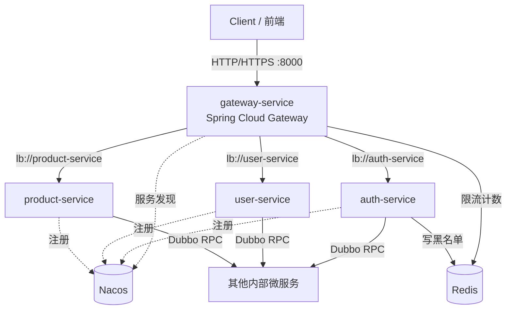
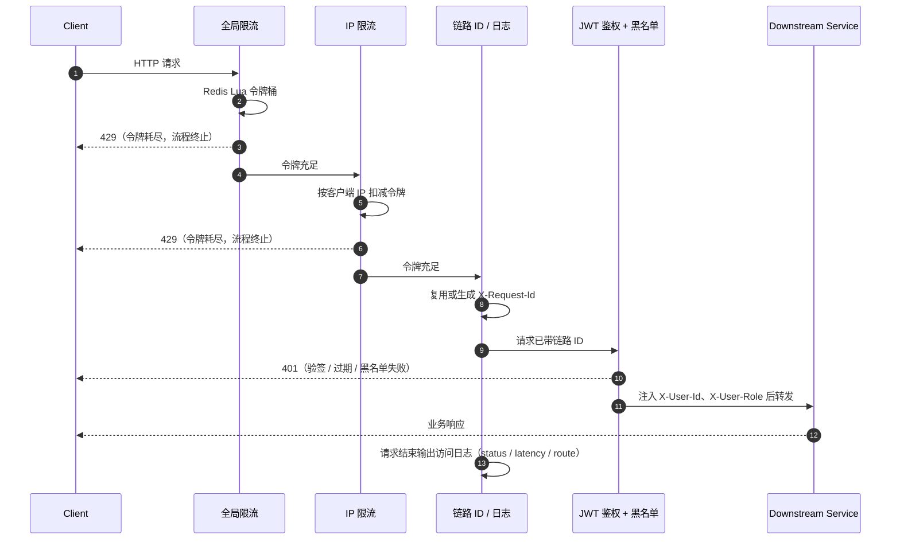
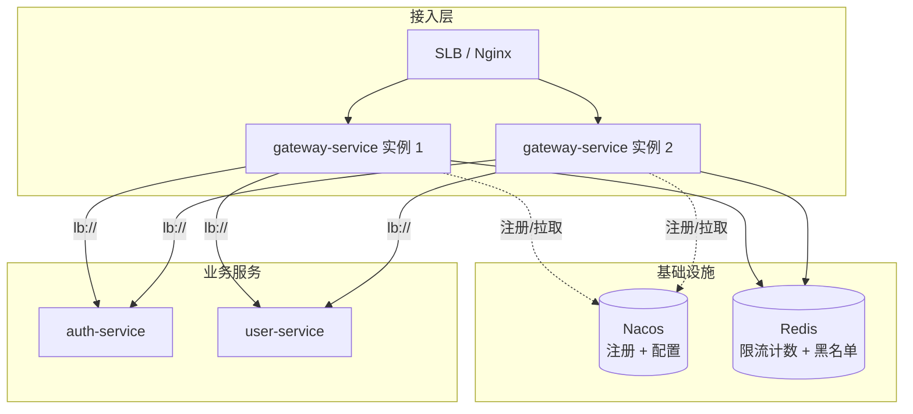

# 网关架构设计（gateway-service）

> 本文描述网关在平台中的位置、内部分层，以及路由、鉴权、限流、黑名单、日志五大能力的协作关系。
> 实现细节与配置清单见 [技术文档.md](技术文档.md)。

## 1. 整体拓扑



```text
                         Internet
                            │
                            │ HTTP/HTTPS
                            ▼
                  ┌─────────────────────┐
                  │   Gateway Service   │
                  │ Spring Cloud Gateway│
                  └──────────┬──────────┘
                             │
                     Spring Cloud
                       Discovery
                             │
                            Nacos
                             │
        ┌────────────────────┼────────────────────┐
        │                    │                    │
        ▼                    ▼                    ▼
  auth-service        user-service        product-service
        │                    │                    │
        └────────────────────┼────────────────────┘
                             │
                             ▼
                          Dubbo RPC
                             │
                             ▼
                      其他内部微服务
```

## 2. 外层网关定位

外层：**Spring Cloud Gateway + Spring Cloud Nacos**，优化的是**对外入口和流量治理**

> Auth-Service 负责 JWT 生成与生命周期管理，外层网关只涉及 JWT 统一鉴权和黑名单
>
> 登录接口的次数限流和外层网关限流：外层网关只对 IP 限流，登录接口包括 IP:UID

### 2.1 能力分层

```text
                    Gateway
                       │
       ┌───────────────┼────────────────┐
       │               │                │
       ▼               ▼                ▼
     路由             鉴权             限流
       │               │                │
       ├───────────────┼────────────────┤
       │               │                │
       ▼               ▼                ▼
     灰度             黑白名单          日志
```

- 所有 HTTP 请求统一从网关进入
- 统一做鉴权、限流、路由、灰度、日志、黑白名单
- 对外暴露一个稳定入口，后端服务可以自由拆分和替换
- 前端只认网关，不直接感知内部服务地址

### 2.2 能力与实现映射

| 能力 | 状态 | 实现载体 | 说明 |
| --- | --- | --- | --- |
| 路由 | 已落地 | `application.yml` 路由表 + Nacos + LoadBalancer | `lb://` 协议按服务名负载均衡，隐式路由已关闭 |
| 鉴权 | 已落地 | `JwtAuthenticationFilter` | 验签 + `iss`/`aud`/`exp` 校验 + 身份头注入 |
| 限流 | 已落地 | `GlobalRateLimitFilter`、`IpRateLimitFilter` | Redis Lua 令牌桶，两级限流，Redis 异常时 fail-open |
| 黑名单 | 已落地 | `RedisBlacklistService` | 按 JWT `jti` 判定，key 为 `auth:blacklist:{jti}` |
| 日志 | 已落地 | `RequestIdLoggingFilter` + `logback-spring.xml` | `X-Request-Id` 全链路透传，访问日志含耗时与路由 |
| 灰度 | 规划中 | 路由权重 / Nacos 元数据 | 按请求头或用户标签分流 |
| 黑白名单（IP） | 规划中 | 网关过滤器 | 与 token 黑名单形成互补 |

### 2.3 请求处理流水线



## 3. 内部服务调用

内部：**Dubbo + Nacos**，优化的是**服务内部调用效率和服务发现**

```text
                         Nacos
                    ┌──────┴──────┐
                    │             │
              Spring Cloud      Dubbo
               Discovery       Service Discovery
                    │             │
                    ▼             ▼
                HTTP调用        RPC调用
                    │             │
                 Gateway       Service
```

- 服务之间走 RPC，不走 HTTP，调用更轻、更快
- 支持长连接、序列化、超时、重试、负载均衡
- 适合内部高频调用，比如 user-service 调用其他内部服务
- Nacos 负责注册发现，让 Dubbo 知道实例在哪

**边界划分：**

| 维度 | 外层（Gateway） | 内部（Dubbo） |
| --- | --- | --- |
| 协议 | HTTP/HTTPS | Dubbo RPC |
| 入口 | 唯一对外入口 `:8000` | 不对外暴露，仅注册到 Nacos |
| 治理重点 | 鉴权、限流、路由、日志 | 负载均衡、超时、重试、序列化 |
| 身份传递 | 网关注入 `X-User-Id` / `X-User-Role`（uid 取 JWT 标准 claim `sub`） | 通过 Dubbo 上下文隐式透传 |
| 服务发现 | Spring Cloud Discovery | Dubbo Service Discovery |

## 4. 部署与依赖形态



要点：

- 网关本身**无状态**，可直接水平扩容；限流与黑名单状态集中在 Redis，多实例间天然共享配额。
- Redis 不可用时限流**放行**（fail-open），优先保证可用性；黑名单查询失败会向上抛出，需结合业务容忍度评估。
- 网关通过 Nacos 同时承担**服务发现**与**配置下发**（路由、限流参数可动态调整）。

## 5. 架构约束

1. **不可引入 `spring-boot-starter-web`**：网关基于 WebFlux，引入 Servlet 栈会导致启动失败；同理避免在过滤器中使用任何阻塞式调用。
2. **网关是唯一入口**：身份头（`X-User-Id` / `X-User-Role`，值来自 JWT 的 `sub` / `role`）的可信性完全依赖该前提，
   需通过网络策略保证后端服务不可被直连（网关只下发这两个头，客户端伪造的同名头会被先清后写）。
3. **鉴权只做校验不做签发**：JWT 生命周期由 `auth-service` 独占，网关仅持有验签密钥。
4. **敏感头隔离**：默认过滤器移除 `Cookie` / `Set-Cookie`，下游不应依赖浏览器凭证。
5. **链路 ID 必须贯穿**：任何新增过滤器都应保留 `X-Request-Id`，不得覆盖为新的值。

## 6. 演进方向

| 阶段 | 目标 | 关键动作 |
| --- | --- | --- |
| 近期 | 稳定性补齐 | 修复过滤器顺序冲突、访问日志改用 Logger、`X-Request-Id` 回写响应头 |
| 近期 | 配置动态化 | 路由与限流参数迁移到 Nacos 配置中心 |
| 中期 | 精细化限流 | 登录接口按 `IP:UID` 维度限流；路由级差异化配额 |
| 中期 | 灰度发布 | 路由权重 + Nacos 元数据标签路由 |
| 中期 | 准入控制 | IP / 设备维度黑白名单 |
| 远期 | 可观测体系 | Prometheus 指标 + OpenTelemetry/Jaeger 全链路追踪 + JSON 日志采集 |