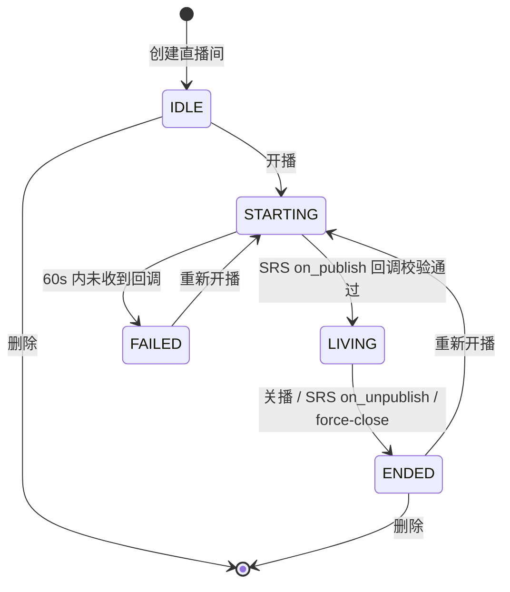

# live-service-go · 需求文档

> 版本：v1.0（阶段一）
> 上游依据：工作区根目录《直播，点播，弹幕设计方案.md》
> 相关文档：`设计文档.md`（怎么实现）、`接口文档.md`（对外契约）

---

## 1. 背景与目标

### 1.1 背景

点播（`video-service-go`）解决「先录后看」，直播解决「边推边看」。
直播间是**强状态**业务：谁在播、播了多久、多少人看、流断了没断 —— 这些状态变化快、
读多写少但读极频繁，因此本服务把「业务控制面」放在 Go + MySQL，
把「实时状态」放在 Redis，把「音视频传输」完全交给 SRS。

**核心设计立场：本服务不处理任何音视频数据。**
自己用 Go 从 RTMP 协议层写媒体服务器是反模式；`live-service-go` 的职责是
**决定谁能推、什么时候算开播、观众看到哪个地址**。

### 1.2 目标

| 目标 | 度量 |
| --- | --- |
| 打通「建房 → 开播 → 推流 → 观看 → 关播」完整链路 | 端到端可用 curl + 推流工具走通 |
| 实时状态查询不压 MySQL | 直播间状态/在线人数查询 100% 走 Redis（P99 < 10ms） |
| 在线人数准确 | 心跳 + ZSet + 定时清理，误差 < 一个心跳周期 |
| 推流安全 | 每次开播生成一次性推流密钥，SRS 回调校验，密钥不可复用 |
| 与现有 Java 体系契约兼容 | 复用 `X-User-Id`，响应体 `{code,message,data}` |

---

## 2. 范围

### 2.1 纳入范围

- 直播间管理（创建 / 修改 / 删除 / 列表 / 详情）
- 开播 / 关播状态机
- 推流地址与播放地址下发（RTMP 推流、HLS/HTTP-FLV/WebRTC 拉流）
- 推流密钥生成与校验
- SRS 生命周期回调接入（on_publish / on_unpublish / on_play / on_stop）
- 在线人数统计（Redis ZSet + 心跳）
- 人气值（累计观看人次）与直播时长
- 直播记录（开播历史）
- 直播中禁言名单（供弹幕服务读取）

### 2.2 明确不做（非目标）

| 不做 | 原因 |
| --- | --- |
| 音视频编解码与转发 | 由 SRS 承担 |
| 弹幕 | 属于 `danmaku-service-go` |
| 直播回放转点播（录制文件入库为 video） | 阶段三做，需 `video-service-go` 的 gRPC |
| 礼物 / 付费 / 打赏 | 与 `order-service` 域重叠 |
| 连麦 / 多人连麦（WebRTC 房间编排） | 阶段四 |
| 自动转码直播流 | SRS 已支持多码率转码，本服务只下发地址 |

---

## 3. 角色与权限

身份来源：`X-User-Id` / `X-User-Role`，与 Java 体系一致。

| 角色 | 能力 |
| --- | --- |
| 游客 | 浏览直播间列表、查看已开播直播间详情、获取播放地址、进入直播间（上报心跳） |
| 登录用户 | 游客能力 + 创建直播间（成为主播）、开播、关播、实名上报心跳 |
| 主播（房间创建者） | 修改/删除自己的直播间、开播、关播、查看推流密钥、查看自己的直播记录、管理禁言名单 |
| 管理员 | 治理能力：强制关闭任意直播间（`force-close`）、下架违规直播间 |

**归属规则**

- 写操作（改 / 删 / 开播 / 关播）仅房间创建者，ADMIN 也不能改他人房间元数据。
- `force-close` 是治理动作：创建者或 ADMIN 均可调用。
- 推流密钥**只对创建者可见**，游客与普通用户访问 → `403 / 40301`。

---

## 4. 功能性需求

### FR-1 直播间管理

| 编号 | 需求 | 优先级 | 阶段 |
| --- | --- | --- | --- |
| FR-1.1 | 创建直播间，返回 `roomId` 与 `streamKey`，初始状态 `IDLE` | P0 | 一 |
| FR-1.2 | 修改直播间标题 / 公告 / 封面 / 分类，仅创建者 | P0 | 一 |
| FR-1.3 | 软删除直播间，仅创建者；直播中不允许删除 | P0 | 一 |
| FR-1.4 | 分页查询直播间列表，支持关键字、分类、开播状态过滤 | P0 | 一 |
| FR-1.5 | 查询直播间详情（含实时状态、在线人数、主播信息） | P0 | 一 |
| FR-1.6 | 查询「我的直播间」列表（一个用户可有多个房间） | P1 | 一 |

**规则**

- `title` 1–64 字符；`notice` ≤ 512 字符。
- 一个用户最多创建 20 个直播间（可配置），超出 → `409 / 70003`。
- `streamKey` 全局唯一，由服务端生成（`随机 32 位 hex`），客户端不可指定。
- 列表默认只返回 `LIVING` 优先、再按 `updatedAt DESC` 排序（保证「正在直播」排在最前）。

### FR-2 开播 / 关播状态机

| 编号 | 需求 | 优先级 | 阶段 |
| --- | --- | --- | --- |
| FR-2.1 | 开播：`IDLE/OFFLINE/FAILED → STARTING`，下发推流地址 | P0 | 一 |
| FR-2.2 | SRS `on_publish` 回调校验密钥后置为 `LIVING` | P0 | 一 |
| FR-2.3 | 关播：`LIVING → ENDED`，通知 SRS 断开推流 | P0 | 一 |
| FR-2.4 | SRS `on_unpublish` 回调自动置为 `ENDED`（主播直接断流） | P0 | 一 |
| FR-2.5 | 开播超时兜底：`STARTING` 超过 60s 未收到 `on_publish` → `FAILED` | P1 | 一 |
| FR-2.6 | `force-close`：创建者或 ADMIN 强制结束直播 | P1 | 一 |

**规则**

- 同一房间不能重复开播（`STARTING` / `LIVING` 状态下再次开播 → 幂等返回当前状态，不报错）。
- 同一主播**不能同时开播多个直播间** → `409 / 70004`。
- 关播时记录 `endedAt`、计算 `durationSec`、清除 Redis 在线人数、写入 `media_live_record`。

### FR-3 推拉流地址

| 编号 | 需求 | 优先级 | 阶段 |
| --- | --- | --- | --- |
| FR-3.1 | 下发 RTMP 推流地址（含密钥），仅创建者可见 | P0 | 一 |
| FR-3.2 | 下发多协议播放地址：HLS / HTTP-FLV / WebRTC | P0 | 一 |
| FR-3.3 | 播放地址在未开播时返回错误（`409 / 70001`），避免观众拉空流 | P0 | 一 |
| FR-3.4 | SRS 回调地址、RTC candidate 可配置 | P0 | 一 |

**地址格式（示例，端口对应 docker-compose）**

```text
推流（RTMP）： rtmp://localhost:1936/live/{streamKey}
HLS：          http://localhost:8088/live/{streamKey}.m3u8
HTTP-FLV：     http://localhost:8088/live/{streamKey}.flv
WebRTC：       webrtc://localhost:8001/live/{streamKey}
```

### FR-4 在线人数与心跳

| 编号 | 需求 | 优先级 | 阶段 |
| --- | --- | --- | --- |
| FR-4.1 | 观众进入直播间上报心跳（`POST /rooms/:id/heartbeat`） | P0 | 一 |
| FR-4.2 | 在线人数 = ZSet 中未过期成员数 | P0 | 一 |
| FR-4.3 | 定时清理超过 60s 未心跳的成员 | P0 | 一 |
| FR-4.4 | 游客可上报心跳（使用会话 ID 而非 uid） | P1 | 一 |
| FR-4.5 | 人气值（累计人次）单调递增，关播后不清零 | P1 | 一 |

**规则**

- 心跳间隔建议 20s，服务端 TTL 60s（3 倍容错）。
- 游客无 `X-User-Id` 时，用请求头 `X-Session-Id` 或客户端生成的 `sessionId` 作为 ZSet 成员，
  标识为 `anon:{sessionId}`，避免与登录用户冲突。
- 同一用户多端进入只算 1 人（ZSet 天然去重）。

### FR-5 直播记录与统计

| 编号 | 需求 | 优先级 | 阶段 |
| --- | --- | --- | --- |
| FR-5.1 | 每次开播写入一条 `media_live_record`（开始时间、结束时间、时长、峰值在线） | P0 | 一 |
| FR-5.2 | 查询某房间的直播历史（仅创建者 / ADMIN） | P1 | 一 |
| FR-5.3 | 峰值在线人数在关播时落库 | P1 | 一 |

**规则**

- 峰值在线通过 Redis 中维护 `live:peak:{roomId}` 的 `max(当前人数, 历史峰值)` 得到，
  关播时读取并落库。

### FR-6 事件发布

| 编号 | 需求 | 优先级 | 阶段 |
| --- | --- | --- | --- |
| FR-6.1 | 开播成功发布 `live.started`（供推荐/通知/统计消费） | P0 | 一 |
| FR-6.2 | 关播发布 `live.stopped` | P0 | 一 |
| FR-6.3 | 弹幕服务订阅 `live.started` / `live.stopped` 以维护房间状态 | P0 | 一 |

### FR-7 运维与可观测

| 编号 | 需求 | 优先级 | 阶段 |
| --- | --- | --- | --- |
| FR-7.1 | `GET /healthz` / `GET /readyz` | P0 | 一 |
| FR-7.2 | SRS 回调接口不做用户鉴权，但需校验 `streamKey` 与可选共享密钥 | P0 | 一 |
| FR-7.3 | 结构化日志 + TraceID | P0 | 一 |
| FR-7.4 | Prometheus 指标（在线人数、开播数、回调耗时） | P1 | 四 |

---

## 5. 非功能性需求

| 类别 | 要求 |
| --- | --- |
| 性能 | 详情/状态查询 P99 < 10ms（纯 Redis）；开播 P99 < 100ms |
| 一致性 | 「开播」与「SRS 收到流」之间用回调对齐，不做乐观预置 `LIVING` |
| 幂等性 | 重复开播、重复关播、SRS 回调重放均幂等 |
| 可用性 | Redis 不可用时列表/详情降级读 MySQL 的 `status` 字段（在线人数返回 0）；SRS 不可用时开播仍成功但日志告警 |
| 安全 | 推流密钥仅创建者可见；每次开播重新生成密钥，旧密钥立即失效 |
| 容量 | 单机 1 万直播间；在线人数 ZSet 按房间分片，单房间 ≤ 10 万成员 |
| 兼容 | 响应体与错误码与 Java 侧一致 |

---

## 6. 状态机



| 状态 | 含义 | 游客可见性 |
| --- | --- | --- |
| `IDLE` | 已创建，从未开播 | 详情可见（提示未开播），播放地址不可用 |
| `STARTING` | 已下发推流地址，等待主播推流 | 同上 |
| `LIVING` | 正在直播 | 可获取播放地址 |
| `ENDED` | 直播已结束 | 详情可见（提示已结束），无播放地址 |
| `FAILED` | 开播失败（未推流 / 被强制关闭） | 同上 |

**非法流转**统一 `409 / 70001`（不在直播中）或 `409 / 70004`（重复开播）。

---

## 7. 验收标准（阶段一）

| 编号 | 验收项 | 判定方式 |
| --- | --- | --- |
| AC-1 | 项目可编译 | `go build ./...` / `go vet ./...` 通过 |
| AC-2 | 服务可启动 | `/healthz` 200，`/readyz` 中 mysql/redis/events 均 UP |
| AC-3 | 建表自动完成 | `auth_service`（与 Java 共库）中 2 张 `media_live_*` 表存在，且未影响 Java 的表 |
| AC-4 | 完整链路可走通 | curl：建房 → 开播（拿到推流地址）→ 伪造 `on_publish` 回调 → 状态变 `LIVING` → 取播放地址 → 关播 |
| AC-5 | 归属校验生效 | `X-User-Id: other` 调写接口 → `403 / 40301` |
| AC-6 | 密钥不可越权获取 | 非创建者调 `GET /rooms/:id/stream-key` → `403 / 40301` |
| AC-7 | 在线人数正确 | 3 个不同 uid 上报心跳 → `onlineCount = 3`；同一 uid 重复上报仍为 3 |
| AC-8 | 回调幂等 | 重复发送同一 `on_publish` 回调，状态与记录不重复 |
| AC-9 | 事件可靠 | 开播后 MQ 中存在 `live.started` 消息 |

---

## 8. 阶段划分

| 阶段 | 交付 |
| --- | --- |
| **一（本次）** | 骨架 + 直播间 CRUD + 开播/关播状态机 + 推拉流地址 + SRS 回调 + 在线人数心跳 + 直播记录 + 事件 |
| 二 | 在线人数清理任务调优、峰值统计完善、禁言名单、开播定时兜底 |
| 三 | 对接真实 SRS（多码率转码、录制）、回放转点播（调 video-service gRPC） |
| 四 | WebRTC 连麦、Prometheus 指标、K8s 清单 |

---

## 9. 风险与开放问题

| 风险 | 影响 | 应对 |
| --- | --- | --- |
| SRS 回调地址不可达（容器内外网差异） | 开播后永远卡在 `STARTING` | `srs.conf` 用 `host.docker.internal`；文档给出排查清单；`STARTING` 超时兜底 |
| 未部署 SRS | 无法真实推流 | `media.driver=mock` 时提供 `POST /rooms/:id/mock-publish` 便于本地联调（仅 debug 模式注册） |
| Redis 丢失在线人数 | 人数显示 0 | 可接受（在线人数是实时指标，非业务事实）；状态字段以 MySQL 为准 |
| 一个主播多房间并发开播 | 资源与流量打散 | 明确限制「一个主播同时只能开 1 个」 |
| 心跳接口被刷 | Redis 写入放大 | 按 `(roomId, uid)` 做节流：同一成员 10s 内重复心跳只更新 ZSet 分数不重复写 |
| 推流密钥泄露 | 他人盗推 | 每次开播重新生成；`on_publish` 校验；后续可加 IP 白名单 |
