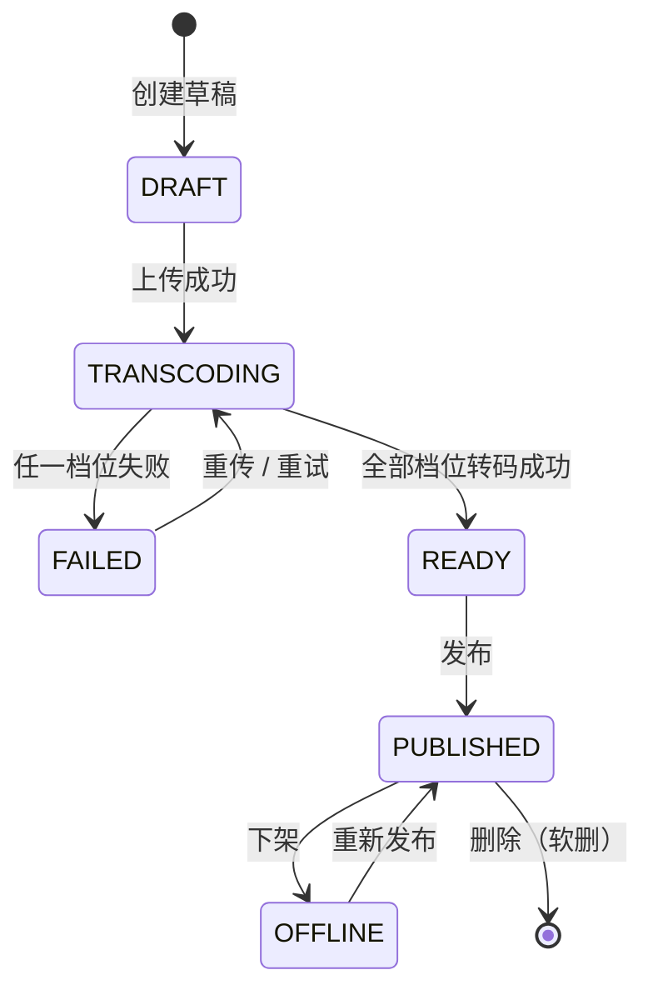

# video-service-go · 需求文档

> 版本：v1.0（阶段一）
> 上游依据：工作区根目录《直播，点播，弹幕设计方案.md》
> 相关文档：`设计文档.md`（怎么实现）、`接口文档.md`（对外契约）

---

## 1. 背景与目标

### 1.1 背景

工作区已有一套 Java 微服务（网关 / 鉴权 / 用户 / 商品 / 订单），但缺一个「媒体内容」域。
本项目用 Go 技术栈补齐**点播（VOD）**能力，并刻意把技术栈用在有业务落点的地方，
而不是堆砌：

- **对象存储（MinIO）**：视频文件不进数据库，只存对象 key；
- **消息队列（RabbitMQ）**：转码是分钟级耗时操作，必须与上传请求解耦；
- **FFmpeg**：产出多码率 HLS，让点播具备自适应码率能力；
- **Redis**：详情缓存 + 播放量缓冲，抗住热点视频的读放大。

### 1.2 目标

| 目标 | 度量 |
| --- | --- |
| 打通「上传 → 转码 → 发布 → 播放」完整链路 | 端到端可用 curl 走通 |
| 上传接口不被转码阻塞 | 上传响应 P99 < 500ms（不含文件上传耗时） |
| 支持多码率 HLS 点播 | 360p / 720p / 1080p 三档 + master.m3u8 |
| 热点视频读性能 | 详情接口命中缓存时 P99 < 20ms |
| 与现有 Java 体系契约兼容 | 复用 `X-User-Id`，响应体 `{code,message,data}` |

---

## 2. 范围

### 2.1 纳入范围

- 视频元数据管理（创建 / 修改 / 删除 / 列表 / 详情）
- 原片上传到对象存储（MinIO）
- 异步转码任务编排（RabbitMQ + Worker + FFmpeg 适配器）
- 视频发布 / 下架 / 播放地址下发
- 分类与标签
- 播放量统计（Redis 缓冲 + 定时回写）
- 创建者归属校验
- 健康检查 / 就绪检查

### 2.2 明确不做（非目标）

| 不做 | 原因 |
| --- | --- |
| 前端页面 | 本服务是纯后端 API |
| 视频审核（人工/机审） | 由 `status` 预留 `REVIEWING` 位，本期不实现流程 |
| 直播能力 | 属于 `live-service-go` |
| 弹幕 | 属于 `danmaku-service-go` |
| CDN 分发与鉴权播放（防盗链签名） | 阶段四再做，本期播放地址为 MinIO 直链 |
| 付费/会员 | 与 `order-service` 域重叠，本期不涉及 |

---

## 3. 角色与权限

身份来源：网关（或直连时手工）注入的 `X-User-Id` / `X-User-Role`，本服务**不解析 JWT**。

| 角色 | 判定 | 能力 |
| --- | --- | --- |
| 游客 | 无 `X-User-Id` | 浏览视频列表、详情、播放地址、分类列表 |
| 登录用户 | 有 `X-User-Id` | 游客能力 + 创建视频、修改/删除**自己的**视频、上传、发布、下架 |
| 管理员 | `X-User-Role: ADMIN` | 登录用户能力 + 管理分类 + 下架任意视频 |

> 归属判定优先级：资源所有者 > 角色。**ADMIN 也不能修改他人视频的元数据**，
> 只能执行「下架」这类治理动作（与 Java 侧 `product-service` 的归属策略一致）。

---

## 4. 功能性需求

### FR-1 视频元数据管理

| 编号 | 需求 | 优先级 | 阶段 |
| --- | --- | --- | --- |
| FR-1.1 | 创建视频草稿，返回 `videoId`，初始状态 `DRAFT` | P0 | 一 |
| FR-1.2 | 修改视频标题 / 描述 / 分类 / 标签，仅所有者 | P0 | 一 |
| FR-1.3 | 软删除视频，仅所有者 | P0 | 一 |
| FR-1.4 | 分页查询视频列表，支持关键字、分类、状态、创建者过滤 | P0 | 一 |
| FR-1.5 | 查询视频详情（含标签、分类名） | P0 | 一 |
| FR-1.6 | 查询「我的视频」列表 | P1 | 一 |

**规则**

- `title` 1–128 字符，必填；`description` ≤ 1024 字符。
- 同一创建者下标题允许重复（不做唯一约束），避免误伤运营场景。
- 列表默认按 `created_at DESC`，`page` 从 1 开始，`pageSize` ∈ [1, 100]。
- 列表默认**只返回已发布视频**给游客；创建者本人与 ADMIN 可看全部状态（`?includeAll=true`）。

### FR-2 视频上传与对象存储

| 编号 | 需求 | 优先级 | 阶段 |
| --- | --- | --- | --- |
| FR-2.1 | `multipart/form-data` 上传原片，仅所有者 | P0 | 一 |
| FR-2.2 | 校验扩展名与 MIME（`mp4/mov/mkv/avi/flv/webm`） | P0 | 一 |
| FR-2.3 | 校验文件大小上限（默认 2GB，可配置） | P0 | 一 |
| FR-2.4 | 流式上传到 MinIO，不落本地磁盘 | P0 | 一 |
| FR-2.5 | 上传成功后创建转码任务并投递 `video.uploaded` 事件 | P0 | 一 |
| FR-2.6 | 上传封面上传（图片，≤ 5MB） | P1 | 二 |
| FR-2.7 | 大文件分片上传与**断点续传**（init / parts / complete / abort） | P0 | 一 |

**规则**

- 上传前视频状态必须是 `DRAFT` 或 `FAILED`（允许重传）；否则 `409 / 60003`。
- 文件类型不支持 → `400 / 60001`；超限 → `413 / 60002`。
- 上传成功后状态流转为 `TRANSCODING`，并记录 `size_bytes`、`source_object`。
- **幂等**：状态已是 `TRANSCODING` 时重复上传直接返回当前状态与任务 ID，不重复投递事件。
- **分片上传（FR-2.7）**：切片大小由服务端在 `init` 时确定并落库；
  非末片必须**正好等于**约定切片大小，否则 `400 / 60005`；
  合并时序号未恰好覆盖 `1..totalParts` → `409 / 60006`；
  会话不存在、已合并或已取消 → `404 / 40404`。
- **断点续传的权威进度来自对象存储**（`ListParts`），服务端只持久化 `uploadId` 与切片计划，
  不另存进度副本（副本必然与真实状态漂移）。
- 重复 `init` 且 `objectKey/ext/fileSize/partSize/totalParts` 均一致 → **复用同一 `uploadId`**，已传分片保留；
  不一致 → 回收旧会话（`AbortMultipartUpload`）后新建，避免分片永久占用存储空间。
- 分片入口与一次性上传在「原片已就位」后走同一条转码编排路径，副作用一致。

### FR-3 异步转码与多码率 HLS

| 编号 | 需求 | 优先级 | 阶段 |
| --- | --- | --- | --- |
| FR-3.1 | 消费 `video.uploaded`，执行转码 | P0 | 一（mock）/ 二（真实 FFmpeg） |
| FR-3.2 | 产出 360p / 720p / 1080p 三档 HLS + `master.m3u8` | P0 | 二 |
| FR-3.3 | 转码任务进度可查（百分比 + 状态 + 失败原因） | P0 | 一 |
| FR-3.4 | 转码失败可重试（`POST /videos/:id/transcode/retry`） | P1 | 二 |
| FR-3.5 | 记录视频时长（`duration`） | P1 | 二 |

**规则**

- 转码任务状态机：`PENDING → RUNNING → SUCCESS / FAILED`。
- 任何档位失败即整体 `FAILED`，视频状态置 `FAILED`，保留已产出的中间产物以便排查。
- 消息消费必须**手动 ACK**；失败重试 3 次后进死信队列，同时任务置 `FAILED`。
- 幂等：按 `eventId` 去重，避免 MQ 重投导致重复转码。

### FR-4 视频发布与播放

| 编号 | 需求 | 优先级 | 阶段 |
| --- | --- | --- | --- |
| FR-4.1 | 发布视频（`READY → PUBLISHED`），仅所有者 | P0 | 一 |
| FR-4.2 | 下架视频（`PUBLISHED → OFFLINE`） | P0 | 一 |
| FR-4.3 | 获取播放信息，返回 `playbackUrl` + 封面 + 时长 | P0 | 一 |
| FR-4.4 | 播放量累加（Redis 缓冲，定时回写 MySQL） | P1 | 一 |

**规则**

- 只有 `READY` 才能发布，否则 `409 / 60003`。
- 未发布的视频：游客拿不到播放地址（`404 / 40401`，不暴露存在性）；所有者与 ADMIN 可预览。
- 播放地址为 HLS `master.m3u8` 的完整 URL；同时返回 `sources[]`（各码率明细）。

### FR-5 分类与标签

| 编号 | 需求 | 优先级 | 阶段 |
| --- | --- | --- | --- |
| FR-5.1 | 分类列表（公开） | P1 | 一 |
| FR-5.2 | 新建 / 修改分类（仅 ADMIN） | P1 | 一 |
| FR-5.3 | 视频打标签，随视频创建/修改一起提交 | P1 | 一 |

### FR-6 运维与可观测

| 编号 | 需求 | 优先级 | 阶段 |
| --- | --- | --- | --- |
| FR-6.1 | `GET /healthz` 进程存活（不依赖下游） | P0 | 一 |
| FR-6.2 | `GET /readyz` 检查 MySQL / Redis / MQ / MinIO 就绪 | P0 | 一 |
| FR-6.3 | 结构化日志（JSON）+ TraceID（`X-Request-Id`） | P0 | 一 |
| FR-6.4 | Prometheus 指标 `/metrics` | P1 | 四 |

---

## 5. 非功能性需求

| 类别 | 要求 |
| --- | --- |
| 性能 | 详情接口命中 Redis 时 P99 < 20ms；列表接口 P99 < 100ms（万级数据） |
| 一致性 | 「发布」必须建立在转码成功之上；转码结果写库与状态流转在同一事务内 |
| 幂等性 | 上传、发布、下架、转码消费均幂等 |
| 可用性 | Redis 不可用时降级为直连 MySQL（不阻断主流程）；RabbitMQ 不可用时降级为进程内事件总线（仅开发环境，日志告警） |
| 安全 | 归属校验覆盖全部写接口；文件类型白名单；路径参数与请求体不得携带用户标识 |
| 容量 | 单视频 ≤ 2GB；单库表行数按百万级设计（列表必须走索引） |
| 兼容 | 响应体与错误码与 Java 侧完全一致，可直接挂到现有网关 |

---

## 6. 状态机

**非法流转**统一返回 `409 / 60003`，并在 message 中说明当前状态与允许的操作。

---

## 7. 验收标准（阶段一）

| 编号 | 验收项 | 判定方式 |
| --- | --- | --- |
| AC-1 | 项目可编译 | `go build ./...` 与 `go vet ./...` 均通过 |
| AC-2 | 服务可启动 | 连上 MySQL/Redis/RabbitMQ 后启动成功，`/healthz` 返回 200 |
| AC-3 | 建表自动完成 | 启动后 `auth_service`（与 Java 共库）中 5 张 `media_*` 表存在且字段正确，且未影响 Java 的表 |
| AC-4 | 核心链路可走通 | curl 完成：创建 → 上传 → 转码完成 → 发布 → 取播放地址 |
| AC-5 | 归属校验生效 | 用 `X-User-Id: other` 调写接口 → `403 / 40301` |
| AC-6 | 统一响应生效 | 所有接口返回 `{code,message,data}`；缺身份头 → `401 / 40101` |
| AC-7 | 缓存生效 | 第二次请求详情命中 Redis，MySQL 无新增查询（看日志） |
| AC-8 | 事件可靠 | 上传后 MQ 中可见 `video.uploaded` 消息；消费者手动 ACK |
| AC-9 | 分片上传与断点续传可用 | `tools/upload-chunk-smoke.ps1` 全绿；中断后重新 `init` 返回已传分片，`complete` 后进入 `TRANSCODING` 并最终 `READY` |

---

## 8. 阶段划分

| 阶段 | 交付 |
| --- | --- |
| **一（本次）** | 骨架 + 元数据 CRUD + MinIO 上传 + 转码任务编排（mock 转码器）+ 发布/播放 + 缓存 + 事件总线 |
| 二 | 真实 FFmpeg 转码（多码率 HLS）、封面图、转码重试与死信处理、进度上报 |
| 三 | 内部 gRPC（供 live-service 查作者信息）、CDN 签名播放 |
| 四 | OpenTelemetry 链路、Prometheus 指标、K8s 清单 |

---

## 9. 风险与开放问题

| 风险 | 影响 | 应对 |
| --- | --- | --- |
| 大文件上传占用内存 | OOM | 分片上传已实现（FR-2.7）：服务端只做流式转发，不在内存里拼整份文件；一次性上传仍限制 `max_size_mb` |
| FFmpeg 未安装 | 转码失败 | `transcoder.driver=mock` 默认可用，配置切 `real`；启动时检测二进制并告警 |
| MinIO 匿名读策略过宽 | 视频被白嫖 | 阶段四改签名 URL；本期仅开发环境开放 |
| 单机 Worker 与 API 同进程 | 转码抢占 API 资源 | 阶段二把 worker 拆成独立进程（`cmd/worker`），共用同一份 `internal` |
| 播放量缓冲丢失 | 统计不准 | Redis `INCR` + 定时回写；重启丢失可接受（本期为近似值） |
