# 前端 UI 设计规范（v2）

> 目标：**B 站的信息密度 + YouTube 的留白与层级**。粉色 `#FB7299` 只做强调色，
> 浅色优先；暗色只替换 CSS 变量，不写第二套结构。

---

## 1. Token

全部定义在 `src/shared/styles/tokens.css`，Tailwind 在 `tailwind.config.js` 里映射。

### 颜色（浅色）

| Token | 值 | 用途 |
| --- | --- | --- |
| `--bg-page` | `#F1F2F3` | 页面底色（B 站同款冷灰） |
| `--bg-card` | `#FFFFFF` | 卡片 / 面板 |
| `--bg-subtle` | `#F2F3F5` | 输入框、胶囊、hover |
| `--text-primary` | `#0F1215` | 标题 / 正文 |
| `--text-secondary` | `#61666D` | 次级信息 |
| `--text-tertiary` | `#9499A0` | 时间 / 播放量 |
| `--border` | `#E5E7EB` | 边框 |
| `--brand-pink` | `#FB7299` | 主操作 / 选中 |
| `--brand-blue` | `#00AEEC` | 链接 / 信息 |

暗色在 `[data-theme='dark']` 中覆盖同名变量（`bg #0F1114` / `card #181A1E` / `border #2B2F36`）。

### 字号

| 类名 | 字号/行高 | 用途 |
| --- | --- | --- |
| `text-display` | 24/32 | 极少用 |
| `text-h1` | 20/28 | 页面标题 |
| `text-h2` | 16/24 | 区块标题 |
| `text-body` | 14/22 | 正文、卡片标题 |
| `text-meta` | 12/18 | 作者 / 播放量 / 时间 |
| `text-micro` | 11/16 | 角标 |

### 圆角 / 阴影

- `rounded-xs` 4：角标
- `rounded-sm` 8：按钮 / 输入框
- `rounded-md` 12：卡片 / 缩略图
- `rounded-lg` 16：播放器 / 弹层
- `rounded-full`：搜索框 / 头像 / 主按钮
- 卡片默认**无阴影**，用 `border-line` 分层；hover 才用 `shadow-hover`

---

## 2. 复用类

在 `src/index.css` 的 `@layer components` 中：

| 类 | 说明 |
| --- | --- |
| `ui-card` | `rounded-md border border-line bg-card` |
| `ui-btn-primary` | 粉色胶囊主按钮（h 36） |
| `ui-btn-ghost` | 白底描边胶囊按钮 |
| `ui-input` | 36 高、浅灰底、focus 粉色 |
| `ui-chip` / `ui-chip-active` | 分类胶囊 / 选中态 |

图标统一走 `src/shared/ui/Icon.tsx`（线性、currentColor），不再用 emoji 当功能图标。

---

## 3. 组件规则

- **Header**：60px、白底、1px 底边；**不单独放 logo**，左侧直接从「首页」导航开始（home 图标 + 文字，参考 B 站）；导航为胶囊，当前项 `bg-subtle`；搜索框 420px、`rounded-full`；移动端顶部显示中性站名「视频社区」，第二行横向滚动导航。
- **VideoCard / LiveCard**：白卡片（`bg-card` + 1px 边框 + 8px padding + 12px 圆角）+ 16:9 缩略图；hover 缩略图 `scale(1.03)`、卡片只加轻阴影；标题两行 14/22；元信息 12。
- **首页氛围光**：只在首页顶部出现一层粉/蓝径向光（`.home-glow`），暗色通过 token 自动降到 10%/7%，其他页面保持纯色灰底。
- **播放页**：1280 容器，左内容 + 右 360 侧栏；播放器圆角 16；操作按钮为胶囊；点播弹幕条紧贴播放器。
- **直播间**：左播放器 + 右 340 聊天；播放器无进度条（直播不可 seek）；控制台推流信息分「服务器 / 串流密钥」两栏。
- **头像**：统一使用 `shared/ui/Avatar`；没有头像或加载失败时用「粉蓝渐变底 + 白色小人剪影」，不再用昵称首字（中文首字在 32px 头像里辨识度太低）。
- **默认封面**：没有封面或封面加载失败时用 `DefaultCover`——按视频/直播间/商品 id 生成稳定的粉/蓝/绿/紫/橙/青渐变 + 半透明几何；视频用播放三角、直播用信号点、商品用购物袋。商品会先按名称关键词推断品类色（数码蓝、服饰粉、食品橙、家居绿、图书紫、运动青），匹配不到再按 id 哈希，不再用「标题首字」灰底。
- **空态 / 骨架**：统一线性图标 + 中性灰骨架，不用 emoji。
- **动效**：160ms `ease-out`；`prefers-reduced-motion` 下全部关闭。

---

## 4. 页面截图

| 页面 | 浅色 | 暗色 |
| --- | --- | --- |
| 首页 |  | 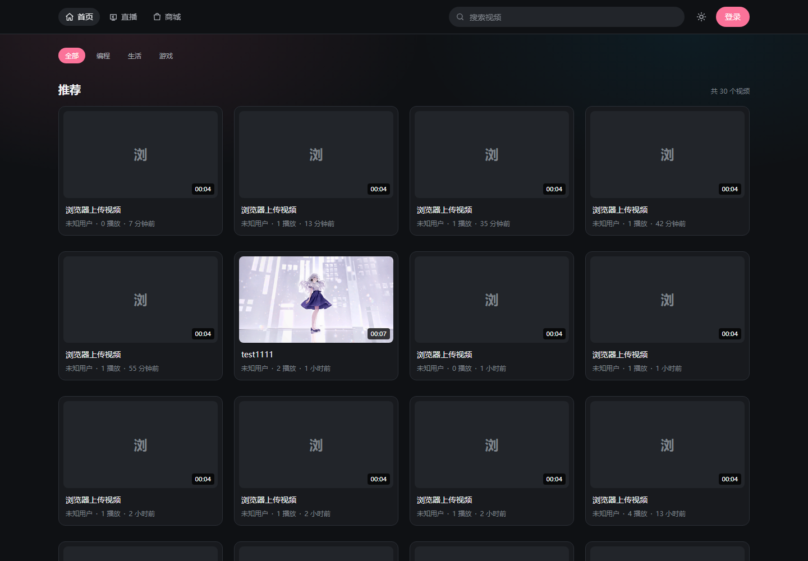 |
| 播放页 | 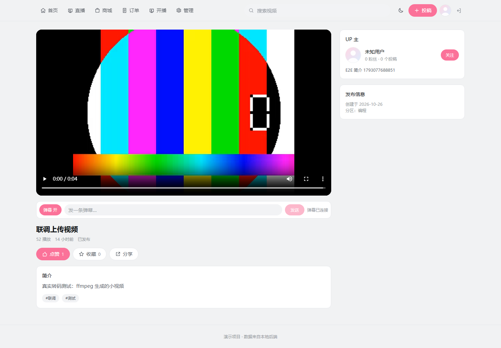 | — |
| 直播间 | 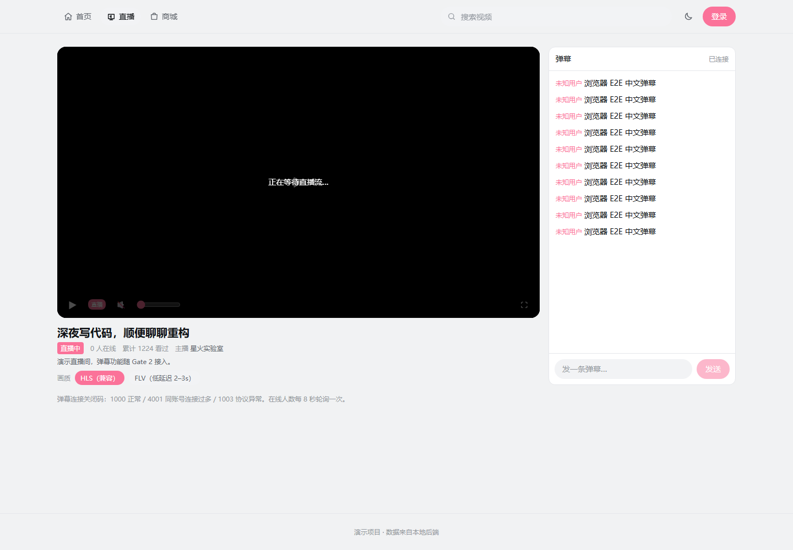 | — |
| 搜索 | 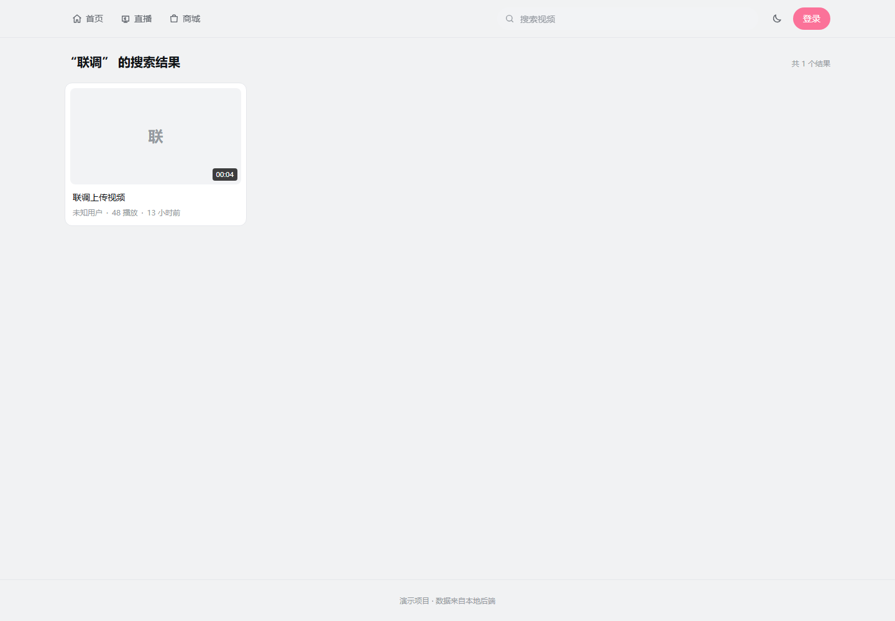 | — |
| 商城 | 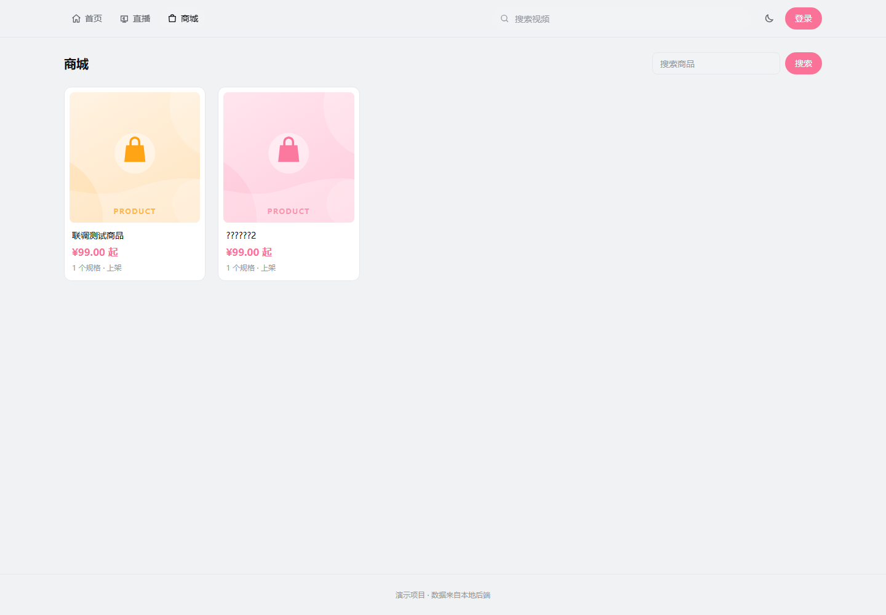 | — |
| 商品详情 | 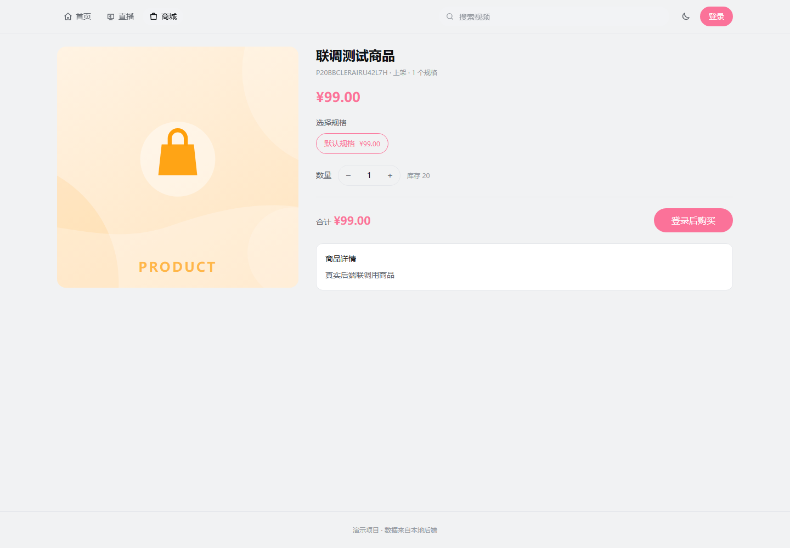 | — |
| 个人空间 | 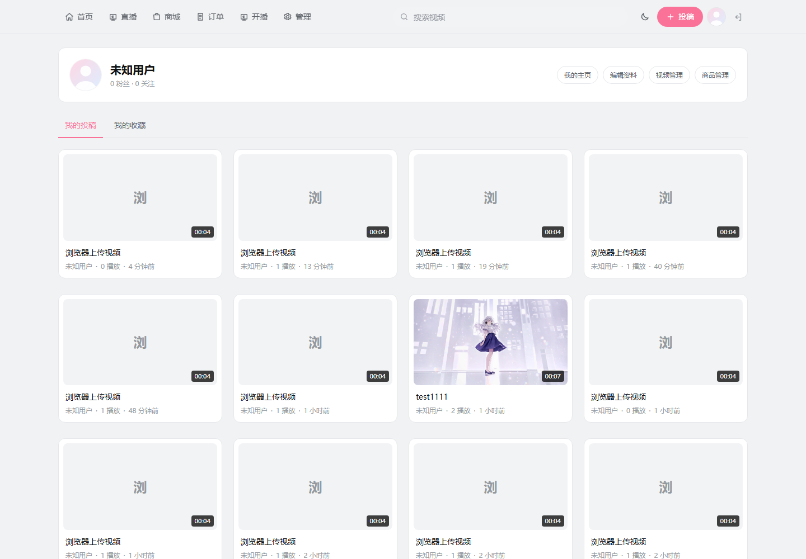 | — |
| 视频管理 | 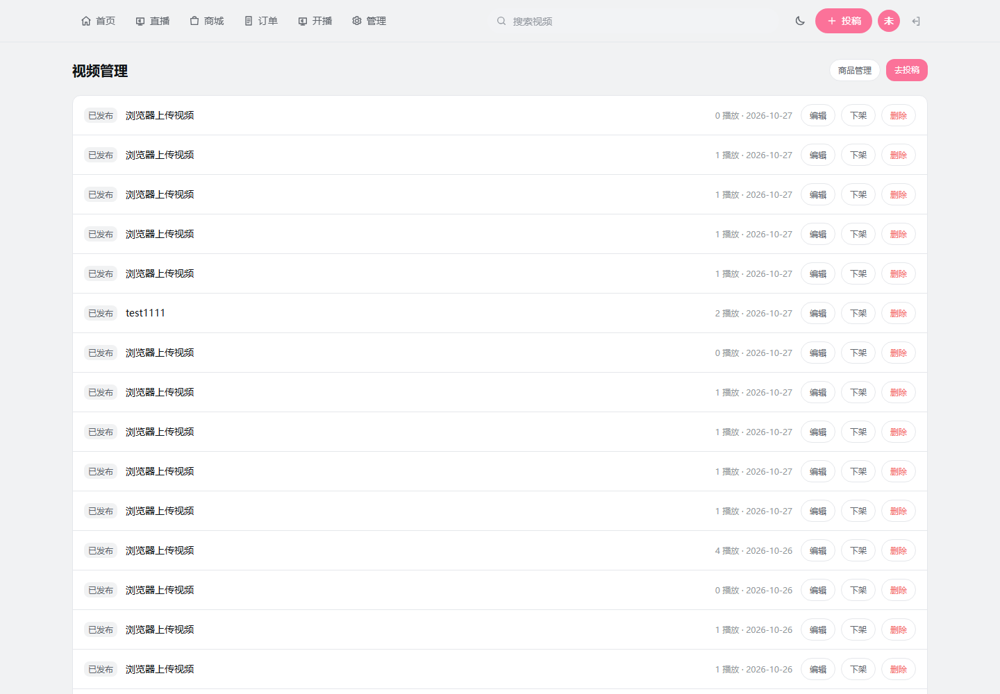 | — |
| 商品管理 | 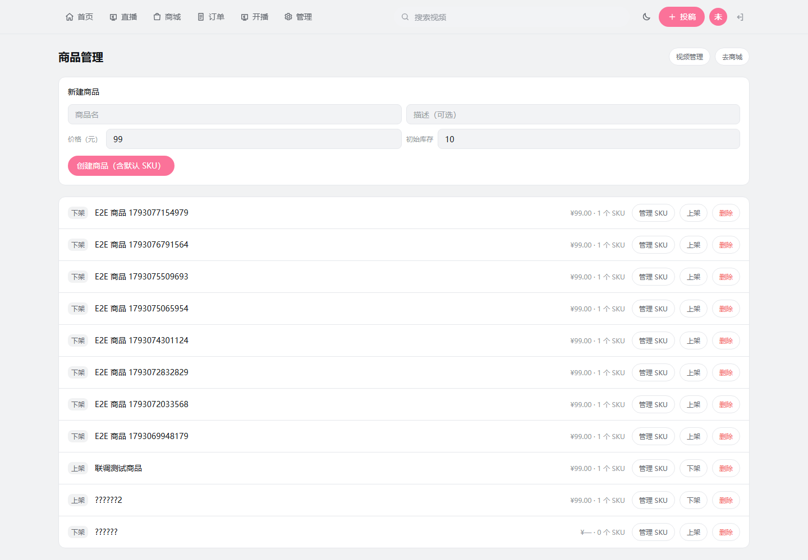 | — |
| 管理后台 | 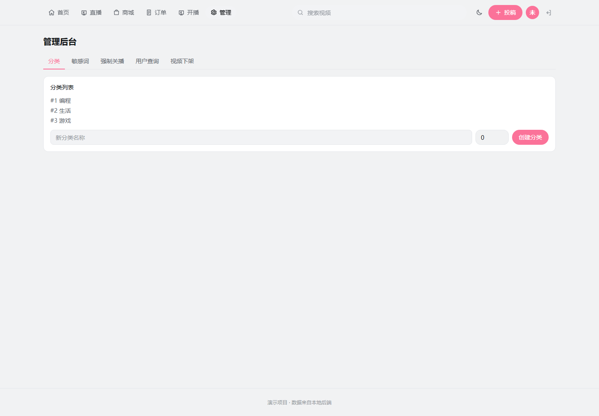 | — |
| 登录 | 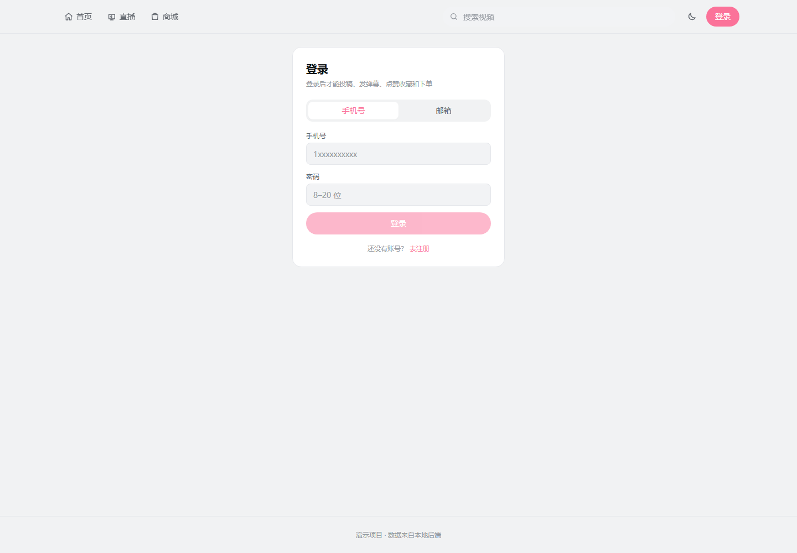 | — |
| 移动端首页 | 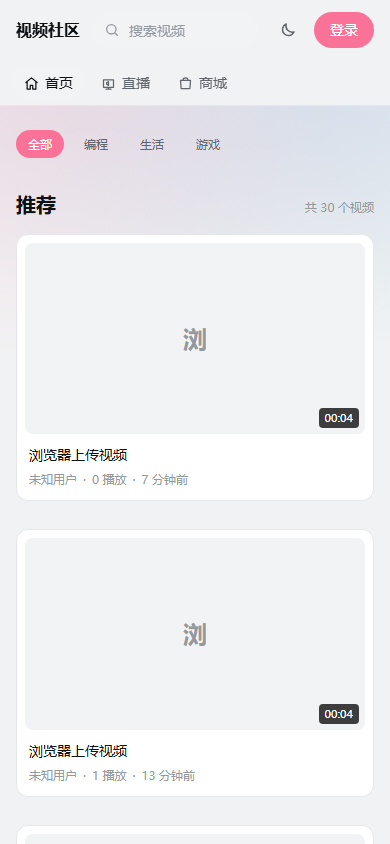 | — |

---

## 5. 页面覆盖

P0–P3 已覆盖：首页、搜索、播放页、直播间、直播列表/开播管理、商城/商品详情、
个人空间/他人主页/资料编辑、投稿、视频管理、商品管理、管理后台、登录注册、订单。

后续可继续做：商城筛选/排序、创作中心数据看板、表格批量操作、图片骨架与空态插画。

---

## 6. 验收 checklist

- [x] 1440 / 390 两个宽度无横向滚动
- [x] 首页 4 列（≥1280）、1 列（<640）
- [x] 直播播放器无原生进度条
- [x] 暗色由 token 自动切换，无第二套布局
- [x] 商城 / 空间 / 投稿 / 创作中心 / 管理后台 / 登录注册 / 订单完成 P3
- [x] `pnpm build`、`pnpm e2e`（4）、`pnpm e2e:real`（5）通过
