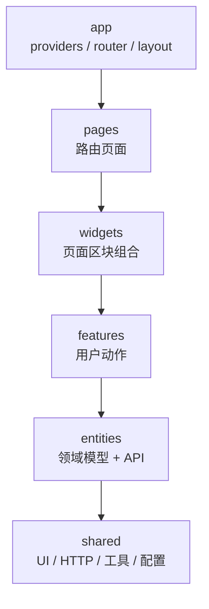

# 前端设计前置：后端问题清单与前端代码架构

> 目标：在现有 8 个服务的后端上，做一个 **B 站风格**的音视频社区前端。
>
> 结论先说：账号、点播、直播、弹幕、商品、订单的主链路是完整的，**可以直接支撑一个“能看、能播、能传、能直播、能发弹幕”的 MVP**。但“B 站风格”不只是配色和卡片：封面、作者、互动、推荐、购物闭环这五类数据目前缺了一半。前端可以先做 MVP，但**不要用假按钮填满页面**——点赞、投币、收藏、评论、关注目前都没有后端接口。

---

## 0. 先划清边界：前端能兜底的 vs 必须后端补的

| 类别 | 具体问题 | 前端能否单独解决 | 建议 |
| --- | --- | --- | --- |
| 部署边界 | 服务直连、身份头可伪造 | 否 | **后端/运维必须先做网络隔离** |
| 跨域 | 网关没有 CORS，OPTIONS 被 JWT 拦截 | 能（同源反代） | 推荐同源反代；直连方案再补网关 CORS |
| 时间格式 | Java / Go 三种时间格式 | 能（适配层） | 前端先适配，后端逐步统一 |
| 分页结构 | `{page,size,total,list}` vs `{total,page,pageSize,items}` | 能（适配层） | 前端先适配，后端逐步统一 |
| 空值 | 有的服务省略 `null`，有的返回 `null` | 能（类型可选） | 前端统一按 `undefined \| null` 处理 |
| 刷新令牌并发 | 多标签页同时刷新会互相踢掉 | 能（单飞 + 锁） | 前端做，后端可加宽限 |
| WebSocket 重连 | 断线、令牌过期、关闭码 | 能 | 前端做 |
| 首页拼装 | 视频、直播、分类三个接口 | 能（并行查询） | 先前端拼，后期 BFF |
| 作者信息 | 只有 `/users/me`，没有公开资料 | **否** | 后端补公开资料/批量接口 |
| 封面/图片 | 视频没有封面上传，图片没有上传接口 | **否** | 后端补媒体上传 |
| 商品列表 | 只有商品详情，没有列表 | **否** | 后端补列表 |
| 支付闭环 | 创建支付单后没有用户可完成的支付入口 | **否** | 后端补 mock 支付/真实渠道 |
| 互动 | 点赞/收藏/关注/评论全无 | **否** | 产品上决定做不做；做则后端补 |

这张表决定了排期：**先把“否”的补掉，前端再进入页面开发**，否则会大量返工。

---

# 第一部分：后端需要先解决的问题

## 1.1 优先级总览

| # | 优先级 | 问题 | 卡住的页面 | 建议方案 | 粗估 |
| --- | --- | --- | --- | --- | --- |
| 1 | **P0** | 下游服务可被直连，`X-User-Id` 可伪造 | 全部（安全） | 只暴露网关；服务绑内网/`127.0.0.1` | 0.5d |
| 2 | **P0** | 网关无 CORS，预检 `OPTIONS` 返回 401 | 全部（若前后端不同源） | 同源反代优先；或网关 CORS | 0.5d |
| 3 | **P0** | 没有公开用户资料/批量查询 | 首页卡片、播放页作者、直播间主播、空间页 | 新增 `/profiles` 接口 | 1d |
| 4 | **P0** | 视频没有封面，图片没有上传入口 | 首页、卡片、上传页、个人资料 | 新增图片上传 + 视频 `coverUrl` | 2d |
| 5 | **P0** | 商品没有列表；支付无法在 UI 完成 | 商城、下单、订单 | 商品列表 + 模拟支付 | 2d |
| 6 | **P0** | 点赞/收藏/关注/评论均未实现 | 播放页操作区、空间页 | 产品决策：做 / 不做 | 4–6d |
| 7 | P1 | 首页没有聚合接口、搜索只搜视频标题 | 首页、搜索页 | 前端先拼；后期 BFF | 1–2d |
| 8 | P1 | 上传走网关，全局响应超时 10s | 上传页 | 路由级超时 / 直传对象存储 | 1d |
| 9 | P1 | 媒资地址是 `localhost` + `http`，CORS 未配 | 播放器、直播 | 同源反代 + TLS + CORS | 1d |
| 10 | P1 | 三种时间格式、两套分页、空值语义不一 | 全部列表/详情 | 后端统一，前端适配 | 2d |
| 11 | P1 | 播放计数每次 `/play` 都 +1 | 播放页 | 独立上报接口 + 幂等 | 1d |
| 12 | P1 | 直播只给 RTMP 推流地址，浏览器不能推 | 开播页 | OBS 引导，或 WHIP/WebRTC | 2–5d |
| 13 | P1 | 弹幕 WS 令牌走 query，登出后连接仍可收 | 弹幕 | 一次性票据 / 连接过期 | 1–2d |
| 14 | P2 | 无 OpenAPI、无指标、无缩略图 | 工程效率 | 按需补 | 持续 |

> 粗估只是“一个人熟悉代码后的净开发时间”，不含联调与测试。

---

## 1.2 P0-1：只暴露网关，否则身份头可以伪造（最高优先级）

**现状**

- 网关校验 JWT 后注入 `X-User-Id` / `X-User-Role`，下游服务**只信任这两个头**，不解析 JWT。
- 代码位置：
  - 网关注入：[`JwtAuthenticationFilter.java`](../gateway-service/src/main/java/com/example/gatewayservice/filter/JwtAuthenticationFilter.java) 第 141–154 行
  - Java 下游取身份：`CurrentUser.uid(httpRequest)`
  - Go 下游取身份：[`identity.go`](../video-service-go/pkg/identity/identity.go) 第 29–36 行
- 这些服务端口（8001/8002/8003/8004、9001/9002/9003）在本地是直接监听的，`README` 也明确说“直连调试要手工补 `X-User-Id`”。

**风险**

1. 只要端口对外可达，任何人 `curl -H "X-User-Id: 1001"` 就能冒充用户。
2. Go 服务的 CORS 允许 `X-User-Id` 且 `Allow-Credentials: true`（见 [`middleware.go`](../video-service-go/internal/middleware/middleware.go) 第 122–143 行）。如果 9001–9003 暴露在公网，**恶意网页的 JavaScript 也能直接伪造身份**，不只是 curl。
3. 这不是前端能修的，必须网络隔离。

**要求**

- 生产只暴露：`gateway:8000`、MinIO `:9000`（只读媒体）、SRS `:8088`（只读媒体）、前端静态站点。
- Java 服务、Go 服务、Nacos、MySQL、Redis、RabbitMQ 一律不对外；K8s 用 ClusterIP + NetworkPolicy，Compose 绑定 `127.0.0.1`。
- Nginx 只反代 `/api`、`/ws`、`/media`、`/live`，**不要**为 8001–8004、9001–9003 单独开 location。
- 前端代码里不允许出现 `http://localhost:9001` 这类直连地址。

---

## 1.3 P0-2：跨域与同源

**现状**

- [`gateway-service/application.yml`](../gateway-service/src/main/resources/application.yml) 没有 `spring.cloud.gateway.globalcors`；全仓 Java 代码也搜不到 CORS 配置。
- 网关的 JWT 过滤器只对白名单放行，`OPTIONS` 预检不在白名单里，于是预检请求直接 `401`（见 `JwtAuthenticationFilter` 第 66–79 行）。
- Go 三个服务自己加了 CORS，但浏览器访问的是网关 `:8000`，**网关这一层没有 CORS**。
- 网关限流返回 `429` 时**没有响应体**（`GlobalRateLimitFilter` 第 85–87 行），也没有 CORS 头。

**推荐方案：同源反代（首选）**

前端和 API 同源，浏览器根本不发跨域预检，也避免 Cookie/`SameSite` 的一系列问题。

- 开发：Vite `server.proxy` 把 `/api`、`/ws`、`/media`、`/live` 代理到本地服务。
- 生产：Nginx 同域反代。
- 这样**不需要改网关**，是最稳的路径。

**备选方案：网关开 CORS**

如果前端必须部署在独立域名（例如静态站放 CDN），再补：

```yaml
spring:
  cloud:
    gateway:
      globalcors:
        cors-configurations:
          '[/**]':
            allowedOrigins:
              - "http://localhost:5173"
              - "https://your-frontend.example.com"
            allowedMethods: [GET, POST, PUT, PATCH, DELETE, OPTIONS]
            allowedHeaders:
              - Authorization
              - Content-Type
              - X-Request-Id
              - X-Session-Id
            exposedHeaders: [X-Request-Id]
            allowCredentials: true
            maxAge: 3600
      default-filters:
        - DedupeResponseHeader=Access-Control-Allow-Origin Access-Control-Allow-Credentials, RETAIN_UNIQUE
```

并在 `gateway.auth.permit-all` 增加：

```yaml
- OPTIONS /**
```

同时把 Go 的 CORS 允许头补上 `X-Session-Id`（游客心跳要用），并修掉“`Origin` 为空时返回 `*` 且 `Allow-Credentials: true`”的非法组合。

> 结论：**同源反代是架构决策，不是临时 workaround**。先定这个，再谈部署。

---

## 1.4 P0-3：公开用户资料 / 批量查询

**现状**

- `user-service` 只有：
  - `GET /api/v1/users/me`（当前登录用户）
  - `GET /api/v1/admin/users/{userId}`（管理员，按内部主键）
- 没有“按 uid 查公开资料”，也没有批量接口。
- 视频、直播只返回 `ownerId`（字符串），没有昵称/头像。
- 登录响应只有 `uid` + 双令牌，没有昵称；`/users/me` 有昵称/头像，但没有 `role`。

**影响**

- 首页卡片只能显示 `UID: 1001`，无法显示 UP 主昵称/头像。
- 播放页无法做“UP 主卡片”和作者主页。
- 直播间无法显示主播信息。
- 管理员按钮只能靠前端解 JWT 的 `role` claim 判断（可以做，但不优雅）。

**建议契约**

不要直接加 `GET /api/v1/users/{uid}`：如果为了公开主页把 `GET /api/v1/users/*` 加进网关白名单，Ant 的 `*` 会匹配 `me`，把 `/users/me` 一起放行；虽然 user-service 仍会因缺少 `X-User-Id` 返回 401，但语义混乱，后续很容易误判。建议独立前缀：

```http
GET /api/v1/profiles/{uid}
GET /api/v1/profiles?uids=1001,1002
```

响应只暴露公开字段：

```json
{
  "uid": "1001",
  "nickname": "小明",
  "avatar": "https://...",
  "bio": "这个人很懒",
  "gender": "male",
  "createdAt": "2026-09-27T10:30:00+08:00"
}
```

规则：

- 批量接口 `uids` 上限 100，未知 uid 直接省略，不报错。
- 不返回 `status`、内部 `userId`、手机号/邮箱。
- 缓存 60s；网关白名单加 `GET /api/v1/profiles`、`GET /api/v1/profiles/*`。
- 同时给 `/users/me` 增加 `role` 字段（`ADMIN` / `user`），前端做 UI 权限判断更直接；后端仍然是唯一鉴权方。

**替代方案**

在视频/直播 DTO 里直接内嵌 `owner: {uid, nickname, avatar}`。读起来最方便，但 Go 服务调 Java 用户服务需要额外链路（Go 没接 Nacos，也没有 RPC），会引入同步依赖。**更推荐批量 `/profiles` + 前端缓存**，或者后期用 BFF 聚合。

---

## 1.5 P0-4：封面与图片上传

**现状**

- 视频创建/修改只接受 `title / description / categoryId / tags`，**没有 `coverUrl`**（见 [`CreateVideoRequest`](../video-service-go/api/dto/dto.go) 第 11–16 行）。
- `Video.CoverURL` 字段存在，但没有写入入口；mock 转码器只生成 HLS，不生成封面；真实 FFmpeg 驱动也没有封面抽取。
- 直播创建/修改接受 `coverUrl`，但只是字符串，没有上传接口。
- 商品创建接受 `coverUrl`，同样只是字符串。
- 用户资料 `avatar` 也是字符串，没有上传接口。

**影响**

- B 站风格首页是“封面墙”，没有封面等于没有视觉。
- 上传页无法设置封面，发布出来的视频在列表里是空白。
- 头像只能贴外链，演示时很容易挂。

**建议**

新增一个轻量媒体接口（可以放在 `video-service-go`，也可以新建 `media-service`）：

```http
POST /api/v1/media/images
Content-Type: multipart/form-data

file:  <binary>
scene: video_cover | avatar | product_cover | live_cover
```

响应：

```json
{
  "url": "https://cdn.example.com/media/image/2026/09/xxx.jpg",
  "width": 1280,
  "height": 720,
  "sizeBytes": 182344,
  "variants": {
    "s": "https://cdn.example.com/media/image/2026/09/xxx_s.jpg",
    "m": "https://cdn.example.com/media/image/2026/09/xxx_m.jpg"
  }
}
```

要求：

- 只允许 `jpg/jpeg/png/webp`，按**文件头**判断，不只看扩展名；单文件 ≤ 5MB。
- 服务端做尺寸校验/压缩/去 EXIF；生成 320w / 640w 两档缩略图。
- 对象 key 随机化，避免可枚举；桶只开匿名读，不开匿名写。
- 视频创建/修改请求增加可选 `coverUrl`；发布前若为空，前端显示默认渐变封面。
- 在封面接口就绪前，前端用“标题首字 + 渐变背景”的占位图，不要留白。

---

## 1.6 P0-5：商品列表与支付闭环

**现状**

- `product-service` 只有 `GET /api/v1/products/{id}`（详情），**没有列表/搜索接口**；`ProductController` 里只有创建、详情、修改、删除、上下架、建 SKU。
- 商品详情返回 `{product, skus[]}`，没有 `minPrice`、`skuCount`、`statusName`。
- 下单需要 `skuId`，但没有列表就无法从 UI 找到 SKU。
- `POST /orders/{id}/pay` 只创建支付单，返回的 `PaymentVO` **没有 `payUrl`**；真正完成支付要调 `POST /payments/callback`，而回调要 HmacSHA256 签名，密钥只在服务端。
- 也就是说：**用户在页面上点“支付”之后，没有合法的前端路径把订单变成已支付。**

**建议**

1. 商品列表：

```http
GET /api/v1/products?page=1&pageSize=12&keyword=&status=1
```

```json
{
  "items": [
    {
      "id": 1,
      "productId": "P...",
      "name": "商品名",
      "coverUrl": "https://...",
      "minPrice": 1399800,
      "skuCount": 3,
      "status": 1,
      "statusName": "上架"
    }
  ],
  "total": 24,
  "page": 1,
  "pageSize": 12
}
```

- 公开只返回 `status=ON_SHELF(1)`；管理员/创建者才可看全部。
- 网关白名单加 `GET /api/v1/products`（精确匹配，不要用 `/*`）。
- `ProductVO` 增加 `statusName`，避免前端硬编码 0/1/2。

2. 模拟支付（仅本地/演示 profile）：

```http
POST /api/v1/orders/{id}/mock-pay
```

- 服务端内部复用回调逻辑（自己签名或直接调 `markPaid`），返回 `{orderId, status, statusName}`。
- 生产环境不注册该路由（和 live 的 `/dev/**` 同样的思路）。
- **绝对不要把 `PAYMENT_CALLBACK_SECRET` 放进前端**。

3. 如果商城不在 MVP 范围：从导航里移除“商城”，不要留一个点进去没有列表的入口。

---

## 1.7 P0-6：互动能力——做还是不做，必须先拍板

**现状**

- 没有点赞、投币、收藏、关注、评论、历史、稍后再看、通知。
- 只有 `viewCount` 和弹幕。

**影响**

B 站播放页的核心操作区是“点赞 / 投币 / 收藏 / 分享 / 关注”。如果后端没有，只有两种选择：

- **不做**：播放页只放“播放量 / 弹幕 / 分享 / UP 主”，视觉上仍然成立，但用户会觉得“少了点什么”。
- **做**：需要新表、计数、批量查询、防刷、审核，工作量不小。

**建议分档**

| 档位 | 能力 | 后端工作 | 前端页面 |
| --- | --- | --- | --- |
| MVP | 播放、弹幕、上传、直播、个人中心、商品/订单 | 无新增 | 已可落地 |
| Phase 2 | 点赞、收藏、关注 | 新表 + 计数 + 批量 viewerState | 播放页操作区、空间页 |
| Phase 3 | 评论、回复、举报 | 审核、分页、反垃圾、通知 | 评论区 |

如果做 Phase 2，建议的最小契约：

```http
POST   /api/v1/videos/{id}/like
DELETE /api/v1/videos/{id}/like
POST   /api/v1/videos/{id}/favorite
DELETE /api/v1/videos/{id}/favorite
GET    /api/v1/videos/{id}/interactions
-> { "liked": true, "favorited": false, "likeCount": 12, "favoriteCount": 3 }
```

列表页需要批量状态，否则每个卡片一次请求会打爆：

```http
GET /api/v1/videos/interactions?ids=1001,1002,1003
-> { "items": [{"videoId":1001,"liked":true,...}] }
```

表结构草图：

```sql
media_video_like(id, video_id, uid, created_at, UNIQUE(video_id, uid))
media_video_favorite(id, video_id, uid, created_at, UNIQUE(video_id, uid))
user_follow(id, follower_uid, followee_uid, created_at, UNIQUE(follower_uid, followee_uid))
media_comment(id, video_id, uid, root_id, parent_id, content, status, created_at)
```

计数用 Redis 缓冲 + 定时回写，避免每次点赞都 `UPDATE ... SET count = count + 1` 打行锁。

评论是最贵的：分页、排序、@、敏感词、举报、删除、审核、通知，**不要低估**。如果只是作品集演示，Phase 2 的点赞/收藏/关注性价比最高。

---

## 1.8 P1-1：首页聚合与搜索

**现状**

- 首页需要的三块数据分别来自：
  - `GET /api/v1/videos?page=1&pageSize=20`
  - `GET /api/v1/live/rooms?livingOnly=true&pageSize=8`
  - `GET /api/v1/categories`
- 视频列表默认按 `created_at DESC`，没有推荐/热度排序。
- 搜索只有 `GET /api/v1/videos?keyword=`，且只模糊匹配 `title`；不能搜用户、直播、商品。
- 没有 banner、热搜、搜索建议。

**两种做法**

| 方案 | 优点 | 缺点 | 适用 |
| --- | --- | --- | --- |
| A. 前端并行拼装 | 零后端改动，马上能做 | 首屏 3 个请求；无统一排序；某个区块失败要单独降级 | MVP |
| B. 新增 `GET /api/v1/feed/home` | 一次请求、可做推荐/运营位、易缓存 | 要新增 BFF 或聚合层 | 正式产品 |

MVP 建议 A：

```ts
const [videos, liveRooms, categories] = await Promise.allSettled([...]);
```

每个区块独立 skeleton/错误态，不要让直播接口挂掉导致整个首页白屏。

搜索 MVP 建议**只搜视频**，输入框 placeholder 写“搜索视频”，不要暗示能搜全站；等后端有统一搜索再做全站搜索。

---

## 1.9 P1-2：契约不统一（前端最容易被坑的地方）

这是当前仓库最需要“先定规矩”的部分。

### 时间格式：三种

| 来源 | 样例 | 说明 |
| --- | --- | --- |
| `user-service` / `auth-service` | `2026-09-27T10:30:00` | Jackson 默认 `LocalDateTime`，ISO 但**无时区** |
| `product-service` / `order-service` | `2026-09-27 10:30:00` | 自定义 `JacksonConfig`，空格分隔、**无时区** |
| Go 三服务 | `2026-09-27T10:30:00+08:00` | RFC3339，带偏移 |

根 README 写的是 `2026-09-27T10:30:00`，但 product/order 实际是空格格式（见 [`JacksonConfig.java`](../order-service/src/main/java/com/example/order/config/JacksonConfig.java) 第 17–24 行）。

**前端适配**（先做，避免每个页面各写一套）：

```ts
const SPACE = /^\d{4}-\d{2}-\d{2} \d{2}:\d{2}:\d{2}$/;
const LOCAL_ISO = /^\d{4}-\d{2}-\d{2}T\d{2}:\d{2}:\d{2}$/;

export function parseServerDate(input?: string | null): Date | null {
  if (!input) return null;
  if (SPACE.test(input)) return new Date(input.replace(' ', 'T') + '+08:00');
  if (LOCAL_ISO.test(input)) return new Date(input + '+08:00');
  return new Date(input); // RFC3339
}
```

**后端长期修复**：统一输出 `OffsetDateTime` / RFC3339 带 `+08:00`，或者至少在文档里明确“所有时间均为 `Asia/Shanghai` 本地时间，无偏移”。两者选一个，不要继续三套。

### 分页：两套

| 体系 | 结构 |
| --- | --- |
| Java order | `{ page, size, total, list }`（[`PageVO.java`](../order-service/src/main/java/com/example/order/common/PageVO.java)） |
| Go video/live/danmaku | `{ total, page, pageSize, items }`（[`response.go`](../video-service-go/pkg/response/response.go) 第 22–27 行） |

前端适配：

```ts
type Page<T> = { items: T[]; total: number; page: number; pageSize: number };

function fromJavaPage<T>(p: { list: T[]; total: number; page: number; size: number }): Page<T> {
  return { items: p.list, total: p.total, page: p.page, pageSize: p.size };
}
```

后端建议把 `PageVO` 改成 `{items,total,page,pageSize}`，一次性对齐，测试和文档一起改。

### 空值：两种

- `product-service` / `order-service` 配置了 `default-property-inclusion: non_null`，空字段**被省略**。
- `user-service`、Go 服务默认输出 `null`。
- 失败响应在 product/order 里 `data` 也可能被省略，不是 `null`。

前端类型一律写成可选：`paidAt?: string | null`，判断用 `value == null`，不要只判断 `undefined`。

### ID：多种语义

| 字段 | 语义 |
| --- | --- |
| `id`（商品/订单/SKU） | 内部自增主键 |
| `productId` / `orderId` / `skuId` | 对外业务编号（`P...` / `O...` / `S...`） |
| `id`（视频） | 视频主键，数字，也是对外 ID |
| `roomId` | 直播间主键，数字 |
| `danmaku.roomId` / `videoId` | **字符串** |
| `uid` | 字符串，对客身份 |

前端不要写一个通用的 `id: number` 类型；按实体分别定义。

### 枚举：三种风格

| 领域 | 风格 |
| --- | --- |
| 商品 `status` / `productType` | 数字，无 `statusName` |
| 订单 `status` / 支付 `status` | 数字 + `statusName` |
| 视频/直播 `status` | 字符串（`DRAFT` / `LIVING`） |
| 用户 `status` | 字符串（`NORMAL` / `DISABLED`） |
| 弹幕 `position` | 字符串（`SCROLL` / `TOP` / `BOTTOM`） |

前端每个实体维护自己的映射表，未知值要有兜底文案，不要直接渲染数字。

### 金额

统一为**分**（`Long`）。展示：`(cents / 100).toFixed(2)`；不要用浮点做加减，不要在 JS 里把分转成元再乘回去。

### 错误响应

| 场景 | 现状 | 前端处理 |
| --- | --- | --- |
| 业务失败 | `{code,message,data}`，HTTP 与 code 前缀对应 | 按 `code` 给文案，按 HTTP 做兜底 |
| 网关 401 | 手写 JSON `{code:40101,...}` | 同业务错误 |
| 网关 429 | **空响应体** | 按 HTTP 429 处理，不要 `JSON.parse` 崩溃 |
| 网关 502/503 | Spring 默认错误体 | 统一兜底文案 |
| 参数校验 | `40001` | 直接展示 `message`（后端已拼好字段名） |

还有一个细节：`40001` 在不同域里语义不同（弹幕撤回超时是 `409/40001`），**不能只按 code 判断**，要 `HTTP status + code + 当前操作` 一起判断。

### 其它

- `pageSize` 上限：视频 100、直播 100、弹幕 200、点播历史 5000；前端分页器不要超过。
- `playUrls` 只在 `LIVING` 时返回，非直播为 `null`。
- `streamKey` / `pushUrl` 只对创建者/ADMIN 出现。
- 未发布视频对游客返回 `404`，不是 `403`；前端不要提示“无权限”，按“不存在”处理。
- `/videos/:id/play` **每次调用都会 `viewCount + 1`**，不要拿来预取或轮询。

---

## 1.10 P1-3：上传链路

**现状**

- 网关全局 `response-timeout: 10s`（[`application.yml`](../gateway-service/src/main/resources/application.yml) 第 79–81 行）。
- 分片上传每片最小 5MiB；2GB 文件按 5MiB 切片是 410 片。
- `PUT /upload/parts/{n}` 要求显式 `Content-Length`，不接受 chunked。
- 单文件一次性上传也走同一个网关。

**问题**

- 5MiB 分片在 1Mbps 上行需要约 40s，**必然超过 10s 网关响应超时**，表现为 504/连接断开。
- 2GB 单文件上传更不可能在 10s 内完成。
- 上传过程中 access token 过期（30min）需要刷新，但“上传请求”不应该因为刷新而丢片。

**建议**

1. 给上传路由单独放宽超时（Spring Cloud Gateway 路由 metadata）：

```yaml
- id: video-service-go
  uri: ${VIDEO_SERVICE_URI:http://localhost:9001}
  predicates:
    - Path=/api/v1/categories/**,/api/v1/videos/**
  metadata:
    response-timeout: 300000   # 5 分钟
    connect-timeout: 5000
```

如果当前 SCG 版本对 metadata 支持不稳定，就拆一条更具体的上传路由放在通用路由**前面**，单独设 `response-timeout`。

2. Nginx：

```nginx
location ~ ^/api/v1/videos/[^/]+/upload {
    proxy_pass http://127.0.0.1:8000;
    proxy_request_buffering off;
    proxy_read_timeout 300s;
    client_max_body_size 10m;
}
```

3. 前端：

- 并发 3 片，每片严格按服务端返回的 `partSize` 切。
- 用 `Blob` / `ArrayBuffer` 作为 body，让浏览器自动带 `Content-Length`；**不要用 `ReadableStream`**，否则会变成 chunked 被后端拒绝。
- 失败重试 3 次（指数退避）；`404/40404` 重新 `init`；`409/60006` 重新 `status` 对齐；`401` 刷新令牌后重试当前片。
- 上传会话 `uploadId` 存 `sessionStorage`/`localStorage`，刷新页面后先 `GET upload/status` 恢复，**以服务端 `ListParts` 为唯一权威**。

4. 更彻底的方案：对象存储预签名直传（浏览器直接 PUT 到 MinIO），网关不承接大流量。需要 MinIO CORS + 预签名接口 + 完成回调，工作量更大；MVP 先用“放宽超时 + 分片”。

---

## 1.11 P1-4：媒体地址、CORS 与 HTTPS

**现状**

- 视频播放地址由 `Storage.URL()` 用 `PublicEndpoint` 拼：默认 `http://<minio-endpoint>/media/<key>`（[`minio.go`](../video-service-go/internal/infra/storage/minio.go) 第 150–156 行）。
- compose 里是 `http://${PUBLIC_HOST:-localhost}:9000`。
- 直播播放地址由 live-service 拼：`http://<rtmp_host>:8088/live/<key>.m3u8`（[`server.go`](../live-service-go/internal/infra/media/server.go) 第 64–74 行），**协议写死 `http`**。
- `srs.conf` 的 `http_server` 没有 `crossdomain on`。

**问题**

- 前端部署到 HTTPS 后，`http://` 的 HLS/FLV 会被浏览器按混合内容拦截。
- 浏览器所在机器不是 `localhost` 时，`http://localhost:9000` 指向用户自己的电脑，直接播不了。
- hls.js 通过 `fetch` 拉 m3u8/ts，需要 MinIO/SRS 返回 CORS 头；SRS 当前没开。
- MinIO 桶是匿名读（compose 里 `mc anonymous set download`），**知道 URL 就能绕过前端直接看**；未发布视频虽然没有 `playbackUrl`，但对象本身仍可被猜到/泄露。生产要考虑签名 URL 或 CDN 鉴权。

**建议**

1. 同源反代，前端只认相对路径：

```
https://your.site/api/...    -> gateway:8000
https://your.site/ws/...     -> gateway:8000 (WebSocket Upgrade)
https://your.site/media/...  -> MinIO:9000
https://your.site/live/...   -> SRS:8088
```

这样媒体地址可以配置成 `https://your.site/media`，没有混合内容，也不需要跨域。

2. 如果必须直连媒体域名：

- MinIO 配 `MINIO_API_CORS_ALLOW_ORIGIN=https://your.site`（或 `mc cors set`），允许 `GET/HEAD` 和 `Range`。
- SRS 在 `http_server` 加 `crossdomain on;`，并确认 HLS/FLV 响应带 `Access-Control-Allow-Origin`。
- 全部上 TLS；WebSocket 用 `wss://`。

3. 缓存策略：

- `.ts` / 图片：`Cache-Control: public, max-age=31536000, immutable`
- `.m3u8`：`no-cache`（直播尤其不能缓存）
- 视频原片：私有，不要公开桶。

4. **演示环境必须用真实转码**：`transcoder.driver=mock` 只生成“结构正确但没有分片”的 m3u8，播放器会一直转圈。要演示播放，设 `driver=real` 并安装 FFmpeg，或提前准备真实 HLS 产物。这一点会直接影响作品集演示效果。

5. 直播延迟：HLS 6–10s，HTTP-FLV 2–3s。前端默认 HLS，提供“低延迟”切换到 FLV（`flv.js`）。`webrtc://` 不是浏览器可直接播放的 URL，需要 SRS 的 WebRTC 信令，MVP 不建议做。

---

## 1.12 P1-5：播放计数与直播状态

**播放计数**

- `GET /videos/:id/play` 每次调用 `INCR video:view:{id}`。
- 前端 prefetch、React StrictMode 双执行、用户刷新都会多算。
- 建议后端拆成 `GET /play`（只返回地址） + `POST /view`（幂等上报，按 `uid/session + videoId + 时间窗` 去重），或者由前端在 `playing` 事件里只调一次并接受误差。MVP 可以前端控制“每次挂载只调一次”，但后端最好补幂等。

**直播状态**

- `POST /start` 后状态是 `STARTING`，要等 SRS `on_publish` 回调才变 `LIVING`；60s 没推流会 `FAILED`。
- 前端不能点完“开播”就假设已开播，必须轮询详情/播放接口，展示“等待推流”。
- `GET /rooms/:id/play` 在非 `LIVING` 时返回 `409/70001`，不要当异常弹红。
- 在线人数只能轮询 `GET /rooms/:id/online`（5–10s），WS 只推弹幕和系统事件。
- 观众心跳 20s 一次，服务端 60s 过期；游客要带 `X-Session-Id`。
- `streamKey` 每次开播都会重新生成；创建时返回的那份只在首次开播前有效。前端要做“复制推流地址 + OBS 教程”，不要尝试浏览器直接 RTMP 推流。

**浏览器开播**

当前只有 RTMP 推流地址，浏览器不能直接推。两个选择：

- MVP：主播用 OBS/ffmpeg，前端给复制按钮和图文教程。
- 进阶：SRS 侧评估 WHIP/WebRTC 推流（需要额外信令与前端采集），或者做一个桌面推流工具。

如果“网页点开播”是硬需求，这是**必须提前评估**的后端能力，不要等前端做完才发现推不了。

---

## 1.13 P1-6：弹幕与 WebSocket

**现状**

- `/ws/danmaku` 需要 JWT，浏览器不能设置请求头，所以令牌走 `?access_token=`；网关会在转发前摘掉。
- 连接建立后，**令牌过期不会断开**；登出也只拉黑 HTTP 请求，已建立的 WS 仍可继续收。
- 弹幕 ID 异步落库，发送响应里 `danmakuId=0`；不能用它做前端 key，要用 `clientMsgId + sentAt`。
- 撤回不广播，历史里下次才消失。
- 直播弹幕历史第 1 页走 Redis 热数据，`total` 是累计数；点播历史按 `timeMs` 升序，上限 5000。
- 关闭码：`1001`（服务端关闭）、`4001`（同 uid 第 4 条连接踢最旧）、`1003`（协议解析失败）。

**建议**

1. 一次性 WS 票据（可选，但推荐）：

```http
POST /api/v1/danmaku/ws-ticket
-> { "ticket": "...", "expiresIn": 30 }
```

WS 用 `?ticket=`，网关校验票据，避免 access token 进入访问日志/浏览器历史。

2. 连接生命周期：服务端在 token 过期时主动关闭；前端收到关闭后用新 token 重连。
3. 前端：心跳 25s、指数退避重连、重连后拉最近历史补洞、按 `clientMsgId` 去重。
4. 如果要多实例部署，弹幕 Hub 目前是进程内内存，需要 Redis Pub/Sub 跨节点广播；否则用户连到不同实例会“看不到彼此的弹幕”。

---

## 1.14 P1-7：认证细节

**现状**

- access token 30min，refresh token 7d；refresh 是**一次性轮换**（Redis Lua 原子替换，[`SessionService.java`](../auth-service/src/main/java/com/example/authservice/service/SessionService.java) 第 36–50、85–111 行）。
- 多标签页同时刷新时，只有一个能成功，其他会拿到 `401/40101`。
- `logout` **只拉黑当前 access token，不失效 refresh token**（`AuthService.java` 第 92–103 行）。被窃取的 refresh token 在 7 天内仍可用。
- `force-logout` 清掉目标用户所有 refresh 会话，但**其他设备的 access token 仍在 30min 内有效**。
- 网关默认过滤器里有 `RemoveRequestHeader=Cookie`（`application.yml` 第 76–78 行），**请求 Cookie 到不了下游**；而 `RemoveRequestHeader=Set-Cookie` 实际是请求头过滤器，并不会移除响应里的 `Set-Cookie`。因此经网关做 HttpOnly Cookie 会话是走不通的（而且 auth-service 目前也不下发 Cookie）。另外，`RemoveRequestHeader=Set-Cookie` 这个写法本身也可疑：`Set-Cookie` 是响应头，若意图是移除响应头，应使用 `RemoveResponseHeader=Set-Cookie`。

**建议**

1. 多标签页：前端 `navigator.locks` + `BroadcastChannel` 做单飞刷新；后端可加 30s 宽限（旧 refresh token 在轮换后短时间内仍可换到**同一个**新 token），但实现要小心重放。
2. 登出：`/auth/logout` 接受 refresh token 并删除对应 session，或维护 `jti -> sessionId` 索引；否则“退出登录”名不副实。
3. 角色：`/users/me` 返回 `role`，前端不必解 JWT。
4. 如果要做 HttpOnly Cookie：需要改网关（去掉 `RemoveRequestHeader=Cookie`，并确认 `Set-Cookie` 响应能透传）+ 引入 BFF/CSRF 防护；当前架构下**不建议**，MVP 用“access 内存 + refresh localStorage”并配 CSP。

**前端存储建议**

| 方案 | XSS 风险 | 多标签 | 实现成本 | 适用 |
| --- | --- | --- | --- | --- |
| access 内存 + refresh localStorage | 中（refresh 可被 XSS 读） | 可 | 低 | 作品集 MVP |
| access 内存 + refresh sessionStorage | 中 | 每个标签独立登录 | 低 | 不推荐 |
| BFF + HttpOnly Cookie | 低 | 可 | 高 | 生产 |

---

## 1.15 后端改造清单（按冲刺）

| 冲刺 | 内容 | 解锁的前端 | 粗估 |
| --- | --- | --- | --- |
| S0 | 网络隔离；同源反代；时间/分页适配约定；确认 `driver=real` | 所有页面能联调 | 1–2d |
| S1 | `/profiles` + 批量；`/users/me` 加 `role`；图片上传 + 视频 `coverUrl` | 首页卡片、作者、上传页 | 2–3d |
| S2 | 上传路由超时；MinIO/SRS CORS + 同源媒体；封面/缩略图 | 上传、播放、直播 | 2–3d |
| S3 | 商品列表 + `statusName` + `mock-pay` | 商城、下单、订单 | 1–2d |
| S4 | 点赞/收藏/关注（可选） | 播放页操作区 | 4–6d |
| S5 | 首页 feed / 统一搜索 / 评论（可选） | 首页、搜索、评论 | 5–10d |

**最小可演示路径**：S0 + S1 + S2 + “只读首页/播放/直播弹幕”，约 **5–8 个工作日** 的后端准备；S3 是商城；S4/S5 是加分项。

---

# 第二部分：前端代码架构

## 2.1 范围与非目标

**MVP 页面**

- 首页（视频 + 直播 + 分类）
- 搜索（仅视频）
- 播放页（HLS + 弹幕 + 作者卡片）
- 直播列表 / 直播间（HLS/FLV + 弹幕 + 在线人数 + 主播控制台）
- 上传页（分片/续传/转码/发布）
- 我的投稿 / 我的直播
- 登录 / 注册 / 个人资料
- 商城 / 商品详情 / 下单 / 订单（后端补列表与 mock 支付后）
- 管理端（可选：分类、敏感词、下架、强制关播）

**非目标（MVP 不做）**

- 点赞/投币/收藏/评论/关注（没有后端）
- 个性化推荐、热搜、搜索建议
- 弹幕高级样式（渐变、图片、语音）
- 多语言
- SSR/SEO（先 SPA；如果视频页要 SEO，再评估 Next.js）

---

## 2.2 技术选型

| 层 | 选择 | 理由 | 备选 |
| --- | --- | --- | --- |
| 框架 | React 18 + TypeScript 5 | 生态成熟、招聘/作品集通用、与 hls.js/视频生态契合 | Vue 3 + Pinia（同样分层可复用） |
| 构建 | Vite 6 | 快、代理简单、按需拆包 | Next.js（需要 SEO/SSR 时） |
| 路由 | React Router 6 | 标准、支持 lazy/loader 之外的轻量方案 | TanStack Router |
| 服务端状态 | TanStack Query 5 | 缓存、重试、分页、并发去重 | SWR |
| 客户端状态 | Zustand 5 | 小而直接，适合播放器/弹幕设置 | Redux Toolkit |
| HTTP | Axios 1 | 拦截器、取消、上传进度成熟 | fetch + 自封装 |
| 播放 | hls.js + flv.js | HLS 兼容性最好，FLV 低延迟 | video.js / 原生 |
| 样式 | Tailwind 3.4 + CSS Variables | 快速搭 B 站风格，同时保留设计 token | SCSS Modules |
| 无障碍/交互 | Radix UI primitives | 无样式、可访问性好，适合自定义皮肤 | Headless UI |
| 表单 | React Hook Form + Zod | 登录/上传/商品表单，校验复用 | Formik |
| 时间 | dayjs | 轻、插件够用 | date-fns |
| 测试 | Vitest + Testing Library + MSW + Playwright | 单元/组件/契约/E2E | Jest |
| 包管理 | pnpm | 快、锁文件稳定 | npm |

> 如果团队更熟 Vue：Vue 3 + `<script setup>` + Pinia + Vue Query + Vue Router，目录分层和本文一致，只需替换 React 特有实现。

---

## 2.3 分层：Feature-Sliced，单向依赖



规则：

1. **只能向下依赖**：`pages` 不能直接被 `features` 反向引用；`entities` 不依赖 `features`。
2. **跨 feature 通信**走 `shared/store` 或事件，不要互相 import。
3. **UI 组件分两类**：
   - `shared/ui`：无业务语义（Button、Modal、Tabs）。
   - `widgets/*`：有业务语义的组合（VideoCard、PlayerShell、DanmakuLayer）。
4. 用 ESLint `import/no-restricted-paths` 固化分层，防止半年后变成“大泥球”。

---

## 2.4 目录结构

```text
web/
├─ index.html
├─ vite.config.ts
├─ tsconfig.json
├─ .env.development
├─ .env.production
├─ public/
│  └─ brand/                      # 自己的 logo / 默认封面 / 空状态插画
├─ src/
│  ├─ main.tsx
│  ├─ app/
│  │  ├─ App.tsx
│  │  ├─ router.tsx               # 路由表 + lazy + guards
│  │  ├─ providers.tsx            # QueryClient / Theme / Toast / ErrorBoundary
│  │  └─ layouts/
│  │     ├─ SiteLayout.tsx        # 顶部导航 + 内容区
│  │     ├─ StudioLayout.tsx      # 投稿/直播管理侧边栏
│  │     └─ AuthLayout.tsx        # 登录/注册居中布局
│  ├─ pages/
│  │  ├─ home/HomePage.tsx
│  │  ├─ search/SearchPage.tsx
│  │  ├─ video/VideoPage.tsx
│  │  ├─ live/LiveListPage.tsx
│  │  ├─ live/LiveRoomPage.tsx
│  │  ├─ upload/UploadPage.tsx
│  │  ├─ studio/MyVideosPage.tsx
│  │  ├─ studio/MyLivePage.tsx
│  │  ├─ space/SpacePage.tsx
│  │  ├─ shop/ShopPage.tsx
│  │  ├─ shop/ProductPage.tsx
│  │  ├─ orders/OrdersPage.tsx
│  │  ├─ orders/OrderDetailPage.tsx
│  │  ├─ auth/LoginPage.tsx
│  │  ├─ auth/RegisterPage.tsx
│  │  ├─ admin/AdminPage.tsx
│  │  └─ NotFoundPage.tsx
│  ├─ widgets/
│  │  ├─ site-header/
│  │  ├─ video-card/
│  │  ├─ live-card/
│  │  ├─ category-tabs/
│  │  ├─ player-shell/            # 播放器容器 + 控制条 + 弹幕开关
│  │  ├─ danmaku-layer/           # canvas 弹幕渲染
│  │  ├─ author-card/             # 依赖 /profiles
│  │  ├─ upload-dropzone/
│  │  ├─ order-status/
│  │  └─ empty-state/
│  ├─ features/
│  │  ├─ auth/                    # 登录/注册/登出/刷新
│  │  ├─ video-upload/            # 分片上传状态机
│  │  ├─ danmaku-send/            # 输入框/颜色/位置
│  │  ├─ live-control/            # 开播/关播/推流地址
│  │  ├─ order-create/            # 下单/支付
│  │  └─ admin/                   # 管理动作
│  ├─ entities/
│  │  ├─ user/
│  │  │  ├─ types.ts
│  │  │  ├─ api.ts
│  │  │  ├─ queries.ts
│  │  │  └─ adapters.ts
│  │  ├─ video/
│  │  ├─ live/
│  │  ├─ danmaku/
│  │  ├─ product/
│  │  └─ order/
│  ├─ shared/
│  │  ├─ api/
│  │  │  ├─ http.ts               # axios 实例 + 信封解包 + 401 刷新
│  │  │  ├─ errors.ts             # ApiError + 错误文案映射
│  │  │  ├─ refresh.ts            # 单飞刷新 + 跨标签锁
│  │  │  └─ query-keys.ts
│  │  ├─ ws/
│  │  │  ├─ DanmakuSocket.ts
│  │  │  └─ protocol.ts
│  │  ├─ ui/                      # Button/Input/Modal/Tabs/Skeleton/Toast...
│  │  ├─ lib/
│  │  │  ├─ datetime.ts           # parseServerDate / relativeTime
│  │  │  ├─ money.ts              # 分 -> ¥
│  │  │  ├─ id.ts                 # 业务编号/内部 ID 区分
│  │  │  └─ status.ts             # 各域状态映射
│  │  ├─ config/env.ts
│  │  └─ styles/
│  │     ├─ tokens.css            # 颜色/间距/圆角/阴影
│  │     ├─ reset.css
│  │     └─ themes.css            # light / dark
│  └─ test/
│     ├─ mocks/                   # MSW handlers + fixtures
│     └─ setup.ts
├─ e2e/
│  ├─ auth.spec.ts
│  ├─ video.spec.ts
│  └─ upload.spec.ts
└─ Dockerfile
```

---

## 2.5 路由与布局

| 路径 | 页面 | 布局 | 鉴权 | 主要数据 |
| --- | --- | --- | --- | --- |
| `/` | 首页 | Site | 否 | 视频列表 + 直播 + 分类 |
| `/search?q=` | 搜索 | Site | 否 | `GET /videos?keyword=` |
| `/video/:id` | 播放页 | Site | 可选 | 详情 + `/play` + 弹幕历史 |
| `/live` | 直播列表 | Site | 否 | `GET /live/rooms?livingOnly=true` |
| `/live/:id` | 直播间 | 沉浸式 | 可选 | 详情 + `/play` + 心跳 + WS |
| `/upload` | 投稿 | Studio | **是** | 创建/分片/转码/发布 |
| `/studio/videos` | 我的投稿 | Studio | **是** | `GET /videos?mine=true` |
| `/studio/live` | 我的直播 | Studio | **是** | `GET /live/rooms?mine=true` |
| `/space` | 我的空间 | Site | **是** | `/users/me` + 我的投稿 |
| `/space/:uid` | 他人空间 | Site | 否 | **需 `/profiles` + 投稿列表** |
| `/shop` | 商城 | Site | 否 | **需商品列表** |
| `/shop/:id` | 商品详情 | Site | 可选 | `GET /products/:id` |
| `/orders` | 我的订单 | Site | **是** | `GET /orders` |
| `/orders/:id` | 订单详情 | Site | **是** | `GET /orders/:id` |
| `/login` | 登录 | Auth | 否 | `/auth/login` |
| `/register` | 注册 | Auth | 否 | 验证码 + 注册 |
| `/admin` | 管理 | Studio | **ADMIN** | 分类/敏感词/下架 |

路由实现：

- 所有 page `React.lazy` + `Suspense`，首屏只加载首页。
- `RequireAuth` 保存 `returnTo`，登录后回跳。
- `RequireAdmin` 只做 UI 隐藏；后端仍会 403。
- 直播页用独立 layout（深色背景、全宽），不要套普通白色内容区。

---

## 2.6 数据层

### 2.6.1 `http.ts` 的职责

1. `baseURL = import.meta.env.VITE_API_BASE ?? '/api/v1'`。
2. 注入 `Authorization`、`X-Request-Id`（`crypto.randomUUID()`）。
3. 解包 `{code,message,data}`：`code !== 0` 抛 `ApiError`。
4. 统一处理 401：单飞刷新，成功后重放原请求一次；失败则清会话并跳登录。
5. 容忍非 JSON（429 空 body、502 HTML），生成带 HTTP 状态的 `ApiError`。
6. 上传请求单独设置 `timeout: 120000`，不走默认 15s。

```ts
// shared/api/http.ts（示意）
export class ApiError extends Error {
  constructor(
    public code: number,
    message: string,
    public status: number,
    public requestId?: string,
    public data?: unknown,
  ) { super(message); }
}

const client = axios.create({
  baseURL: import.meta.env.VITE_API_BASE ?? '/api/v1',
  timeout: 15_000,
});

client.interceptors.request.use((config) => {
  const token = useAuthStore.getState().accessToken;
  if (token) config.headers.Authorization = `Bearer ${token}`;
  config.headers['X-Request-Id'] ??= crypto.randomUUID();
  return config;
});

client.interceptors.response.use(
  (res) => res,
  async (error) => {
    const status = error.response?.status ?? 0;
    const body = error.response?.data;
    const code = typeof body?.code === 'number' ? body.code : status;

    if (status === 401 && !isAuthPath(error.config?.url)) {
      const token = await refreshOnce();       // 单飞 + 跨标签锁
      if (token) {
        error.config.headers.Authorization = `Bearer ${token}`;
        return client.request(error.config);   // 只重放一次
      }
      logoutLocal();
    }
    throw new ApiError(code, body?.message ?? httpMessage(status), status,
      body?.requestId ?? error.response?.headers?.['x-request-id']);
  },
);

export async function request<T>(config: AxiosRequestConfig): Promise<T> {
  const res = await client.request<Envelope<T>>(config);
  if (res.data.code !== 0) {
    throw new ApiError(res.data.code, res.data.message, res.status);
  }
  return res.data.data;
}
```

### 2.6.2 刷新单飞与跨标签

```ts
let inflight: Promise<string | null> | null = null;

export function refreshOnce(): Promise<string | null> {
  if (!inflight) {
    inflight = withCrossTabLock(() => doRefresh()).finally(() => { inflight = null; });
  }
  return inflight;
}

async function withCrossTabLock<T>(fn: () => Promise<T>): Promise<T> {
  if ('locks' in navigator) {
    return navigator.locks.request('auth-refresh', fn);
  }
  return fn(); // 降级：单标签场景
}
```

- refresh token 更新后写入 `localStorage`，并 `BroadcastChannel('auth')` 通知其他标签。
- 其他标签收到消息后只更新 `refreshToken`；access token 仍各自内存持有，过期时再走单飞。
- 不要在 `localStorage` 存 access token（减少暴露面）。

### 2.6.3 查询键与缓存时间

```ts
export const qk = {
  categories: ['categories'] as const,
  videos: (p: VideoListParams) => ['videos', p] as const,
  video: (id: string) => ['video', id] as const,
  play: (id: string) => ['video', id, 'play'] as const,
  liveRooms: (p: LiveListParams) => ['live-rooms', p] as const,
  liveRoom: (id: string) => ['live-room', id] as const,
  online: (id: string) => ['live-room', id, 'online'] as const,
  danmakuVideo: (id: string) => ['danmaku', 'video', id] as const,
  profiles: (uids: string[]) => ['profiles', uids.join(',')] as const,
  orders: (p: OrderListParams) => ['orders', p] as const,
};
```

| 数据 | staleTime | 说明 |
| --- | --- | --- |
| 分类 | 10min | 很少变 |
| 视频列表 | 60s | 首页可接受 |
| 视频详情 | 5min | 标题/简介不常变 |
| 播放地址 | 30s | 发布状态可能变 |
| 直播间列表 | 10s | 直播状态变化快 |
| 在线人数 | 5s + 轮询 | 轻量接口 |
| 弹幕历史 | 0 | 每次进房拉最新 |
| 订单 | 30s | 支付后手动 invalidate |
| 用户资料 | 5min | 批量缓存 |

### 2.6.4 契约适配器

把后端的不一致**收敛在 `entities/*/adapters.ts`**，页面层只看到干净模型：

```ts
// entities/video/adapters.ts
export function toVideo(dto: VideoDTO): Video {
  return {
    id: String(dto.id),
    title: dto.title,
    coverUrl: dto.coverUrl || '',
    durationSec: dto.duration,
    publishedAt: parseServerDate(dto.publishedAt),
    status: dto.status,
    viewCount: dto.viewCount,
    ownerId: dto.ownerId,
  };
}
```

- `parseServerDate` 处理三种时间。
- `formatMoney` 处理分。
- `normalizePage` 处理两套分页。
- `statusText` 按域映射枚举。
- 所有 DTO 字段可选，适配器给默认值。

### 2.6.5 错误映射

| HTTP / code | UI 行为 |
| --- | --- |
| `401 / 40101` | 刷新一次；失败跳登录，保留 `returnTo` |
| `403 / 40301` | Toast“没有权限”；不跳登录 |
| `404 / 404xx` | 空状态/“内容不存在”；视频未发布按 404 处理 |
| `409 / 409xx` | Toast 后端 `message`；刷新当前资源 |
| `429`（空 body） | “操作太频繁，请稍后再试”；按钮倒计时 |
| `429 / 80002` | 用 `retryAfterMs` 禁用发送按钮 |
| `5xx` | “服务暂时不可用” + `requestId` 复制按钮 |
| 网络错误 | “网络异常，请检查连接” + 重试 |

`requestId` 一定要展示/可复制，后端日志靠 `X-Request-Id` 串联。

---

## 2.7 认证与权限

### 2.7.1 会话模型

```ts
type Session = {
  uid: string;
  role: 'ADMIN' | 'user';
  accessToken: string;      // 仅内存
  refreshToken: string;     // localStorage
  accessExpiresAt: number;  // 由 JWT exp 解析
};
```

启动流程：

1. 读 `localStorage.refreshToken`；没有则匿名。
2. 有则 `POST /auth/token/refresh` 换 access（顺便校验 refresh 是否还有效）。
3. 成功 → `GET /users/me` 拉昵称/头像/角色。
4. 失败 → 清会话，匿名。
5. 整个启动过程用全局骨架屏，避免“先显示未登录再跳登录”。

### 2.7.2 登录 / 注册

- 登录：`POST /auth/login` `{type: 'PHONE'|'EMAIL', target, password}`。
- 登录响应没有昵称，登录后必须再拉 `/users/me`；如果 user-service 挂了，允许先进入但头像用默认。
- 注册：先 `POST /auth/verification/send` `{type, purpose:'REGISTER', target}`，再 `POST /auth/register/phone|email`。
- 学习模式下验证码会随响应返回（`code` 字段），前端显示“开发模式验证码”并自动填入；生产模式不显示。
- 注册接口返回 `void`，成功后自动用同一账号密码登录，减少一次输入。
- 密码规则：8–20 位；手机号 `^1[3-9]\d{9}$`；验证码 6 位数字。

### 2.7.3 权限

- 前端从 `/users/me.role` 或 JWT `role` claim 得到角色，仅用于显示管理入口。
- 所有管理动作后端都会再校验；前端隐藏不是安全边界。
- `RequireAdmin` 命中时显示 403 页面，不要白屏。

### 2.7.4 登出

- 调 `POST /auth/logout`（带 Authorization）→ 清本地 session → `BroadcastChannel` 通知其他标签 → 跳首页。
- 已知后端限制：refresh token 不会被注销；前端只能清本地。正式环境应后端修复。

---

## 2.8 弹幕与 WebSocket

### 2.8.1 连接

```ts
const url = new URL('/ws/danmaku', WS_BASE);
url.searchParams.set('roomId', roomId);     // 或 videoId
url.searchParams.set('uid', uid);           // 游客不传
url.searchParams.set('nickname', nickname);
url.searchParams.set('access_token', accessToken); // 浏览器不能设 header
const ws = new WebSocket(url);
```

- 网关会摘掉 `access_token` 再转发；下游优先用 `X-User-Id`。
- 生产用 `wss://`；`WS_BASE` 从环境变量取，默认同源。
- 令牌过期后重连要拿新 access token。

### 2.8.2 `DanmakuSocket` 类

职责：

- 连接/关闭/重连（指数退避 1s → 30s，最多 8 次）。
- 25s 发 `{type:'ping'}`；收到 `pong` 更新延迟。
- 解析 `welcome / danmaku / system / error / pong`。
- 事件订阅：`onDanmaku`、`onSystem`、`onError`、`onStatus`。
- 去重：`clientMsgId` + `sentAt` + `danmakuId`。
- 关闭码处理：
  - `1000` 正常，不重连。
  - `1001` 服务端关闭，退避重连。
  - `4001` 同 uid 连接过多，提示“请在其它标签页关闭弹幕”，延迟重连。
  - `1003` 协议错误，不自动重连，提示刷新。
- 重连成功后拉最近 50 条历史补洞。

### 2.8.3 点播弹幕渲染

- 历史接口按 `timeMs` 升序，一次最多 5000 条；进入页面先拉 `0–600000ms`，播放到边界再拉下一段。
- 维护 `cursor`，`timeupdate` 时投放 `timeMs <= currentTime*1000` 的弹幕。
- `seek` 时重置 cursor，并清空屏幕（或只保留当前时间附近）。
- 暂停时停止 rAF；继续时恢复。
- `SCROLL`：从右到左，分轨道，避免重叠；`TOP/BOTTOM`：固定 3–5 秒。
- 渲染用 `<canvas>`，避免几百个 DOM 节点；文字用 `fillText`，支持 `#RRGGBB` / `#AARRGGBB`。
- 限制同屏数量（如 80 条），超出丢弃低优先级；尊重 `prefers-reduced-motion`（可关闭动画）。

### 2.8.4 直播弹幕

- 进入房间先拉第 1 页历史（Redis 热数据），再连 WS。
- 新消息 append 到虚拟列表，自动滚底；用户上滑时暂停自动滚动，显示“回到最新”。
- 发送按钮本地先插入“pending”条目，收到广播后按 `clientMsgId` 替换；失败显示重试。
- `error` 帧按 `code` 处理：`80001` 敏感词、`80002` 限流（用 `retryAfterMs` 禁用输入）、`80003` 未开播。
- `system` 帧 `LIVE_STARTED/ENDED` 更新房间状态。

---

## 2.9 播放器

### 2.9.1 抽象

```ts
interface PlayerAdapter {
  mount(el: HTMLElement, src: PlaySource): Promise<void>;
  play(): Promise<void>;
  pause(): void;
  seek(sec: number): void;
  setVolume(v: number): void;
  setQuality(profile: string): void;
  destroy(): void;
  on(event: 'time' | 'ended' | 'error' | 'playing', cb: (...args: any[]) => void): void;
}
```

- VOD：`hls.js` 播 `playbackUrl`（master.m3u8）；Safari 用原生 HLS。
- 直播：默认 HLS；用户切换“低延迟”时用 `flv.js` 播 `httpFlv`。
- `sources[]` 用于清晰度菜单（360p/720p/1080p）；直播用 HLS levels。
- 错误恢复：`Hls.Events.ERROR` 中 `NETWORK_ERROR` 重试，`MEDIA_ERROR` `recoverMediaError()`，fatal 显示“播放失败，重试”。
- 自动播放：默认 `muted` + `playsInline`；用户手势后取消静音。
- 记忆播放：`localStorage` 存每个视频的进度；进入时提示“上次看到 12:34，继续播放？”。
- 快捷键：空格、←/→ 5s、↑/↓ 音量、F 全屏、D 弹幕开关。
- 画中画：`requestPictureInPicture()`（可选）。
- **播放计数**：`on('playing')` 第一次触发时调一次 `/play`，不要用详情接口或预取来计数。

### 2.9.2 播放页布局

```text
┌──────────────────────────────────────────────┬──────────────┐
│ 播放器 16:9                                   │ UP 主卡片     │
│ 标题 / 播放量 / 发布时间                       │ 相关推荐      │
│ 弹幕输入条                                     │              │
│ 简介 / 标签                                    │              │
└──────────────────────────────────────────────┴──────────────┘
```

- 桌面两栏：左 70%，右 30%。
- 移动端单栏，作者卡片折叠到标题下方。
- 没有点赞/收藏时，操作区只放“分享 / 举报（无接口则不做） / 弹幕开关”，不要放灰色假按钮。

---

## 2.10 上传

### 2.10.1 状态机

```text
DRAFT
  → init（拿到 uploadId + partSize + uploadedParts）
  → uploading（并发 3，逐片 PUT）
  → completed（POST complete）
  → TRANSCODING（轮询 /transcode）
  → READY（可发布）
  → PUBLISHED / OFFLINE
  ↘ FAILED（重试 / 删除）
```

### 2.10.2 `UploadManager`

职责：

- 创建草稿：`POST /videos`（标题/简介/分类/标签）。
- `POST /upload/init`；如果返回 `uploadedParts`，跳过已传的片。
- 按 `partSize` 切片，`Promise` 池并发 3；`PUT /upload/parts/:n`，header `Content-Type: application/octet-stream`。
- 进度 = 已传字节 / 总字节；显示速度、剩余时间。
- 单片刻失败重试 3 次（1s/2s/4s）；401 刷新后重试；`40404` 重新 init；`60006` 重新 status。
- `complete` 后进入转码轮询：2s 一次，最多 5min；展示 `progress` / `message`。
- `READY` 后显示“发布”按钮；`OFFLINE` 可重新发布。
- 离开页面前 `beforeunload` 提示（上传中/未发布）。
- 取消：`DELETE /upload`，回收分片。

### 2.10.3 边界情况

| 情况 | 处理 |
| --- | --- |
| 刷新页面 | 读本地 `videoId` + `uploadId` → `GET upload/status` 恢复 |
| 换设备 | 只能从“我的投稿”进入草稿，重新 `status`；本地没有 `uploadId` 也能恢复 |
| 文件 > 2GB | 前端先拦截并提示 |
| 扩展名不在白名单 | 前端提示，后端仍会校验 |
| 上传中 token 过期 | 刷新后重试当前片，不重置整个上传 |
| 转码失败 | 显示 `message` + “重试转码”（`POST /transcode/retry`） |
| 发布失败 409 | 刷新详情，检查 `status` 和 `playbackUrl` |

### 2.10.4 封面

- 后端 `coverUrl` 就绪前：上传完成后显示默认渐变封面。
- 就绪后：拖拽/选择图片 → `POST /media/images?scene=video_cover` → `PUT /videos/:id {coverUrl}`。
- 前端裁剪 16:9，限制 5MB。

---

## 2.11 设计系统：B 站风格，但不是复制 B 站

### 2.11.1 品牌

用一个自己的名字（示例：**示例站 / MediaHub / 次元站**），不要用 B 站 logo、2233 娘、`bilibili` 字样。参考的是**布局、信息密度、交互习惯**，不是商标和素材。

### 2.11.2 Design tokens

```css
:root {
  --brand-pink: #fb7299;
  --brand-pink-hover: #fc8bab;
  --brand-blue: #00aeec;
  --bg-page: #f1f2f3;
  --bg-card: #ffffff;
  --bg-elevated: #ffffff;
  --text-primary: #18191c;
  --text-secondary: #61666d;
  --text-tertiary: #9499a0;
  --border: #e3e5e7;
  --danger: #f56c6c;
  --success: #52c41a;
  --radius-sm: 4px;
  --radius-md: 6px;
  --radius-lg: 10px;
  --shadow-card: 0 2px 8px rgb(0 0 0 / 6%);
  --shadow-hover: 0 6px 20px rgb(0 0 0 / 12%);
  --header-h: 64px;
  --content-max: 1400px;
  --font-sans: "PingFang SC", "Microsoft YaHei", system-ui, sans-serif;
}

[data-theme='dark'] {
  --bg-page: #18191c;
  --bg-card: #232527;
  --bg-elevated: #2b2d30;
  --text-primary: #f1f2f3;
  --text-secondary: #a8abb2;
  --border: #333639;
  --shadow-card: 0 2px 8px rgb(0 0 0 / 40%);
}
```

### 2.11.3 布局规格

| 元素 | 规格 |
| --- | --- |
| 顶部导航 | 高 64px，白底/深色底，底部 1px 边框，滚动吸顶 |
| 内容宽度 | 最大 1400px，左右 24px；宽屏可 1600px |
| 首页卡片 | 16:9 封面，圆角 6px，标题 2 行，hover 轻微上浮 + 阴影 |
| 栅格 | ≥1600: 5 列；≥1200: 4 列；≥900: 3 列；≥600: 2 列；<600: 1 列 |
| 时长角标 | 右下角，黑底半透明，`mm:ss` / `hh:mm:ss` |
| 直播角标 | 左上角粉色“直播中”+ 呼吸点 |
| 分类栏 | 横向滚动 chips，选中粉色下划线/填充 |
| 播放页 | 左内容 70%，右侧 30%；间距 24px |
| 直播间 | 播放器 + 右侧 360px 聊天栏；移动端聊天栏变底部抽屉 |

### 2.11.4 组件清单

`Button`（primary/ghost/text/danger）、`Input`、`Textarea`、`Select`、`Tabs`、`Modal`、`Drawer`、`Dropdown`、`Tooltip`、`Toast`、`Skeleton`、`Empty`、`Pagination`、`InfiniteScroll`、`Avatar`、`Badge`、`Progress`、`Switch`、`Slider`、`UploadDropzone`、`VideoCard`、`LiveCard`、`DanmakuInput`。

优先用 Radix 的 `Dialog/Dropdown/Tooltip/Tabs` 做无障碍，再套自己的皮。

### 2.11.5 B 站风格的“感觉”来自哪里

- **信息密度**：卡片标题两行、元信息一行、封面大；不要大留白。
- **粉色只做强调**：主按钮、选中态、直播中；不要整页粉色。
- **播放页两栏**：视频 + 右侧 UP 主/推荐，是 B 站的核心识别。
- **弹幕层**：输入条在播放器下方，开关/透明度/速度设置。
- **直播聊天**：右侧滚动消息 + 底部输入 + 在线人数。
- **分区导航**：首页顶部横向分类，来自 `/categories`，不要硬编码“番剧/国创”等不存在的分区。
- **深色模式**：播放/直播场景默认深色，列表页浅色。

### 2.11.6 响应式与无障碍

- 断点：`sm 640 / md 768 / lg 1024 / xl 1280 / 2xl 1536`。
- 所有图片有 `alt`；播放器控制按钮有 `aria-label`；弹幕开关可键盘操作。
- 焦点环可见；颜色对比度 ≥ 4.5:1（粉色按钮上的白字要检查）。
- `prefers-reduced-motion` 时关闭卡片上浮和弹幕滚动动画。

---

## 2.12 状态划分

| 类型 | 工具 | 存什么 |
| --- | --- | --- |
| 服务端状态 | TanStack Query | 视频/直播/订单/资料/弹幕历史 |
| 全局客户端状态 | Zustand | 会话、播放器设置、弹幕设置、主题 |
| URL 状态 | React Router `searchParams` | 搜索词、分类、分页、排序 |
| 表单状态 | React Hook Form | 登录、上传元数据、商品下单 |
| 本地持久化 | localStorage | refreshToken、音量、弹幕设置、上传会话、游客 sessionId |

原则：**服务端数据不进 Zustand**，避免两份真相。

---

## 2.13 性能

- 路由级 `lazy`；`hls.js`/`flv.js` 只在播放页动态 import（hls.js 约 500KB）。
- 首页卡片图片 `loading="lazy"`、`decoding="async"`、固定 `aspect-ratio: 16/9`，避免 CLS。
- 媒体域名 `preconnect`；封面用 `srcset`（后端出缩略图后）。
- 列表虚拟化：直播弹幕、长评论、后台表格。
- 弹幕用 canvas，不要给每条弹幕建 DOM。
- 搜索输入 300ms 防抖；`keepPreviousData` 避免翻页闪烁。
- 预取：hover 视频卡片 150ms 后 `queryClient.prefetchQuery` 详情；不要预取 `/play`（会计数）。
- 打包分析：`rollup-plugin-visualizer`，确保首页 chunk < 200KB gzip。
- 目标：LCP < 2.5s、CLS < 0.1、INP < 200ms（4G 中端机）。

---

## 2.14 安全

- 不渲染 HTML：标题、简介、弹幕、昵称一律按文本渲染；禁止 `dangerouslySetInnerHTML`。
- 外链图片（头像/封面）只允许 `http/https`，拒绝 `javascript:` / `data:`（除自有占位）。
- refresh token 存 localStorage 是 MVP 折中；配 CSP、禁用内联脚本、依赖审计。
- WS token 在 URL 中，避免打日志；生产建议一次性票据。
- 不在前端保存支付密钥、JWT secret、管理密钥。
- 管理端按钮隐藏只是 UX；所有写操作后端校验。
- 上传文件前端只做预检，后端必须按文件头/大小校验。
- CSP 示例：

```text
default-src 'self';
img-src 'self' https: data:;
media-src 'self' https: blob:;
connect-src 'self' https: wss:;
script-src 'self';
style-src 'self' 'unsafe-inline';
frame-ancestors 'none';
```

---

## 2.15 测试

| 层 | 工具 | 覆盖 |
| --- | --- | --- |
| 单元 | Vitest | 时间/金额/状态/分页适配器、弹幕去重、上传切片 |
| 组件 | Testing Library | VideoCard、PlayerShell、UploadDropzone、OrderStatus |
| 契约 | MSW + fixtures | 用真实接口样例做 mock，字段缺失/空值/429 空 body 都要有 case |
| E2E | Playwright | 登录 → 首页 → 播放 → 发弹幕；上传断点续传；下单（mock 支付） |
| 视觉 | Playwright screenshot（可选） | 首页/播放页/直播间的亮暗两套 |

MSW fixture 直接从各服务 `docs/接口文档.md` 抄响应样例，改字段时能第一时间发现契约漂移。后端上 OpenAPI 后，用 `openapi-typescript` 生成类型，contract test 会更省力。

---

## 2.16 构建与部署

### 2.16.1 环境变量

```bash
# .env.development
VITE_API_BASE=/api/v1
VITE_WS_BASE=            # 空 = 同源，自动 ws/wss
VITE_MEDIA_BASE=         # 空 = 后端返回的绝对地址
```

生产同源时全部留空，前端只用相对路径。

### 2.16.2 Vite 代理

```ts
export default defineConfig({
  server: {
    proxy: {
      '/api': { target: 'http://localhost:8000', changeOrigin: true },
      '/ws': { target: 'ws://localhost:8000', ws: true },
      '/media': { target: 'http://localhost:9000', changeOrigin: true },
      '/live': { target: 'http://localhost:8088', changeOrigin: true },
    },
  },
});
```

### 2.16.3 Nginx

```nginx
server {
  listen 443 ssl http2;
  server_name your.site;

  root /usr/share/nginx/html;
  index index.html;

  location / {
    try_files $uri $uri/ /index.html;
  }

  location /api/ {
    proxy_pass http://127.0.0.1:8000;
    proxy_set_header Host $host;
    proxy_set_header X-Real-IP $remote_addr;
    proxy_set_header X-Forwarded-For $proxy_add_x_forwarded_for;
    proxy_set_header X-Request-Id $request_id;
  }

  # 大文件分片上传：关闭缓冲、放宽读超时
  location ~ ^/api/v1/videos/[^/]+/upload {
    proxy_pass http://127.0.0.1:8000;
    proxy_request_buffering off;
    proxy_read_timeout 300s;
    client_max_body_size 10m;
    proxy_set_header Host $host;
  }

  location /ws/ {
    proxy_pass http://127.0.0.1:8000;
    proxy_http_version 1.1;
    proxy_set_header Upgrade $http_upgrade;
    proxy_set_header Connection "upgrade";
    proxy_read_timeout 3600s;
  }

  location /media/ {
    proxy_pass http://127.0.0.1:9000;
    proxy_cache_valid 200 1y;
  }

  location /live/ {
    proxy_pass http://127.0.0.1:8088;
    add_header Cache-Control "no-cache" always;  # m3u8 不缓存；ts 另配
  }
}
```

> `/live` 下 `.ts` 分片不要 `no-cache`，只对 `.m3u8` 生效；可用 `location ~ \.m3u8$` 单独处理。

### 2.16.4 Dockerfile

```dockerfile
FROM node:22-alpine AS build
WORKDIR /app
COPY package.json pnpm-lock.yaml ./
RUN corepack enable && pnpm install --frozen-lockfile
COPY . .
RUN pnpm build

FROM nginx:1.27-alpine
COPY nginx.conf /etc/nginx/conf.d/default.conf
COPY --from=build /app/dist /usr/share/nginx/html
```

---

## 2.17 页面—接口映射

| 页面 | 接口 | 状态 |
| --- | --- | --- |
| 首页 | `GET /videos?page&pageSize`、`GET /live/rooms?livingOnly=true`、`GET /categories` | 已有 |
| 首页 banner/推荐 | `GET /feed/home` | **建议新增** |
| 搜索 | `GET /videos?keyword=` | 已有（仅视频） |
| 播放页 | `GET /videos/:id`、`GET /videos/:id/play`、`GET /danmaku/videos/:id/history`、`WS ?videoId=` | 已有 |
| 播放页作者 | `GET /profiles/:uid` / `GET /profiles?uids=` | **需新增** |
| 播放页操作 | 点赞/收藏/关注 | **未实现** |
| 上传 | `POST /videos`、`init`、`PUT parts`、`complete`、`GET /transcode`、`POST /publish` | 已有 |
| 上传封面 | `POST /media/images` + `PUT /videos/:id` | **需新增** |
| 我的投稿 | `GET /videos?mine=true` | 已有 |
| 直播列表 | `GET /live/rooms?livingOnly=true` | 已有 |
| 直播间 | `GET /live/rooms/:id`、`/play`、`POST /heartbeat`、`GET /online`、`WS ?roomId=` | 已有 |
| 直播间主播 | `POST /start`、`/stop`、`GET /stream-key`、`GET /records` | 已有 |
| 直播分类 | `GET /live/categories` | **需新增**（如果要分类筛选） |
| 我的直播 | `GET /live/rooms?mine=true` | 已有 |
| 个人空间 | `GET /users/me`、`GET /videos?mine=true` | 已有（仅自己） |
| 他人空间 | `GET /profiles/:uid` + `GET /videos?ownerId=` | 部分需新增 |
| 商城 | `GET /products?page&pageSize` | **需新增** |
| 商品详情 | `GET /products/:id`（含 SKU） | 已有 |
| 下单 | `POST /orders` | 已有（需 SKU ID） |
| 支付 | `POST /orders/:id/pay` + **mock pay** | 闭环缺 |
| 我的订单 | `GET /orders?page&size&status` | 已有 |
| 订单详情/取消 | `GET /orders/:id`、`POST /orders/:id/cancel` | 已有 |
| 登录/注册 | `/auth/login`、`/verification/send`、`/register/*` | 已有 |
| 管理端 | 分类、敏感词、下架、强制关播 | 已有部分；用户列表缺 |

---

## 2.18 里程碑

| 阶段 | 内容 | 验收 | 粗估 |
| --- | --- | --- | --- |
| M0 | 仓库/工程化：Vite、TS、Tailwind、token、路由、MSW、CI | `pnpm dev` 出首页骨架 | 1d |
| M1 | 首页/搜索/播放页静态 + 真实视频接口 | 列表→详情→HLS 播放 | 3d |
| M2 | 登录/注册/个人资料 + 刷新单飞 + 路由守卫 | 刷新页面保持登录 | 2d |
| M3 | 上传全链路（分片/续传/转码/发布） | 2GB 内文件可恢复上传 | 3d |
| M4 | 直播列表/直播间 + 心跳/在线 + 直播弹幕 | 开播（OBS）→ 观看→ 弹幕 | 3d |
| M5 | 点播弹幕渲染 + 历史补洞 + 设置 | 弹幕不重叠、seek 正确 | 2d |
| M6 | 商城/订单（后端补列表 + mock 支付） | 下单→支付→已完成 | 2d |
| M7 | 响应式/暗色/无障碍/性能/E2E/部署 | Lighthouse ≥ 90 | 2d |

**总计约 18 个前端人日**（不含后端补齐）。如果只做“首页 + 播放 + 上传 + 直播弹幕”的演示版（M0–M5），约 12–14 天。

---

## 2.19 需要你拍板的决策

1. **前端框架**：React（本文默认）还是 Vue 3？两者分层可复用，但代码不通用。
2. **代码位置**：`web/` 放进当前后端仓库（单仓）还是独立仓库？单仓便于契约联调，独立仓库更贴近真实团队。
3. **MVP 边界**：只做“视频 + 直播 + 弹幕 + 上传”，还是包含商城/订单？互动（点赞/收藏/关注）做不做？
4. **认证方案**：MVP 用“access 内存 + refresh localStorage”，还是投入做 BFF + HttpOnly Cookie？
5. **部署**：同源 Nginx 反代（推荐）还是前端独立域名 + 网关 CORS？
6. **SEO**：视频详情页需要被搜索引擎收录吗？需要则考虑 Next.js，不需要则 Vite SPA。
7. **品牌**：站点名/logo/主色是否就用 B 站粉，还是做自己的品牌色？

---

## 附录 A：TypeScript 领域模型（按当前契约）

```ts
export type Page<T> = { items: T[]; total: number; page: number; pageSize: number };

export type VideoStatus = 'DRAFT' | 'TRANSCODING' | 'READY' | 'PUBLISHED' | 'OFFLINE' | 'FAILED';

export interface Video {
  id: string;                 // 数字，但统一转 string 避免精度/比较问题
  title: string;
  description: string;
  ownerId: string;
  categoryId: number | null;
  categoryName?: string;
  tags: string[];
  coverUrl: string;
  durationSec: number;
  status: VideoStatus;
  viewCount: number;
  publishedAt: Date | null;
  createdAt: Date;
  updatedAt: Date;
}

export interface PlayInfo {
  videoId: string;
  title: string;
  coverUrl: string;
  durationSec: number;
  format: 'hls';
  playbackUrl: string;
  sources: Array<{
    profile: '360p' | '720p' | '1080p';
    url: string;
    width: number;
    height: number;
    bandwidth: number;
  }>;
}

export type LiveStatus = 'IDLE' | 'STARTING' | 'LIVING' | 'ENDED' | 'FAILED';

export interface LiveRoom {
  roomId: string;
  title: string;
  notice: string;
  coverUrl: string;
  ownerId: string;
  categoryId: number | null;
  status: LiveStatus;
  onlineCount: number;
  viewerTotal: number;
  peakOnline: number;
  startedAt: Date | null;
  playUrls: { hls: string; httpFlv: string; webrtc: string; rtmp: string } | null;
}

export interface Danmaku {
  danmakuId: number;          // 0 = 尚未落库，不作为 key
  clientMsgId: string;
  roomId: string;
  videoId: string;
  uid: string;
  nickname: string;
  content: string;
  color: string;
  position: 'SCROLL' | 'TOP' | 'BOTTOM';
  timeMs: number;
  sentAt: Date;
  status: 'NORMAL' | 'RECALLED';
}

export interface Product {
  id: number;
  productId: string;
  name: string;
  description: string;
  coverUrl: string;
  productType: 1 | 2;         // 1 实物 2 虚拟
  status: 0 | 1 | 2;          // 0 下架 1 上架 2 删除
  createdAt: Date;
}

export interface Order {
  id: number;
  orderId: string;
  status: 0 | 1 | 2 | 3;      // 待支付/已支付/已完成/已取消
  statusName: string;
  totalAmount: number;        // 分
  expireAt: Date;
  paidAt?: Date | null;
  completedAt?: Date | null;
  cancelledAt?: Date | null;
  items: Array<{
    productId: string;
    skuId: string;
    productName: string;
    skuName: string;
    unitPrice: number;        // 分
    quantity: number;
    totalAmount: number;      // 分
  }>;
}
```

## 附录 B：建议的后端契约补充（按优先级）

```text
P0
GET    /api/v1/profiles/{uid}
GET    /api/v1/profiles?uids=1001,1002
POST   /api/v1/media/images                # multipart, scene
PUT    /api/v1/videos/{id}                 # 增加 coverUrl
GET    /api/v1/products?page&pageSize&keyword&status
POST   /api/v1/orders/{id}/mock-pay        # 仅 dev profile

P1
GET    /api/v1/videos/{id}                 # 增加 owner: {uid,nickname,avatar}
GET    /api/v1/feed/home
GET    /api/v1/search?q=&type=
POST   /api/v1/danmaku/ws-ticket
POST   /api/v1/videos/{id}/view            # 与 /play 解耦

P2
POST   /api/v1/videos/{id}/like
DELETE /api/v1/videos/{id}/like
POST   /api/v1/videos/{id}/favorite
DELETE /api/v1/videos/{id}/favorite
GET    /api/v1/videos/{id}/interactions
GET    /api/v1/comments?videoId=&page=
POST   /api/v1/comments
```
